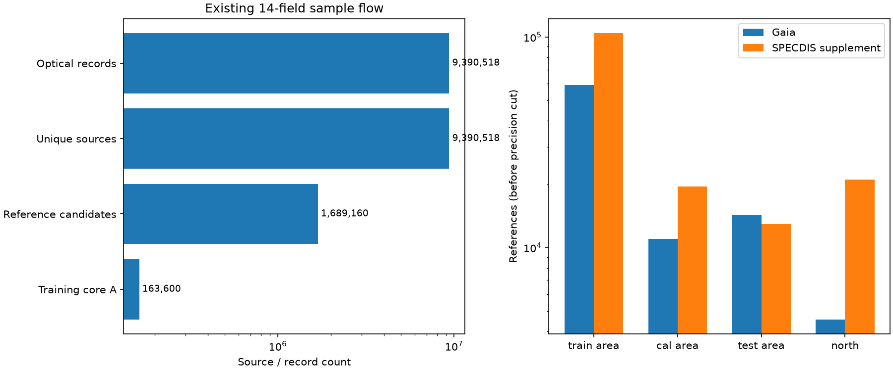
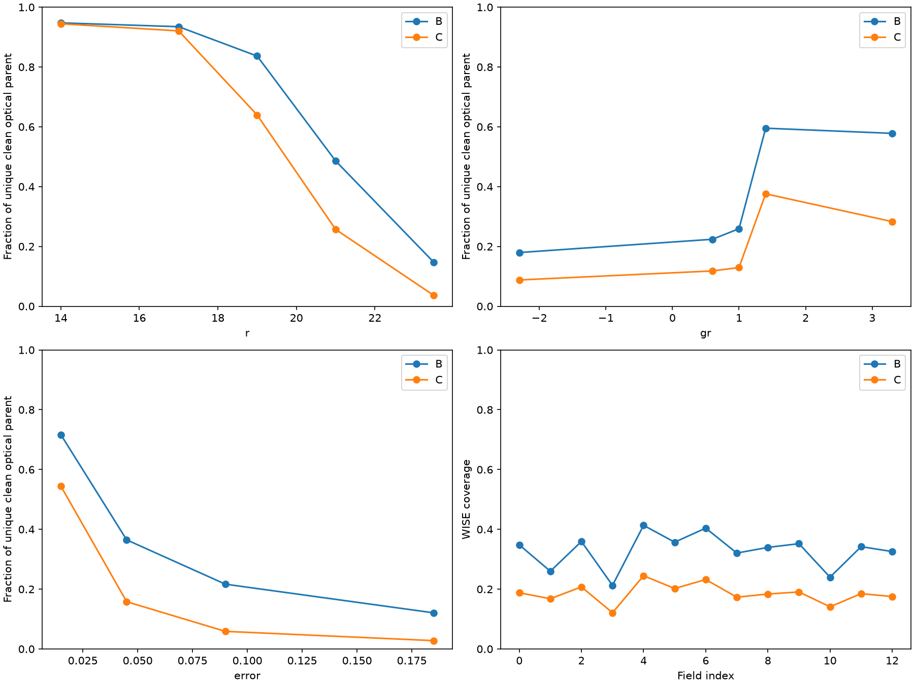
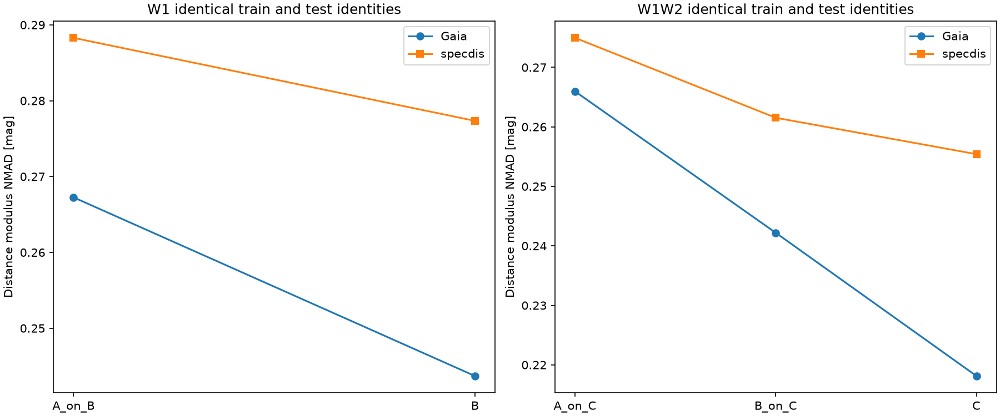
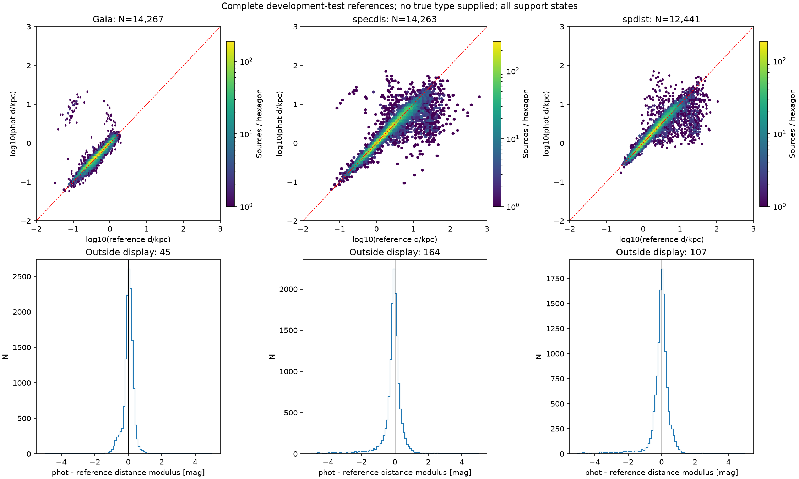
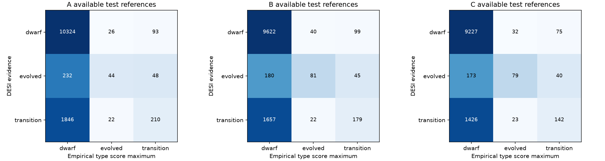
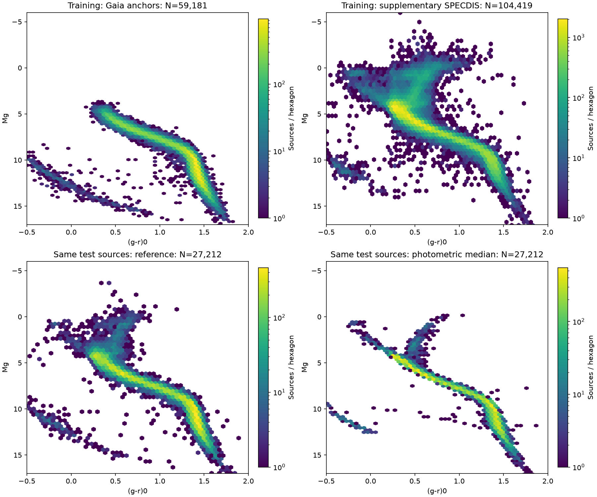
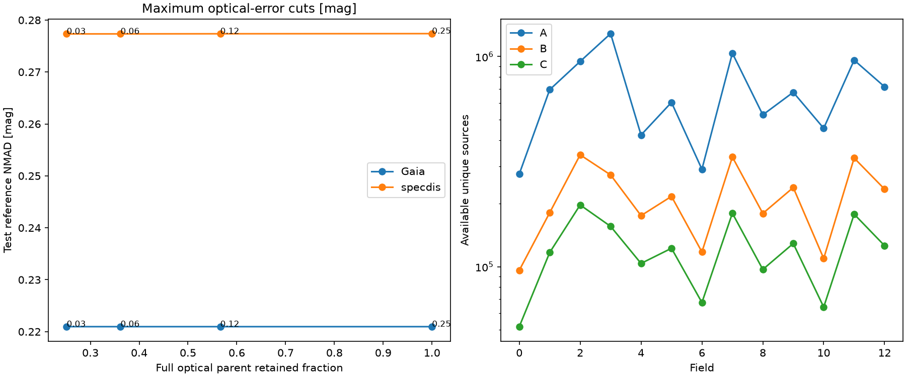
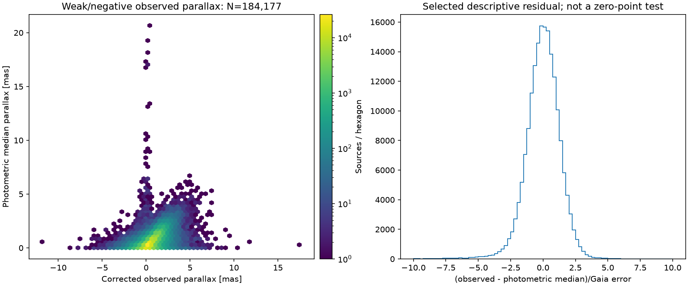
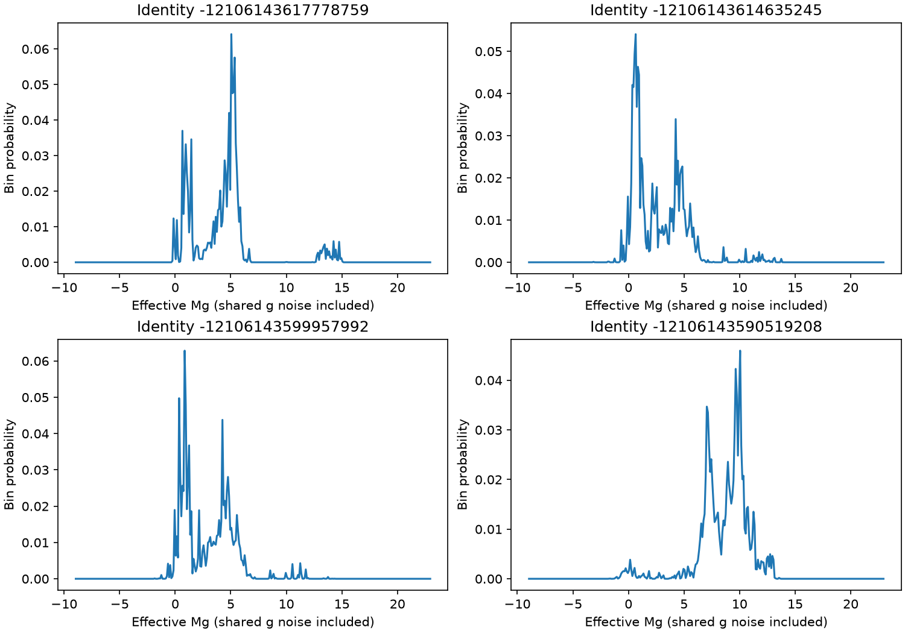

# 统一多星族测光距离 baseline v0：完整流程与初步目录

2026-11-02。依据[完整Pro评审](pro_review_60f65d5.md)；[冻结协议](baseline_v0_protocol.md)；[目录字段与运行方法](baseline_v0_catalog.md)。

**本轮已完成光学母样本、宽人群训练、整场验证和已有天区的内部目录。WISE有同星信息增益，当前整体精度主要由矮星主导；低重力演化星仍存在严重的光度解错误，暗端参照不足。流程交付完成不等于所有星族的科学距离产品已通过标定。**

## 1. 本轮确定的框架与样本

应用入口为DR11 PSF、grz有效实测且S/N≥5、既有clean条件、|b|>30°、0≤EBV<0.03。Gaia、光谱和WISE均不是母样本必需条件。当前天空范围是首版验证域，项目仍面向银河盘和晕的多种星族。

| 环节 | 实际数量／规则 |
|---|---|
| 14场母样本记录／唯一身份 | 9,390,518 / 9,390,518 |
| DECam／BASS-MzLS | 8,899,334 / 491,184 |
| 参照候选及弱视差诊断对象 | 1,689,160（不都是有效距离标签） |
| 有效Gaia标签／补充SPECDIS标签 | 89,005 / 157,970（全部14场） |
| 训练A／B／C | 163,600 / 149,743 / 136,078 |
| A中无合格W1 | 13,857 |
| A训练标签来源 | Gaia 59,181；SPECDIS 104,419 |
| cal／test参照候选 | 206,189 / 224,941 |
| test有优先距离标签 | 27,212（其余保留预测及诊断状态） |

训练标签按Gaia高质量S/N≥20优先、既有有效SPECDIS补充；SPDist仅作交叉参照。训练核心要求grz各误差<0.03mag；完整评价和应用不加这个严格入口。目标为Legacy Mg=g0−μ参考，不把Gaia MG当作Legacy Mg。

按整场固定train=0,1,2,3,7,8,11,12；cal=4,9；test=5,6,10；north=13。同一身份只归一个区。旧场已被查看，因此这是发展阶段空间验证，不能称为最终盲测。

采用固定128树QRF，叶内最少32、最大深度20；A输入grz两种颜色，B加z−W1，C加W1−W2。8次同源同波段扰动保留共享g的颜色—距离协方差。经验分布保留多光度解，不以真实类型决定预测分支。原始标签误差保留但未去卷积，训练人群比例也未重加权成银河真实比例。

光学母样本、参照候选与训练核心是不同分母；右图为各分区距离标签，尚未施加训练精度切选。

## 2. WISE能覆盖多少实际对象

| 输入可用性 | DECam唯一对象 | 占全部光学母样本 |
|---|---|---|
| A | 8,899,334 | 100.00% |
| B | 2,821,370 | 31.70% |
| C | 1,587,931 | 17.84% |

| 观测r | 光学母样本 | W1合格 | W1+W2合格 |
|---|---|---|---|
| 12–16 | 51,869 | 94.8% | 94.5% |
| 16–18 | 359,878 | 93.5% | 92.1% |
| 18–20 | 811,005 | 83.7% | 64.0% |
| 20–22 | 1,860,455 | 48.6% | 25.7% |
| 22–25 | 5,792,509 | 14.7% | 3.6% |

WISE资格为所用波段通过质量条件且S/N≥5。这些是既有低消光、高银纬场中PSF光学对象的覆盖率，不是整个DR11恒星的完备率。grz承担全光学覆盖，WISE作为可选增强。

WISE覆盖随观测r、g−r、最大光学误差和天区变化；分母始终为各格的全部唯一光学母样本。

## 3. 增加颜色的信息收益：相同训练和测试对象

| 共同样本 | 参照 | 模型 | N | Δμ中位数 | NMAD | \|Δμ\|>1 | W68 | 覆盖68 | 覆盖95 |
|---|---|---|---|---|---|---|---|---|---|
| W1 | Gaia | A_on_B | 13,470 | +0.061 | 0.267 | 1.7% | 0.60 | 64.5% | 94.3% |
| W1 | Gaia | B | 13,470 | +0.069 | 0.244 | 1.3% | 0.50 | 62.5% | 93.9% |
| W1 | specdis | A_on_B | 12,895 | -0.051 | 0.288 | 8.2% | 0.70 | 70.1% | 96.1% |
| W1 | specdis | B | 12,895 | -0.050 | 0.277 | 7.9% | 0.60 | 69.8% | 96.0% |
| W1W2 | Gaia | A_on_C | 13,381 | +0.060 | 0.266 | 1.6% | 0.60 | 64.3% | 94.4% |
| W1W2 | Gaia | B_on_C | 13,381 | +0.069 | 0.242 | 1.2% | 0.50 | 62.6% | 94.0% |
| W1W2 | Gaia | C | 13,381 | +0.049 | 0.218 | 1.0% | 0.50 | 66.3% | 95.0% |
| W1W2 | specdis | A_on_C | 11,730 | -0.052 | 0.275 | 7.3% | 0.60 | 69.7% | 96.0% |
| W1W2 | specdis | B_on_C | 11,730 | -0.053 | 0.262 | 7.0% | 0.60 | 69.3% | 95.7% |
| W1W2 | specdis | C | 11,730 | -0.049 | 0.255 | 6.8% | 0.60 | 70.5% | 96.1% |

Δμ=μphot−μref；正值代表距离偏远。NMAD与W68单位为mag，W68为中央68%区间全宽。每组的训练身份、测试身份和测光扰动都一致；未按测试残差删星。

额外WISE颜色降低了当前共同样本的核心散布；这不是全星族、全深度均达到相同精度的证明。

实际主模型使用各自可用训练样本。校准场上，B相对A的绝对残差中位数从0.1981降至0.1907mag，C相对B从0.1863降至0.1740mag，因此按预设规则采用支持域内C→B→A。所有可用模型都在支持域外时仍保留A预测，并将supported标为False；这部分不能当成可靠距离。所有可用模型输出仍保存，未由测试结果改路由或参数。

## 4. 完整流程成绩：总体指标不能代替各人群

| 参照 | N | Δμ中位数 | NMAD | \|Δμ\|>1 | W68 | 覆盖68 | 覆盖95 |
|---|---|---|---|---|---|---|---|
| Gaia | 14,267 | +0.051 | 0.221 | 1.3% | 0.50 | 66.2% | 94.9% |
| specdis | 14,263 | -0.047 | 0.277 | 8.2% | 0.60 | 69.6% | 95.7% |
| spdist | 12,441 | +0.023 | 0.296 | 6.8% | 0.60 | 66.5% | 95.9% |

Gaia层相对距离NMAD为10.41%，但其类型和亮度分布受到Gaia锚点选择影响。SPECDIS/SPDist表格描述各自目录尺度上的一致性，并不是三套完全独立真值；覆盖率针对带噪参照点，也不是已经确立的真实距离覆盖率。

不向模型提供真实类型的完整测试对比；横纵轴为log10(d/kpc)，红线为一致线，下排保留大残差分布并标出显示范围以外数量。

### 粗星族成绩单

| SPECDIS参照中的DESI类别 | N | Δμ中位数 | NMAD | \|Δμ\|>1 | W68 | 覆盖68 | 覆盖95 |
|---|---|---|---|---|---|---|---|
| 保守矮星 | 9,542 | -0.015 | 0.218 | 1.8% | 0.50 | 75.6% | 98.1% |
| 低重力演化星 | 298 | -3.960 | 2.488 | 81.9% | 4.45 | 30.2% | 74.5% |
| 过渡／其他合格恒星 | 1,944 | -0.331 | 0.538 | 20.8% | 0.90 | 60.6% | 93.6% |

**当前低重力演化星的点估计不可作为可靠巨星距离使用。** 其误差不是总体NMAD约0.28mag能够概括的；加入WISE后仍有大量对象落到错误光度解。这里不能用围绕严重偏移中心计算的相对NMAD宣传“巨星精度”。现有实验尚未分离颜色简并、训练参照构成和标签质量各自的贡献。

A训练核心含3,314个有可靠低重力标签的对象、73,458个有可靠矮星标签的对象及其他/未知对象。叶内粗类别分数只是经验比例，尚未校准为真实类别概率。Gaia测试层没有可靠DESI低重力对象，不能用Gaia总体精度替代巨星几何验证。

每个模型在自身可用测试对象上检验粗类别最大分数：矮星识别较强，演化星和过渡类型大量落在矮星侧。三张图分母不同，不能直接用它们计算同星波段增益。

上排为两类训练标签的CMD；下排为同一批27,212个测试参照对象的参考CMD与预测中位数CMD。预测关系变窄包含模型压缩，不能把这张图当成独立精度证明。

### 暗端和测光误差的验证缺口

| r | Gaia N | SPECDIS N | Gaia NMAD | SPECDIS NMAD |
|---|---|---|---|---|
| 12–16 | 3398 | 684 | 0.192 | 0.268 |
| 16–18 | 8807 | 7369 | 0.215 | 0.236 |
| 18–20 | 2048 | 6052 | 0.252 | 0.336 |
| 20–22 | 14 | 154 | 样本不足 | 0.742 |
| 22–25 | 0 | 4 | 样本不足 | 样本不足 |

上表N<30仅作显示上的小样本提示，不是新增目录筛选。完整优先参照27,212颗中只有13颗的最大光学误差≥0.03mag；因此现有真实参照几乎没有检验低精度母样本。r≥22的准确度仍未验证。

| 最大光学误差门槛 | 保留母样本 | 母样本比例 | Gaia测试N | SPECDIS测试N |
|---|---|---|---|---|
| 0.03 | 2,237,634 | 25.1% | 14265 | 14252 |
| 0.06 | 3,219,331 | 36.2% | 14267 | 14259 |
| 0.12 | 5,038,093 | 56.6% | 14267 | 14262 |
| 0.25 | 8,899,334 | 100.0% | 14267 | 14263 |

横轴为真实光学母样本保留率，纵轴为相应测试参照NMAD；曲线接近平坦不意味着低精度对象已经通过检验，因为参照几乎都处于高精度层。

cal仅作CQR区间扩展，未校正距离中心。推荐流程cal后总体优先参照68%/95%覆盖为67.57% / 95.18%，这不能抵消演化星和暗端的分层问题。CQR端点不作为完整PDF。

184,177颗弱/负视差对象在视差空间比较，其中33,267颗观测视差为负。图示受S/N选样影响，不由残差中心推断零点，也不反演负视差作为真距离。

原始经验光度分布的多模式示例。模式和权重可识别部分歧义，但未触发固定多解标志也不保证预测正确。

## 5. 目录、实际核验与版本交付

| 输出状态 | DECam对象数 |
|---|---|
| 推荐A | 7,181,693 |
| 推荐B | 609,151 |
| 推荐C | 1,108,490 |
| 推荐模型颜色域内 | 4,392,686 |
| 触发多解标志 | 234,784 |

已输出14个FITS目录，共9,390,518行；其中8,899,334个DECam对象具有内部预测，北方491,184个对象保留同结构目录和无同系统模型标志。支持域不是准确度保证，所有行均标注internal_uncalibrated。大目录、完整评估PDF和模型留在NERSC。

根路径：`/pscratch/sd/y/yunao/photdis_pipeline/data/baseline_v0/`。见[字段与复现说明](baseline_v0_catalog.md)。

3个数学测试通过；实际产物通过206项检查，包括训练/测试身份隔离、相同训练对照、模型哈希、PDF归一化和非负性、区间顺序、全部目录行的身份顺序/可用性/距离单位、文件哈希与总数守恒。9张图已逐张检视。

机器可读证据：[准备清单](../manifests/baseline_v0_prepared.json)、[六模型成绩](../manifests/baseline_v0_fit.json)、[统一成绩单及目录哈希](../manifests/baseline_v0_report.json)、[实际检查](../manifests/baseline_v0_validation.json)。

## 6. 本轮决定与下一版优先级

1. **确定并保留这套v0完整流程。** grz为主干，WISE可选增强，输出条件分布及全部状态；不把五波段齐全设为入口。
2. **优先处理全局人群简并和参照构成。** 用现有冻结切分研究演化星/过渡星为何落入矮星光度解，并区分颜色信息不足、参照比例和标签质量；不能仅按总体NMAD继续优化。
3. **补齐影响最多对象的深度验证。** 实际低精度、无WISE母样本远多于可验证参照，需要针对这部分建立验证证据，再决定科学目录质量门槛。
4. **独立标定保留其正确角色。** 旧cold-v4、蓝端、暖演化星、K巨星和星团结果全部冻结。旧星团结果只支持各自旧模型，不能转作新v0的独立验证，也不作为第一版流程交付的前置条件。

历史入口：[cold-v4](cold_v4.md)、[K巨星条件距离](kgiant_distance_result_v1.md)、[固定外部参考批次](kgiant_reference_batch_result_v1.md)。本轮没有新增星团搜索或算法搜索。
