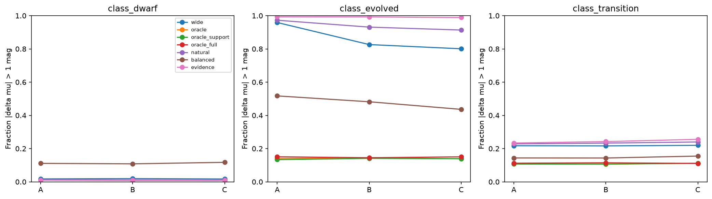
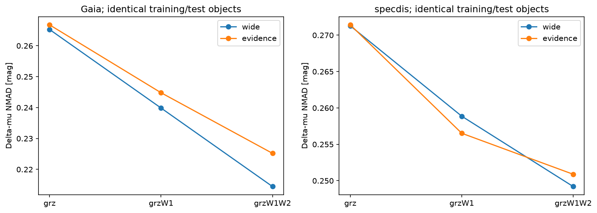
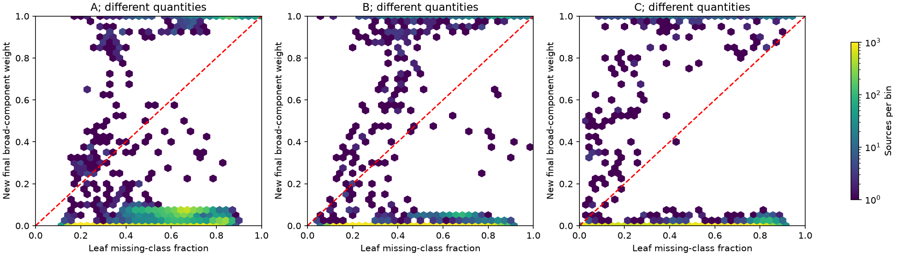
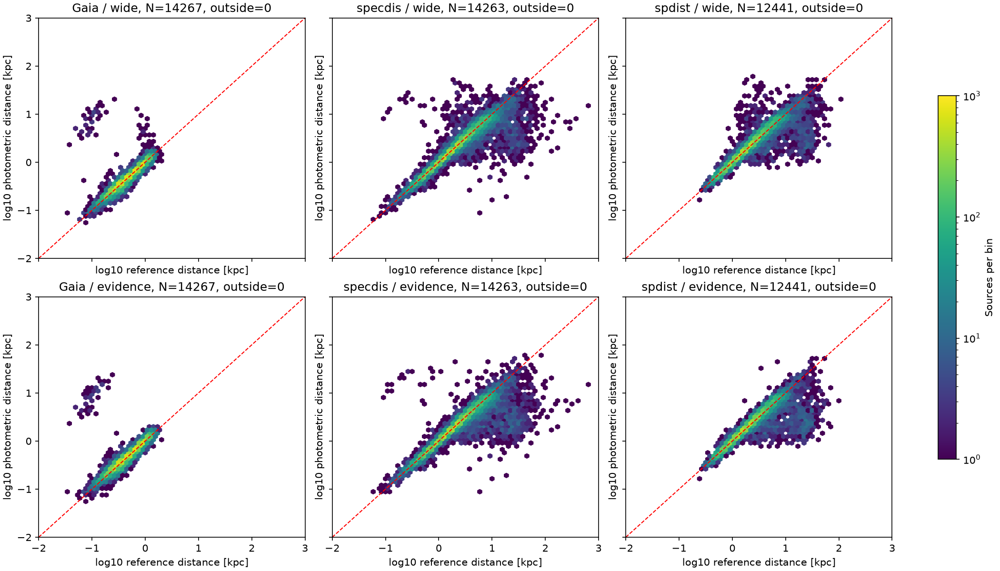
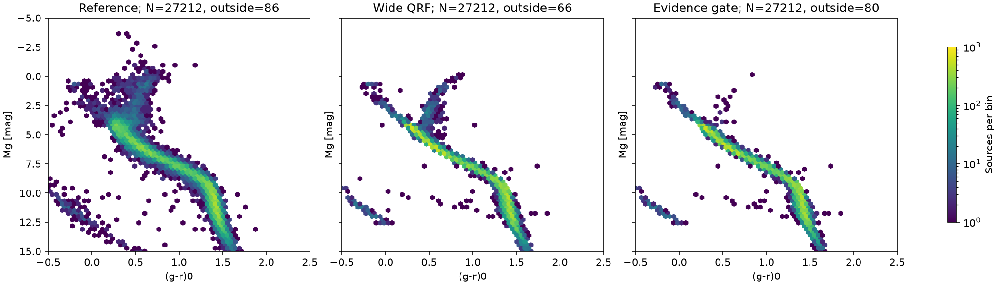
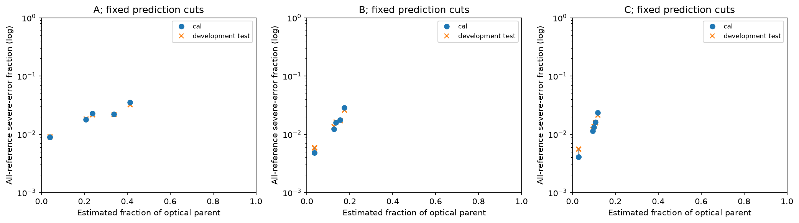
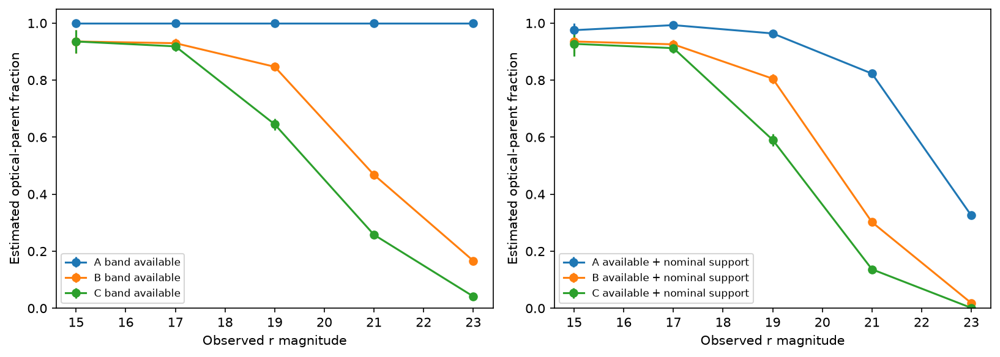
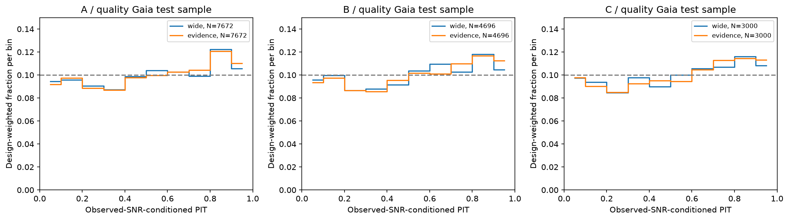

# baseline v1.1：分支回退与联合监督实验

本轮是冻结v1专家、原空间切分和Sobol128后的有限比较。没有重算完整目录；
test是已使用过的发展验证，区间和得分主要检查带噪教师相容性，不代表独立绝对距离校准。

## 采用决定

| 配置 | cal采用新门控 | 三类宏平均严重错误改善 [百分点] | 未通过的条件 |
|---|---|---:|---|
| A | False | -3.60 | macro_improvement, class_dwarf_width95, class_evolved_coverage95, log_density |
| B | False | -9.29 | macro_improvement, class_dwarf_width95, class_evolved_coverage95, log_density |
| C | False | -11.54 | macro_improvement, class_dwarf_width95, class_evolved_coverage95, log_density |
| A_on_B | False | -4.68 | macro_improvement, class_dwarf_width95, class_evolved_coverage95, log_density |
| A_on_C | False | -5.55 | macro_improvement, class_dwarf_width95, class_evolved_coverage95, class_transition_width95, log_density |
| B_on_C | False | -11.10 | macro_improvement, class_dwarf_width95, class_evolved_coverage95, log_density |

通过预登记cal门槛的配置：无。本轮仅给出采用建议，v1内部目录保持原样。

## 同对象回退分解

C配置、chosen参照的演化星发展测试；oracle只用于诊断。

| 分布 | N | 中位Δμ [mag] | 严重错误率 | 95%宽度 [mag] |
|---|---:|---:|---:|---:|
| wide | 266 | -3.963 | 0.801 | 6.610 |
| oracle | 266 | -0.061 | 0.139 | 4.130 |
| oracle_support | 266 | -0.071 | 0.139 | 4.152 |
| oracle_full | 266 | -0.149 | 0.150 | 6.927 |
| natural | 266 | -5.015 | 0.914 | 6.571 |
| balanced | 266 | -0.770 | 0.436 | 6.922 |
| evidence | 266 | -5.367 | 0.989 | 6.397 |

C演化星：支持回退相对直接oracle改变+0.00百分点；
完整回退相对直接oracle改变+1.13百分点；
新门控相对宽模型改变+18.80百分点（正值为严重错误增加）。
本轮应据这些同星差值判断回退的实际影响，不能将oracle与纯测光流程的全部差距归因于标签缺失。
联合光度监督仍受到训练人群组成和固定门控表达能力的影响；失败不等于已经证明颜色的物理信息极限。

直接oracle→支持回退→完整回退使用完全相同的对象和测光扰动。差值用于定位机制，
不把它们强行解释为可相加的因果百分比。unknown_fraction是缺类别标签份额；
新门控第四分量是宽经验分布权重，两者均不是第四种恒星类别概率。

## 固定v1波段路由下的实际距离对照

| 参照 | 分布 | N | 中位Δμ | NMAD | 严重错误率 | 95%覆盖 |
|---|---|---:|---:|---:|---:|---:|
| Gaia | wide | 14267 | 0.052 | 0.217 | 0.013 | 0.954 |
| Gaia | evidence | 14267 | 0.075 | 0.228 | 0.014 | 0.951 |
| Gaia | selected | 14267 | 0.052 | 0.217 | 0.013 | 0.954 |
| specdis | wide | 14263 | -0.046 | 0.272 | 0.083 | 0.960 |
| specdis | evidence | 14263 | -0.033 | 0.272 | 0.082 | 0.957 |
| specdis | selected | 14263 | -0.046 | 0.272 | 0.083 | 0.960 |
| spdist | wide | 12441 | 0.024 | 0.292 | 0.069 | 0.963 |
| spdist | evidence | 12441 | 0.039 | 0.292 | 0.069 | 0.954 |
| spdist | selected | 12441 | 0.024 | 0.292 | 0.069 | 0.963 |

## 预测状态、污染与覆盖

固定抽样26,000颗，来自13个DECam光学母样本场；按场规模加权。
横轴置信区间仅反映有限母样本抽样误差，不包含模型或天区迁移系统误差。
固定筛选组包含其混入的所有真实星族；cal少于30参照者不作可靠性判定。
没有参照的母样本对象不能被计为预测正确。加权只修正此次抽样，不修正Gaia/光谱目标选择；
参照风险不能直接当作整个光学母样本的真实纯度。详细联合状态、来源和污染计数见risk清单。

固定中间切选示例：最大权重>=0.8、W68<=1mag且名义支持；并非按测试结果另选最佳点。

| 配置 | 母样本估计保留率（95%抽样区间） | 测试参照N | 新门控严重错误率 | 同星旧宽模型 | 混入的已知演化星数 |
|---|---|---:|---:|---:|---:|
| A | 20.81%（20.28–21.34%） | 20117 | 1.85% | 1.82% | 59 |
| B | 12.57%（12.15–13.00%） | 19123 | 1.37% | 1.38% | 38 |
| C | 9.47%（9.09–9.85%） | 19360 | 1.23% | 1.18% | 30 |

这些预测组在现有参照上的总体风险较低，但旧宽模型的同星结果相近。
它们并不证明新门控更优，也不能据此把母样本中无参照对象宣布为可靠恒星。

## 真实观测视差检查

质量与零点有效的Gaia测试母集220,667颗，分层抽样7,672颗，其中负视差1,800颗。
不使用正视差或高S/N准入；在每个观测S/N区间条件化预测CDF和256次模拟。
积分保留g与颜色的共享误差；不再次叠加g误差。每箱8点积分并以16点复核。
模拟针对固定逐星经验PDF，没有加入共享Gaia/模型系统误差，其p值不是最终科学校准证明。

| 配置 | 分布 | N | 低PIT<0.05 | 高PIT>0.95 | 条件中心残差 [mas] |
|---|---|---:|---:|---:|---:|
| A | wide | 7672 | 0.049 | 0.056 | 0.013 |
| A | evidence | 7672 | 0.049 | 0.057 | 0.019 |
| B | wide | 4696 | 0.052 | 0.058 | 0.009 |
| B | evidence | 4696 | 0.047 | 0.059 | 0.016 |
| C | wide | 3000 | 0.047 | 0.055 | 0.013 |
| C | evidence | 3000 | 0.046 | 0.058 | 0.017 |

| 配置/分布 | 选择概率数值下溢数 | 8/16点PIT最大差（固定子集） |
|---|---:|---:|
| A/wide | 0 | 5.98e-10 |
| A/evidence | 0 | 4.11e-10 |
| B/wide | 0 | 7.88e-10 |
| B/evidence | 0 | 2.58e-10 |
| C/wide | 0 | 7.06e-10 |
| C/evidence | 0 | 4.06e-10 |

## 验证与复现

实际产物核验470项通过。训练证据来自四折空间留出，不含自身训练标签；
同训练波段比较共用证据身份与权重，cal/test未进入门控拟合。旧宽模型逐值一致；
其余旧对照因float32/float64累加差异，最大CDF差4.02e-7、最大分位点差0.000411mag。
复现验收同时要求CDF差<=1e-6、分位点最大差<=0.001mag且P99<=1e-5mag；科学采用门槛未改。
权重/PDF归一化、身份隔离、负视差保留和v1目录哈希均已核验。
代码入口：run_baseline_v1_1_fit.sh → run_baseline_v1_1_checks.sh；
固定样本由run_baseline_v1_1_samples.sh单独准备。大产物保留在NERSC data/baseline_v1_1。
预登记方案见[协议](baseline_v1_1_protocol.md)；完整来源见[Pro评审](pro_review_97c2775.md)。
新门控是本轮唯一新增方案。后续应按本轮实测的回退损失和星族代价确定工作，
不自动重新跑九百万行目录、扩展星团或搜索模型族。
