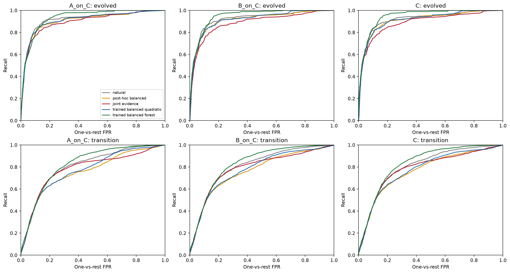
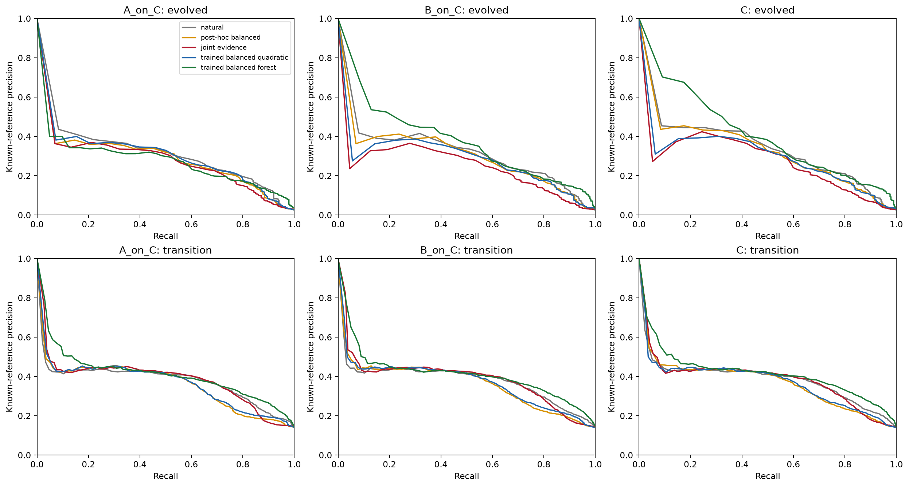
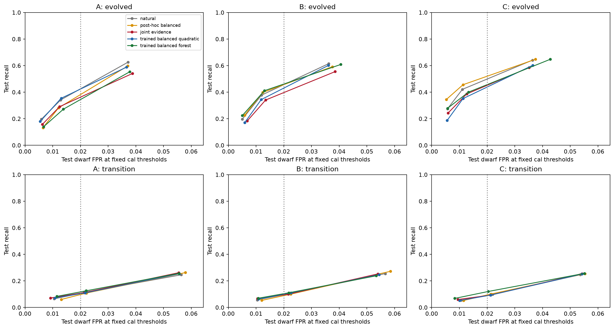
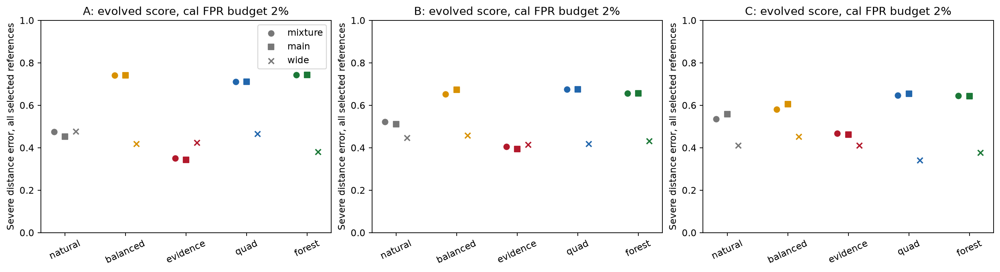
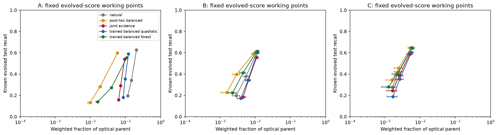
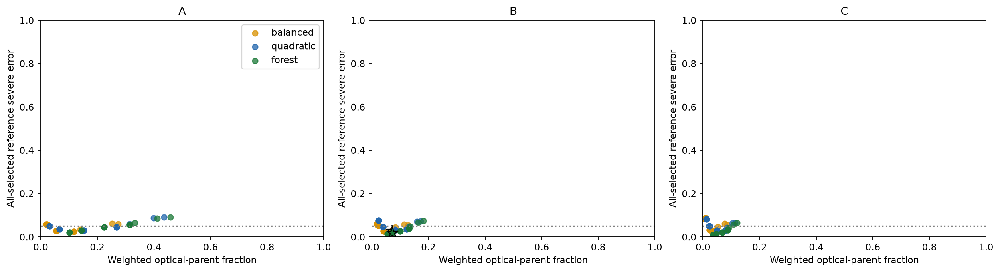
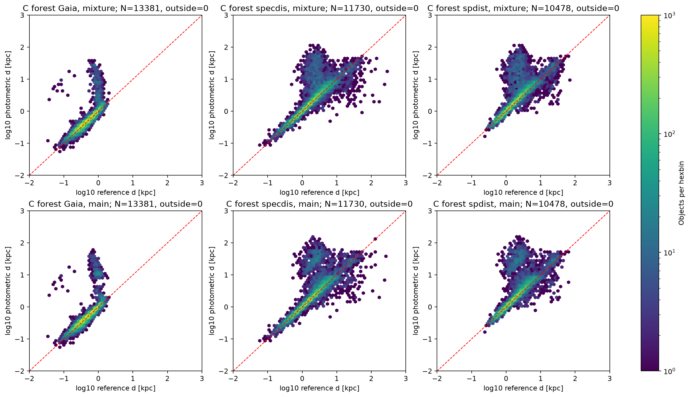
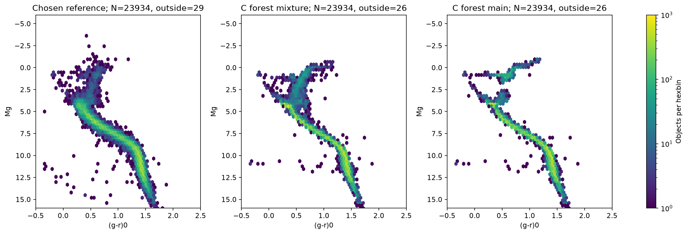
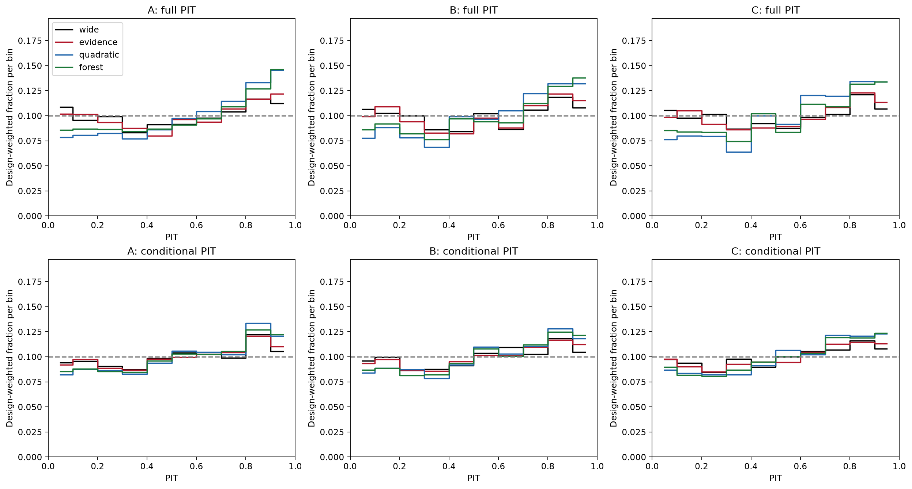
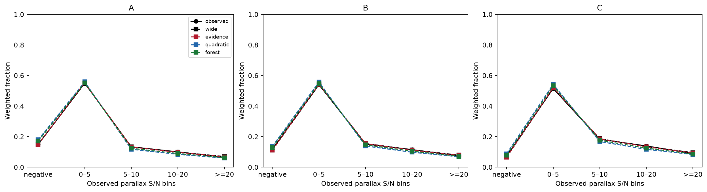

# baseline v1.2：颜色可分性与距离决策

冻结距离专家与原空间切分，仅新增类别平衡二次分类器和固定森林。工作点由cal确定；
test仍为发展验证。分类分数不是场星类别概率，参考精度不等于母样本纯度。
本轮只处理现有参照及固定概率样本，保留v1部署，没有更新完整目录。

## 本轮结论

本轮得到的是受限的分类排序能力，而不是可直接发布的巨星距离。类别平衡训练和固定森林
没有一致胜过既有分数；在固定误入预算下，少数演化星仍承受明显的矮星/过渡类混入。
主分支距离也没有普遍降低整个选中组的错误，不能用正确分类子集替代完整流程评价。
在各自相同Gaia样本内，原宽模型的完整对数预测得分高于本轮新混合；主分支硬决策的尾部更差。
因此保留v1部署和多解信息。本次是现有数据/模型下的界限，不是颜色的普适物理极限。

## 固定误入预算下能找回多少星族？

下表是cal矮星误入预算2%、回退后权重的固定工作点。测试误入率不被强制为2%。

| 配置 | 分类器 | 目标 | test目标/矮星分母 | test召回 | test矮星误入 | 选中矮/演化/过渡/未知 | 已知参照精度 | 母样本保留 |
|---|---|---|---|---:|---:|---|---:|---:|
| A | natural | 1 | 316/10187 | 34.18% | 1.29% | 131/108/79/138 | 33.96% | 14.58% |
| A | natural | 2 | 2020/10187 | 11.63% | 2.20% | 224/11/235/147 | 50.00% | 1.15% |
| A | balanced | 1 | 316/10187 | 28.16% | 1.21% | 123/89/51/106 | 33.84% | 1.88% |
| A | balanced | 2 | 2020/10187 | 10.89% | 2.22% | 226/4/220/113 | 48.89% | 0.52% |
| A | evidence | 1 | 316/10187 | 29.11% | 1.25% | 127/92/37/109 | 35.94% | 7.16% |
| A | evidence | 2 | 2020/10187 | 11.24% | 2.14% | 218/7/227/179 | 50.22% | 2.36% |
| A | quadratic | 1 | 316/10187 | 35.44% | 1.31% | 133/112/67/127 | 35.90% | 9.62% |
| A | quadratic | 2 | 2020/10187 | 10.99% | 2.17% | 221/6/222/149 | 49.44% | 1.29% |
| A | forest | 1 | 316/10187 | 27.22% | 1.38% | 141/86/31/103 | 33.33% | 3.92% |
| A | forest | 2 | 2020/10187 | 12.57% | 2.21% | 225/2/254/199 | 52.81% | 1.52% |
| B | natural | 1 | 299/9521 | 37.79% | 1.20% | 114/113/70/84 | 38.05% | 0.54% |
| B | natural | 2 | 1806/9521 | 10.63% | 2.24% | 213/10/192/55 | 46.27% | 0.24% |
| B | balanced | 1 | 299/9521 | 39.80% | 1.24% | 118/119/67/71 | 39.14% | 0.29% |
| B | balanced | 2 | 1806/9521 | 10.02% | 2.25% | 214/6/181/46 | 45.14% | 0.21% |
| B | evidence | 1 | 299/9521 | 34.11% | 1.34% | 128/102/50/105 | 36.43% | 0.63% |
| B | evidence | 2 | 1806/9521 | 10.02% | 2.16% | 206/7/181/82 | 45.94% | 0.25% |
| B | quadratic | 1 | 299/9521 | 34.45% | 1.19% | 113/103/52/84 | 38.43% | 0.61% |
| B | quadratic | 2 | 1806/9521 | 11.02% | 2.26% | 215/8/199/97 | 47.16% | 0.57% |
| B | forest | 1 | 299/9521 | 41.14% | 1.30% | 124/123/43/85 | 42.41% | 0.44% |
| B | forest | 2 | 1806/9521 | 11.07% | 2.18% | 208/0/200/191 | 49.02% | 0.62% |
| C | natural | 1 | 287/9107 | 42.16% | 1.11% | 101/121/71/58 | 41.30% | 0.24% |
| C | natural | 2 | 1550/9107 | 9.81% | 2.20% | 200/14/152/25 | 41.53% | 0.16% |
| C | balanced | 1 | 287/9107 | 45.64% | 1.13% | 103/131/78/48 | 41.99% | 0.24% |
| C | balanced | 2 | 1550/9107 | 10.13% | 2.14% | 195/7/157/15 | 43.73% | 0.13% |
| C | evidence | 1 | 287/9107 | 38.68% | 1.26% | 115/111/56/50 | 39.36% | 0.25% |
| C | evidence | 2 | 1550/9107 | 9.29% | 2.12% | 193/10/144/25 | 41.50% | 0.16% |
| C | quadratic | 1 | 287/9107 | 35.19% | 1.13% | 103/101/44/59 | 40.73% | 0.26% |
| C | quadratic | 2 | 1550/9107 | 9.35% | 2.13% | 194/7/145/74 | 41.91% | 0.34% |
| C | forest | 1 | 287/9107 | 40.07% | 1.33% | 121/115/36/67 | 42.28% | 0.22% |
| C | forest | 2 | 1550/9107 | 12.06% | 2.04% | 186/1/187/143 | 50.00% | 0.32% |

下面单独比较同训练、同测试对象的W1/W2信息增益，仍用cal2%预算和演化目标：

| 同星组 | 模型 | 分类器 | test目标/矮星分母 | 召回 | 矮星误入 | 已知参照精度 |
|---|---|---|---|---:|---:|---:|
| W1 | A_on_B | balanced | 299/9521 | 29.10% | 1.21% | 33.85% |
| W1 | A_on_B | quadratic | 299/9521 | 35.12% | 1.31% | 35.84% |
| W1 | A_on_B | forest | 299/9521 | 26.76% | 1.40% | 32.79% |
| W1 | B | balanced | 299/9521 | 39.80% | 1.24% | 39.14% |
| W1 | B | quadratic | 299/9521 | 34.45% | 1.19% | 38.43% |
| W1 | B | forest | 299/9521 | 41.14% | 1.30% | 42.41% |
| W1W2 | A_on_C | balanced | 287/9107 | 34.84% | 1.28% | 34.72% |
| W1W2 | A_on_C | quadratic | 287/9107 | 34.84% | 1.36% | 35.84% |
| W1W2 | A_on_C | forest | 287/9107 | 26.13% | 1.36% | 32.47% |
| W1W2 | B_on_C | balanced | 287/9107 | 42.51% | 1.21% | 40.13% |
| W1W2 | B_on_C | quadratic | 287/9107 | 34.84% | 1.22% | 39.06% |
| W1W2 | B_on_C | forest | 287/9107 | 39.72% | 1.26% | 42.38% |
| W1W2 | C | balanced | 287/9107 | 45.64% | 1.13% | 41.99% |
| W1W2 | C | quadratic | 287/9107 | 35.19% | 1.13% | 40.73% |
| W1W2 | C | forest | 287/9107 | 40.07% | 1.33% | 42.28% |

目标1=演化星，2=其他合格恒星／过渡类；分类分母包括有任一种有效参照的可靠类别对象，与chosen距离分母不同。
未知类保留，不能算作分类正确。1%/2%/5%、raw/nominal/final、
同训练波段对照及Wilson计数区间见机器清单；完整细分统计在NERSC逐模型scores.json。

ROC/PR采用同一观测颜色下、回退前的nominal分数；raw扰动平均与final回退权重工作点另存。

## 分类收益能否转成距离？

以下仍是演化分数2%工作点，但距离错误计入选中的所有真实类别及有距离参照的未知类。
主分支只由测光最大最终权重选出；不使用真实类型，宽分量最大时也保留。

| 配置 | 分类器 | chosen参照N | 混合中位数严重错误 | 主分支严重错误 | 同星旧宽模型 | cal单值规则 |
|---|---|---:|---:|---:|---:|---|
| A | natural | 402 | 47.51% | 45.27% | 47.76% | 无通过规则 |
| A | balanced | 329 | 74.16% | 74.16% | 41.95% | 无通过规则 |
| A | evidence | 330 | 35.15% | 34.24% | 42.42% | confidence0.8_margin0.4 |
| A | quadratic | 391 | 71.10% | 71.10% | 46.55% | 无通过规则 |
| A | forest | 331 | 74.32% | 74.32% | 38.07% | 无通过规则 |
| B | natural | 342 | 52.34% | 51.17% | 44.74% | 无通过规则 |
| B | balanced | 340 | 65.29% | 67.35% | 45.88% | confidence0.7_margin0.4 |
| B | evidence | 350 | 40.57% | 39.43% | 41.43% | 无通过规则 |
| B | quadratic | 318 | 67.61% | 67.61% | 41.82% | 无通过规则 |
| B | forest | 335 | 65.67% | 65.67% | 43.28% | confidence0.9_margin0.4 |
| C | natural | 319 | 53.61% | 55.80% | 41.07% | 无通过规则 |
| C | balanced | 325 | 58.15% | 60.62% | 45.23% | 无通过规则 |
| C | evidence | 301 | 46.84% | 46.18% | 41.20% | 无通过规则 |
| C | quadratic | 278 | 64.75% | 65.47% | 34.17% | 无通过规则 |
| C | forest | 308 | 64.61% | 64.29% | 37.66% | 无通过规则 |

通过cal单值条件的组仍是待验证工作点，不是全星族可靠产品。下表专门列出其演化星代价：

| 配置/分类器 | cal规则 | test总体严重错误 | test演化星N | test演化星严重错误 | 同星旧模型 | 母样本保留 |
|---|---|---:|---:|---:|---:|---:|
| A/evidence | confidence0.8_margin0.4 | 2.59% | 111 | 100.00% | 100.00% | 36.15% |
| B/balanced | confidence0.7_margin0.4 | 2.84% | 52 | 11.54% | 44.23% | 7.06% |
| B/forest | confidence0.9_margin0.4 | 1.86% | 63 | 9.52% | 55.56% | 7.21% |

严重错误为|Δμ|>1mag；按Gaia/SPECDIS/SPDist分别的区间、偏差和散布保留于清单。
固定confidence×margin网格要求三类cal各至少30个参照、整体错误<=5%且各类不显著劣于同星旧模型。
未通过时仅保留多解，不将主分支强行写成可靠单值。完整混合和条件PDF均保存在NERSC。

## 完整观测视差预测检验

固定7672个Gaia样本（1800负视差），逆入选率加权恢复质量/零点合格Gaia母集。
主结果不按实际观测S/N截断；旧条件PIT保留为箱内诊断，另比较跨箱概率。
r>=22仍无对象，Gaia准入的选择效应和共享系统误差未由抽样权重消除。

| 配置 | 分布/摘要 | N | 未截断低/高PIT尾 | 平均log密度 [mas⁻¹] | 实际箱平均log概率 |
|---|---|---:|---:|---:|---:|
| A | wide_mixture | 7672 | 5.24%/5.67% | -0.431 | -0.517 |
| A | evidence_mixture | 7672 | 4.92%/6.01% | -0.449 | -0.528 |
| A | evidence_main | 7672 | 7.67%/6.07% | -0.983 | -0.706 |
| A | balanced_mixture | 7672 | 4.00%/6.59% | -0.465 | -0.544 |
| A | balanced_main | 7672 | 5.01%/10.75% | -1.190 | -0.763 |
| A | quadratic_mixture | 7672 | 3.74%/7.07% | -0.641 | -0.576 |
| A | quadratic_main | 7672 | 5.19%/10.59% | -1.336 | -0.761 |
| A | forest_mixture | 7672 | 4.08%/7.36% | -0.614 | -0.556 |
| A | forest_main | 7672 | 5.40%/9.69% | -1.456 | -0.833 |
| B | wide_mixture | 4696 | 5.71%/5.53% | -0.305 | -0.492 |
| B | evidence_mixture | 4696 | 5.00%/5.68% | -0.324 | -0.499 |
| B | evidence_main | 4696 | 8.24%/5.89% | -0.819 | -0.736 |
| B | balanced_mixture | 4696 | 4.40%/6.27% | -0.346 | -0.519 |
| B | balanced_main | 4696 | 5.48%/10.07% | -0.776 | -0.674 |
| B | quadratic_mixture | 4696 | 4.10%/6.78% | -0.423 | -0.542 |
| B | quadratic_main | 4696 | 5.53%/10.06% | -0.911 | -0.664 |
| B | forest_mixture | 4696 | 4.61%/7.20% | -0.535 | -0.520 |
| B | forest_main | 4696 | 5.85%/9.67% | -1.008 | -0.757 |
| C | wide_mixture | 3000 | 5.50%/5.69% | -0.198 | -0.456 |
| C | evidence_mixture | 3000 | 4.99%/5.79% | -0.227 | -0.468 |
| C | evidence_main | 3000 | 8.62%/5.89% | -0.680 | -0.775 |
| C | balanced_mixture | 3000 | 3.85%/6.27% | -0.251 | -0.491 |
| C | balanced_main | 3000 | 5.34%/10.56% | -0.601 | -0.630 |
| C | quadratic_mixture | 3000 | 3.76%/6.80% | -0.295 | -0.514 |
| C | quadratic_main | 3000 | 5.53%/10.51% | -0.538 | -0.601 |
| C | forest_mixture | 3000 | 4.07%/7.00% | -0.249 | -0.482 |
| C | forest_main | 3000 | 5.90%/9.75% | -0.632 | -0.683 |

完整log密度=条件log密度+实际箱log概率（无下溢时）。各预测对象都保留，
极小密度用log-sum-exp计算，不作概率下限裁剪；线性密度下溢及8/16点积分差异另列在机器清单，不把箱内PIT相似等同于完整分布相容。

## 核验与复现

实际产物检查2364项通过。16项数学/回归测试通过；十张图交付前逐张检查。
训练身份与类总权重、原专家哈希、同训练身份、cal阈值、全类别计数、PDF质量及冻结目录均核验。
旧混合PDF/权重/分位点直接复用冻结产物；缓存重组舍入差异及原重组版本另行保留，没有放宽复现标准。
运行：run_baseline_v1_2_fit.sh → run_baseline_v1_2_checks.sh。大产物在NERSC data/baseline_v1_2。
[预登记协议](baseline_v1_2_protocol.md) · [完整评审](pro_review_dbeac65.md)。

## 交付审计（2026-11-03）

作业60731324为COMPLETED、退出码0:0。原始2364项检查逐项为true，16项聚焦测试通过，十张图已逐张检查。
最终文字采用当前报告脚本的表格与结论段，从同一份compact report生成；模型与评分没有重算。
源产物与交付文件哈希见[交付清单](../manifests/baseline_v1_2_delivery.json)。
[完整报告数据](../manifests/baseline_v1_2_report.json)、
[分参照工作点](../manifests/baseline_v1_2_source_workpoints.json)、
[实际验收](../manifests/baseline_v1_2_validation.json)、
[冻结产物复用审计](../manifests/baseline_v1_2_frozen_reuse_audit.json)。

source_workpoints.json由验收之后的报告步骤生成，原验收清单尚未收录其哈希；
交付清单另行核对其与NERSC源文件一致，不将该缺项解释为哈希不匹配。
实际最终执行链为固定fit、checks、稳定视差finish，再运行reuse_finish；
恢复本轮只需阅读这些已存在产物，不应重复拟合。

森林在同nominal输入的ROC/PR上展示部分排序增益，但这不保证回退后cal工作点的距离收益。
同训练测试控制下，演化目标2%预算的森林召回A_on_C/B_on_C/C为26.13%/39.72%/40.07%，
说明本次W1在该工作点增益明显，W2在2%工作点只增加1颗；但同星AP从0.359升至0.407，
1%预算召回从62/287升至80/287，不能将单个工作点的较小增益概括为W2信息较少。
B/forest单值组测试总体严重错误1.86%，其中演化星63颗、严重错误9.52%；
A/evidence单值组总体2.59%，其中111颗演化星全部严重失败。相对旧宽模型不恶化的
cal约束不能保证每个星族有较低绝对错误率；不据此发布通用可靠单值距离。
