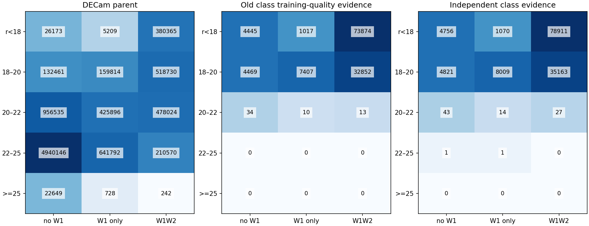
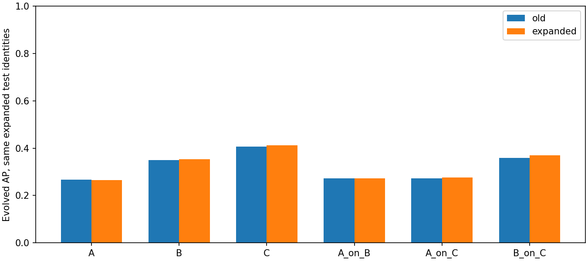
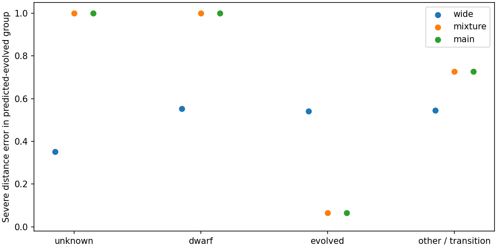

# v1.3：独立标签入口与固定演化星候选

基线ebf37f8；原空间切分、距离专家和v1部署保持冻结。类别2统一称“其他合格恒星／过渡类”。
本轮标签入口使用已有DESI匹配对象；分类不再要求距离或Mg。新增类别训练仍保持原0.03mag测光门槛；验证不要求距离有效。

## 实际新增监督

|配置|原训练数|新训练数|新增|剔除冲突/污染等|
|---|---:|---:|---:|---:|
|A|93417|99704|6287|0|
|B|86678|92457|5779|0|
|C|79819|85051|5232|0|
|A_on_B|86678|92457|5779|0|
|A_on_C|79819|85051|5232|0|
|B_on_C|79819|85051|5232|0|

|配置|原森林演化AP|扩展森林演化AP|原/新2%预算召回|
|---|---:|---:|---:|
|A|0.2676|0.2650|27.67% / 27.67%|
|B|0.3493|0.3528|40.33% / 39.67%|
|C|0.4071|0.4130|39.72% / 41.81%|
|A_on_B|0.2716|0.2729|28.67% / 28.33%|
|A_on_C|0.2717|0.2756|26.83% / 26.83%|
|B_on_C|0.3587|0.3696|40.07% / 39.72%|

A新增6287个训练对象：矮星4648、演化星395、其他合格恒星／过渡类1244；新增无W1训练对象508个。
新增证据主要在亮端。22–25等全体类别标签仅2个且都在train，cal/test为0；这不能建立暗端验证。
固定森林的演化AP仅小幅变化，不能声称已解决人群覆盖问题。

固定森林与原森林在相同扩展cal/test身份上比较，阈值仅由cal设定；另保留原参照子集结果。
分数为nominal类别排序分数，与v1.2回退后工作点不是同一量。类别平衡分数不解释为母样本概率。

## 仍缺什么证据

|r层|无W1母样本/类别标签|仅W1母样本/类别标签|W1W2母样本/类别标签|
|---|---|---|---|
|<18|26173/4756|5209/1070|380365/78911|
|18–20|132461/4821|159814/8009|518730/35163|
|20–22|956535/43|425896/14|478024/27|
|22–25|4940146/1|641792/1|210570/0|
|>=25|22649/0|728/0|242/0|

完整135格按r、光学误差、WISE和g-r拆分，分别保存类别、距离和弱/负视差证据以及空间分区；零证据格保留。
下一批数据优先针对母样本非零而类别证据为零的暗端、无W1格；需合格光谱类别和按来源有效距离。
此次没有把已有数据释放等同于新增外部观测。若暗端仍空缺，需要定向扩大匹配或取得新参照，并预留未查看的新天区。

## 固定预测候选的完整风险

定义：B/forest supported confidence>=0.9 margin>=0.4 main_index==1。只使用测光预测及支持域，不用真实类别选样。
母样本加权保留率：0.2015%；test选中162个参照入口对象，类别计数{'-1': 38, '0': 44, '1': 66, '2': 14}。
候选组相对比较条件通过：False；绝对可靠性未定义，状态为candidate_only。原父组cal通过不等于子组通过。

|真实类别（仅评价）|chosen N|wide严重错误|混合严重错误|演化主分支严重错误|
|---|---:|---:|---:|---:|
|unknown|37|35.14%|100.00%|100.00%|
|dwarf|38|55.26%|100.00%|100.00%|
|evolved|61|54.10%|6.56%|6.56%|
|other qualified stars / transition|11|54.55%|72.73%|72.73%|

完整chosen参照147颗：主分支/混合严重错误59.18%，同星wide49.66%。
该候选未通过相对比较条件；目前不推荐替代wide，保留完整PDF与状态，结束这个固定阈值尝试。
这与真实演化星子集中的局部改善可以同时成立，因为应用筛选仍包含误入对象。

|距离参照|N|wide严重错误|混合严重错误|主分支严重错误|
|---|---:|---:|---:|---:|
|Gaia|25|24.00%|100.00%|100.00%|
|specdis|122|54.92%|50.82%|50.82%|
|spdist|132|47.73%|51.52%|53.03%|

同一预测组包含误入的矮星、其他合格恒星／过渡类、未知对象；Gaia/SPECDIS/SPDist分别评分。
完整PDF与多解继续保留，混合分布的区间覆盖见机器结果；本轮没有后验调阈值。

### 同组完整Gaia检验

|预测|N|平均log密度|高PIT尾|
|---|---:|---:|---:|
|wide_mixture|48|-0.16265072213446896|10.49%|
|forest_mixture|48|-0.45863691671642537|16.69%|
|forest_main|48|-3.73504755946671|28.15%|

无样本时不能作性能推断。Gaia质量/零点准入限制与r>=22无验证边界保留。

## W2表述修正

v1.2同星森林AP从B_on_C的0.359提高到C的0.407；1%预算召回从62/287提高到80/287。
“收益小”仅指2%工作点（114到115颗），不能概括W2无用。

本轮实际检查93项通过；本地18项聚焦测试通过。模型、身份与新参照表哈希记录于机器清单。
[协议](baseline_v1_3_protocol.md) · [完整Pro建议](pro_review_ebf37f8.md) · [机器结果](../manifests/baseline_v1_3_result.json)

补充权重与冻结模型审计24项通过：逐对象训练权重另存NERSC，旧六套距离专家与旧森林哈希均未改变。
[权重与冻结审计](../manifests/baseline_v1_3_audit.json)。
