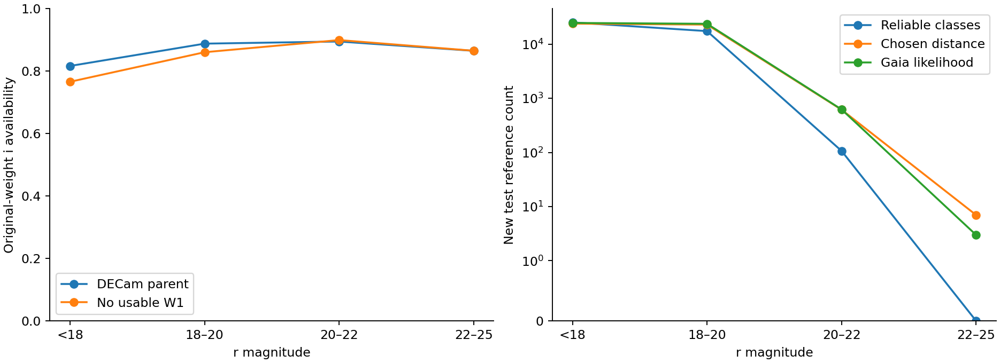
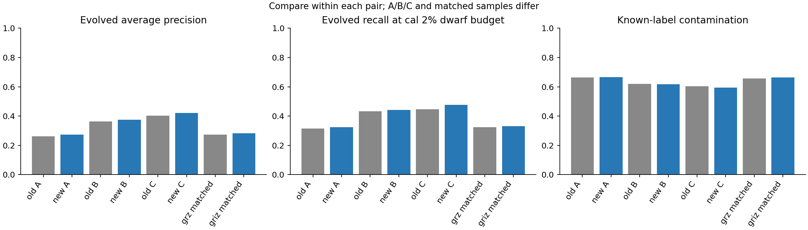
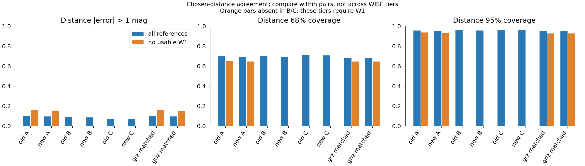
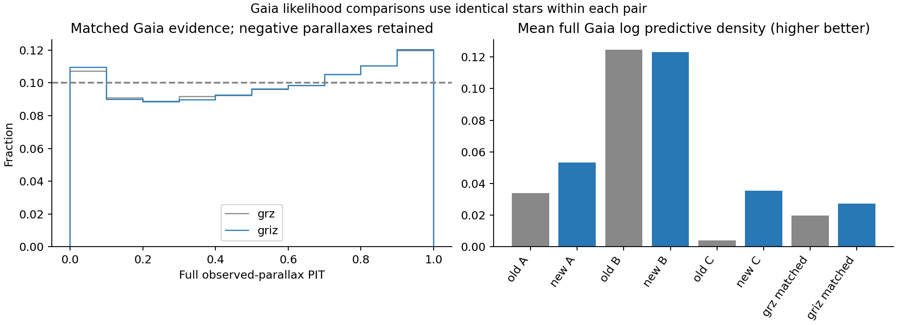
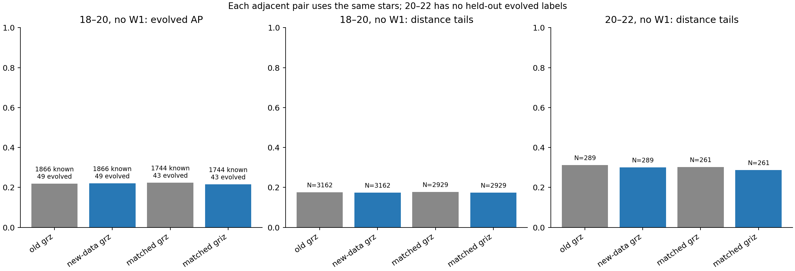

# Baseline v1.4 results

## Main findings

**Retain deployed v1.** The registered broader-reference and optional-i experiments are complete. The fixed tests establish modest and mixed changes, with severe unresolved evolved-star distance failures; they do not justify a general reliability claim or an automatic deployment change.

The new geometry supplies 138,080 class-training labels and 153,403 distance-training objects. New test has 42,964 class labels in frozen sky outside the historical fields.

Adding the new training data with fixed algorithms raises A/B/C classification AP from 0.2607/0.3642/0.4025 to 0.2724/0.3740/0.4218; chosen-distance severe tails decrease only modestly, from 9.82%/8.85%/7.41% to 9.68%/8.70%/7.22%. The priority 18–20/no-W1 interval coverage does not improve in this data-only control.

On the matched i-usable stars, adding i changes marginalized class AP from 0.2729 to 0.2823, evolved recall from 32.33% to 33.19%, and known-label contamination from 65.76% to 66.35%. On the same 43,706 distance references, severe tails change from 9.71% to 9.57%; 68% coverage is 68.37% versus 68.31%.

The matched full Gaia comparison retains 45,117 test objects, including 3,839 negative parallaxes. Mean log predictive density rises from 0.0198 to 0.0273, but the combined PIT<.05/>.95 fraction rises slightly from 11.99% to 12.18%. The likelihood and tail diagnostics therefore do not show a uniform improvement.

The priority 18–20/no-W1 comparison has 43 evolved class labels: AP changes from 0.2247 to 0.2148, while distance tails change from 17.72% to 17.41%. On the 261 matched 20–22/no-W1 distance references, the severe-error count changes from 79 to 75; this sparse descriptive improvement is not a broad faint-star accuracy guarantee.

Most importantly, on 1064 same-star evolved distance references, grz/griz severe tails remain 97.46%/96.52%, with 68% coverage only 14.94%/15.88%. Overall averages obscure this failure. Adding one optical color has not resolved the luminosity-branch problem in the fixed algorithm.

Weighted i availability is 87.01% overall and 86.88% without usable W1. Coverage is sufficient for the experiment, but is not evidence of distance accuracy. New 20–22 cal/test has no evolved class labels; 22–25 test has 0 reliable class labels and only 7 chosen-distance/3 Gaia references. Broad22–25 validation remains absent.

Stop this registered experiment here. Preserve the new frozen references, selection/provenance fields, raw weak fluxes and all negative results for the next scientific review. Do not launch another model family, tune candidate cuts, rerun the parent catalog or replace v1 automatically.

## Scope and evidence

All 1600 sweeps extracted. Assembled 3,565,499 unique reference rows before scientific eligibility; raw counts are not qualified labels.
Actual artifact checks: 3331; all passed. Deployed v1 remains unchanged.

| Model | Test AP | Evolved recall | Known contamination | Chosen distance N | Tail >1mag | Coverage68 | Full Gaia N |
|---|---:|---:|---:|---:|---:|---:|---:|
| frozen_A | 0.2607 | 0.3142 | 0.6627 | 47756 | 0.0982 | 0.6971 | 49327 |
| expanded_A | 0.2724 | 0.3236 | 0.6669 | 47756 | 0.0968 | 0.6900 | 49327 |
| frozen_B | 0.3642 | 0.4332 | 0.6201 | 42786 | 0.0885 | 0.7005 | 43911 |
| expanded_B | 0.3740 | 0.4409 | 0.6171 | 42786 | 0.0870 | 0.6956 | 43911 |
| frozen_C | 0.4025 | 0.4461 | 0.6027 | 37752 | 0.0741 | 0.7120 | 38277 |
| expanded_C | 0.4218 | 0.4758 | 0.5939 | 37752 | 0.0722 | 0.7057 | 38277 |
| matched_grz | 0.2729 | 0.3233 | 0.6576 | 43706 | 0.0971 | 0.6837 | 45117 |
| matched_griz | 0.2823 | 0.3319 | 0.6635 | 43706 | 0.0957 | 0.6831 | 45117 |

Classification: old/new comparisons are nominal scores; matched grz/griz uses shared four-band Sobol128 marginalization. Each workpoint is fixed by cal at the same 2% dwarf budget; no test tuning.

Expanded training adds only new train identities to historical training. Each old/new pair has identical new evaluation identities. Matched grz/griz uses only the new i-usable train identities, with identical training/evaluation identities and hyperparameters between the two controls.

A/B/C use different WISE-availability subsets: compare scores within each old/new pair, not across these subsets. The matched grz/griz pair uses exactly the same stars.

The original26000 probability sample covers the southern DECam parent; northern rows are outside this i-band coverage estimate.

## Validation limits

New geometric reference-selected sky.22–25 claims require actual truth counts; unrepresented cells remain unvalidated.

Gaia, SpecDis and SPDist scores are retained separately in the result manifest. The chosen training-distance recipe remains Gaia anchors then SpecDis; SPDist is a separate check.

SpecDis/SPDist error and interval-coverage scores measure agreement with published point estimates; their retained reference uncertainties are not convolved into these point-reference metrics. These are not universal absolute-accuracy claims. The full Gaia likelihood instead convolves the predicted distribution with the signed observed-parallax uncertainty.

Reference-selected population fractions do not estimate parent purity. Zero-ID associations with unknown epochs are flagged, use a0.5arcsec threshold and2arcsec ambiguity veto; systematic matching risk remains.

Figures: classification.png, distance.png, gaia.png, coverage.png, priority.png under figures/baseline_v1_4. All five figures were visually inspected; exact image hashes and validation evidence are recorded in manifests/baseline_v1_4_delivery.json.

## Actual faint reference support

| Split | r / WISE | Class labels | Evolved | Chosen distance | SpecDis | SPDist | Gaia likelihood |
|---|---|---:|---:|---:|---:|---:|---:|
| cal | r18_20:no_W1 | 1333 | 13 | 2499 | 2474 | 1641 | 2839 |
| cal | r20_22 | 25 | 0 | 418 | 418 | 191 | 446 |
| cal | r22_25 | 4 | 0 | 7 | 7 | 0 | 4 |
| test | r18_20:no_W1 | 1866 | 49 | 3162 | 3144 | 2069 | 3511 |
| test | r20_22 | 107 | 0 | 618 | 618 | 267 | 625 |
| test | r22_25 | 0 | 0 | 7 | 7 | 0 | 3 |

Zero-count cells are unvalidated. Sparse counts are descriptive evidence, not a general accuracy guarantee.

## Actual training composition

| Model | Class training N | Distance training N | Composition |
|---|---:|---:|---|
| frozen_A | 99704 | 163600 | frozen historical |
| expanded_A | 237784 | 317003 | historical plus new |
| frozen_B | 92457 | 149743 | frozen historical |
| expanded_B | 219651 | 287687 | historical plus new |
| frozen_C | 85051 | 136078 | frozen historical |
| expanded_C | 203001 | 258295 | historical plus new |
| matched_grz | 85138 | 95101 | new only, matched i-usable |
| matched_griz | 85138 | 95101 | new only, matched i-usable |

## Priority same-star comparisons

| Model | Group | Known class N | Evolved N | AP | Recall | Known contamination | Distance N | Tail >1mag | Coverage68 |
|---|---|---:|---:|---:|---:|---:|---:|---:|---:|
| frozen_A | r18_20:no_W1 | 1866 | 49 | 0.2188 | 0.3061 | 0.7170 | 3162 | 0.1755 | 0.6211 |
| expanded_A | r18_20:no_W1 | 1866 | 49 | 0.2205 | 0.3265 | 0.7091 | 3162 | 0.1739 | 0.6104 |
| matched_grz | r18_20:no_W1 | 1744 | 43 | 0.2247 | 0.3256 | 0.7200 | 2929 | 0.1772 | 0.6122 |
| matched_griz | r18_20:no_W1 | 1744 | 43 | 0.2148 | 0.3488 | 0.7321 | 2929 | 0.1741 | 0.6145 |
| frozen_A | r20_22 | 107 | 0 | absent | absent | 1.0000 | 618 | 0.2638 | 0.5550 |
| expanded_A | r20_22 | 107 | 0 | absent | absent | 1.0000 | 618 | 0.2589 | 0.5550 |
| matched_grz | r20_22 | 106 | 0 | absent | absent | 1.0000 | 565 | 0.2814 | 0.5522 |
| matched_griz | r20_22 | 106 | 0 | absent | absent | 1.0000 | 565 | 0.2779 | 0.5487 |
| frozen_A | r20_22:no_W1 | 40 | 0 | absent | absent | 1.0000 | 289 | 0.3114 | 0.5156 |
| expanded_A | r20_22:no_W1 | 40 | 0 | absent | absent | 1.0000 | 289 | 0.3010 | 0.5225 |
| matched_grz | r20_22:no_W1 | 39 | 0 | absent | absent | 1.0000 | 261 | 0.3027 | 0.5402 |
| matched_griz | r20_22:no_W1 | 39 | 0 | absent | absent | 1.0000 | 261 | 0.2874 | 0.5441 |
| frozen_A | r22_25 | 0 | 0 | absent | absent | absent | 7 | 0.5714 | 0.4286 |
| expanded_A | r22_25 | 0 | 0 | absent | absent | absent | 7 | 0.5714 | 0.2857 |
| matched_grz | r22_25 | 0 | 0 | absent | absent | absent | 7 | 1.0000 | 0.0000 |
| matched_griz | r22_25 | 0 | 0 | absent | absent | absent | 7 | 0.8571 | 0.0000 |

## Separate distance evidence

| Model | Evidence | N | Bias (mag) | Scatter (mag) | Tail >1mag | Coverage68 | Coverage95 |
|---|---|---:|---:|---:|---:|---:|---:|
| frozen_A | Gaia | 3207 | 0.0669 | 0.2710 | 0.0312 | 0.6626 | 0.9445 |
| frozen_A | specdis | 47335 | -0.0226 | 0.3026 | 0.0978 | 0.7046 | 0.9591 |
| frozen_A | spdist | 37317 | 0.0430 | 0.3249 | 0.0870 | 0.6577 | 0.9644 |
| expanded_A | Gaia | 3207 | 0.0767 | 0.2762 | 0.0315 | 0.6455 | 0.9348 |
| expanded_A | specdis | 47335 | -0.0115 | 0.3002 | 0.0963 | 0.6991 | 0.9550 |
| expanded_A | spdist | 37317 | 0.0561 | 0.3239 | 0.0854 | 0.6393 | 0.9580 |
| frozen_B | Gaia | 2987 | 0.0759 | 0.2343 | 0.0241 | 0.6548 | 0.9451 |
| frozen_B | specdis | 42401 | -0.0239 | 0.2868 | 0.0882 | 0.7097 | 0.9635 |
| frozen_B | spdist | 33868 | 0.0388 | 0.3099 | 0.0800 | 0.6588 | 0.9616 |
| expanded_B | Gaia | 2987 | 0.0864 | 0.2316 | 0.0241 | 0.6505 | 0.9444 |
| expanded_B | specdis | 42401 | -0.0140 | 0.2824 | 0.0867 | 0.7057 | 0.9595 |
| expanded_B | spdist | 33868 | 0.0511 | 0.3106 | 0.0779 | 0.6409 | 0.9554 |
| frozen_C | Gaia | 2913 | 0.0543 | 0.2068 | 0.0185 | 0.6845 | 0.9561 |
| frozen_C | specdis | 37402 | -0.0216 | 0.2550 | 0.0739 | 0.7213 | 0.9657 |
| frozen_C | spdist | 30313 | 0.0353 | 0.2842 | 0.0719 | 0.6635 | 0.9597 |
| expanded_C | Gaia | 2913 | 0.0564 | 0.2080 | 0.0185 | 0.6801 | 0.9540 |
| expanded_C | specdis | 37402 | -0.0137 | 0.2537 | 0.0722 | 0.7160 | 0.9614 |
| expanded_C | spdist | 30313 | 0.0458 | 0.2842 | 0.0696 | 0.6468 | 0.9538 |
| matched_grz | Gaia | 2643 | 0.1137 | 0.2926 | 0.0382 | 0.6209 | 0.9281 |
| matched_grz | specdis | 43340 | 0.0052 | 0.2983 | 0.0965 | 0.6931 | 0.9510 |
| matched_grz | spdist | 34184 | 0.0721 | 0.3205 | 0.0855 | 0.6255 | 0.9508 |
| matched_griz | Gaia | 2643 | 0.1182 | 0.2861 | 0.0356 | 0.6103 | 0.9194 |
| matched_griz | specdis | 43340 | 0.0056 | 0.2971 | 0.0951 | 0.6923 | 0.9510 |
| matched_griz | spdist | 34184 | 0.0722 | 0.3178 | 0.0836 | 0.6260 | 0.9498 |

## Gaia numerical convergence

Full Gaia log density and PIT use separately frozen convergence-controlled numerical scores of the unchanged PDFs. The original8-order results remain on NERSC.16/32/64/128-order checks escalate unresolved cases to adaptive integration; target absolute precision1e-5.

| Model | Gaia cal+test N | Max log-density correction | Mean correction | Max PIT correction |
|---|---:|---:|---:|---:|
| frozen_A | 94305 | 1.7592 | 0.0000 | 0.0003 |
| expanded_A | 94305 | 0.2545 | -0.0000 | 0.0004 |
| frozen_B | 84489 | 0.2545 | -0.0000 | 0.0003 |
| expanded_B | 84489 | 0.2545 | -0.0000 | 0.0003 |
| frozen_C | 73974 | 0.9163 | 0.0000 | 0.0002 |
| expanded_C | 73974 | 0.2545 | -0.0000 | 0.0001 |
| matched_grz | 83000 | 0.2722 | 0.0000 | 0.0003 |
| matched_griz | 83000 | 0.2722 | 0.0000 | 0.0002 |

## Distance tails by known class

Chosen-distance agreement; unknown classes are retained separately and are not counted as dwarfs.

| Model | Dwarf N / tail | Evolved N / tail | Other N / tail | Unknown N / tail |
|---|---|---|---|---|
| frozen_A | 32719 / 0.0215 | 1163 / 0.9544 | 6408 / 0.2144 | 7466 / 0.2017 |
| expanded_A | 32719 / 0.0195 | 1163 / 0.9656 | 6408 / 0.2136 | 7466 / 0.1998 |
| frozen_B | 30266 / 0.0209 | 1075 / 0.8391 | 5717 / 0.2085 | 5728 / 0.1845 |
| expanded_B | 30266 / 0.0201 | 1075 / 0.8502 | 5717 / 0.2034 | 5728 / 0.1807 |
| frozen_C | 28687 / 0.0200 | 1019 / 0.8027 | 4644 / 0.2199 | 3402 / 0.1126 |
| expanded_C | 28687 / 0.0183 | 1019 / 0.8302 | 4644 / 0.2123 | 3402 / 0.1082 |
| matched_grz | 29865 / 0.0197 | 1064 / 0.9746 | 5873 / 0.2091 | 6904 / 0.2019 |
| matched_griz | 29865 / 0.0193 | 1064 / 0.9652 | 5873 / 0.2048 | 6904 / 0.1994 |

## Weighted WISE measurement states

Original26000 DECam probability sample; all original weights retained. Low-SNR fluxes were preserved but not passed to Gaussian magnitude models.
States: -1 unmatched; 0 no observation; 1 invalid measurement; 2 quality failure; 3 low S/N including negative flux; 4 usable S/N>=5 color.

| Band | State | N | Weighted fraction |
|---|---|---:|---:|
| w1 | -1 | 0 | 0.0000 |
| w1 | 0 | 0 | 0.0000 |
| w1 | 1 | 0 | 0.0000 |
| w1 | 2 | 15576 | 0.6099 |
| w1 | 3 | 1892 | 0.0749 |
| w1 | 4 | 8532 | 0.3151 |
| w2 | -1 | 0 | 0.0000 |
| w2 | 0 | 0 | 0.0000 |
| w2 | 1 | 0 | 0.0000 |
| w2 | 2 | 14699 | 0.5728 |
| w2 | 3 | 6196 | 0.2372 |
| w2 | 4 | 5105 | 0.1900 |

## Identity and coverage exclusions

Zero-ID recovery: 520 accepted matches from 9009 source identities; ambiguous and unmatched sources remain excluded. Raw fluxes and candidate metadata are retained separately.
Historical identity exclusions: 187584; native collision rows: 8; source/native geometry disagreements: 0.

specdis: 160 raw rows without valid Gaia IDs; 0 pass the fixed distance-quality recipe. These raw rows are retained; none supplies a lost qualified distance label.
spdist: 1,202,772 raw rows without valid Gaia IDs; 0 pass the fixed distance-quality recipe. These raw rows are retained; none supplies a lost qualified distance label.

## Full observed-parallax checks

| Model | Test N | Negative N | Mean log density | PIT <.05 | PIT >.95 | S/N-bin Brier |
|---|---:|---:|---:|---:|---:|---:|
| frozen_A | 49327 | 4139 | 0.0338 | 0.0558 | 0.0549 | 0.3030 |
| expanded_A | 49327 | 4139 | 0.0532 | 0.0576 | 0.0582 | 0.3036 |
| frozen_B | 43911 | 3243 | 0.1246 | 0.0568 | 0.0540 | 0.2909 |
| expanded_B | 43911 | 3243 | 0.1232 | 0.0591 | 0.0574 | 0.2914 |
| frozen_C | 38277 | 1727 | 0.0041 | 0.0581 | 0.0536 | 0.2745 |
| expanded_C | 38277 | 1727 | 0.0355 | 0.0606 | 0.0567 | 0.2745 |
| matched_grz | 45117 | 3839 | 0.0198 | 0.0579 | 0.0620 | 0.3040 |
| matched_griz | 45117 | 3839 | 0.0273 | 0.0589 | 0.0630 | 0.3035 |

Signed observed parallaxes are never inverted into weak-distance labels. Observed and predicted S/N fractions (negative,0–5,5–10,10–20,>=20), selection-conditioned PIT, full predictive mean and per-object scores remain in the NERSC artifacts. Full PIT and likelihood are diagnostics on reference-selected sky; they do not establish an unbiased population calibration.

## Figures

Weighted parent i availability and actual new-test evidence.

Classification comparisons within each fixed pair.

Same-star chosen-distance errors and interval coverage.

Signed-parallax PIT and full predictive likelihood.

Priority faint/no-WISE comparisons with actual sample counts.
