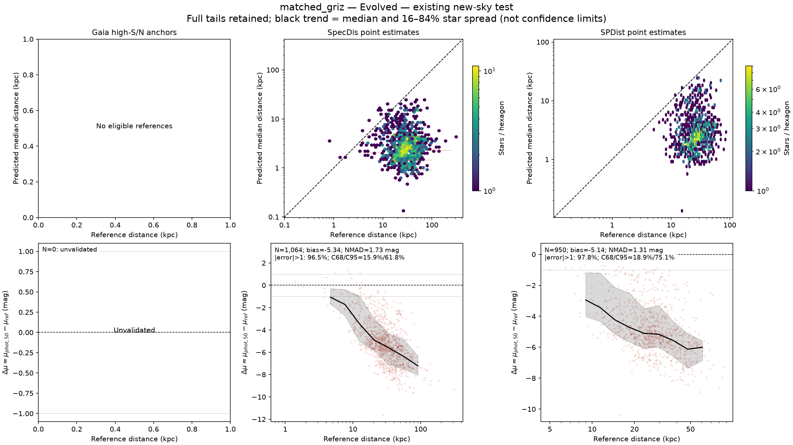
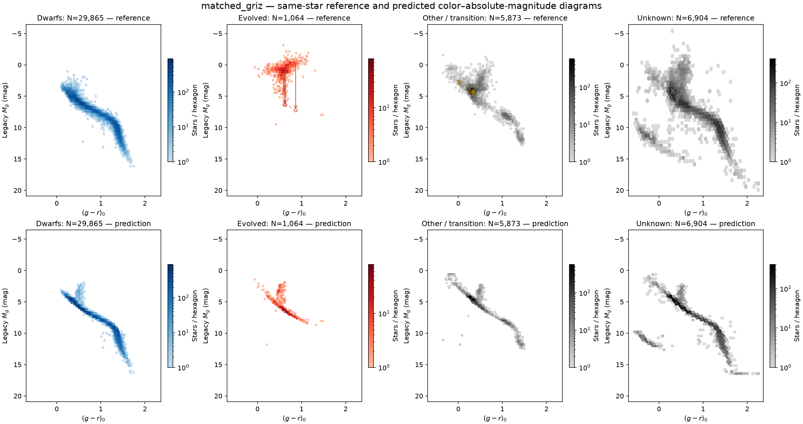
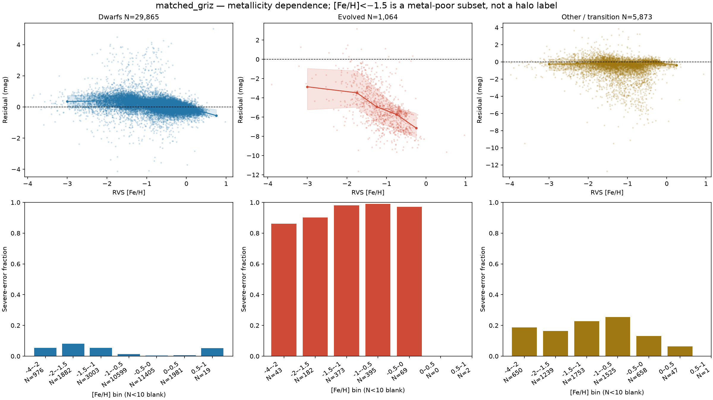
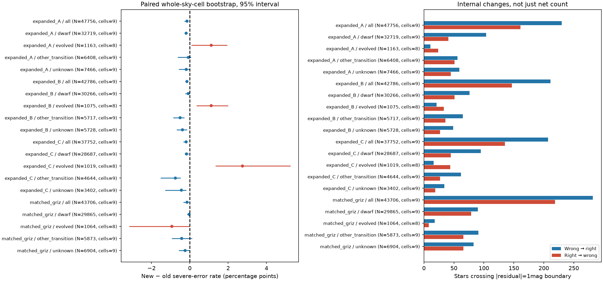
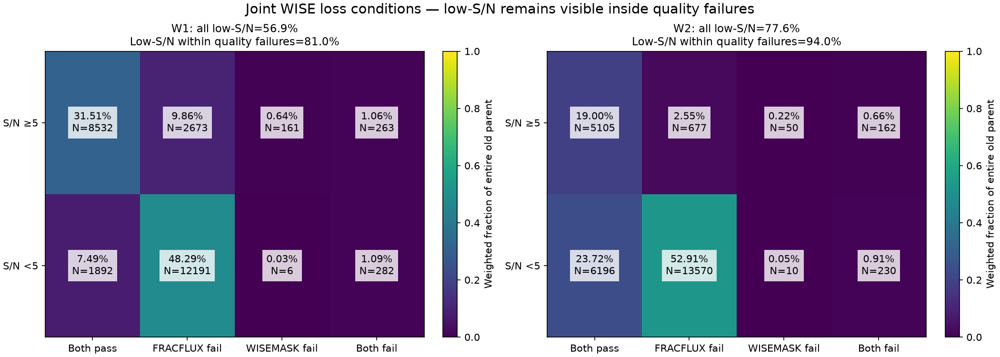

# v1.4 逐星科学诊断：哪些恒星测得好，哪些被推到了错误的光度分支

本轮按 [GPT Pro 最新建议](pro_review_46cb68a.md)，完成八组诊断。
本报告的图件和历史交付哈希对应提交 `63cdbaa`。覆盖图勘误和后续实验见 [r₀ 对照与图集修正](baseline_v1_5_r0_result.md)。
主结果继续使用已冻结的新天区 test；没有重新训练模型、调整阈值、改变部署或重跑全母星表。
完整逐图图注、分来源/分类别表格见 [科学图集](baseline_v1_4_science_atlas.md)。

**核心结论：已知矮星的参考一致性较好，但多数演化星的光度被预测得过暗、距离被系统性推近。
这发生在测光支持域内，并且在多个天区重复出现。新增数据和 i 波段的小幅总体收益，不能解决这个分支问题。**
另外发现一个值得单独处理的金属贫乏矮星偏差，以及此前顺序统计掩盖的 WISE 低信噪比损失。

## 1. 距离对比：大多数矮星较好，演化星不是普通的小偏差

下表使用 matched_griz 的同星 chosen 参考（合格 Gaia 高精度锚优先，否则 SpecDis）。
距离残差为 `预测中位距离模数 − 参考距离模数`；严重错误定义为绝对残差 >1 mag。

| 可靠类别 | N | 中位残差 / mag | NMAD / mag | 严重错误率 | 68% / 95% 覆盖率 |
|---|---:|---:|---:|---:|---:|
| 矮星 | 29,865 | +0.048 | 0.236 | 1.93% | 74.29% / 97.45% |
| 演化星 | 1,064 | −5.340 | 1.730 | 96.52% | 15.88% / 61.84% |
| 其他恒星或过渡类 | 5,873 | −0.306 | 0.530 | 20.48% | 61.88% / 95.66% |
| 未知类 | 6,904 | +0.011 | 0.526 | 19.94% | 56.01% / 87.57% |

演化星的中位距离比 `d_phot/d_ref=0.0855`，即相对于参考估计，典型预测距离只有约十二分之一。
此组没有合格的高精度 Gaia 距离锚，1,064 个 chosen 参考均来自 SpecDis；
单独的 SPDist 950 星比较也有 −5.140 mag 中位残差和 97.79% 严重错误率。
这两个目录有共同数据与选择效应，不能当作两套完全独立真值，但失败方向一致。

图中保留到约 −12 mag 的尾部。远端参考星并未随参考距离增长得到相应的大距离，
而是大量集中于较近的预测距离。其他/过渡类与未知类也有长尾，不能混入“表现良好的矮星”叙述。
[矮星对照](../figures/baseline_v1_4_science/distance_matched_griz_dwarf.png) 和
[更宽 grz 样本](../figures/baseline_v1_4_science/distance_expanded_A_evolved.png) 保留在图集中。

覆盖率针对发布点估计计算，未卷积 VAC 参考误差。
高精度 Gaia 矮星子集的68%覆盖约61.5%，低于总体矮星值，说明混合目录的总体覆盖也不能替代分来源检验。
弱与负视差不做倒数测距；它们用于第6节观测视差空间检查。

## 2. CMD：演化支被压向主序附近

上下两行分别是同一批星的 `Legacy g0 − mu_ref` 与 `Legacy g0 − mu_phot`，使用相同坐标范围。
演化星的参考位置与矮星序列明显不同，预测位置却集中到与主序相近的光度范围。
因此，“预测 CMD 看起来像一条合理恒星序列”并不构成测距成功证据。

少量箭头是固定身份顺序选取的说明性个例，未为视觉效果挑选。
过渡类和未知类仍按原标签单列，没有追加 RGB、RC、BHB 或白矮星的未经验证分类。

## 3. 颜色空间：失败在类别重叠区域十分普遍

[grz 颜色残差](../figures/baseline_v1_4_science/colors_gr_rz.png)、
[含 W1 的颜色残差](../figures/baseline_v1_4_science/colors_gr_zW1.png)、
[i 波段颜色残差](../figures/baseline_v1_4_science/colors_ri_iz.png)
分别给出计数、中位残差与严重错误率，并将矮星和演化星分开。

在预设颜色网格内，1,064 颗演化星中，1,053 颗所在的 grz 色格同时有至少10颗矮星；
在 r−i/i−z 色格中对应1,054颗。含合格 W1 的图内987颗演化星中，982颗也处于至少10颗矮星的色格。
W1 颜色图中的残差来自只使用光学输入的 matched_griz，图上的 W1 用于定位失败对象。评估 W1 的增益应使用匹配样本的波段对照。
这些是当前参考样本在指定网格下的重叠描述，不能据此断言更精细颜色、误差建模或其他方法没有信息。

同一色格的全体中位残差经常接近零，但演化星层显示很大负残差和接近1的严重错误率。
后续解释与模型评价应继续使用类别分层，不能只优化或展示多数类主导的整体平均。

## 4. 天区：失败跨多个区域存在，但验证远未覆盖整个天空

[分星族天区图](../figures/baseline_v1_4_science/sky_class.png)、
[分参考来源](../figures/baseline_v1_4_science/sky_source.png)、
[分亮度](../figures/baseline_v1_4_science/sky_brightness.png) 和
[训练/校准/测试足迹](../figures/baseline_v1_4_science/footprint.png)
使用原10°网格，不插值，性能图要求每格至少20颗参考。

expanded_A 的 chosen test 参考实际只落在 **9 个天区 cell**。
其中一个 cell 有21,817/47,756颗，即45.7%的参考，空间分布很不均匀。
全部对象的格内中位残差在约−0.10到+0.004 mag之间；
但5个达到计数门槛的演化星天区都出现约−4.80到−5.56 mag的中位残差，严重错误率90.3%–98.0%。
这不是单一天区的孤立异常。

这仍不足以估计光学天空的零点修正：不同天区的类别、参考来源、颜色、亮度与选择构成不同。
本轮不对天空残差拟合任何校正。计数图表示原始参考数量；
另给 [按球面面积归一化的参考密度](../figures/baseline_v1_4_science/sky_density.png)，避免把10°格当等面积。
“扫描1600个 sweep”不等于“所有天区都已获得可靠测试标签”。

## 5. 物理参数：金属贫乏矮星是另一条明确的残差结构

matched_griz 中，有可靠光谱参数、**原始 RVS** `[Fe/H]<−1.5` 的2,858颗矮星：
中位残差 **+0.386 mag**，中位距离比 **1.194**，严重错误率 **7.21%**，68%覆盖率 **49.93%**。
其表现明显差于所有矮星的1.93%严重错误率和74.29%覆盖率。
相反，金属贫乏演化星225颗仍有−3.409 mag中位残差与89.33%严重错误率。

[Kiel 图](../figures/baseline_v1_4_science/kiel.png) 显示低重力层的系统性负残差；
[观测条件图](../figures/baseline_v1_4_science/observing_conditions.png)
说明演化星失败不只发生在暗星或无 WISE 层。

这是需要解释的相关结构，尚不是“金属丰度造成全部偏差”的因果结论。
颜色、参考来源和选择可能共同变化；不能直接用真实光谱金属丰度给无光谱目标做事后校正。
金属贫乏子样本也不等于确认的银河晕成员。

## 6. 概率分布：支持域与歧义标记不能保证正确光度解

[类别×亮度区间表现](../figures/baseline_v1_4_science/intervals.png) 和
[refined Gaia PIT及预测标记](../figures/baseline_v1_4_science/gaia_flags.png)
给出了点估计以外的证据：

- 支持域内的演化星1,042颗中，1,010颗严重错误，错误率96.93%。
  因而当前问题不能主要归因于模型检测到的外推对象。
- 未打歧义标记的演化星826颗中，812颗严重错误，错误率98.31%；其68%覆盖仅7.75%。
  “没有歧义标记”不能用作可靠距离的充分条件。
- 完整观测视差检验保留1,162颗演化星，包括403颗负视差；其中602颗落在 PIT<0.1，约51.8%。
  分布强烈偏向低端，与预测视差偏大、距离偏近的方向一致。
  该评分读取 refined 文件，未混用旧数值积分结果。

固定抽取的两颗演化星失败个例中，griz 在参考模数±1 mag内仍有 **22.66%** 和 **36.31%** 的概率质量，
但中位数偏差分别是−5.95和−5.51 mag，68%宽度约6.31和6.29 mag。
[完整 PDF 第一页](../figures/baseline_v1_4_science/pdf_examples_1.png)
可以看到远距离解的概率质量并非完全消失，而是没有主导全局中位数。
[第二页](../figures/baseline_v1_4_science/pdf_examples_2.png) 保留无 WISE、未知类等其余固定个例。

对稀有真实类别，即便条件混合分布的总体权重恰当，全局中位数也可能集中在多数类光度支。
诊断权重需要整体概率评分和独立验证。十个固定个例只展示可能的机制。前几轮门控的负结果仍有效：
“知道真实类别后条件模型更好”与“能用测光可靠选择该类别”是两个不同问题。

## 7. 增加数据与增加 i：小的总体净收益，伴随不同星族的损伤

| 同星对照 | 错→对 | 对→错 | 净减少严重错误 | 新−旧尾率 / 百分点 | 天区bootstrap 95%区间 / 百分点 |
|---|---:|---:|---:|---:|---:|
| frozen_A → expanded_A | 230 | 161 | 69 | −0.144 | [−0.289, −0.103] |
| frozen_B → expanded_B | 211 | 147 | 64 | −0.150 | [−0.235, −0.132] |
| frozen_C → expanded_C | 207 | 135 | 72 | −0.191 | [−0.336, −0.128] |
| matched grz → griz | 282 | 219 | 63 | −0.144 | [−0.337, −0.043] |

这些是在当前9个 cell、当前参考选择下的小幅总体收益；少量且不均衡的天区限制了区间的推广范围。
**扩充训练数据同时使演化星尾率分别增加1.12、1.12、2.75个百分点。**
加入 i 对演化星只有18颗救回、8颗损伤，净改善10颗；对应尾率差的95%区间为[−3.17,0.00]个百分点，
不能将总体的小收益解释为演化支问题已经解决。

[按颜色、重力与金属丰度的配对变化](../figures/baseline_v1_4_science/paired_physics.png)
保留了这些差异。分类器与距离 QRF 是独立路径，所以原先分类 AP 提高并不意味着距离已经改用更正确的光度分支。

## 8. 应用范围与 WISE：低信噪比损失比顺序分类显示得更大

| 加权比例，原 DECam 母样本 | W1 | W2 |
|---|---:|---:|
| 所有低 S/N 对象 | 56.92% | 77.59% |
| 质量失败 | 60.99% | 57.28% |
| 同时低 S/N 与质量失败 | 49.42% | 53.87% |
| 质量失败组内的低 S/N 比例 | 81.03% | 94.03% |

因此，旧 W1 的“低 S/N 7.49%”只能解释为“通过质量条件之后仍低 S/N”的比例，
不能表示所有深度损失。这里的交叉统计来自原26,000颗概率样本与51个保留 sweep 的精确 native-ID 关联，
原权重未变，所有样本都有匹配，保留负通量。

[修正的应用覆盖图](../figures/baseline_v1_5_r0/application_coverage.png)
按实际训练、校准和测试资格区分分类与距离参考。[原图](../figures/baseline_v1_4_science/application_coverage.png)保留波段可用率曲线，原校准／测试样本口径复用了训练条件。
母样本权重只适用于原南天 DECam 母样本，不代表所有新增天区。
固定颜色—星等格中“无参考”与模型的支持域标记是不同概念；有参考的格也不自动具有可靠距离。
合并历史与新增训练的331,926个独立身份后，原母样本加权55.13%仍落在没有训练参考的固定格；
采用实际验证资格后，66.04% 落在没有分类或距离证据的 test 格，70.19% 落在没有 chosen 距离参考的格。22–25 等的 test 有 7 个 chosen 距离参考。
22–25 等的广泛验证缺口保持不变。

## 下一次核心修改应针对什么

这轮图集把优先级缩小到两个实证问题：**支持域内演化星的光度分支分配，以及金属贫乏矮星的系统残差**。
若推进新的模型实验，应先解释此前门控失败与本轮 PDF 次峰证据之间的关系，
在同星、分星族的风险与覆盖标准下设计一次明确对照；不能继续用无差别增加总训练量代替这个目标。
弱 WISE 通量是值得单独注册的输入信息实验，但不能直接放松质量阈值、再沿用高斯星等误差假设。

本轮完成到科学诊断与下一方向证据，不自动启动上述新训练。
任何依据这批 test 图选择的改动都需要另留独立最终检验。现有 v1 部署继续保留。

## 可复查交付

- [全部图、统计表与逐图说明](baseline_v1_4_science_atlas.md)。
- [诊断协议](baseline_v1_4_diagnostics_protocol.md)，[实际校验](../manifests/baseline_v1_4_science_validation.json)，[输入哈希和统计](../manifests/baseline_v1_4_science.json)。
- [最终交付与图像哈希](../manifests/baseline_v1_4_science_delivery.json)：1,943项实际检查、4项针对性测试、29张已检查科学图。
- 逐星诊断表、完整 PDF、原始测光和冻结模型留在 NERSC；Git 保存程序、紧凑数值、报告与图。
