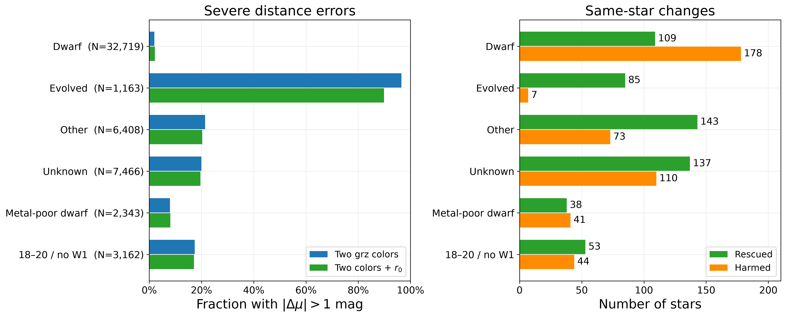
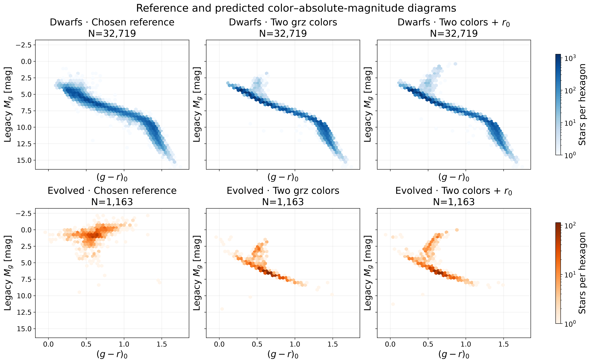
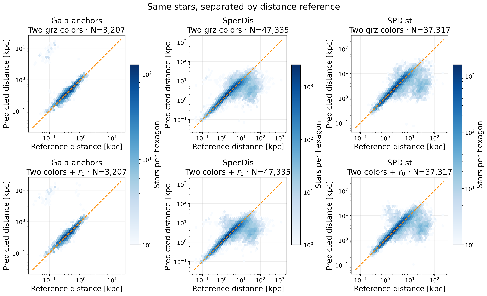
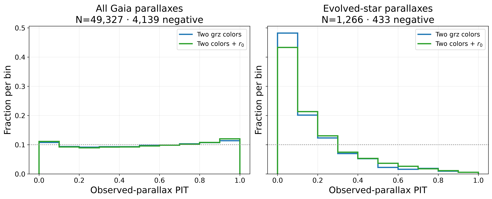
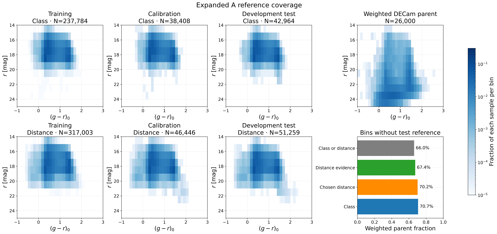

# 给 expanded A 增加视星等 r₀ 的同星对照

加入消光改正后的视星等 r₀ 后，1,163 颗有点距离参考的演化星中，85 颗从严重错误变为合格，7 颗反向变化。严重错误率下降 **6.71 个百分点**，仍达 **89.85%**，中位距离模数残差仍是 **−5.16 mag**。全体误差略降，矮星的尾部和 Gaia 概率校准出现退步。这组结果支持视亮度对部分分支判断有信息，当前表现不足以把它作为测距替代方案。

## 只改变一项输入

复用冻结 expanded A 的两色预测，新增一个 QRF，输入 `(g−r)₀, (r−z)₀, r₀`，目标仍为 Legacy `M_g`。训练对象 **317,003** 个，校准和测试距离评估身份 **97,705** 个，与旧模型完全对齐。两模型使用相同的逐星 Sobol128 测光扰动，颜色与 r₀ 从同一组扰动后的 g、r、z 计算。森林超参数原样复制。固定的 `max_features=0.75` 在两维与三维下分别给出每次分裂的一项和两项候选特征，这是沿用该规则时的维数效应。该条件可以携带参考样本的距离、人群和目标选择信息。

## 哪些星改善，哪些星损伤

使用预先指定的 Gaia 高精度锚优先、否则 SpecDis 的 chosen 参考。严重错误为 `|Δμ| > 1` mag。区间覆盖衡量与目录点估计的一致性。分层行存在重叠。

| 分组 | N | 中位残差（mag） | 严重错误率 | 68% 覆盖 | 救回 / 损伤 |
|---|---:|---:|---:|---:|---:|
| 全体 | 47,756 | -0.006 → -0.003 | 9.68% → 9.46% | 69.00% → 68.67% | 474 / 368 |
| 矮星 | 32,719 | +0.032 → +0.037 | 1.95% → 2.16% | 75.09% → 73.42% | 109 / 178 |
| 演化星 | 1,163 | -5.301 → -5.160 | 96.56% → 89.85% | 19.35% → 21.93% | 85 / 7 |
| 其他／过渡 | 6,408 | -0.314 → -0.304 | 21.36% → 20.27% | 62.38% → 60.41% | 143 / 73 |
| 未知 | 7,466 | +0.003 → -0.030 | 19.98% → 19.62% | 55.72% → 62.24% | 137 / 110 |
| 原始 RVS 贫金属矮星 | 3,057 | +0.400 → +0.377 | 6.84% → 6.87% | 49.69% → 49.13% | 45 / 46 |
| 校正域内贫金属矮星 | 2,343 | +0.451 → +0.427 | 7.98% → 8.11% | 43.28% → 42.98% | 38 / 41 |
| 18–20 无 W1 | 3,162 | +0.019 → -0.002 | 17.39% → 17.11% | 61.04% → 65.56% | 53 / 44 |

演化星尾率差的天区整块 bootstrap 95% 区间为 **[−10.94, −3.55] 个百分点**，校准区同向下降 13.92 个百分点。开发测试演化星 NMAD 从 1.73 增至 2.02 mag，68% 覆盖从 19.35% 升至 21.93%。这些变化显示一部分星获救，剩余分布仍有很长的负尾。整体 106 颗净改善中有 78 颗来自一个大格（cell 387），全部 chosen 测试只有 9 个天区格。

| 10° 天区格 | Chosen N | 尾率差（百分点） | 救回 / 损伤 |
|---|---:|---:|---:|
| 28 | 219 | +0.000 | 1 / 1 |
| 62 | 12,439 | +0.008 | 87 / 88 |
| 63 | 4,840 | -0.269 | 39 / 26 |
| 116 | 48 | -2.083 | 1 / 0 |
| 244 | 2,800 | -0.214 | 23 / 17 |
| 278 | 810 | +0.000 | 6 / 6 |
| 297 | 2,937 | +0.034 | 21 / 22 |
| 387 | 21,817 | -0.358 | 272 / 194 |
| 638 | 1,846 | -0.542 | 24 / 14 |

校正适用域内的贫金属矮星，偏差从 +0.451 到 +0.427 mag，严重错误率略升，95% 覆盖从 92.23% 到 89.07%。18–20 等无 W1 层净救回 9 颗，尾率差的天区区间包含零，68% 覆盖由 61.04% 到 65.56%。20–22 等有 618 个 chosen 参考，尾率 25.89% 到 26.38%。22–25 等有 7 个 chosen 参考，仍缺少广泛验证。

## 优先应用人群与区间宽度

18–20 等、无合格 W1 的演化星共有 **47 颗**，两模型各有 **44** 颗严重错误。加入 r₀ 救回 1 颗、损伤 1 颗，中位残差从 -4.933 到 -5.185 mag，68% 覆盖从 25.53% 到 17.02%。全体演化星的收益在这一优先人群中未复现。

按原 WISE 质量层拆分全体净变化。W1/W2 均合格净救回 108 颗，无合格 W1 净救回 10 颗，只有 W1 合格净增加 12 颗严重错误。两个 r₀ 对照模型都是纯光学模型，这个分组描述收益落在哪些人群。

| 子样本 | N | 68% 覆盖 | 68% 区间中位全宽（mag） | 严重错误率 |
|---|---:|---:|---:|---:|
| 18–20 无 W1 | 3,162 | 61.04% → 65.56% | 0.844 → 1.054 | 17.39% → 17.11% |
| 20–22 | 618 | 55.50% → 67.80% | 0.980 → 1.677 | 25.89% → 26.38% |

暗端的覆盖提升伴随区间明显加宽。18–20 无 W1 的 NMAD 基本持平，20–22 层严重错误增加 3 颗。全体演化星的绝对误差逐星变化均值为 −0.337 mag、中位数为 −0.021 mag，改善主要集中在部分对象。

## 参考来源、亮度和完整 Gaia 视差

| 观测 r | Gaia 锚 N，尾率 | SpecDis N，尾率 | SPDist N，尾率 |
|---|---:|---:|---:|
| 全部 | 3,207，3.15% → 3.37% | 47,335，9.63% → 9.41% | 37,317，8.54% → 8.21% |
| <18 | 2,649，1.81% → 2.23% | 23,758，8.14% → 7.90% | 20,468，7.82% → 7.58% |
| 18–20 | 557，9.52% → 8.80% | 22,952，10.73% → 10.49% | 16,582，9.21% → 8.77% |
| 20–22 | 1，0.00% → 0.00% | 618，25.89% → 26.38% | 267，22.47% → 21.72% |
| 22–25 | 0 | 7，57.14% → 57.14% | 0 |

两份光谱距离参考有共同数据与选择。演化星没有合格的高精度 Gaia 距离锚。其 SpecDis 尾率从 96.56% 到 89.85%，SPDist 从 96.88% 到 89.28%，方向一致。亮端 Gaia 锚尾率上升，18–20 等 Gaia 锚尾率下降。加入 r₀ 后的收益依赖参考来源和亮度，当前证据限于已有样本选择和天区。

完整观测视差评分有 **49,327** 个测试对象，包含 **4,139** 个负视差。整体平均 log density 从 **0.05322 到 0.05408**，PIT 极端尾部从 **11.58% 到 12.36%**。演化星 log density 从 −0.5820 到 −0.5031，PIT 极端尾部从 33.33% 到 30.33%。矮星 log density 从 0.2131 到 0.2074，PIT 极端尾部从 10.24% 到 11.42%。两模型均用收敛控制后的评分。极端尾部定义为 PIT<0.05 或 PIT>0.95。

## v1.4 图集的更正

覆盖图现在用实际 expanded A 训练身份，cal/test 按分类与距离评估资格分开。距离证据包括点距离目录和合格的带符号视差，另外单列 chosen 和仅视差资格。旧图对 cal/test 复用了训练入口，漏掉了不满足训练误差限制的对象。

| 评价资格 | Cal N | Test N | Test 22–25 等 N | 加权母样本在无相应 test 参考格的比例 |
|---|---:|---:|---:|---:|
| 合格分类 | 38,408 | 42,964 | 0 | 70.65% |
| Chosen 点距离 | 43,112 | 47,756 | 7 | 70.19% |
| 全部距离证据 | 46,446 | 51,259 | 7 | 67.36% |
| 仅视差 | 1,358 | 1,523 | 0 | 74.68% |
| 分类或距离证据 | 46,743 | 51,672 | 7 | 66.04% |

原 v1.4 金属丰度图使用**原始 RVS [Fe/H]**。固定 `[Fe/H] < −1.5` 后，将可靠 RVS 参数和正的丰度误差用于三种口径。校正适用域为 4,200 ≤ Teff < 6,600 K、1.8 ≤ log g < 5.5。中间一行先限制校正适用域，再用原始值切分，用来区分适用域和丰度重分组的影响。

| matched griz 的贫金属矮星定义 | N | 中位残差（mag） | 严重错误率 | 68% 覆盖 |
|---|---:|---:|---:|---:|
| 原始 RVS 全质量样本 | 2,858 | +0.386 | 7.21% | 49.93% |
| 原始 RVS 限校正适用域 | 2,744 | +0.395 | 6.96% | 49.42% |
| 适用域内校正丰度 | 2,179 | +0.433 | 8.26% | 43.69% |

原 W1 颜色图的残差来自只用光学波段的 `matched_griz`，展示该模型在有合格 W1 的对象上、按 W1 颜色坐标分布的失败位置。估计 W1 的实际增益应使用同训练、同测试的波段对照。维持当前质量筛选时，弱通量模型最多能把旧母样本的 W1 测量覆盖从 31.51% 提到 39.01%。W2 的 42.72% 对应单波段覆盖。

PDF 个例显示远距离解存在，但全局中位数落在近解。条件分布即便正确表达了稀有星族比例，其中位数也可能系统性错估该星族。判断混合概率是否需要修改，还需要整体概率评分、预测时可用的条件和独立验证。

## 复现

[固定实验协议](baseline_v1_5_r0_protocol.md) · [逐组数值与输入哈希](../manifests/baseline_v1_5_r0_result.json) · [覆盖、图像及交付校验](../manifests/baseline_v1_5_r0_delivery.json)

五张图使用 Pal 5 New Step 5 的 DejaVu Sans、13/17/18 pt 字号层级、蓝绿橙色和浅网格，按面板数量安排画幅，输出 300 dpi。源逐星表、新模型、评估检查点保存在 NERSC 的 `data/baseline_v1_5_r0`。已用于诊断的天区作为开发集。后续若推进该特征，需要独立天区判断这项人群收益与损伤是否可迁移。
