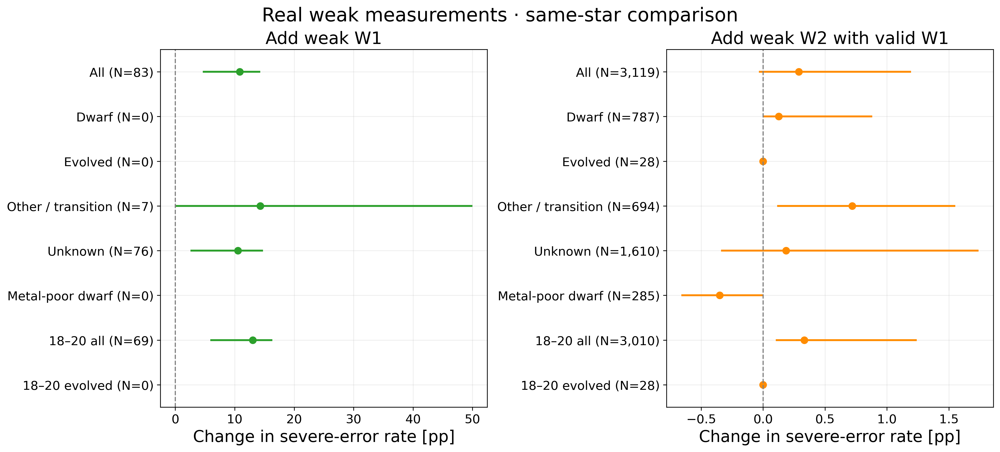
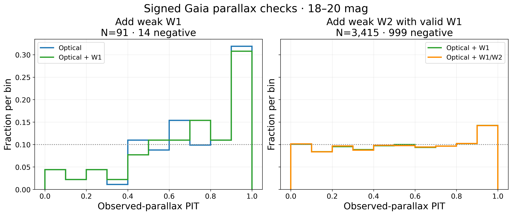
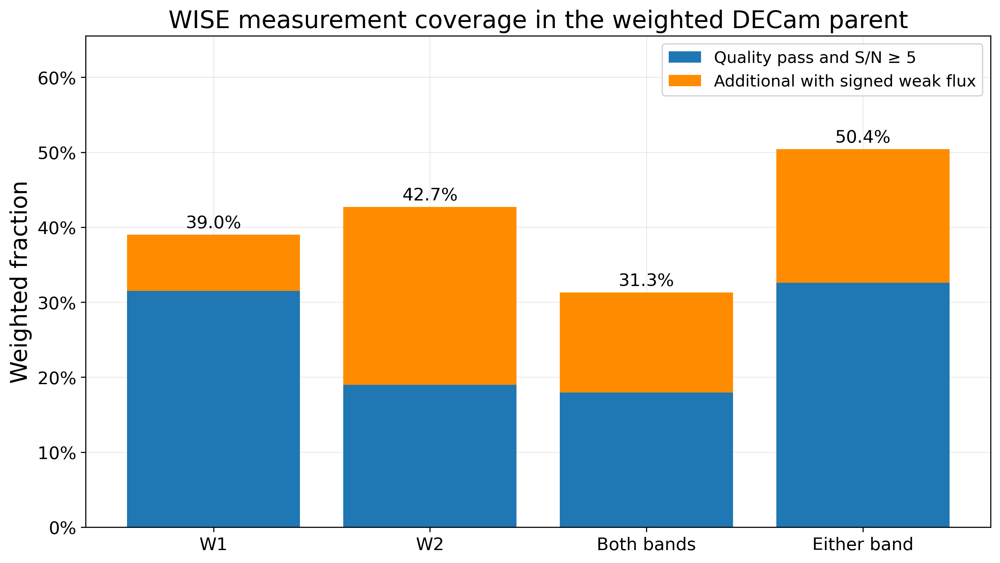

# 弱 WISE 通量固定对照

**这一固定原型未能从真实弱 WISE 测量获得目标人群收益。** 在 18–20 等开发测试中，弱 W1 和弱 W2-only 都增加了严重距离错误。有合格 W1 后再加弱 W2，变化较小且方向仍不利。

本轮用同一组联合经验模板对照纯光学、加 W1、加 W1/W2。三组使用同一套光学噪声抽样和校准／开发测试身份。模板来自新训练区，共 122,217 颗，同时满足 W1 和 W2 的 S/N≥5。校准和开发测试共 97,705 个完全对齐的身份。冻结 expanded A 作为外部参照。它的训练集合和估计器不同，差异用于描述当前原型的水平。

每个模板保存绝对星等和两项红外／光学通量比。在同一组扰动后的光学测量下，用邻近颜色的模板推算正的 WISE 模型通量，与带符号原始观测比较。观测方差加上固定的 5% 模板通量散布，W1 和 W2 测量误差在给定模板后按独立处理。缺测和质量失败的波段不参与似然。W2 通过质量而 W1 缺失时单独记录为 W2-only。

严重错误为绝对距离模数残差超过 1 mag。点距离对比使用 frozen chosen 参考，光谱距离一致性与高精度 Gaia 锚另列。区间覆盖和全宽一起评价。Gaia 概率评分使用收敛控制的带符号观测视差，保留负视差。

## 实际弱测量的同星结果

| 18–20 等同星对照 | Chosen N | 严重错误率 | 救回 / 损伤 | 68% 覆盖 | 68% 全宽（mag） |
|---|---:|---:|---:|---:|---:|
| 光学 → 弱 W1 | 69 | 39.13% → 52.17% | 1 / 10 | 47.83% → 40.58% | 1.167 → 0.998 |
| 已有合格 W1 → 加弱 W2 | 3,010 | 20.60% → 20.93% | 13 / 23 | 51.56% → 50.63% | 0.857 → 0.846 |
| 无合格 W1 → 加弱 W2 | 100 | 40.00% → 44.00% | 0 / 4 | 43.00% → 41.00% | 1.152 → 1.120 |

弱 W1 目标层有 64 个未知类和 5 个其他／过渡类。可靠矮星、演化星、贫金属矮星各为零。弱 W2-only 层也没有可靠演化星。这两组的负结果主要来自未知类，无法单独判断其演化星效果。

已有合格 W1 的弱 W2 层有 28 颗演化星，两组均为 **28/28 严重错误**，中位残差从 −4.239 到 −4.004 mag。校正域内 283 颗贫金属矮星救回 2 颗、损伤 1 颗。其全星等子组的中位残差仍约 +0.35 mag。三个 18–20 等对照的尾率变化分别为 +13.04、+0.33、+4.00 个百分点。相应天区整块 bootstrap 描述性 95% 区间约为 [+5.88, +16.35]、[+0.10, +1.24]、[+1.45, +7.94] 个百分点。cal 的三个对应层也都是净损伤。少量天区和参照选择限制了外推。

高信噪比单列。在双波段高 S/N 的 1,019 颗演化星中，同时加 W1/W2 将尾率从 95.29% 降到 89.30%，救回 69 颗、损伤 8 颗。相同高 S/N 层的矮星从 1.80% 升到 2.26%，贫金属矮星从 8.47% 升到 10.48%。两波段均无合格测量时，4,395 个点距离测试对象的三个原型输出完全相同。数值清单保留各参照来源、亮度、天区、星族、覆盖率和区间宽度。

## 完整带符号 Gaia 评分

| 18–20 等同星对照 | Gaia N | 负视差 | 平均 log predictive density | PIT 极端尾部 |
|---|---:|---:|---:|---:|
| 光学 → 弱 W1 | 91 | 14 | -1.8226 → -1.9961 | 17.58% → 24.18% |
| 已有合格 W1 → 加弱 W2 | 3,415 | 999 | -1.6172 → -1.6249 | 13.56% → 13.50% |
| 无合格 W1 → 加弱 W2 | 128 | 38 | -5.1876 → -5.2204 | 11.72% → 14.84% |

全体开发测试使用 49,327 个 Gaia 观测视差，包括 4,139 个负视差。加入 W1/W2 后相对同模板纯光学对照，平均 log density 从 −3.3230 到 −3.3432，PIT 极端尾部从 12.94% 到 13.21%。冻结 expanded A 的两项分数分别为 +0.0532 和 11.58%。新表示的总体距离尾率也比该基线高。极端 PIT 定义为 PIT<0.05 或 PIT>0.95。自适应积分在部分极端尾部触发舍入或分段上限提示，所有输出有限且 PIT 范围检查通过。小的 log density 差异应结合 PIT 和点距离指标解读。

## 测量机会与验证范围

| 原 DECam 母样本加权覆盖 | 质量合格且 S/N≥5 | 质量合格，纳入弱通量 |
|---|---:|---:|
| W1 | 31.51% | 39.01% |
| W2 | 19.00% | 42.72% |
| 两波段均可用 | 17.93% | 31.32% |
| 任一波段可用 | 32.58% | 50.41% |

母样本使用原 26,000 个概率抽样对象及原权重。其中 13.35% 有合格 W1 和弱 W2，10.37% 有弱 W2 且无合格 W1。开发测试的有效 W1/W2 分别保留 3/97 个负通量，本批实测有效零通量为 0。代码的零通量路径由合成回归覆盖。母样本比例量化能进入似然的测量机会，开发测试结果只衡量实际参照星的误差变化。高 S/N 模板与母样本在人群、星等和测量条件上有明显选择差异。

本轮以这套固定经验模板作负结果收束。对所测弱通量人群，没有出现足以推进独立天空验证的收益。全 PDF 和原始带符号通量保存在 NERSC 实验目录，供后续分支摘要或独立方案比较使用。原 r₀ 报告已补充关键无 W1 演化星层及区间宽度。

[固定协议](baseline_v1_6_wise_protocol.md) · [完整分层数值](../manifests/baseline_v1_6_wise_result.json) · [交付校验](../manifests/baseline_v1_6_wise_delivery.json) · [r₀ 报告补充](baseline_v1_5_r0_result.md)
