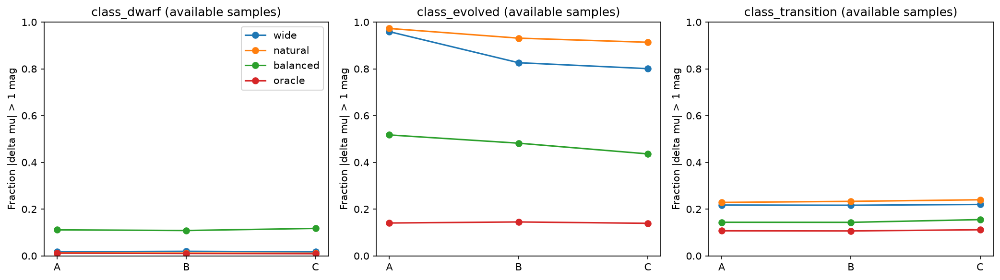
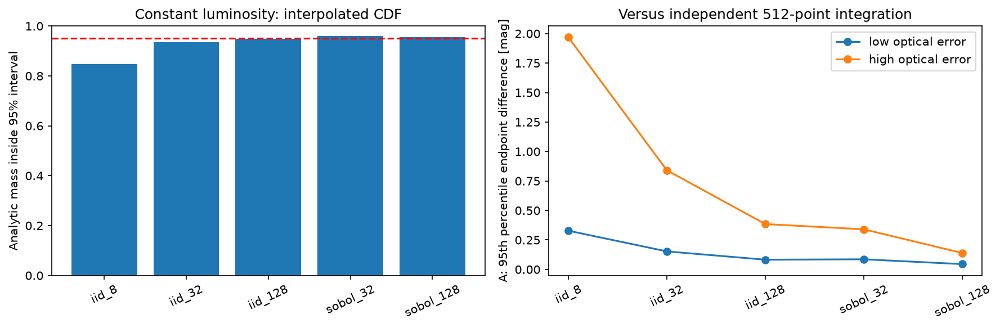
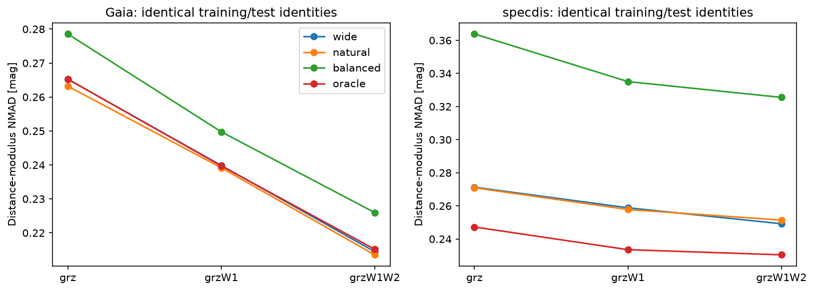
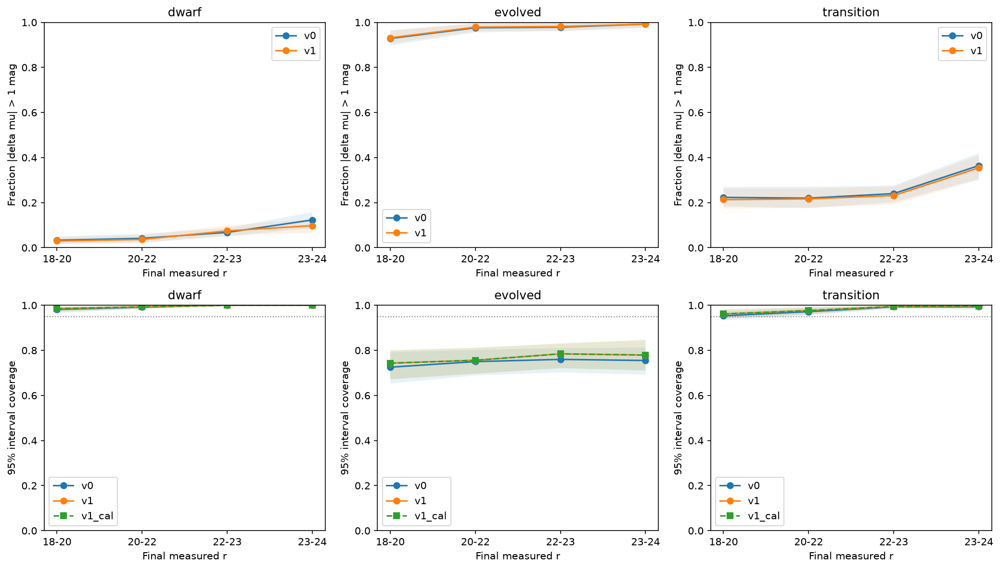
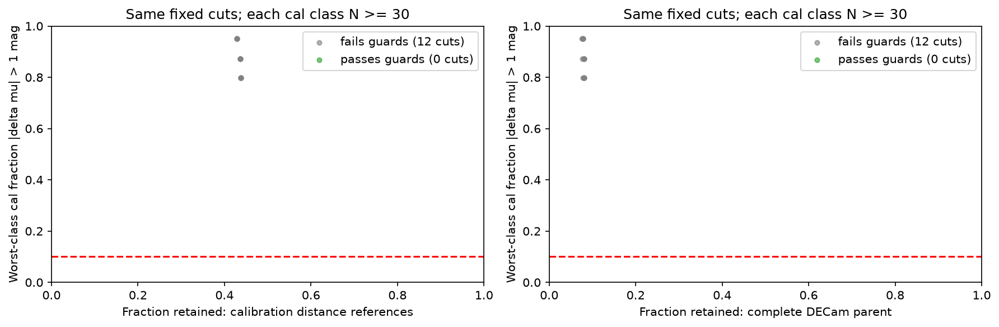
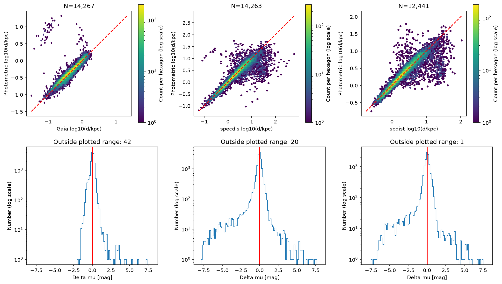
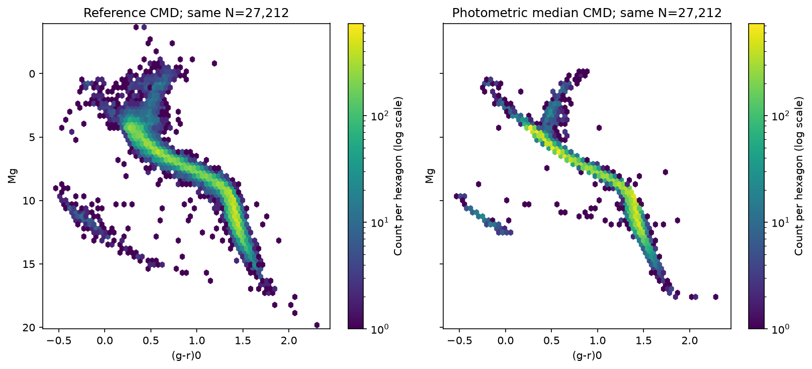
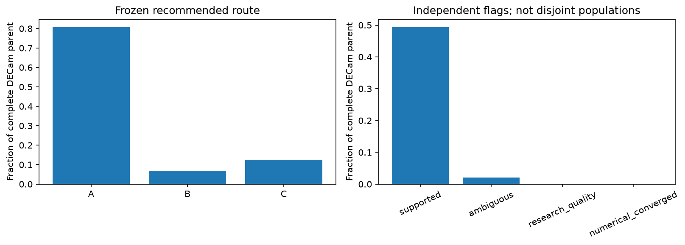

# baseline v1：光度分支、数值传播和暗端压力实验

2026-11-03。依据[完整Pro评审](pro_review_494b12c.md)和[预先登记协议](baseline_v1_protocol.md)。本轮已完成固定实验及完整内部目录；v0模型、预测和历史结果保持冻结。

**采用的v1是原宽QRF加128点Sobol积分和箱内CDF插值。显式类别模型在给定真实类别时明显改善演化星距离，但两种纯测光门控均未通过校准护栏，因此没有替换部署模型。数值尾部大幅稳定，但仍有分层收敛失败；也没有找到三类错误率同时达标的质量子目录。上述负结果均保留在最终产物中。**

## 1. 保留整体框架，明确本轮改动

沿用14场、唯一身份、原空间train/cal/test划分、训练精度和应用入口：高银纬、低消光的DR11 PSF光学母样本，grz S/N≥5及既有clean条件；Gaia、光谱和WISE都不是应用入口条件。北方BASS/MzLS行继续保留且不赋予南方模型距离。旧test已经用于开发诊断，称为发展阶段空间验证，不称为新的盲测。

| 配置 | 训练对象 | 矮星 | 演化星 | 过渡类 | 未知类别 |
| --- | --- | --- | --- | --- | --- |
| A | 163600 | 73458 | 3314 | 16645 | 70183 |
| B | 149743 | 68588 | 3107 | 14983 | 63065 |
| C | 136078 | 64616 | 2947 | 12256 | 56259 |

条件QRF保持原森林参数；仅用训练颜色学习固定二次logistic门控。自然比例和人工等比例是两种实验权重，不是银河真实类别概率。未知类别对象继续贡献宽QRF；分支支持不足时回退到宽分布。同一次扰动内先组合分支，再传播共享g到距离。oracle使用已知类别，仅用于诊断，不能进入实际目录。

## 2. 正确光度解可以恢复，纯测光分支权重仍未解决

| v0配置 | 优先参照粗类 | N | 参照Mg±0.5质量中位数 | 质量<5%比例 | 严重错误中域内且未标多解 |
| --- | --- | --- | --- | --- | --- |
| A | 演化 | 292 | 8.5% | 36.6% | 180/281 |
| A | 过渡 | 1943 | 47.3% | 6.6% | 358/428 |
| B | 演化 | 276 | 9.9% | 29.7% | 149/229 |
| B | 过渡 | 1738 | 48.0% | 7.0% | 318/374 |
| C | 演化 | 266 | 10.6% | 27.1% | 136/212 |
| C | 过渡 | 1497 | 46.2% | 7.2% | 288/329 |

这是全部对应参照对象的原PDF审计，不仅是触发多解者。正确解附近通常有少量质量，但不保证形成独立模式；参照标签自身也有误差。域内、未触发多解不是可靠性的充分条件。

| 配置 | 实验 | 演化星N | 演化偏差 | 演化NMAD | 演化严重错误 | 矮星严重错误 |
| --- | --- | --- | --- | --- | --- | --- |
| A | wide | 292 | -4.627 | 1.860 | 95.9% | 1.7% |
| A | natural | 292 | -5.108 | 1.509 | 97.3% | 1.2% |
| A | balanced | 292 | -1.014 | 1.439 | 51.7% | 11.1% |
| A | oracle | 292 | -0.023 | 0.499 | 14.0% | 1.1% |
| B | wide | 276 | -3.981 | 2.450 | 82.6% | 1.9% |
| B | natural | 276 | -4.893 | 1.610 | 93.1% | 1.2% |
| B | balanced | 276 | -0.883 | 1.321 | 48.2% | 10.8% |
| B | oracle | 276 | -0.047 | 0.512 | 14.5% | 1.0% |
| C | wide | 266 | -3.963 | 2.676 | 80.1% | 1.7% |
| C | natural | 266 | -5.015 | 1.659 | 91.4% | 1.1% |
| C | balanced | 266 | -0.770 | 1.162 | 43.6% | 11.7% |
| C | oracle | 266 | -0.061 | 0.521 | 13.9% | 0.9% |

表中每个配置内使用同一批测试对象，A/B/C自身可用对象不同，不能把这张表当作严格同星波段增益。优先参照采用Gaia合格标签、其次SPECDIS；SPECDIS/SPDist分源成绩完整保存在清单。oracle的显著改善支持“分支判别/权重是主要障碍之一”，不能证明颜色已达到物理信息上限。自然门控使演化星更差；均衡权重改善演化星却增加矮星严重错误。

按粗星族分别显示严重错误率；oracle不属于可部署成绩。

## 3. 数值传播改进及未通过的收敛条件

| 固定光度解析反例 | 旧箱中心95%区间所含概率 | CDF插值后所含概率 |
| --- | --- | --- |
| iid_8 | 81.7% | 84.7% |
| iid_32 | 92.8% | 93.5% |
| iid_128 | 94.3% | 94.9% |
| sobol_32 | 96.2% | 96.0% |
| sobol_128 | 95.2% | 95.6% |

解析反例有5000个身份、sigma_g=0.2mag；这不是实际星表覆盖率。CDF插值与更多扰动共同减少尾部数值误差。

| A误差层 | 积分 | N | 95下端差P95 | 中位数差P95 | 95上端差P95 | 多解状态变化 |
| --- | --- | --- | --- | --- | --- | --- |
| low | iid_8_0 | 780 | 0.286 | 0.400 | 0.328 | 7.6% |
| low | iid_32_0 | 780 | 0.153 | 0.246 | 0.144 | 3.8% |
| low | iid_128_0 | 780 | 0.069 | 0.132 | 0.082 | 1.9% |
| low | sobol_128_0 | 780 | 0.025 | 0.048 | 0.045 | 0.9% |
| high | iid_8_0 | 2220 | 1.968 | 0.877 | 1.799 | 31.6% |
| high | iid_32_0 | 2220 | 0.841 | 0.367 | 0.739 | 7.9% |
| high | iid_128_0 | 2220 | 0.385 | 0.158 | 0.311 | 4.0% |
| high | sobol_128_0 | 2220 | 0.115 | 0.041 | 0.139 | 1.1% |

| 独立128重复 | 误差层 | N | 95下端差P95 | 中位数差P95 | 95上端差P95 | 多解状态变化 |
| --- | --- | --- | --- | --- | --- | --- |
| A | low | 780 | 0.031 | 0.060 | 0.052 | 1.3% |
| A | high | 2220 | 0.155 | 0.054 | 0.176 | 1.6% |
| B | low | 520 | 0.028 | 0.033 | 0.037 | 0.8% |
| B | high | 1450 | 0.094 | 0.040 | 0.138 | 0.7% |
| C | low | 263 | 0.015 | 0.032 | 0.012 | 0.0% |
| C | high | 699 | 0.069 | 0.040 | 0.138 | 1.3% |

从母样本按误差、可用波段、支持和多解状态固定抽取3000个源，比较基准是独立数字移位Sobol512。低/高误差界为最大grz误差0.03mag。预设端点/中位容差为0.10/0.03/0.10mag，且各可用配置都须通过。**两层均未全部通过，所以按协议采用128次并保留numerical_converged=False。**它表示误差层级审计未通过，不表示每颗星的全部分位点都不稳定；也不允许把小的平均误差写成普遍收敛。

解析概率质量与母样本分层端点稳定性是不同检验。

## 4. WISE仍是可选增强：同训练、同星比较

| 共同层 | 参照 | 模型 | N | Δμ中位数 | NMAD | 绝对Δμ>1 | W68 | 覆盖68 | 覆盖95 |
| --- | --- | --- | --- | --- | --- | --- | --- | --- | --- |
| W1 | Gaia | A_on_B | 13,470 | 0.060 | 0.266 | 1.7% | 0.591 | 65.6% | 94.7% |
| W1 | Gaia | B | 13,470 | 0.071 | 0.241 | 1.3% | 0.500 | 64.1% | 94.6% |
| W1 | specdis | A_on_B | 12,895 | -0.051 | 0.285 | 8.2% | 0.661 | 71.1% | 96.5% |
| W1 | specdis | B | 12,895 | -0.049 | 0.273 | 8.0% | 0.625 | 70.9% | 96.3% |
| W1W2 | Gaia | A_on_C | 13,381 | 0.060 | 0.265 | 1.6% | 0.588 | 65.4% | 94.8% |
| W1W2 | Gaia | B_on_C | 13,381 | 0.071 | 0.240 | 1.2% | 0.500 | 64.0% | 94.5% |
| W1W2 | Gaia | C | 13,381 | 0.050 | 0.214 | 1.0% | 0.502 | 68.3% | 95.6% |
| W1W2 | specdis | A_on_C | 11,730 | -0.053 | 0.271 | 7.3% | 0.619 | 70.7% | 96.2% |
| W1W2 | specdis | B_on_C | 11,730 | -0.051 | 0.259 | 7.0% | 0.574 | 70.5% | 96.1% |
| W1W2 | specdis | C | 11,730 | -0.048 | 0.249 | 6.8% | 0.579 | 71.7% | 96.4% |

Δμ=μphot−μref，星等指标单位mag，W68是中央68%全宽。相同层保持相同训练/测试身份及同源扰动。真实参照高度集中于亮、高精度对象；同星增益不能外推到所有暗端或演化星。母样本WISE覆盖不变：W1合格2,821,370/8,899,334=31.70%，W1W2合格1,587,931/8,899,334=17.84%；22≤r<25分别约14.7%和3.6%，因此纯光学A继续承担主体覆盖。

固定共同训练和测试对象上的颜色增益，保留所有四种实验分布。

## 5. 固定通量降深：已有源进入暗端后会发生什么

三个留出场共1,067个原始源，每源四个目标深度、各两次实现，共8,536行；重新筛选后7,587行保留。包含矮星、演化、过渡和未知类别。噪声来自实际母表通量逆方差，按目标亮度缩放原始通量并给参考距离模数增加相同位移；只补足差额噪声，随后重算S/N、WISE和路由。

| 目标档／状态 | 流程 | 保留/模拟 | N | Δμ中位数 | NMAD | 绝对Δμ>1 | W68 | 覆盖68 | 覆盖95 |
| --- | --- | --- | --- | --- | --- | --- | --- | --- | --- |
| target_depth_0 | v0 | 2134/2134 | 2,134 | -0.137 | 0.439 | 22.5% | 0.800 | 63.3% | 92.8% |
| target_depth_0 | v1 | 2134/2134 | 2,134 | -0.128 | 0.439 | 22.3% | 0.771 | 64.1% | 93.5% |
| target_depth_0 | v1_cal | 2134/2134 | 2,134 | -0.128 | 0.439 | 22.3% | 0.773 | 64.2% | 93.5% |
| target_depth_1 | v0 | 2134/2134 | 2,134 | -0.132 | 0.516 | 23.6% | 1.000 | 66.2% | 94.3% |
| target_depth_1 | v1 | 2134/2134 | 2,134 | -0.131 | 0.512 | 23.2% | 1.080 | 68.2% | 94.8% |
| target_depth_1 | v1_cal | 2134/2134 | 2,134 | -0.131 | 0.512 | 23.2% | 1.082 | 68.2% | 94.8% |
| target_depth_2 | v0 | 2096/2134 | 2,096 | -0.188 | 0.708 | 26.8% | 2.000 | 71.3% | 95.6% |
| target_depth_2 | v1 | 2096/2134 | 2,096 | -0.184 | 0.673 | 26.1% | 2.203 | 73.9% | 96.1% |
| target_depth_2 | v1_cal | 2096/2134 | 2,096 | -0.184 | 0.673 | 26.1% | 2.203 | 73.9% | 96.1% |
| target_depth_3 | v0 | 1223/2134 | 1,223 | -0.372 | 0.978 | 36.3% | 2.700 | 69.7% | 94.9% |
| target_depth_3 | v1 | 1223/2134 | 1,223 | -0.334 | 0.878 | 34.6% | 2.946 | 72.1% | 95.3% |
| target_depth_3 | v1_cal | 1223/2134 | 1,223 | -0.334 | 0.878 | 34.6% | 2.946 | 72.1% | 95.3% |
| no_W1 | v0 | 5086/6025 | 5,086 | -0.207 | 0.696 | 29.0% | 1.900 | 68.7% | 94.7% |
| no_W1 | v1 | 5086/6025 | 5,086 | -0.200 | 0.669 | 28.2% | 1.948 | 70.7% | 95.1% |
| no_W1 | v1_cal | 5086/6025 | 5,086 | -0.200 | 0.669 | 28.2% | 1.948 | 70.7% | 95.1% |

| 粗类 | 最终实测r | 原始源数 | N | Δμ中位数 | NMAD | 绝对Δμ>1 | W68 | 覆盖68 | 覆盖95 |
| --- | --- | --- | --- | --- | --- | --- | --- | --- | --- |
| 矮星 | 18–20 | 300 | 600 | -0.002 | 0.235 | 3.0% | 0.629 | 79.2% | 98.5% |
| 矮星 | 20–22 | 300 | 598 | 0.038 | 0.277 | 3.7% | 0.864 | 78.6% | 99.3% |
| 矮星 | 22–23 | 298 | 588 | 0.087 | 0.438 | 7.5% | 1.839 | 84.2% | 100.0% |
| 矮星 | 23–24 | 245 | 357 | -0.031 | 0.467 | 9.8% | 2.495 | 93.8% | 100.0% |
| 演化 | 18–20 | 167 | 335 | -4.687 | 1.649 | 93.1% | 4.612 | 24.2% | 74.3% |
| 演化 | 20–22 | 167 | 332 | -5.074 | 1.530 | 97.9% | 4.422 | 20.5% | 75.6% |
| 演化 | 22–23 | 167 | 325 | -5.018 | 1.369 | 98.2% | 3.752 | 12.6% | 78.5% |
| 演化 | 23–24 | 150 | 249 | -5.302 | 1.185 | 99.2% | 3.920 | 3.6% | 77.9% |
| 过渡 | 18–20 | 300 | 600 | -0.342 | 0.513 | 21.3% | 0.966 | 63.5% | 96.2% |
| 过渡 | 20–22 | 300 | 600 | -0.313 | 0.527 | 21.7% | 1.293 | 75.8% | 97.7% |
| 过渡 | 22–23 | 300 | 587 | -0.333 | 0.619 | 23.2% | 3.207 | 88.2% | 99.5% |
| 过渡 | 23–24 | 219 | 302 | -0.471 | 0.886 | 35.4% | 4.430 | 86.4% | 99.7% |

非变暗配对141行；逐波段缩放后的模板噪声已超过目标预算的比例为2.2%, 1.9%, 1.7%, 1.7%, 1.6%（g/r/z/W1/W2）。这些配对没有在看残差后删除；无法减去已有噪声。无grz基础S/N与clean失败原因可重叠，详见清单。缺少可用WISE的模板仍进入光学试验；不模拟新增图像形态、混叠或源检测完备率。

置信区间按原始源聚类bootstrap，不能把每源八次模拟当作八颗独立星。输入模板仍来自亮、高精度参照；按类别限额抽样后的人群比例也不代表母样本，不能把合并严重错误率解释为全目录错误率。本实验揭示噪声和路由退化，不证明真实暗端族群、参考尺度或污染组成已被验证。

按最终实测r和粗类分层；阴影为原始源聚类95%置信区间。

## 6. 校准选择、实际保留率和参照成绩

cal按各粗类严重错误的宏平均比较，同时限制矮星及整体严重错误增加≤2百分点、整体绝对残差中位数增加≤0.05mag。六组配置均保留wide。B/A与C/B在共同支持的cal对象上通过升级规则，仍用C→B→A；全域外时保留A并标域外。test与降深结果均未用于重训、调整阈值或事后挑选模型。

| cal配置 | 候选 | 矮星严重错误 | 演化严重错误 | 演化W68 | 演化W95 | 演化覆盖68 | 演化覆盖95 |
| --- | --- | --- | --- | --- | --- | --- | --- |
| A | wide | 2.6% | 90.3% | 5.000 | 6.846 | 39.3% | 80.8% |
| A | natural | 2.0% | 95.6% | 4.932 | 6.666 | 37.7% | 81.8% |
| A | balanced | 14.0% | 39.0% | 5.119 | 6.918 | 69.2% | 95.0% |
| B | wide | 2.6% | 72.8% | 4.874 | 6.901 | 43.5% | 87.4% |
| B | natural | 1.8% | 89.7% | 4.962 | 6.631 | 40.5% | 86.0% |
| B | balanced | 13.7% | 37.9% | 4.432 | 6.830 | 70.8% | 95.3% |
| C | wide | 2.4% | 68.4% | 4.902 | 6.635 | 48.6% | 86.5% |
| C | natural | 1.7% | 87.8% | 4.996 | 6.604 | 42.4% | 87.2% |
| C | balanced | 14.5% | 34.0% | 3.333 | 6.748 | 71.9% | 95.8% |

上表并列保留cal的错误率、区间宽度与覆盖诊断。预登记采纳护栏以类别错误和中心误差为决策量；CQR另行在cal扩展区间。不能因分布变宽而把覆盖提升解释为光度分支已经选对。

预登记144组预测宽度、最大已知类权重、跨配置分歧和光学误差组合；其中12组满足每粗类至少30个cal参照，**没有一组同时达到三类严重错误率≤10%的条件**。所有内部行仍保留，research_quality=False。这不是说所有对象不可用，而是本次没有得到跨三类统一有效的可观测筛选。

同一组预定筛选在参照和完整光学母样本中的保留率不同；纵轴仍是cal分层错误率。

| 真实参照 | N | Δμ中位数 | NMAD | 绝对Δμ>1 | W68 | 覆盖68 | 覆盖95 |
| --- | --- | --- | --- | --- | --- | --- | --- |
| Gaia | 14,267 | 0.052 | 0.217 | 1.3% | 0.508 | 68.1% | 95.4% |
| specdis | 14,263 | -0.046 | 0.272 | 8.3% | 0.631 | 70.8% | 96.0% |
| spdist | 12,441 | 0.024 | 0.292 | 6.9% | 0.602 | 67.9% | 96.3% |

| SPECDIS参照粗类 | N | Δμ中位数 | NMAD | 绝对Δμ>1 | W68 | 覆盖68 | 覆盖95 |
| --- | --- | --- | --- | --- | --- | --- | --- |
| class_dwarf | 9,542 | -0.015 | 0.212 | 1.8% | 0.543 | 77.1% | 98.4% |
| class_evolved | 298 | -3.955 | 2.436 | 82.2% | 4.458 | 30.2% | 74.2% |
| class_transition | 1,944 | -0.333 | 0.538 | 20.8% | 0.869 | 60.9% | 93.6% |

Gaia总体仍由矮星主导；SPECDIS/SPDist是一致性参照而非两套独立几何真值。覆盖率针对带噪参照点，不能解释为真实距离已校准。CQR只在cal扩展区间，不改中心；完整raw/cal成绩均保留。v1没有重跑弱/负视差后验检验，原v0视差空间诊断作为历史结果保留，不升级为v1校准证据。

光度距离与Gaia、SPECDIS、SPDist的密度散点和残差；全部测试对象按相应参照有效性计入。

同源测试CMD：参考Mg与预测中位Mg；预测关系变窄也可能来自模型压缩，不能视为独立精度验证。

## 7. 完整内部目录、核验与后续边界

| 实际产物 | 数量 |
| --- | --- |
| 完整14场唯一身份 | 9,390,518 |
| DECam预测 | 8,899,334 |
| 北天无同系统模型 | 491,184 |
| 推荐A | 7,181,693 |
| 推荐B | 609,151 |
| 推荐C | 1,108,490 |
| supported | 4,392,686 |
| ambiguous | 180,152 |
| research_quality | 0 |
| numerical_converged | 0 |

仅在cal规则冻结后完整运行一次，按不重叠分块写入，再按身份原顺序组装。数据、六套条件模型、参照评价PDF、降深逐源结果及全量FITS留在NERSC的`/pscratch/sd/y/yunao/photdis_pipeline/data/baseline_v1/`；Git仅保存代码、配置、结果清单和八张图。目录字段、分支权重含义和复现命令见[运行说明](baseline_v1_catalog.md)。

完整母样本路由和独立状态标记；这些状态不是互斥类别。

实际全产物核验通过321项：v0模型/目录哈希不变，训练与评价身份隔离，同训练对照，PDF归一化，分位数顺序，共享亮度位移，cal区间包含raw，14场身份/行数/单位/可用波段及全母表身份唯一。另有8项聚焦数值/噪声测试通过，固定筛选计数的288项浮点边界比较与直接布尔掩码一致。

本轮到此结项：已完成Pro提出的有限实验和版本交付。下一步应从已暴露的整体瓶颈中选择任务：建立受参照选择函数约束、可校准的分支权重，并单独评价演化与过渡星；为低精度、无WISE人群补充实际验证。数值剩余误差应针对已识别的不稳定分布处理，避免再次全目录试探重跑。不自动启动星团扩张、模型族搜索或统一距离零点修正；v1仍为内部研究目录。

机器可读来源：[总成绩与哈希](../manifests/baseline_v1_report.json)、[实际核验](../manifests/baseline_v1_validation.json)、[目录产物清单](../manifests/baseline_v1_application.json)。
