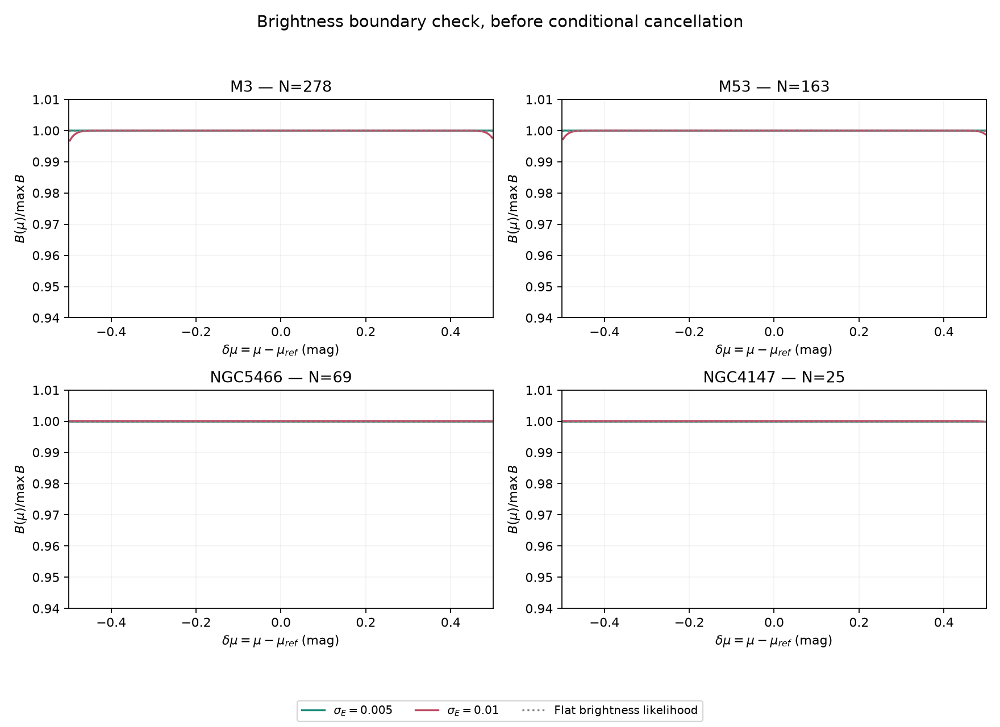
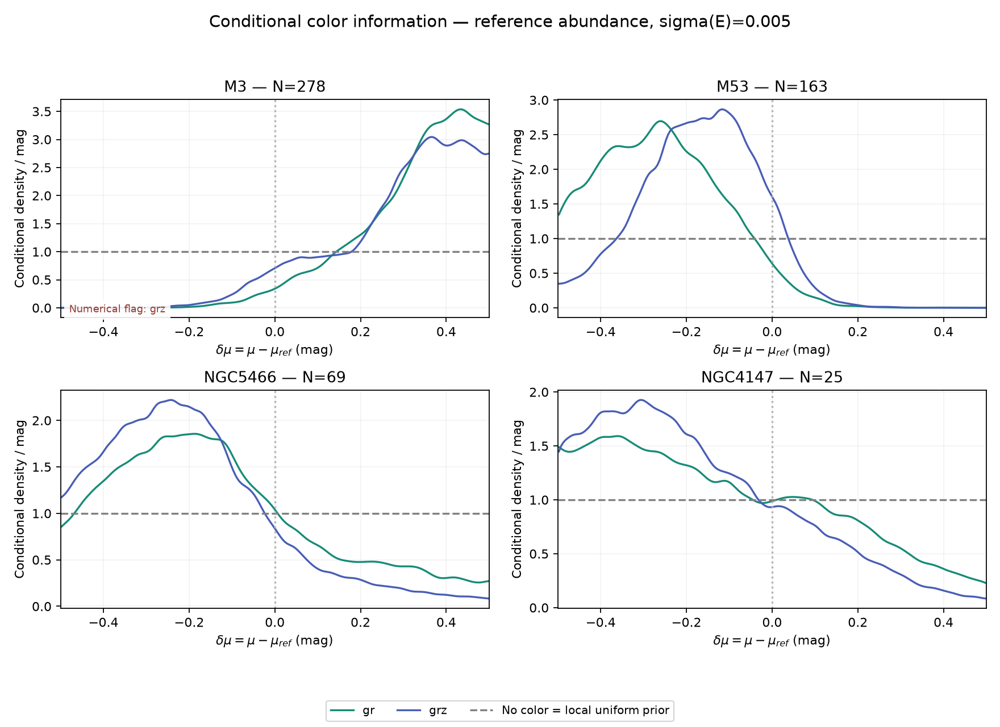
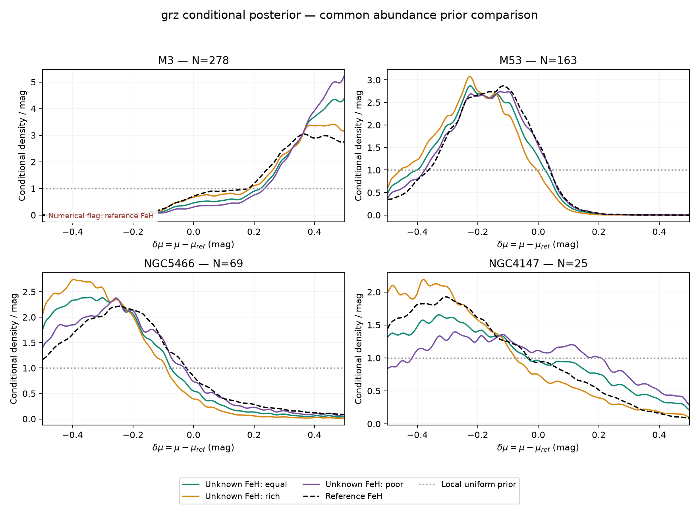
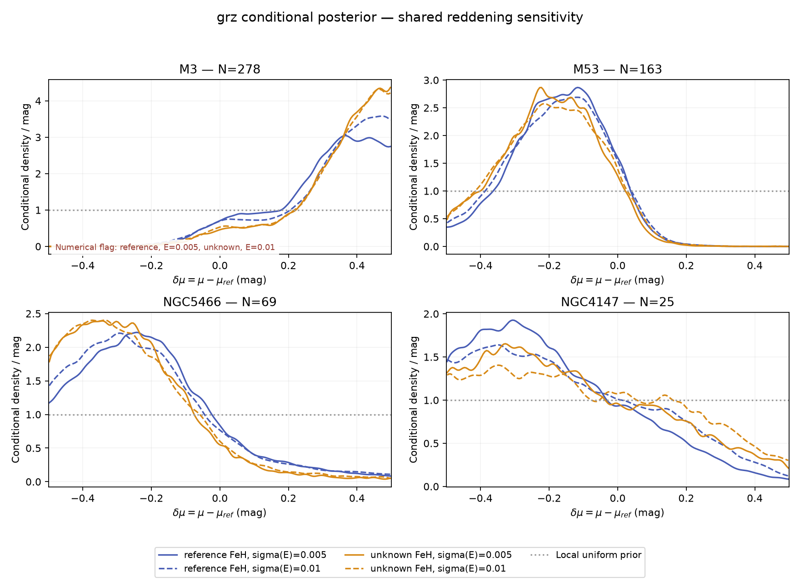

# Local conditional RGB color information

Protocol: [fixed local experiment](cluster_rgb_local_color_protocol_v1.md).
Request: [complete Pro review of 4c203ca](pro_review_4c203ca.md).
The previous external-scale audit is closed. This experiment keeps its frozen
relations, error assumptions, original member identities and phase/quality cuts.

## Question and disclosed conditioning

We ask how colors update a uniform local distance-modulus prior after removing
the direct brightness-distribution likelihood. All four clusters use
`delta_mu = mu - mu_ref` in **[-0.5,+0.5] mag** and nominal
`1.1 <= g0 - mu_ref <= 2.4`, within the original clean grz lower-RGB sample.
The reference determines this local window and the interior sample. No RR distance
likelihood is multiplied into the new inference. M3 and M53 were calibration
systems; NGC 5466 and NGC 4147 have already been revealed in previous experiments.
These are local information measurements on known RGB members, not new blind
recoveries or ordinary field-star distance validation.

| Cluster | Original members | Fixed interior members | Role |
|---|---:|---:|---|
| M3 | 422 | 278 | Calibration system |
| M53 | 250 | 163 | Calibration system |
| NGC 5466 | 93 | 69 | Previously revealed validation system |
| NGC 4147 | 42 | 25 | Previously revealed validation system |

Each gr/grz comparison uses exactly the same interior source identities. The
saved manifest records parent/interior identity hashes, input hashes and code
hashes. Catalogs, model-index chains and posterior arrays remain on NERSC.

## Likelihood and controls

For shared parameters eta, form each member product before marginalizing:

`J(mu) = integral p(eta) product_i L_gc,i(mu,eta) d eta`

`B(mu) = integral p(eta) product_i L_g,i(mu,eta) d eta`

`p(delta_mu | C,G) proportional to local_uniform(mu) J(mu)/B(mu)`.

This is a ratio of shared-parameter marginals. It is not the prior average of
per-member conditional ratios. We reuse the exact piecewise RGB integration,
shared-band covariance and Gaussian collapse from the previous implementation.
The frozen robust mixture remains a residual model, not a measured type fraction.
A single abundance and reddening realization is shared by every cluster member.

Numerator draws target `local_uniform * J`; its unknown constant cancels on final
normalization. Saved conditional Gaussian bin masses provide the marginalized
mu density. Unknown abundance retains the existing two point atoms **-1.46 and
-2.00 dex**: equal weights (0.5,0.5), rich weights (0.8,0.2), and poor weights
(0.2,0.8). Posterior atom occupancy retains relative evidence before reweighting.
These are three specified mixture priors, not a comprehensive unknown-abundance
model. Reference-abundance cases use the existing cluster Gaussian mean/error.

The no-color identity sets J=B and returns the exact local uniform prior:
median 0, W68=0.68 mag, W95=0.95 mag, KL=0. Separately, we evaluate whether
B itself is flat, so algebraic cancellation is not mistaken for an empirical
boundary check. The common physical reddening widths are 0.005 and 0.01; the
per-band common zero-point width stays 0.01 mag.

## Numerical evaluation

Each initial fit uses four chains, 3000 warmup and 24000 retained steps per chain.
Only failed new sampling checks receive one 48000-step refinement. The original
outputs remain intact. The criteria remain Rhat<1.01, bulk/tail ESS>400 and
0.005/0.0025-mag grid quantile agreement within 0.005 mag. Remaining failures
are reported; this experiment has a bounded numerical endpoint.

The wider-reddening denominator exposed inadequate GH64/128 agreement. We
therefore integrate the same one-dimensional brightness marginal adaptively,
factoring out the constant `(1/2.5)^N`. Two tolerances, 1e-9 and 1e-11, are
compared against the unchanged 1e-5 log-likelihood tolerance. The integration
range [-12,+12] in standard-normal common shift discards <3.6e-33 probability.
No numerator resampling is needed for this correction. The final manifest keeps
original quadrature results and initial/refined sampling diagnostics separately.

## Results: brightness and posterior boundaries

| Cluster | max log B range, E sigma=.005 | max log B range, .01 | Minimum margin / total g sigma, .01 | Union crossing bound, .01 |
|---|---:|---:|---:|---:|
| M3 | 6.39e-07 | 0.0039235 | 2.66 | 0.008942 |
| M53 | 5.25e-07 | 0.0033939 | 2.72 | 0.01135 |
| NGC5466 | 1.17e-12 | 5.4069e-05 | 3.87 | 8.297e-05 |
| NGC4147 | 1.73e-10 | 0.00026411 | 3.47 | 0.0002643 |

All brightness log ranges are below the registered 0.05-nat flag. The largest
corresponds to about 0.4% relative variation across the entire window. This is
an empirical support check in addition to the exact no-color cancellation.
The union probability is an upper bound, not an independent-member rejection
rate. Common g errors dominate the small measurement errors and remain shared.

## Reference-abundance, same-star gr/grz comparison

All centers and widths below are in mag; E sigma=0.005. W68 and W95 are
central interval widths. KL is in nats relative to the declared uniform local
prior. An asterisk marks a remaining numerical diagnostic failure.

| Cluster | Bands | delta_mu median | W68 | W95 | KL | Max outer-strip mass | Edge flag |
|---|---|---:|---:|---:|---:|---:|---|
| M3 | gr | +0.352 | 0.271 | 0.497 | 0.774 | 0.168 | True |
| M3 | grz* | +0.328 | 0.330 | 0.559 | 0.632 | 0.141 | False |
| M53 | gr | -0.263 | 0.300 | 0.514 | 0.608 | 0.079 | False |
| M53 | grz | -0.162 | 0.272 | 0.511 | 0.616 | 0.019 | False |
| NGC5466 | gr | -0.169 | 0.473 | 0.883 | 0.167 | 0.048 | False |
| NGC5466 | grz | -0.223 | 0.370 | 0.780 | 0.336 | 0.065 | False |
| NGC4147 | gr | -0.157 | 0.569 | 0.895 | 0.097 | 0.073 | False |
| NGC4147 | grz | -0.216 | 0.473 | 0.813 | 0.221 | 0.078 | False |

The no-color baseline is median 0, W68=0.680, W95=0.950 and KL=0 for every
system. z adds local information in both revealed validation systems under
the reference-abundance assumptions:

- NGC5466: W68 decreases by 0.103 mag; KL increases by 0.169 nat; the center changes by -0.054 mag.
- NGC4147: W68 decreases by 0.097 mag; KL increases by 0.125 nat; the center changes by -0.059 mag.

These are conditional posterior changes, not an accuracy gain measured on
new systems. M3 is especially sensitive to the local upper endpoint; its
narrow intervals cannot be interpreted as unrestricted distance precision.
A case just below the fixed edge threshold still has the reported edge mass;
passing that threshold does not establish insensitivity to all wider windows.

## Unknown abundance and reddening sensitivity

grz, E sigma=0.005; the three columns change only the weights of the same
two shared abundance atoms. This comparison preserves their relative evidence.

| Cluster | Equal median | Rich median | Poor median | Median span | Equal W68 | Equal KL |
|---|---:|---:|---:|---:|---:|---:|
| M3 | +0.375 | +0.348 | +0.391 | 0.044 | 0.261 | 0.826 |
| M53 | -0.191 | -0.213 | -0.170 | 0.043 | 0.284 | 0.598 |
| NGC5466 | -0.278 | -0.305 | -0.244 | 0.061 | 0.326 | 0.495 |
| NGC4147 | -0.162 | -0.253 | -0.082 | 0.171 | 0.554 | 0.103 |

Effect of changing common E sigma from 0.005 to 0.01 in grz:

| Cluster | Reference median change | Reference W68 (.005 → .01) | Equal-prior median change | Equal W68 (.005 → .01) |
|---|---:|---:|---:|---:|
| M3* | +0.024 | 0.330 → 0.329 | -0.002 | 0.261 → 0.273 |
| M53 | -0.004 | 0.272 → 0.291 | +0.004 | 0.284 → 0.302 |
| NGC5466 | -0.018 | 0.370 → 0.379 | -0.001 | 0.326 → 0.343 |
| NGC4147 | +0.043 | 0.473 → 0.544 | +0.048 | 0.554 → 0.595 |

The M3* sensitivity row includes the two numerically flagged combinations;
their diagnostics are listed below.

NGC 4147 is the clearest prior-sensitive case. Changing the atom weights
moves its center by about 0.17 mag, while the broader reddening prior further
weakens the color update. The poor-weight, wider-reddening grz case has KL
0.026 nat and W68=0.604 mag, close to the 0.680-mag prior width.
At E sigma=0.01, NGC 4147 also triggers the registered edge-mode flag for
gr with equal/rich weights and grz with rich weights. Those broad curves retain
the window-sensitivity label even though their outer-strip masses are modest.

## Numerical endpoint and provenance

32 joint fits were evaluated; 12 received the single allowed refinement.
30/32 final fit combinations pass all registered checks.

- M3 / robust_grz__reference__e0.005: log_target, Rhat=1.01086, bulk ESS=445.5, tail ESS=1259.2.
- M3 / robust_grz__unknown__e0.010: log_target, Rhat=1.01638, bulk ESS=323.5, tail ESS=836.9.

Maximum coarse/fine-grid quantile change: 6.33e-05 mag.
Maximum adaptive-tolerance log difference: 4.26e-13;
maximum estimated relative integration error: 1.27e-12.
Remaining flags stay visible in the figures and manifest. No old broad-window
chains were extended, and no further new-chain refinement is taken.

34 focused mathematical/regression tests pass, including ratio order, exact
no-color recovery, shared integral checks, sharp-boundary Gaussian convolution,
atom-evidence weighting and reversible model proposals. Initial jobs:
60598037/60598038/60598039/60598040; refinements: 60598666/60598710/60598805;
final aggregation: 60598989. The aggregate records the selected chain length
per fit and retains initial numerical results plus original GH-conditioned
statistics. [Machine-readable results](../manifests/cluster_rgb_local_color_v1.json).

## Interpretation and endpoint

Posterior widths and KL quantify updates within this declared local model. They
are not empirical accuracy, a fraction of distance information, a physical
uncertainty floor or per-star field-distance precision. Unknown point-mixture
priors can yield narrower intervals or larger KL than a reference Gaussian;
that reflects different prior shapes and weights, not extra abundance data.

A posterior edge flag means >15% probability in either outer 0.05-mag strip or
its density maximum lies in such a strip. It is distinct from brightness-boundary
variation. No flagged curve is extended beyond the fixed window or the calibrated
Mg support. Full-sample historical distances, intervals, sampling flags and
candidate products remain unchanged.

**Decision:** colors retain local information after brightness conditioning.
For the two revealed validation systems, adding z sharpens the reference-FeH
posterior. The unknown-FeH comparisons reveal substantial sensitivity, especially
in NGC 4147; M3 adds a separate window-endpoint limitation. The frozen model
therefore remains a conditional RGB prototype. This closes the bounded
information experiment and the earlier external-scale audit.

The next scientific milestone should specify an intended RGB population and
establish usable abundance and evolutionary-phase evidence for that population.
That evidence can then support an explicit luminosity distribution and joint
observation/selection model. A wider calibrated luminosity range requires actual
calibration evidence. The present results identify these missing inputs; another
polynomial search or another arbitrary audit field does not supply them.

## Interpretation update after Pro a7b5c5d

The eight strictly uniform no-color controls now have `mode=null` and
`edge_flag=false`: an arbitrary first-bin argmax is not a unique mode. This is
a metadata-only correction. All posterior values, numerical flags for the
nonuniform fits, and original run provenance remain unchanged; no chains were
rerun. The correction script and original manifest hash are recorded.

The two atoms at [Fe/H] = -1.46 and -2.00 provide only a bounded prior-pressure
test. NGC 5466's reference -2.16 is outside that interval. Its 0.061-mag center
span does not demonstrate general abundance robustness; NGC 4147's 0.171-mag
span is not an upper bound on field-star abundance uncertainty. Equal-prior
poor-atom occupancies of roughly 65/56/42/64 percent show limited discrimination.
The reported widths describe a shared cluster distance, not individual stellar errors,
and cannot be divided by sqrt(N). A later q(FeH | colors) must not be multiplied
as an independent prior by a likelihood reusing the same colors.
