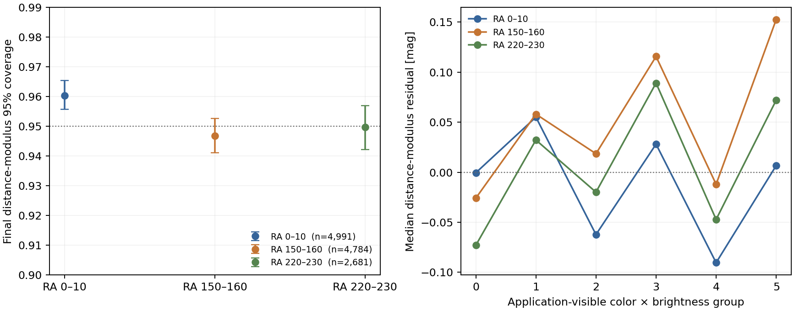
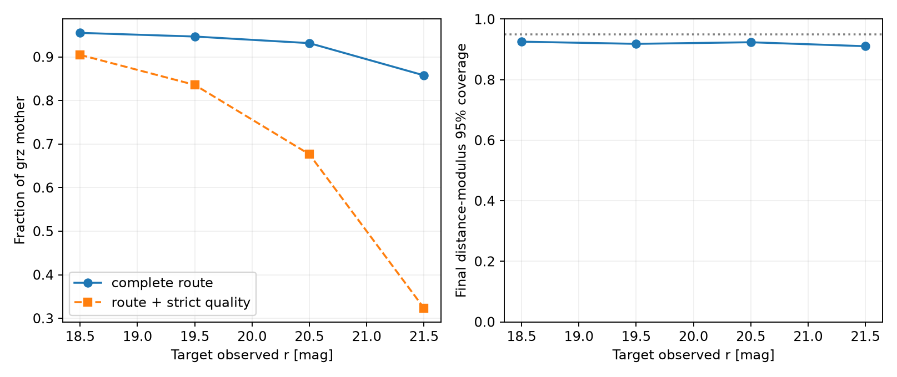

# 扩充冷主序锚点与完整候选路由

2026-10-28。上一版冻结模型、原始测试对象和历史结果分别保留在 `c3637cb` 与 [Pro v2 验证报告](pro_followup_v2.md)。本实验单列为 `cold_v4`；星表、森林和逐星产品只保存在 NERSC。三个新最终场及方法先登记于 [配置](../configs/cold_v4_fields.json)，再读取新场星表。

## 开发样本与冻结方法

训练包括原 100 平方度场的非测试 nside=64 单元，以及三个上一轮已经用过的开发场 RA140–150、RA190–200、RA320–330。原测试单元继续留出；星团和宽双星参考对象继续排除。每个训练对象满足既有严格光学质量、Gaia 高信噪比视差、有效 `BP−RP`、冷主序 CMD 和已知污染排除条件。A/B/C 的输入分别为 `grz`、`grzW1`、`grzW1W2` 的 2/3/4 个去消光颜色。每层重新训练 300 树、叶节点至少 20 个对象的 QRF；另在完全相同的五波段训练身份上各训练一个对照森林。

光学颜色盒由扩充后 A 训练星的第 1–99 百分位定义。A/B/C 各自使用实际输入颜色维度的训练支持：尺度依次为 `(0.2,0.15)`、`(0.2,0.15,0.2)`、`(0.2,0.15,0.2,0.1)` mag，阈值为到第 10 个**其他**训练星距离的训练分布 95 百分位。应用时先过光学盒，再按 C→B→A 选择最高且有自身输入支持的层级。类型状态仍为“冷矮星假设”；没有给候选赋予类型概率。

中心修正沿用上一轮的决定：本实验不使用它。完整路由在 RA205–215/Dec−10–0 场单独校准 68% 与 95% 区间。应用端可见的 `r−z` 按开发训练星三等分，每个颜色段再按该段开发星的观测 `r` 中位数分亮、暗；每组六个独立校准偏移均用有限秩 CQR 计算，偏移不为负。若一个校准组少于 80 颗，则使用全校准场偏移。新最终场为 RA0–10/Dec−35–−25、RA150–160/Dec20–30、RA220–230/Dec20–30；[预备清单](../manifests/cold_v4_prepared.json)与模型哈希在最终评估前冻结。

## 训练与校准结果

| 严格冷星训练来源 | 星数 | Gaia `BP−RP=1.3–1.8` | Gaia `BP−RP=2.8–3.5` |
|---|---:|---:|---:|
| 原场非测试 | 1,289 | 251 | 140 |
| RA140–150 开发场 | 2,077 | 483 | 233 |
| RA190–200 开发场 | 4,145 | 1,137 | 387 |
| RA320–330 开发场 | 271 | 69 | 20 |
| 合计 | **7,782** | **1,940** | **780** |

A/B/C 可训练星数分别为 **7,782 / 7,351 / 7,341**。完全同身份的对照拟合为 7,341 颗，在原留出 223 颗上的 A/B/C `M_g` NMAD 为 **0.270 / 0.262 / 0.216 mag**；此项只用于与既有原测试结果对照。新版训练的光学盒为 `g−r=0.909–1.599`、`r−z=0.401–2.395`。A/B/C 自身输入空间的标准化支持半径为 **0.136 / 0.300 / 0.439**。

独立校准场有 1,317 颗严格冷星，**1,257** 颗通过完整路由，分到 A/B/C 为 **63/19/1,175**。六组人数为 **220/215/240/217/217/148**，全部满足至少 80 颗。校准场原始 95% 覆盖为 **94.6%**，组内 CQR 后为 **95.9%**；这只是校准样本上的核对。分组阈值、偏移及 SHA-256 均见[预备清单](../manifests/cold_v4_prepared.json)。

## 最终场与深度实验

三个新最终场的源表均在方法及预备清单冻结后评估。下表的“冷星召回”以各场严格 Gaia 冷主序锚点为分母；“母样本接受”以各场通过基础 `grz` 条件的 PSF 测光记录为分母，两者不是同一种比率。距离模数与相对距离误差均针对通过完整颜色盒、特征匹配支持和 C→B→A 路由的严格冷星。

各场原始选样与光谱匹配的逐步统计分别在[RA0–10](../manifests/field_cold_v4_ra000_010.json)、[RA150–160](../manifests/field_cold_v4_ra150_160.json)、[RA220–230](../manifests/field_cold_v4_ra220_230.json)清单；相应的[Gaia CMD](../figures/field_cold_v4_ra000_010/02_gaia_cmd.png)、[光谱匹配图](../figures/field_cold_v4_ra150_160/03_spectroscopy.png)等小图与程序一同保存。

| 新最终场（RA/Dec，度） | 严格冷星/路由保留 | 冷星召回 | `grz` 母样本/路由接受 | 距离模数偏差/NMAD (mag) | 95% 直接/校准后覆盖 | 校准后 95% 宽度中位数 (mag) | 相对距离 NMAD |
|---|---:|---:|---:|---:|---:|---:|---:|
| 0–10 / −35–−25 | 5,158 / 4,991 | 96.8% | 1,106,593 / 214,917 (19.4%) | −0.005 / 0.212 | 95.2% / **96.0%** | 1.333 | 9.8% |
| 150–160 / 20–30 | 4,986 / 4,784 | 95.9% | 694,128 / 144,468 (20.8%) | +0.044 / 0.215 | 93.6% / **94.7%** | 1.290 | 10.2% |
| 220–230 / 20–30 | 2,785 / 2,681 | 96.3% | 336,208 / 83,895 (25.0%) | +0.018 / 0.217 | 94.3% / **95.0%** | 1.304 | 10.0% |

各场校准后 95% 覆盖的 nside=64 天空块重采样 95% 区间依次为 **95.6%–96.5%、94.1%–95.3%、94.2%–95.7%**。三个场的 68% 覆盖为 **73.9%、69.5%、70.8%**。超过 50% 的相对距离误差比例分别为 **0.60%、0.75%、0.56%**。完整数字、上下尾漏出率与各分组样本数见[最终场清单](../manifests/cold_v4_final.json)。

光学颜色与 `r` 亮度组成的六个应用可见组仍有中心偏差。0–10 场最明显一组的距离模数偏差为 −0.090 mag，95% 覆盖 93.2%（854 星）；150–160 场的暗红组偏差 +0.153 mag，覆盖 94.0%（664 星）；220–230 场的中间颜色暗组偏差 +0.089 mag，覆盖 94.8%（557 星）。CQR 对称扩张没有修正中心。Gaia `BP−RP=2.8–3.5` 红端在三场的校准后 95% 覆盖为 **97.1%、93.6%、95.8%**，样本数 **410、362、215**；这一颜色只用于诊断，没有进入应用端规则。

图中组号 0/1 为 `r−z<0.990` 的亮/暗端，2/3 为 `0.990–1.597`，4/5 为 `r−z≥1.597`；各颜色段的亮暗分界 `r` 分别为 **16.304、17.192、18.007 mag**。这些界线来自开发训练样本，与新最终场的标签无关。

这些数字验证的是**严格 Gaia 冷矮星条件下**的距离组件。母样本中的路由接受对象尚没有对应的类别真值分布；19%–25% 接受比例不是冷矮星目录的完备率或纯度。现阶段产品应继续标记“冷矮星假设”、光学质量、深度及支持状态，不赋予未经校准的类型概率。深度噪声实验单独检验目标暗端的接受与距离覆盖。

## 同星同噪声的暗端距离实验

以原冻结测试中 **223 颗独立冷星**为模板，每颗每档模拟 8 次，共 1,784 次五波段共同观测。噪声环境从原场通过基础 `grz` 条件的 **312,975** 条 PSF 测光母样本按目标 `r` 档抽取，事先不要求 W1/W2 成功。每次五波段观测只生成一次，再通过同一个颜色盒、特征匹配支持、C→B→A 路由和校准后的森林区间。下表接受率和严格率的分母都是该档的 1,784 次模拟；最终距离指标的分母是路由接受对象。

| 模拟目标 `r` | 路由接受 | 同时严格质量 | A/B/C 选择 | 最终距离模数偏差/NMAD (mag) | 68%/95% 覆盖 | 95% 区间宽度中位数 (mag) | 相对距离 NMAD |
|---|---:|---:|---:|---:|---:|---:|---:|
| 18–19 | 1,704 (95.5%) | 1,614 (90.5%) | 251/213/1,240 | −0.005 / 0.261 | 71.7% / **92.5%** | 1.371 | 12.0% |
| 19–20 | 1,689 (94.7%) | 1,491 (83.6%) | 361/462/866 | −0.014 / 0.289 | 69.5% / **91.8%** | 1.425 | 13.3% |
| 20–21 | 1,662 (93.2%) | 1,207 (67.7%) | 666/640/356 | −0.012 / 0.313 | 66.9% / **92.4%** | 1.494 | 14.3% |
| 21–22 | 1,530 (85.8%) | 577 (32.3%) | 1,007/472/51 | −0.030 / 0.376 | 60.3% / **91.0%** | 1.548 | 17.0% |

按原始 223 颗星聚类重采样的最终距离模数 95% 覆盖区间，四档依次为 **89.6%–95.2%、89.3%–94.6%、89.7%–94.9%、87.8%–93.7%**。最暗档的下/上尾漏出分别为 **3.5%/5.4%**，相对距离误差超过 50% 的比例为 **2.6%**。[完整噪声清单](../manifests/cold_v4_noise.json)另列各档的 `M_g` 覆盖、直接/校准后区间、距离误差及每波段模板已有噪声比例。18–19 档的模板噪声大于抽取目标误差的比例，在 `z/W1/W2` 为 **22.9%/19.4%/13.1%**；到 `r≥20` 基本可忽略。

**使用界线：**三个新最终场对高质量冷矮星的整体区间接近名义覆盖，但这次深度压力测试在所有四档都低于 95%，到 `r=21–22` 明显低于名义值。六个 CQR 组仅以 `r=16.3–18.0` 附近的三条界线分亮暗，没有针对 `r=18–22` 各档的噪声分布分别校准；这些区间不能直接作为深端候选的可靠 95% 区间发布。目标测光母样本来自同一个 100 平方度试验场，模拟沿用模板的掩膜和环境属性，因此接受率是该模拟设计下的值。下一版应使用具有独立距离真值的深端标签或新的独立模板/天区，分质量重新校准并验证完整路由。已有 Gaia/DESI 类别审计见[第二轮报告](pro_followup_v2.md)；当前标签选择不支持可靠的冷矮星、巨星和非恒星类型概率。
