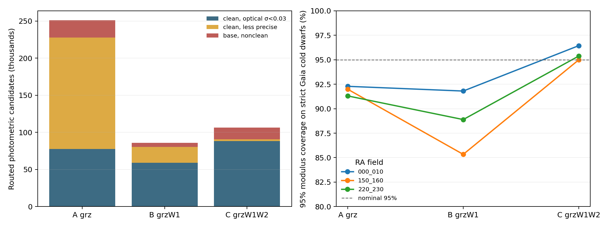

# 冷主序 v4：实际测光候选与 Gaia 验证样本的分层差异

2026-10-28。冻结的 `cold_v4` 森林、支持域、颜色盒、C→B→A 路由及六组区间偏移均未改动。本报告使用独立校准场和三块已登记的 v4 最终场，从[分层清单](../manifests/cold_v4_application_audit.json)汇总完整路由的候选组成与 Gaia 距离误差。原最终场的严格冷主序指标仍以[原清单](../manifests/cold_v4_final.json)为准。

## 对象定义

- **测光候选**：DR11 试验场已存的 PSF 测光行，满足 `grz_base`、冻结颜色盒、实际所选层的 2/3/4 维训练支持，再按 C→B→A 选层。没有逐星距离真值。
- **独立 Gaia 冷星诊断**：有高质量 Gaia 天体测量和有效的 `BP−RP=1.3–3.5`，Gaia 自身绝对 (G>5)，且满足基础 `grz` 测量及既有外部参考隔离/污染排除。这个星族判断不使用可能受损的 Legacy (g)。其中的 `anchor` 交集仍可单独与原严格样本比较。
- **清洁层**：`grz_clean` 在基础测量之上要求现有 `FRACMASKED<0.4`、`FRACIN>0.7`、`FRACFLUX<0.5` 与饱和/ALLMASK/BAILOUT 位检查。`grz_high_quality` 再要求 (g,r,z) 形式星等误差各小于 0.03 mag。A/B/C 的 WISE 可用条件沿用当前程序。

## 新测试场的实际组成

| 样本与所选层 | 光学高质量 | 清洁但未达 0.03 mag | 基础测量但不清洁 | 合计 |
|---|---:|---:|---:|---:|
| 测光候选 A (`grz`) | 77,778 | **149,968** | 23,466 | **251,212 (56.7%)** |
| 测光候选 B (`grzW1`) | 59,192 | 21,014 | 5,511 | **85,717 (19.3%)** |
| 测光候选 C (`grzW1W2`) | 88,086 | 2,349 | 15,916 | **106,351 (24.0%)** |
| 全部测光候选 | 225,056 | 173,331 | **44,893** | **443,280** |
| 独立 Gaia 冷星 A | 796 | 0 | 1,437 | 2,233 |
| 独立 Gaia 冷星 B | 251 | 0 | 145 | 396 |
| 独立 Gaia 冷星 C | 11,409 | 0 | 7,205 | 18,614 |

因此，完整选择与 `grz_clean` 的交集是 **398,387/443,280（89.9%）** 条，要求清洁光学测光会移出 **44,893（10.1%）** 条原候选。严格 Gaia 冷星原定义所选 A/B/C 合计为 **796/251/11,409**，C 占 **91.6%**，而实际测光候选的 C 只占 **24.0%**。独立 Gaia 诊断里没有“清洁但光学误差大于 0.03 mag”的对象；这一层在真实候选中有 **173,331** 条，现有高精度 Gaia 参考没有直接测过其距离性能。

## 冻结区间在各层的表现

下面各格为**所选层的严格 Gaia 锚点**；表中 95% 覆盖已应用冻结的完整路由 CQR 偏移。样本数、距离模数偏差及 NMAD 都以该格对象计算，置信区间按 nside=64 天空块重采样，详见清单。

| 新最终场 | A：人数 / 偏差 / NMAD / 95%覆盖 | B：人数 / 偏差 / NMAD / 95%覆盖 | C：人数 / 偏差 / NMAD / 95%覆盖 |
|---|---|---|---|
| RA0–10 | 350 / +0.010 / 0.282 mag / **92.3%** | 122 / +0.059 / 0.366 mag / **91.8%** | 4,519 / −0.007 / 0.208 mag / **96.4%** |
| RA150–160 | 262 / +0.038 / 0.329 mag / **92.0%** | 75 / +0.250 / 0.419 mag / **85.3%** | 4,447 / +0.042 / 0.210 mag / **95.0%** |
| RA220–230 | 184 / +0.026 / 0.291 mag / **91.3%** | 54 / +0.073 / 0.429 mag / **88.9%** | 2,443 / +0.018 / 0.212 mag / **95.4%** |

独立 Gaia 冷星中的不清洁光学测光，使 A 的 95% 覆盖在三个场降至 **84.1%、82.0%、86.0%**；B 在 RA150–160 场为 **65.4%（52 星）**。这些是按 Gaia 标签条件选出的对象，不能直接充当候选目录的污染率。它们说明旧的基础测量层不适合作为已验证的可靠距离输出层。

校准场严格锚点的 A/B/C 仅 **63/19/1,175**，其中 B 太少，原六组 CQR 主要由 C 星决定。新场 A/B 的表现与这个组成差异一致。对实际候选最有价值的下一步是保留 `grz_base` 审计母样本，至少将 `grz_clean` 作为可用距离层的必要条件，同时独立扩充清洁但低信噪比的 A/B 距离验证与区间校准。图像质量门槛先按现有值比较，避免只为了提高候选数而移动颜色盒或支持半径。

本清单还提供每场所选层×光学质量、所用波段最大形式误差（0.03/0.10/0.20 mag 分段）、到第十近邻距离/层专属支持半径的分布，以及按源标签可见的直接/校准后 68%/95% 覆盖、上下尾、宽度、相对距离误差和天空块偏差区间。暗端重复模拟的层级误差另行汇总；这里的真实测光候选只有数量和误差分布。
