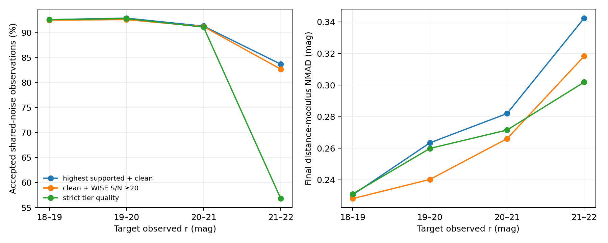

# 冷主序 v4：同观测路由规则开发比较

2026-10-28。使用 RA50–60 开发场中 500 颗高质量、未进入 v4 拟合的 Gaia 冷矮星模板；每颗在四个目标 `r` 层各做两次共享的五波段噪声实现。目标环境从该场所有 `grz_base` 行抽取，没有预筛 WISE 检测。六条路由规则面对**完全相同的 1,000 次观测／亮度层**；森林、颜色盒和 2/3/4 维支持域均冻结。指标见[开发清单](../manifests/cold_v4_policy_development.json)，规则锁定在[配置](../configs/cold_v4_deep_policy.json)。

| 目标 `r` | 路由 | 接受率 | 最终距离模数 NMAD | 原始 95% 区间覆盖 |
|---|---|---:|---:|---:|
| 18–19 | 光学清洁、最高可用层 | 92.6% | 0.231 mag | 94.9% |
| 18–19 | 光学清洁、WISE S/N≥20 | 92.5% | 0.228 mag | 94.9% |
| 19–20 | 光学清洁、最高可用层 | 92.9% | 0.263 mag | 94.4% |
| 19–20 | 光学清洁、WISE S/N≥20 | 92.6% | 0.240 mag | 95.5% |
| 20–21 | 光学清洁、最高可用层 | 91.3% | 0.282 mag | 94.6% |
| 20–21 | 光学清洁、WISE S/N≥20 | 91.2% | 0.266 mag | 95.3% |
| 21–22 | 光学清洁、最高可用层 | 83.7% | 0.342 mag | 93.5% |
| 21–22 | 光学清洁、WISE S/N≥20 | 82.7% | 0.318 mag | 94.0% |
| 21–22 | 所用层严格质量 | 56.8% | 0.302 mag | 93.8% |

选择 `grz_clean` 加 WISE S/N≥20 作为下一轮受控路由。它在后三个目标深度层同时降低 NMAD，暗端仅损失约 1 个百分点接受率；严格质量规则会丢掉约 27 个百分点的暗端对象。对已经可用的 WISE 层提高 S/N 要求时，仍允许回退到支持域内的 A/B 层。开发场在 `r=21–22` 的 A/B/C 选中数由 528/274/35 变为 721/105/1，说明改善伴随明显的层级重排。它还需要在独立校准场重新定区间，并在另一独立场检查；本页的原始 95% 覆盖不能当作新规则的最终深端覆盖。
