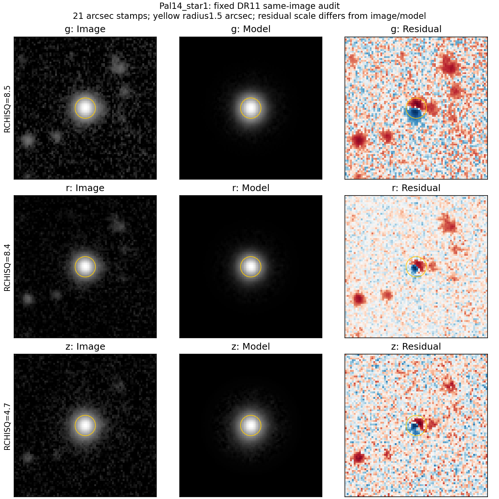
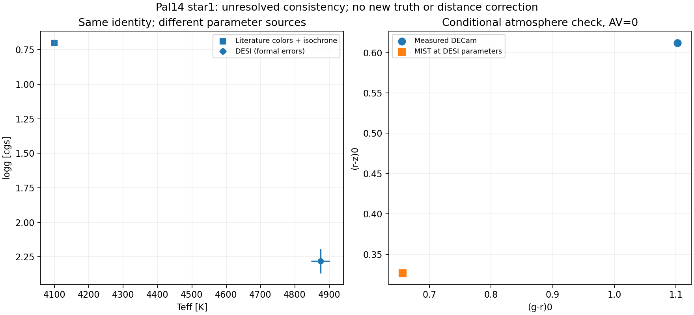
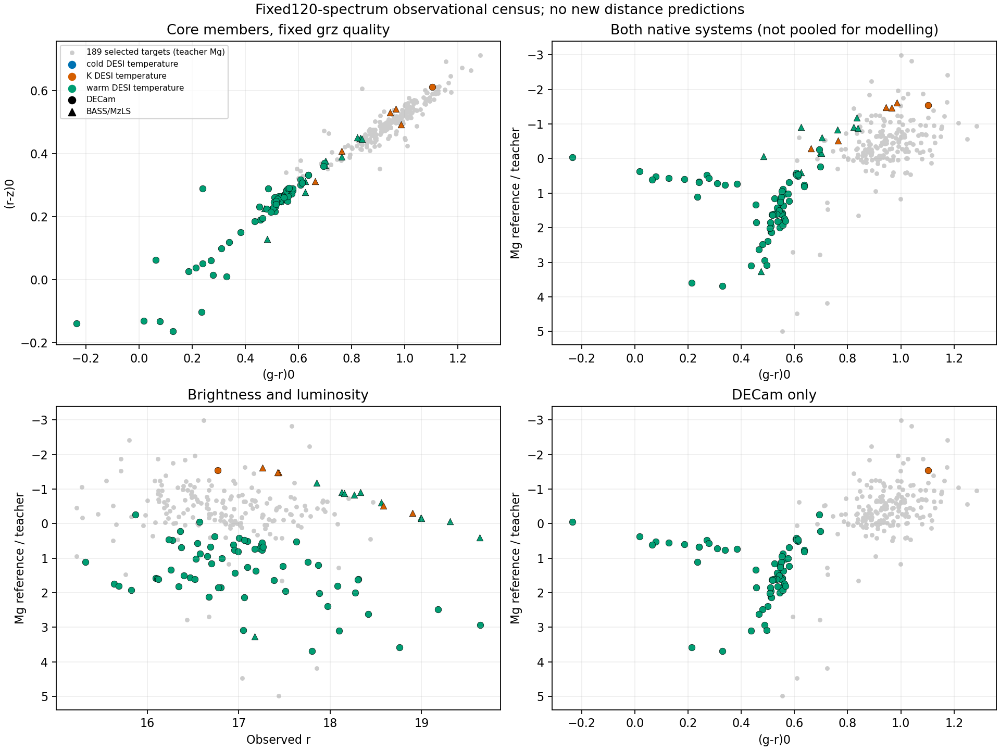
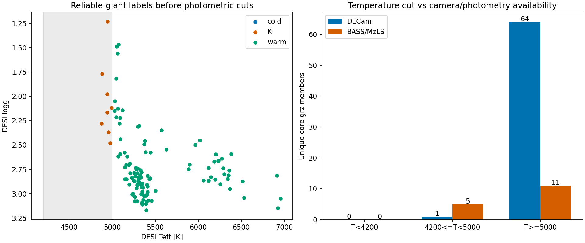

# Pal 14参数来源与固定巨星观测域审计

本轮承接[完整Pro评审](pro_review_68eb2f3.md)，按[预登记协议](giant_parameter_audit_protocol_v1.md)核对固定Pal 14身份，并盘点既有120条可靠巨星光谱在温窗前的观测覆盖。没有改变模型、温窗、教师资格、参照距离或22组预测；窗外对象不进行新评分。

## 1. Pal 14：身份关联与参数可信度是不同问题

固定对象为Gaia DR3 `4464703441466064512`、DESI TARGETID `39628147343232961`。Jordi et al. (2009) Table 1的star 1位置为16:11:05.81、+14:57:45.1，V=17.37、B−V=1.39，日心RV=72.53±0.07km/s，成员标记Y。与冻结成员位置的分离约0.343角秒。[原表](https://arxiv.org/html/0903.4448v1#S3.T1)

Çalışkan et al. (2012) Table 2对同编号star 1采用4100K、logg=0.7。温度依据光学VRI和2MASS JHK的经验颜色标定；重力来自10/11Gyr Yale–Yonsei等时线，采用[Fe/H]=−1.5、[α/Fe]=+0.3。它们不是独立于测光/恒星模型的纯光谱真值；该论文复用Jordi光谱/RV，不能将两篇RV当作两次独立观测。[参数表与方法](https://arxiv.org/html/1110.5151v1#S3)

DESI导出的原始值为T=4874.74±27.12K，logg=2.2799±0.0877，RV=71.069±0.537km/s，RVS_WARN=0、SUCCESS=True、PRIMARY=True、RR_SPECTYPE=STAR，SN_R=33.42；单行核对得到SURVEY=main、PROGRAM=bright、HEALPIX=31723。原始REF_CAT是G2、REF_ID与该Gaia源数值一致，Gaia扩展为同一SOURCE_ID；DECam则为G3关联。保留这些来源标记，没有把历史G2字段悄悄重命名成G3。

文献与DESI参数差为+774.7K、+1.580dex。文献中的±100K、±0.5dex是丰度敏感性扰动，不能和DESI形式误差直接构成一个精确显著性。RV差为−1.461km/s，合并所报形式误差约0.542km/s（约2.70个形式σ）；[DESI官方说明](https://data.desi.lbl.gov/doc/releases/dr1/vac/mws/)列有RV系统误差等已知问题；该对象为bright，不能套用backup专属修正。跨设备、历元和管线系统误差未进入这个数字，不能据此单独判定身份错误、双星或非成员。

Gaia G/BP/RP分别为16.8853/17.6320/16.0606，BP−RP=1.5713，RUWE=1.0046；DECam观测g/r/z为17.9067/16.7678/16.1227。Gaia与DECam保存坐标相同，DESI目标位置相差小于0.001角秒；文献位置分离远小于1角秒。但J2000标记是坐标参照，不自动给出准确曝光历元，因此没有把该位置差当成精密自行检验。

**解释边界：**原对象满足已登记的DESI筛选，其跨来源温度/重力冲突仍需保留。成员证据较强不等于大气参数已被确认；不能在看到偏近残差后用4100K把原对象删除，也不能只因DESI温度位于训练范围就称其为可靠、可比的暖K验证点。

## 2. 同星测光、图像和有限模型检查

Gaia G/BP/RP、DECam AB grz和文献Johnson V/B−V分别保存。不同通带的星等不能直接相减解释成零点误差；本轮不引入未经验证的跨系统颜色变换。Gaia与DECam身份链、实测星等及原始质量量见[同星证据](../manifests/pal14_parameter_evidence_v1.json)。



三个波段均有中心正负相邻残差；图中周围还有较弱结构。1.5角秒孔径净残差/模型通量约为g 0.119%、r 0.138%、z 0.088%，对应绝对残差和为4.19%、1.71%、1.20%，净值不能替代绝对残差。3角秒净比值约0.448%、0.364%、0.522%。这些是同一套coadd内部拟合诊断，既不能证明总通量无偏，也不能据此作修正或排除混光。原始FITS与URLs/哈希保留，未改变任何测光或质量门槛。[图像清单](../manifests/pal14_image_audit_v1.json)

另外，用官方[MIST v1 DECam AB热改正表](https://mist.science/model_grids.html#bolometric)，在DESI温度、重力、校正丰度及AV=0处作8节点多线性内插。得到(g−r)₀=0.6560、(r−z)₀=0.3266，实测为1.1028、0.6122。计算保存节点、系数、源文件哈希，没有外推该热改正网格。

若额外假设质量0.7–0.9太阳质量，固定该组参数处的BC_g，并代入参考M_g=−1.538，重力一致性值按

\[
\log g=4.438+\log(M/M_\odot)+4\log(T/5772)
       +0.4\,(M_g+BC_g-4.74)
\]

得到logg=1.216–1.325。这个推算使用太阳Mbol=4.74，且没有随新重力重新求解BC；它是有明确条件的检查，不是新的观测参数、等时线拟合或距离模型。颜色和光度的不一致提示需要解释参数/身份/测光/星族差异，不能唯一指定原因。



## 3. 温度筛选前的固定集合覆盖

[完整逐星表](../manifests/giant_parameter_inventory_v1.json)包含120条合格光谱、120个唯一Gaia身份、16个系统；没有重复光谱带来的数量膨胀。原K温窗内8颗，窗外112颗均为5000≤T<7000K，没有T<4200K对象。原始光谱行、误差和质量量保存在[温度筛选前证据](../manifests/giant_parameter_typed_v1.json)，[分层统计](../manifests/giant_parameter_summary_v1.json)可复算下表。

119颗获得至少一种DR11测量，Pal 1的唯一候选未匹配；90颗有DECam、31颗有BASS/MzLS，其中2颗M2对象同时有两种系统。两颗的北天测量均未通过grz质量条件；全部记录保留。逐相机计数允许这两颗分别出现，唯一星汇总和图优先使用唯一DECam、其次唯一BASS/MzLS，未重复计数。

这里的质量核心仍是成员概率>0.9及原有grz规则，不加入新的温度、消光、丰度或残差筛选。W1按原有单独资格统计。所有对象的具体演化阶段仍为未知；可靠低重力标签不能直接转换成RGB/RC/HB/AGB分类。

| 原生系统与DESI温度层 | 有测量 | 核心且grz合格 | 系统数 | 其中W1合格 | 颜色＋光度盒交集 | 再要求丰度盒 |
|---|---:|---:|---:|---:|---:|---:|
| DECam，4200–5000K | 3 | 1 | 1 | 0 | 0 | 0 |
| DECam，5000–7000K | 87 | **64** | 10 | 15 | **0** | 0 |
| BASS/MzLS，4200–5000K | 5 | 5 | 1 | 2 | 3 | 0 |
| BASS/MzLS，5000–7000K | 26 | **11** | 2 | 1 | **4** | 0 |
| 唯一恒星合计 | 119 | 81 | 13 | 18 | 7 | 0 |

“盒”仅为预登记的描述性5–95百分位范围，来自冻结190目标中189个有效SPECDIS对象；目标光度由教师距离换算，不能当作真值。边界为(g−r)₀=0.7174–1.1268、(r−z)₀=0.3724–0.6030、M_g=−1.5907至+0.7600，观测r=15.7086–17.9192，校正[Fe/H]=−1.5016至−0.4851。颜色＋光度交集指前面两种颜色和M_g，观测r另行统计。[冻结定义](../manifests/giant_parameter_coverage_definition_v1.json)

64颗DECam窗外核心中，51颗观测r落入目标范围、19颗参考M_g落入目标范围、22颗丰度落入目标范围；但两种颜色各自均为0颗落入目标盒。**存在亮度或丰度的单维资源，不等于补齐当前K人群的联合覆盖。**这些对象在图中整体偏蓝，不能只通过取消温窗就当成K模型的新测试。

北天4颗窗外颜色＋光度交集全部为NGC 2419成员，DESI温度约5026–5065K，校正丰度−2.31至−1.91，均低于当前目标5–95%丰度范围。加上3颗K对象，7颗颜色＋光度交集仍只来自同一个已研究的北方系统；原生通带不同，图上的数值接近不代表已经完成跨系统转换。Pal 14只因(r−z)₀=0.6122略高于描述性95百分位而未进这个盒；**该新描述性标志不是拒绝规则，原预测继续保留**。



灰点为189个目标的教师光度，彩点为成员的固定外部参考光度；圆点DECam、三角BASS/MzLS，不将两种相机混合拟合。右下单列DECam。图用于比较资源位置，不是新测距精度图。



旧范围也分别保留：DECam的65个核心中，26个满足EBV<0.03、62个满足|b|>30°、26个两者均满足；BASS/MzLS的16个核心中，相应均为1个。窗外DECam的64个核心中，有12颗来自历史M3/M53 RGB开发系统、7颗来自已经揭盲的NGC 5466/4147、45颗属于本通道其他系统；北天11颗窗外核心中的10颗来自历史NGC 2419审计，1颗来自M13。这些历史身份在逐星表中明列，其他系统也未被宣称为项目全局未触碰的最终测试集。

## 4. 距离解释修订与路线决定

原Pal 14 grz中位距离55.68/48.22kpc、参照73.579kpc全部保留。参照在两支公开CDF中的位置约为78.7%、83.4%，不在极端尾部。不能因为宽68%区间包含参照就宣布校准成功，也不能只用参照的小误差把中心差夸大为高显著失败。四颗星、两个系统和宽分布不支持估计或采用统一零点修正。

上一轮完成的是**DESI合格K巨星通道**，不是对整张母表的所有类型证据做了穷尽判断。159个距离—成员关联系统只有18个具有DESI成员光谱；141个无DESI系统不在此次工作范围内。此次进一步回答温窗之前的可靠巨星集合能够补充什么资源。

**本轮选择“当前K巨星绝对标定证据仍不足”的路线。**本批窗外资源没有补上当前DECam K目标的联合颜色、光度和丰度缺口，因此结束这条固定批次搜索，保留grz条件原型与W1同星对照，不做新的K模型拟合或零点修正。

新增的64颗DECam窗外合格成员可以登记为既有5000–7000K暖演化支线的后续资源，而不是立即混进K支线。下一独立任务应先为该暖支线明确阶段证据、实际目标观测域和系统级开发/检验身份；若阶段与支持域仍不具备，不启动新的距离训练。冷主序、贫金属主序等既有分支继续保留。本次没有扩展141个无DESI系统，也没有以寻找第三个外部系统为终点。

## 5. 验证与复现

NERSC分配CPU任务60680467完成，耗时17分49秒、退出码0:0。5项实际产物检查全部通过：120条光谱完整去重、原资格及8颗K对象光度不变、逐系统母表计数不变、22组预测逐字节哈希不变、预登记覆盖盒独立重算一致。最终元数据整理还逐字段断言120颗的原始观测量不变；只明确历史名称别名和“光学资格”标志含义。

全部5个Python脚本通过编译，batch脚本通过bash语法检查；Jordi/Çalışkan的数值转录由归档表行断言验证，MIST在包围节点内插，四张结果图人工检查。Çalışkan网页将部分数据单元标作th而非td，解析器已同时识别两者；未改变转录数值。原始文献、MIST和三张FITS在本地与NERSC哈希一致。[执行验证清单](../manifests/giant_parameter_validation_v1.json)


本轮原始目录与完整中间资料保存在NERSC `data/giant_parameter_audit_v1/`；小型逐星证据、原始合格光谱行、统计和图随仓库保存。参考文献HTML及MIST原始文件也保存为版本化哈希，未以持续变化的网页替换预测参照。

```bash
# NERSC仓库：实际读取在分配的CPU节点上运行
sbatch scripts/run_giant_parameter_audit.sh
# 同步小型清单后，本地整理元数据并生成证据与图
python scripts/giant_parameter_finalize.py /tmp/giant_parameter_inventory_raw.json
python scripts/pal14_parameter_evidence.py /tmp/photdis_pal14_sources
python scripts/giant_parameter_report.py
```

表中“覆盖”使用预登记的目标5–95%逐维范围；盒内不等于联合流形受支持，也不自动产生测试资格。相机系统分别统计；阶段未知保留未知。完整表与分层统计交付即结束，不另找系统、不改变温窗、不重启冻结的冷主序和旧RGB拟合。
