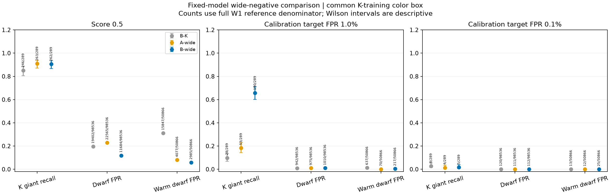
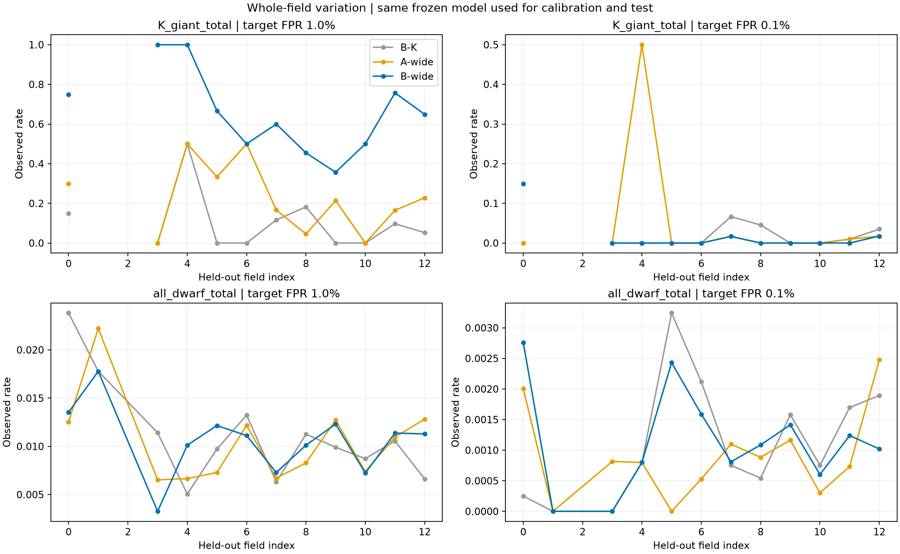
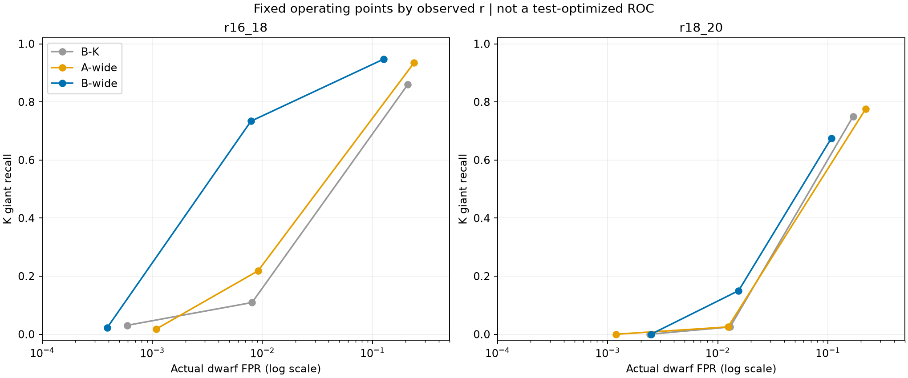
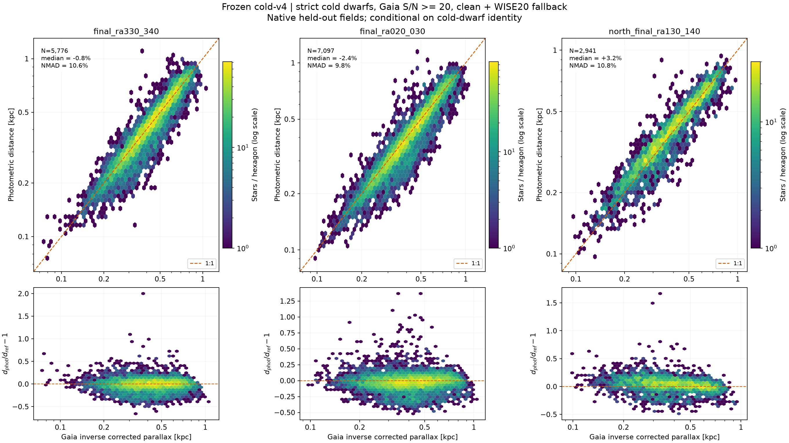
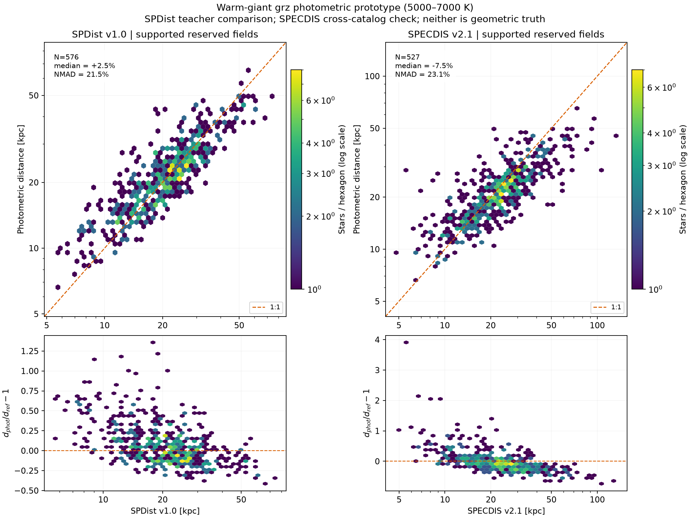
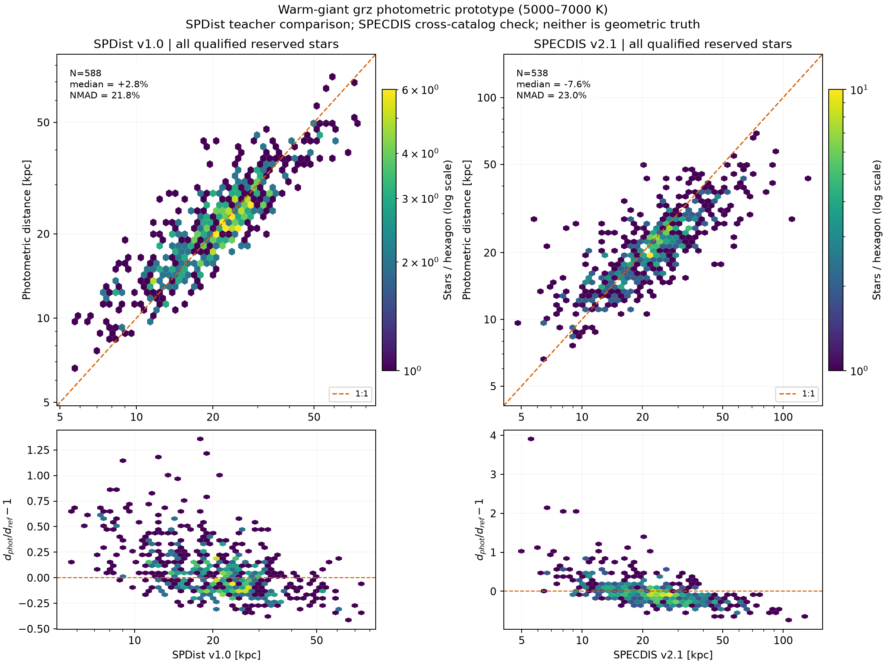

# 扩展矮星负类：固定模型、独立校准与距离对比图

依据[完整 Pro 建议](pro_review_20261102.md)和[预先登记的协议](giant_wide_protocol_v1.md)。
本轮固定三项模型、质量条件和工作点；这是既有场的发展验证，不是新的未触碰天区检验。

## 1. 修改了什么

正类保持 4200–5000 K 的可靠 K 巨星。B-K 负类为 K 矮星；A-wide、B-wide
纳入全部可靠冷／K／5000–7000 K 矮星。中间重力、未知、较热巨星与原始非恒星
风险层只评价，不冒充确定负类。应用输入仍只有测光。

采用已有 clean、低消光、高银纬 DECam 数据，W1 S/N≥5，不要求 W2。
14 个登记场中有 13 个 DECam 场，其中 field 2 没有可用光谱参照；北方相机 field 13
不混入。实际轮换 **12 个非空场**，每次 9 场训练、2 场校准、1 场测试。
每个参照身份恰好测试一次。共 180,306 个 W1 参照，其中 K 巨星 289、可靠矮星 98,536。

二次 logistic、C=1、16 次测光扰动保持不变。每划分总权重固定为旧 K-only
训练数 Nref，两类各占一半。共享对象使用相同带噪实现；B-K/B-wide 的标准化
与主比较颜色盒完全相同，来自训练侧 K-only 对象。A-wide 使用其光学投影。
模型拟合后冻结，用该模型的校准场分数确定阈值，再直接评分测试场，没有重拟合。

此前报告补充了全分母、盒内及盒内较热矮星三种口径，并纠正 field 4 的
“得分”应为“相对基线得分增益”。README 中已经完成的工作不再列作下一步。

## 2. 训练负类覆盖确实是主要缺口之一

下面各模型使用相同测试对象。主比较拒绝共同 K 颜色盒外对象，分母仍为整个 W1
参照；阈值 1%／0.1% 指校准侧目标，不是对新场误入率的保证。

| 工作点 | 模型 | K 巨星选中 / 289 | 召回 | 矮星误入 / 98,536 | 实际误入率 |
|---|---|---:|---:|---:|---:|
| 分数≥0.5 | B-K | 246 | 85.1% | 19,402 | 19.69% |
| 分数≥0.5 | A-wide | 263 | 91.0% | 22,565 | 22.90% |
| 分数≥0.5 | B-wide | 262 | 90.7% | 11,684 | 11.86% |
| 校准 1% | B-K | 28 | 9.7% | 942 | 0.956% |
| 校准 1% | A-wide | 53 | 18.3% | 975 | 0.989% |
| 校准 1% | **B-wide** | **190** | **65.7%** | **1,010** | **1.025%** |
| 校准 0.1% | B-K | 8 | 2.8% | 120 | 0.122% |
| 校准 0.1% | A-wide | 4 | 1.4% | 111 | 0.113% |
| 校准 0.1% | B-wide | 5 | 1.7% | 112 | 0.114% |

B-K 是新角色划分下的对照副本，不是直接拿上一轮不同训练划分的数值作差。
在固定 0.5 分数下，共同盒内较热矮星误入从 **15,847/17,073=92.8%** 降至
**2,985/17,073=17.5%**。同一盒子、标准化与相对正则强度下出现改善，支持
“原训练负类没有覆盖实际人群”的解释；仍有的重叠不能据此归为纯粹物理极限。

在1%工作点，B-wide相对B-K的召回增量为 **+56.1个百分点**，按整场配对重采样的描述性95%范围为 **+43.6至+63.5个百分点**；相对A-wide为+47.4个百分点，范围+36.3至+55.1。各划分训练场有重叠，这些范围不是完全独立重复试验的显著性证明。相对B-K的矮星误入增量为+0.069个百分点，场重采样范围−0.151至+0.234个百分点。

在 1% 工作点，B-wide 全分母误入为 1010/98536=1.025%，盒内条件误入为
1010/41552=2.43%，两者不能混称。B-wide 自有训练盒的完整流程保留187/289，
误入1007/98536，与共同盒主比较接近，主要收益不是扩大颜色范围造成的。

## 3. 收益有亮度边界，也不是目录纯度

| B-wide，校准目标 1% | K 巨星选中 | 召回 | 矮星误入 | 误入率 |
|---|---:|---:|---:|---:|
| r=16–18 | 168/229 | 73.4% | 466/59,194 | 0.787% |
| r=18–20 | 6/40 | 15.0% | 518/33,502 | 1.546% |
| W2 不合格层 | 1/7 | 样本太少 | 46/5,344 | 0.861% |

现有数据不支持 r≥20 的 K 巨星性能声明。0.1% 工作点的真阳性仍然极少，
这条严格阈值路线到此结束，不继续按测试结果微调阈值。

有≥10颗 K 巨星的六个场中，B-wide 的1%工作点召回为：field0 15/20、
field7 36/60、field8 10/22、field9 5/14、field11 78/103、field12 37/57。
收益并非只在一个场出现；同时场间召回差异明显。全部场实测矮星误入率约
0.33%–1.78%。每个模型的校准阈值不同，不能取平均阈值后直接应用全目录。
最小校准矮星数为1,451，0.1%仅容许1个误入，尾部校准本身较脆弱。

1%工作点的全部参照入选2,375个，其中：K巨星190、矮星1010、较冷巨星3、
较暖巨星367、过渡122、原始非恒星风险95、未知588。
这里的未知没有被当成可靠巨星；190/2375也不是普通光度目录的纯度估计，
因为光谱参照样本有自己的选样。只假定K巨星/矮星两类、巨星基率1%时，
TPR/FPR约64，对应假想纯度约39%；这只是规划换算。

**决定：冻结 B-wide 为 DECam 亮端的候选富集／排序方案及验证结果，不发布
高纯度完整 K 巨星目录。** 不再扩大这一固定分类器族或继续微调阈值。
这并不否定其他有明确适用域的无u选择方法，也不改变项目面向银河盘和晕多类恒星的目标。

## 4. 把距离主线落到实际保留的人群

在B-wide的1%工作点，190颗K巨星的温度中位数为4904K，logg中位数2.39；
170颗具有当前定义下的有效丰度，其中161颗[Fe/H]≥−1.5，9颗低于−1.5。
丰度16/50/84分位为−1.22/−0.85/−0.59，20颗不能被当成有可靠丰度标签。
其主要人群比M3/M53的贫金属参照更富金属；DESI与星团丰度标度本身也不能默认为完全一致。

逐一以Gaia source_id和DESI target identity匹配已有、审计过的VAC联合表，
190颗均找到唯一配对；其中39颗SPDist、189颗SPECDIS满足各自原有有效性条件。
这些是可以继续利用的带误差教师，不是新增独立距离真值。两个目录的有效样本
不同，不能直接把其总体中位距离之差解释成零点差。

进一步以各目录距离构造 `Mg = g0−10−5log10(d/kpc)`，光度范围也与旧标尺明显不同：

| 距离教师 | 有效数量 | 教师Mg中位数 | Mg<0.5 | 0.5≤Mg≤3 | Mg>3 |
|---|---:|---:|---:|---:|---:|
| SPDist | 39 | +0.046 | 34 | 5 | 0 |
| SPECDIS | 189 | −0.425 | 179 | 7 | 3 |

因此，按现有教师尺度，大多数实际保留目标比旧下RGB标尺更亮；这不能用来直接
认定其演化阶段，却明确了独立标定需要覆盖的光度范围。这里没有根据教师距离
删除对象，也没有把两套教师的不同样本中位数当成零点差。

本轮数据没有独立RGB/RC/HB阶段标签。低重力本身不能提供这个标签，不能在
190颗对象上自动套用原先0.5≤Mg≤3的贫金属下RGB关系。下一项限定任务应使用
这批实际候选的同星教师交集和阶段证据，区分光度范围与标度差异，再决定可标定
的分支。无需先把普通光度目录做到高纯度，也不需要再重复丰度机制实验或随意加场。

## 5. 请求的 phot-d、Gaia-d、spec-d 散点密度图

全部距离单位为 kpc；上排为 log-log 六边形计数密度与1:1线，下排为
`d_phot/d_ref−1`。图示是原冻结距离模型的真实预留／独立场对象，
**没有把新分类分数转换成距离，也没有重新调整距离模型**。

### 冷主序：phot-d 对 Gaia-d

Gaia 距离采用校正视差为正、S/N≥20 的严格锚点反演；沿用 cold-v4 的
clean+WISE20 回退与支持条件。三个场均为历史登记的模型外场。
“north”是这个试验的天空场名称，不等于 BASS/MzLS 相机。

| 场 | 同星数量 | 相对残差中位数 | 相对残差 NMAD |
|---|---:|---:|---:|
| RA330–340 | 5,776 | −0.82% | 10.56% |
| RA20–30 | 7,097 | −2.37% | 9.80% |
| RA130–140 | 2,941 | +3.22% | 10.75% |

这是“严格冷矮星且处于模型适用域”的结果；不能推广为所有暗端候选的精度。
同星使用的g既进入颜色，也进入距离模数；图中不再另加一次独立g误差。
Gaia点参照有测量误差，这些散布不是去卷积后的本征精度。

### 暖巨星：phot-d 对 SPDist / SPECDIS

复现原 grz 核混合模型的整场预留预测，训练/评价身份不重叠，参数仍为
带宽0.06、星等平滑下限0.15。温度范围5000–7000K；这与本轮4200–5000K
选择目标不同，不能把图中的表现直接移植给新K巨星候选。

| 光谱距离参照 | 支持域内同星数量 | 相对残差中位数 | 相对残差 NMAD |
|---|---:|---:|---:|
| SPDist v1.0 | 576 | +2.47% | 21.50% |
| SPECDIS v2.1 | 527 | −7.52% | 23.10% |

SPDist 是这个模型的训练教师，图为跨场复现教师的一致性；SPECDIS是另一目录的
交叉检查，两者并非独立无偏几何真值。教师标签、观测量或建模假设可能相关。
SPECDIS有效质量匹配数较少，因此两个面板的对象数不同，不能直接比较NMAD来
判定哪个目录更准确。当前结果不构成经过验证的场巨星距离产品。

全部合格预留样本（含支持域外）的SPDist/SPECDIS数量分别为588/538，
NMAD为21.80%/23.01%。另图保留这部分，以显示支持筛选影响而非隐藏异常点。

## 6. 可复现入口

- NERSC：`sbatch scripts/run_giant_wide.sh fit`，已完成的输出禁止覆盖。
- 汇总：`sbatch --mem=8G scripts/run_giant_wide.sh summarize`。
- 距离图：`sbatch scripts/run_giant_wide.sh distances`；既有逐星预测重画用 `render`。
- 实结果校验：`sbatch --mem=8G scripts/run_giant_wide.sh validate`。
- 逐星分数、教师匹配、冻结模型和原始全分层结果保留在 NERSC
  `data/giant_wide_v1/`、`data/distance_comparison_v1/`。
- 仓库仅保存[主分层逐场清单](../manifests/giant_wide_v1.json)、汇总、图及来源哈希。
  原5.3MB详细清单完整留在远端；投影清单明确记录其路径和SHA256。

## 7. 建议与交付对应

| 最新建议 | 本轮落实 |
|---|---|
| 扩展负类，控制正则强度和标准化 | 三模型配对、Nref等权、共享K侧预处理 |
| 阈值与实际使用模型一致 | 整场训练/校准/测试；序列化模型哈希前后核验 |
| 明确各类分母和暖矮星泄漏 | 全参照、盒内、温度、亮度、W2及风险层计数 |
| 比较多场收益，设定终点 | 固定三个工作点，场重采样与富集方案决定 |
| 转回匹配实际人群的距离问题 | 190颗K巨星的丰度、教师与阶段缺口清点 |
| phot-d与Gaia-d/spec-d密度图 | 三组、七个距离比较面板及对应残差图 |
| 已完成问题不再返工 | 冷主序/RGB/丰度机制与旧测试身份保持冻结 |

验证：13项相关单元测试通过；最终分配作业60669734完成，11项真实数据检查通过，180306个测试身份无重复；历史暖巨星588颗预留对象的原始指标精确复现。六张最终图均作视觉检查。详细作业和哈希见[执行清单](../manifests/giant_wide_execution_v1.json)、[真实数据验证](../manifests/giant_wide_validation_v1.json)及[汇总清单](../manifests/giant_wide_summary_v1.json)。
