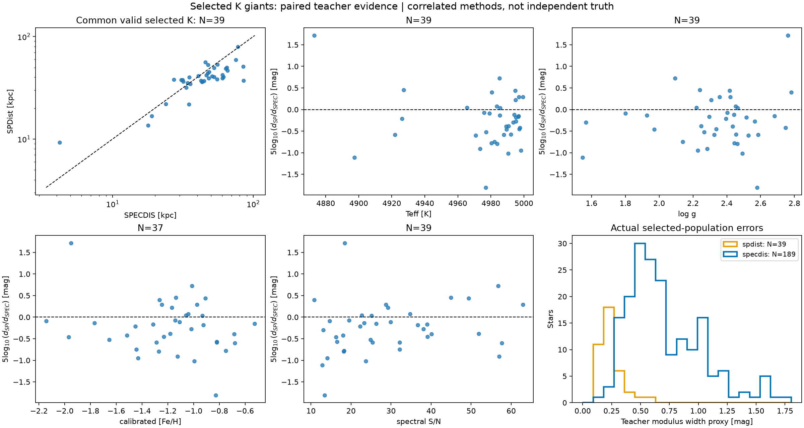
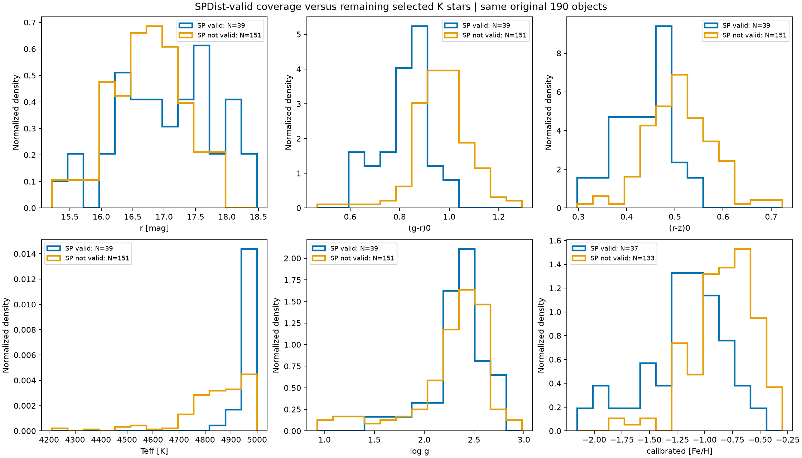
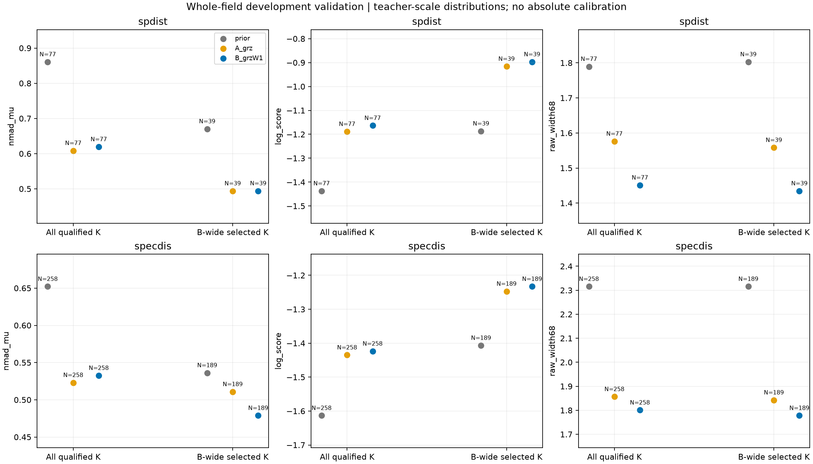
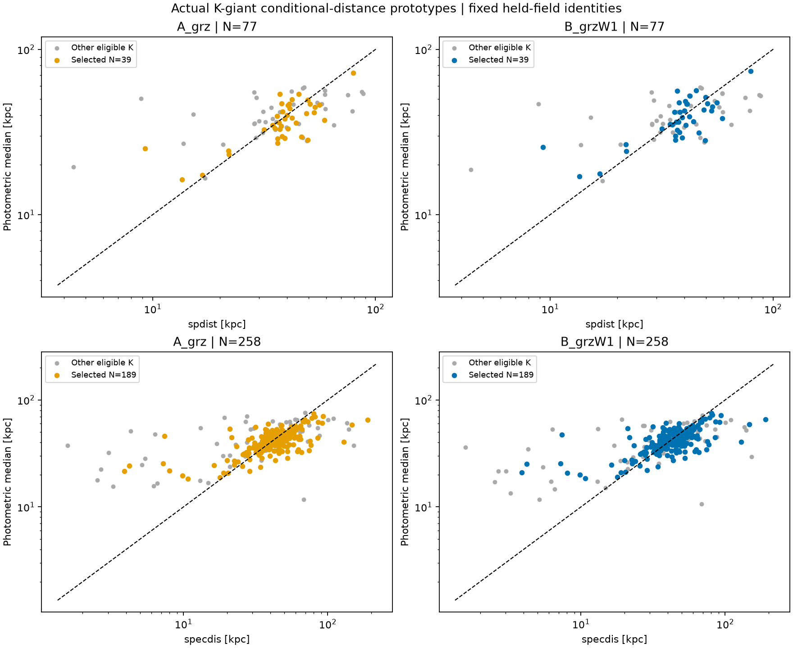
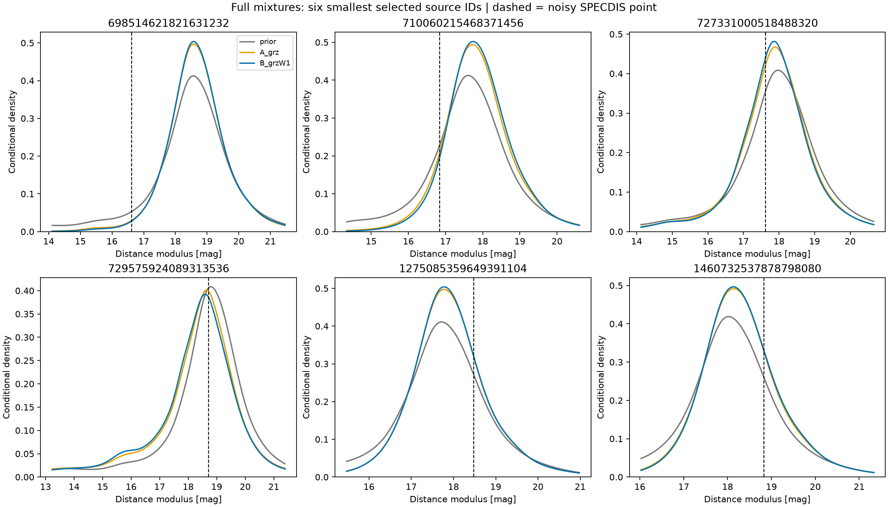
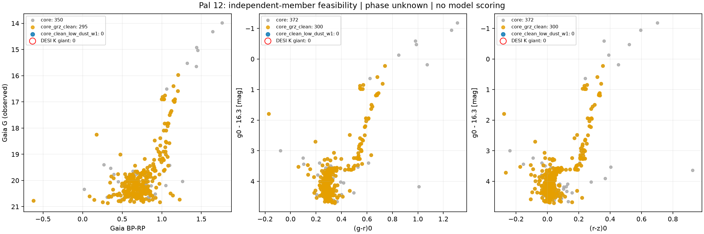

# 实际 K 巨星：同星教师审计、条件距离与独立标尺可行性

2026-11-02；衔接 [Pro 对 1689ec2 的完整评审](pro_review_1689ec2.md)。
本轮在运行前登记[实验协议](kgiant_distance_protocol_v1.md)，没有改变分类器、
原有 cold-v4、暖巨星或下 RGB 模型。总体多星族距离目标保持不变。

**结论：当前 K 人群的颜色确实提供教师尺度上的跨场光度信息；W1 的增量有限，
且没有带来稳定的散布改善。教师标签误差、覆盖偏差及独立标尺缺口仍限制绝对准确度。
本轮完成一个有明确终点的发展实验，保留条件分布原型，不发布通用 K 巨星距离目录。**

## 1. 最新建议逐项完成情况

| Pro 要求 | 本轮交付 |
|---|---|
| 修正历史图的适用范围 | [上一轮正文](giant_wide_result_v1.md)补入冷主序 Gaia 参考距离约 0.075–1.09 kpc，以及暖样本相对差异超过 50% 的 7.29%／9.11% 尾部 |
| 更新项目检查点 | AGENTS、PLAN、WORKLOG 与详细 Goal；完整评审留档 |
| 同星教师、误差、质量与覆盖 | 190 行证据表、精确交集、固定参数分层、两张审计图 |
| 全部合格 K 标签训练 | 光学 308、W1 289；SPDist／SPECDIS 分别整场留出，不把 190 当训练上限 |
| 有限同星 grz／grzW1／无颜色比较 | 同一核混合模型族、同训练和测试身份、固定平滑参数；完整距离分布保存 |
| 共享测光误差 | g 同时进入颜色、绝对星等和最终距离；按联合高斯条件化传播 |
| 独立参照 | 全量身份核查、已有星团支持范围核对、单个 Pal 12 定向可行性检查；阶段未知保留 |
| 可复核产物 | 图、JSON、190 行 JSON、源码、作业与校验记录；大型逐星混合分布留在 NERSC |

## 2. 190 颗实际选中 K 巨星的教师证据

[逐星证据 JSON](../manifests/kgiant_selected190_evidence_v1.json)按 Gaia source_id 和
DESI TARGETID **双身份**关联；本轮无模糊 VAC 配对。
[完整清单](../manifests/kgiant_distance_inventory_v1.json)同时记录光学母样本、W1 层及选中层。

| 样本 | 全部对象 | SPDist 有效 | SPECDIS 有效 | 两者共同有效 |
|---|---:|---:|---:|---:|
| 光学合格 K | 308 | 84 | 274 | 69 |
| W1 合格 K | 289 | 77 | 258 | 65 |
| 冻结 B-wide 1% 工作点选中 K | 190 | 39 | 189 | **39** |

共同 39 颗的 `5 log10(d_SP/d_SPEC)` 中位数 **−0.274 mag**，NMAD **0.461 mag**，
16–84% 范围 **−0.773 至 +0.285 mag**。这是同星目录差异，不是两个不同样本中位数之差；
也不能据此判定哪套目录是真值、统一修正距离或逆方差合并标签。

实际 189 颗 SPECDIS 的 `σd/d` 中位数 **29.2%**，16–84% 为 **19.3%–50.4%**；
**153/189** 超过 20%，**31/189** 超过 50%。因此“有效”并不等于高精度。
主实验的对数正态宽度近似对应 σμ 中位数 **0.620 mag**。

39 颗 SPDist 的 σμ 中位数 **0.194 mag**，16–84% 为 **0.174–0.301 mag**。
这里按官方说明将 MG 分位数半宽、Gaia G 误差与 **0.167 mag 方法项**合成，
方法项只计一次。两套目录共享 Gaia／光谱信息，跨目录与跨星的系统相关性未知。
[SPDist 官方定义](https://data.desi.lbl.gov/doc/releases/dr1/vac/mws-spdist/)；
[SPECDIS 官方定义](https://data.desi.lbl.gov/doc/releases/dr1/vac/mws-specdis/)。

失效原因有重叠：选中层有 140 个 SP 参数质量不合格、144 个落在输入适用域外、
3 个没有唯一 SP 配对；不能将这些数字相加。SPECDIS 的 1 个无效值来自距离／误差要求。
逐星原始标志、SP QFLAG_COMMENTS 与重复身份标志均保留。



### SPDist 有效子集没有覆盖完整 K 人群

39 颗全部处于 **4800–5000 K**，温度中位数 4986 K；其余 151 颗为 4872 K。
两组 `(g-r)0` 中位数为 **0.842／0.969**，`r` 为 **17.140／16.807**；
有效丰度对象的中位数为 **−1.138／−0.787**（37／133 个）。因此 SP 子集偏暖、偏蓝、
更贫金属，不能用其结果代表其余对象。

固定丰度层中的同星 Δμ 中位数为 −0.277（FeH<−1.5，N=6）、−0.166
（−1.5 至 −1，N=19）、−0.483（−1 至 −0.5，N=12）；低于／高于 S/N=20
分别为 −0.463（N=13）／−0.180（20–60，N=25）。这些是小样本的描述性差异，
分层变量相关，尚不能拟合成校准公式。全部层数和空层都在清单中。



## 3. 距离实验如何保证同星比较

- 使用全部 W1 合格 K 教师标签：SPDist 77、SPECDIS 258。每次留出整个场，
  从其他场训练，剔除相同身份组和已知系统成员。两教师分别建模，未合并。
- 无颜色基线、A=grz、B=grzW1 在每个教师／折内共用训练与测试对象、权重和标签。
  另 19 颗只满足光学条件的对象留在资源清单，未混入 W1 增益比较。
- 每颗训练星一个高斯分量；固定每个颜色带宽 0.12 mag，Mg 平滑 0.15 mag。
  这些是预登记的平滑量，不是测得的本征散布或推荐的全局最优参数。
- 训练标签为 `Mg=g0−μ_teacher`，共享 g 协方差显式进入；查询端先条件化
  `(颜色观测, Mg+εg)`，再得到 `μ=g观测−(Mg+εg)`，不把两次 g 当成独立观测。
- 这是**含测量误差展宽的经验教师混合分布**，没有去卷积训练测量误差，
  没有把未知 RGB／RC／HB 阶段硬分为单一序列。
- 评价场曾参与项目发展，称为发展验证；没有宣称新的未触碰最终测试。
  SPDist 共 8 个有样本场，SPECDIS 共 11 个，所有符合本轮最低训练量的折均评分。

完整模型分量保存在 NERSC `data/kgiant_distance_v1/mixtures/`，
`predictions.json` 包含身份、分位数、有效分量数、支持标志与来源哈希。

## 4. 实际选中层的同星结果

`Δμ=预测中位数−教师距离模数`。NMAD、宽度单位为 mag；W68 是中央 68% **全宽**。
log score 对观测教师误差再卷积后计算，越大越好。
raw 覆盖只针对带噪教师点参照，不能解释为真实距离覆盖。

| 教师 | 输入 | N | Δμ 中位数 | NMAD | abs(Δμ)>0.5 | 平均 log score | W68 | raw 68% / 95% 覆盖 |
|---|---|---:|---:|---:|---:|---:|---:|---:|
| SPDist | 无颜色 | 39 | -0.206 | 0.670 | 51.3% | -1.187 | 1.803 | 76.9% / 100.0% |
| SPDist | grz | 39 | -0.058 | 0.494 | 23.1% | -0.916 | 1.558 | 87.2% / 100.0% |
| SPDist | grzW1 | 39 | -0.020 | 0.494 | 20.5% | -0.897 | 1.435 | 87.2% / 97.4% |
| SPECDIS | 无颜色 | 189 | -0.213 | 0.536 | 37.0% | -1.407 | 2.316 | 88.4% / 98.9% |
| SPECDIS | grz | 189 | -0.078 | 0.511 | 30.7% | -1.247 | 1.843 | 86.2% / 98.9% |
| SPECDIS | grzW1 | 189 | -0.043 | 0.479 | 32.3% | -1.233 | 1.778 | 85.7% / 98.4% |

颜色相对无颜色基线的预测分数增益明确存在：选中层 B−prior 为 SPDist **+0.290／星**、
SPECDIS **+0.174／星**。这里不是把有颜色与无颜色的不同测试样本比较。

**W1 增量较小：**SPECDIS 选中层 B−A 的平均分数增益 **+0.0143／星**，
场重采样 95% 区间 **[+0.0101,+0.0166]**；NMAD 差为 **−0.032 mag**，
对应区间 **[−0.048,+0.057]**，不支持稳定散布改善。SPDist 的分数增益
**+0.0189／星**，区间 **[−0.0472,+0.0461]**，也不能视为确定的 W1 增益。
场重采样只描述当前场布局，训练折有重叠，不能当成独立外部系统检验。

选中层 B 的相对残差 NMAD 分别为 **21.9%／21.9%**，但这是对教师的一致性；
相对差异超过 50% 的比例仍为 **5.1%／10.6%**。
特别是 SPECDIS raw 68% 区间覆盖 **85.7%**、全宽 **1.778 mag**，明显偏宽。
训练标签已经含噪，再作误差展宽可扩大区间；本轮不能从这些宽度推断本征 RGB 散布，
也不能凭较高覆盖宣布概率校准成功。



### 全部合格留出 K 的结果

| 教师 | 输入 | N | Δμ 中位数 | NMAD | 平均 log score | W68 |
|---|---|---:|---:|---:|---:|---:|
| SPDist | 无颜色 | 77 | +0.043 | 0.861 | -1.437 | 1.789 |
| SPDist | grz | 77 | -0.006 | 0.608 | -1.189 | 1.576 |
| SPDist | grzW1 | 77 | -0.019 | 0.619 | -1.164 | 1.451 |
| SPECDIS | 无颜色 | 258 | -0.027 | 0.652 | -1.613 | 2.316 |
| SPECDIS | grz | 258 | +0.027 | 0.523 | -1.435 | 1.857 |
| SPECDIS | grzW1 | 258 | -0.013 | 0.533 | -1.424 | 1.801 |

两教师的全部样本中，B 的 NMAD 都略高于 A，进一步说明不能只引用选中 SPECDIS
子集的 NMAD 下降来宣布全面改善。
[清单](../manifests/kgiant_distance_comparison_v1.json)还保留各场、星等、温度、丰度及误差层。
例如 SPECDIS B 在 r16–18 为 N=209、NMAD=0.501；r18–20 为 N=30、NMAD=0.883。
4200–4800 K 为 N=65、NMAD=0.958，4800–5000 K 为 N=193、NMAD=0.517。
这些层仍使用各自全部留出 K，不能误读为都来自选中 190 颗。
SPDist 低于 4800 K 只有 1 颗，无法验证该温度范围的距离关系。

SPECDIS 误差敏感性：将对数正态宽度换成线性传播宽度后，选中 B 的
Δμ 中位数 **−0.045**、NMAD **0.479**、W68 **1.814**，B−A 分数增益 **+0.0146**。
主结论未改变；两种宽度都只是由 d、σd 构造的近似，不是目录的完整后验。



每行左右使用同一批测试星；上下的 SPDist／SPECDIS 样本不同，不能用这两个面板
直接判定教师优劣。图中颜色标出冻结 B-wide 选中对象，灰点为其他合格 K。
本轮数量有限，保留逐点散点，不用密度平滑掩盖稀疏尾部；此前冷／暖人群的大样本
[密度图与 CMD](giant_wide_result_v1.md)保持原样。



示例固定取选中 SPECDIS 对象中 Gaia ID 最小的六个，不按效果挑选。
保留全部混合分量和可能的宽峰／多峰；虚线是带噪教师点，不是真实距离。

## 5. 独立参照与本轮结束决定

当前 W1 K 层及选中层都没有匹配到已准备的独立系统成员，也没有满足当前高质量
天体测量、零点有效、校正视差 S/N≥20 的 Gaia 几何锚点。
光学层只有一个 HSC_2310 候选成员，但缺少 W1 资格，不能支撑本轮配对验证。
这只是对现有参考目录及质量条件的结论，不是宇宙中不存在可用标尺。

已有星团资源的原生测光和覆盖已复核：

| 资源 | 相机／丰度 | 当前限制 |
|---|---|---|
| M3、M53 | DECam；FeH约−1.46、−2.00 | 原下 RGB 范围0.5–3mag；M3恢复的gr上支主要仍为Mg约0.42–0.86，不能替代明亮端 |
| NGC7006 | DECam；FeH约−1.40 | 上 RGB 候选gr56、grz19；宽CMD阶段候选，不等于本轮K光谱／阶段确认样本 |
| NGC5466、NGC4147 | DECam；更贫金属 | 已有条件下RGB与揭盲诊断，不覆盖实际主体的丰度、亮度和阶段混合 |
| NGC2419 | BASS/MzLS；贫金属 | 相机／红化不同；不能混入DECam模型当直接绝对校准 |

依据：[自然系统审计](cluster_rgb_native_system_v2.md)、
[下RGB模型报告](cluster_rgb_lower_result_v2.md)、
[历史暖巨星诊断](giant_photo_baseline_v1.md)。

### Pal 12：丰度更合适，但目前不是合格的 K 巨星独立标尺

按[单团预登记方案](kgiant_pal12_feasibility_v1.md)，使用已有成员表与实际 DR11
DECam 测量完成可行性检查，没有按距离残差选星或拟合新曲线。
394 个 P≥0.5 成员全部精确匹配；其中 P>0.9 核心为 372 个，全部 RELEASE=11010。

| 核心质量层 | 数量 | Mg<0.5 | r16–18 |
|---|---:|---:|---:|
| 全部 P>0.9 成员 | 372 | 7 | 24 |
| gr 合格、PSF | 309 | 5 | 22 |
| grz 合格、PSF | 300 | 1 | 22 |
| grz 合格且 EBV<0.03 | **0** | 0 | 0 |

目录 EBV 在核心中为 **0.0355–0.0380**，全部在当前低消光适用域外；
z 饱和有 6 个，明亮端确实进一步损失。全部 394 个成员中，现有 DESI DR1 MWS
没有提供符合本轮质量及 4200–5000 K 定义的光谱巨星标签。
不能把其余普通成员按颜色直接认定为 K 巨星，更不能全部输入 K 距离模型。
没有合格光谱标签不表示该团没有 K 巨星，只表示当前这条证据链不完整。

图中 μ=16.3 仅来自模型 CMD 拟合，用来展示光度覆盖，未作模型训练或评分；
不是几何距离。低消光条件保持原样，RGB／RC／HB 阶段保留未知。
这个结果落实了独立资源检查，同时给出了明确的负可行性结论；本轮不继续追加星团。
[实际逐层清单](../manifests/kgiant_pal12_feasibility_v1.json)。



Gaia 面板仅画有限 BP−RP 和 G 的 350 个核心成员；其中 grz 合格为 295 个。
Legacy 面板的相应人数为 372／300，差异来自 Gaia 颜色缺测，不是重新选成员。

**采用决定：**保留本轮两教师尺度的条件距离分布作为研究原型；不把它部署成普通场星
距离目录，也不把旧贫金属下 RGB 曲线外推到这些更亮、更富金属的对象。
本轮问题已经回答，停止 classifier、核带宽或场数的无目的迭代。
下一项有用工作应以独立距离／阶段证据为入口，优先覆盖 DECam、FeH约−1至−0.5、
Mg<0.5、4200–5000 K；先确认测光质量和成员/阶段证据，再登记外部距离检验。
若仍只有教师标签，应称教师监督发展，不能靠更宽区间获得绝对准确度结论。

## 6. 复现与验收

在 NERSC checkout 中按顺序提交（已有结果文件受防覆盖保护）：

```bash
sbatch scripts/run_kgiant_distance.sh inventory
sbatch --dependency=afterok:INVENTORY_JOB_ID scripts/run_kgiant_distance.sh fit
sbatch --dependency=afterok:FIT_JOB_ID scripts/run_kgiant_distance.sh summary
sbatch scripts/run_kgiant_distance.sh pal12
```

完整数据留在 `/pscratch/sd/y/yunao/photdis_pipeline/data/kgiant_distance_v1`。
本地与 GitHub 跟踪小型报告、图和清单。
六项相关数学测试通过；八项真实输出检查通过，包括选中190重现、SP方法项一次计入、
A/B/prior身份一致、场与身份隔离、成员排除、混合归一化及来源哈希。
[执行与文件校验记录](../manifests/kgiant_distance_execution_v1.json)记录作业与校验。
