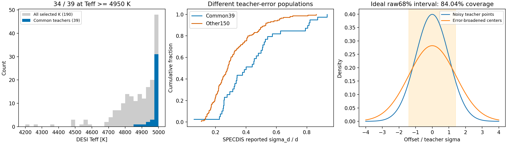
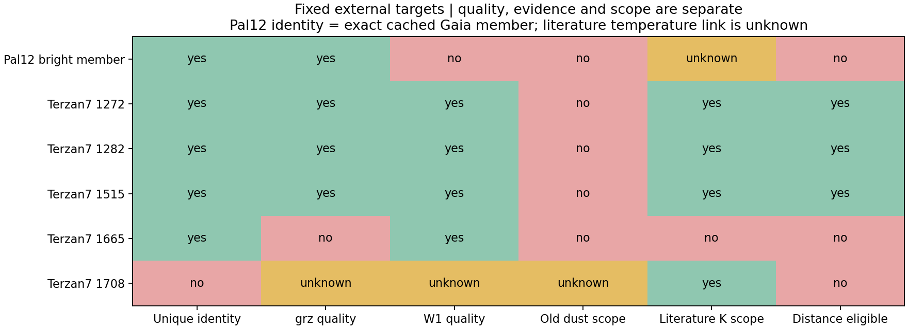
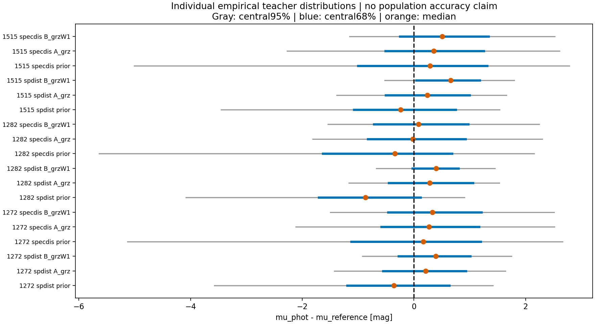
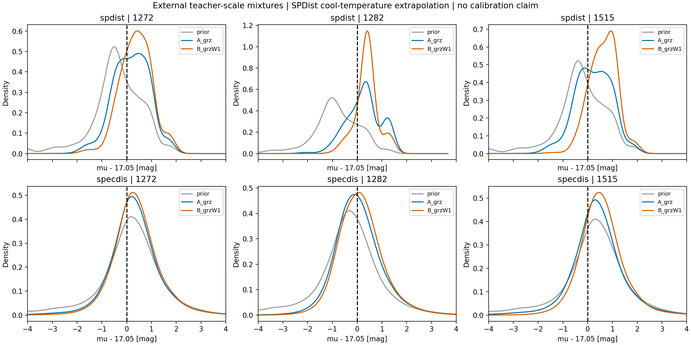

# 固定小名单的 K 巨星外部检验

2026-11-02。依据[完整评审](pro_review_a399c3e.md)，在外部距离计算前
登记[协议](kgiant_external_protocol_v1.md)及五颗 Terzan7 的文献坐标。
历史模型、教师资格、带宽、分类器及全部原始结果保持冻结。

## 1. 已补清的教师范围和预测区间含义

对190行公开证据重新计算，共同39颗的温度为4873–4999K，34颗≥4950K。
它们的 SPECDIS 相对误差中位数40.1%，其余150颗有效标签为28.0%。
SPDist A/B 选中层分别有0/39、3/39落在训练颜色盒外，SPECDIS A/B均为0/189。
这些限制已补入[原报告](kgiant_distance_result_v1.md)，原固定样本没有重新删选。

当前混合模型是教师尺度的经验分布。带噪中心的方差与每个分量的教师误差
展宽同时存在；没有完成潜在真实光度分布的去卷积。在等误差、相同真值的
理想无限样本中，混合方差为2σ²，中央68%区间覆盖带噪教师点84.04%。
这不是实际样本误差分解。SPECDIS 对数正态宽度仍是宽度代理，而非目录完整后验。

## 2. 六颗对象的身份与外部参照

Pal12 对象为缓存中唯一明亮且 clean grz 的高概率成员
**Gaia DR3 6817950249538781952**。成员概率0.99999；g0=16.52601，
目录EBV=.036838，W1本身无有效测量。它确实超出原EBV<.03范围，
但本轮不再用该范围门槛覆盖测量质量标志，也没有将缺少W1当作光学拒绝原因。

[Cohen2004](https://arxiv.org/abs/astro-ph/0311187)研究四颗Pal12巨星；
其表1–2提供星号及温度，却没有天空坐标。SIMBAD Harvard镜像返回
SVB1118/1128/1305的历史星号，坐标为空；目标3.6角秒范围也无对应条目。
这些结果**不能证明该星没有光谱**，但不足以把文献温度可靠赋予这个Gaia身份。
未根据亮度猜测它是哪颗文献星。Gaia官方TAP单对象查询与VizieR镜像查询超时；
没有用缺失结果或未经质量审查的GSP-Phot参数补成可靠类型标签。
本轮 Pal12 的外部温度／K巨星身份因而保持未确认。

Terzan7 五个目标直接采用[Sbordone2005表1](https://arxiv.org/abs/astro-ph/0505307)
的坐标、温度和低重力／径向速度证据：1272、1282、1515、1665、1708。
名义温度分别4421、4203、4468、3945、4231K。1665在K范围外；
1282、1708靠近4200K边界。温度来自B−V和假定红化，±100K只作边界
敏感性标记，并非论文给出的逐星标准误差；阶段不据此声明为已确认RGB。

Pal12参考μ=16.3±.1来自[Musella2018的CMD拟合](https://arxiv.org/abs/1709.08509)。
Terzan7参考μ=17.05、d=25.3±.6kpc、E=.06来自
[Siegel2011表1](https://arxiv.org/abs/1108.6276)，折算σμ=.0515mag。
两者均有模型依赖，不能称为几何真值。文献物理红化不直接替换目录SFD坐标。

## 3. 实际测量与预测结果

**已得到三颗真实外部成员的18组固定预测，完成本轮有限实验。**

| 对象 | grz质量 | W1质量 | 原低消光范围 | 外部身份／范围 | 本轮处置 |
|---|---|---|---|---|---|
| Pal12 Gaia6817950249538781952 | 合格 | 不合格 | 外 | 文献温度关联未确认 | 不评分；A颜色盒内也不能替代类型证据 |
| Terzan7 1272 | 合格 | 合格 | 外 | 唯一匹配，4421K | 两教师 prior/A/B |
| Terzan7 1282 | 合格 | 合格 | 外 | 唯一匹配，4203K，边界敏感 | 两教师 prior/A/B，保留温度标志 |
| Terzan7 1515 | 合格 | 合格 | 外 | 唯一匹配，4468K | 两教师 prior/A/B |
| Terzan7 1665 | 不合格 | 合格 | 外 | 唯一匹配，3945K，温度范围外 | 不评分 |
| Terzan7 1708 | 未赋值 | 未赋值 | 未赋值 | 2角秒内两个DR11对象 | 匹配歧义，不挑选更有利的对象 |

三颗实际评分星匹配距离0.51–0.63角秒，第二近邻均超过3角秒；成员概率
0.99989、0.99998、0.99994，全部DR11 DECam release11010。
它们的目录EBV为.0862–.0870，明显超出原.03范围；这是登记过的范围外压力检验。
1665的r/z FRACMASKED=.871/.832，且饱和位受影响，未放松任何测量质量条件。
1708最近两个对象相距文献位置.831和1.114角秒，不能把未知的测量质量写成已测得的不合格。
[逐星测量清单](../manifests/kgiant_external_inventory_v1.json)。

训练仍为77颗SPDist／258颗SPECDIS，全体参考星团成员均未进入训练。
各教师内 prior、A、B共用训练身份、原带宽和原误差定义。
下表为相对**预登记μ=17.05**的结果；W68为距离模数中央68%全宽。

| 星号 | 教师 | 输入 | 中位距离 kpc | Δμ mag | W68 mag | 训练颜色盒外 |
|---|---|---|---:|---:|---:|---|
| 1272 | spdist | A_grz | 28.28 | +0.208 | 1.481 | 否 |
| 1272 | spdist | B_grzW1 | 30.76 | +0.390 | 1.281 | 是 |
| 1272 | specdis | A_grz | 29.07 | +0.268 | 1.747 | 否 |
| 1272 | specdis | B_grzW1 | 29.89 | +0.327 | 1.671 | 否 |
| 1282 | spdist | A_grz | 29.28 | +0.283 | 1.512 | 是 |
| 1282 | spdist | B_grzW1 | 30.84 | +0.395 | 0.821 | 是 |
| 1282 | specdis | A_grz | 25.50 | -0.018 | 1.752 | 否 |
| 1282 | specdis | B_grzW1 | 26.73 | +0.085 | 1.684 | 否 |
| 1515 | spdist | A_grz | 28.68 | +0.238 | 1.502 | 否 |
| 1515 | spdist | B_grzW1 | 34.74 | +0.654 | 1.138 | 是 |
| 1515 | specdis | A_grz | 30.26 | +0.355 | 1.766 | 否 |
| 1515 | specdis | B_grzW1 | 32.44 | +0.505 | 1.585 | 否 |

SPDist三个对象都处于其较弱的冷端温度覆盖，B全部在颜色盒外，1282的A也在盒外；
因此不能把SPDist结果当作已验证的域内精度。SPECDIS A/B都在颜色盒内，但仍有消光范围外、
温度／阶段覆盖及模型依赖参考尺度的限制。颜色盒是逐维范围，不证明局部密度充分。

SPECDIS的B相对A使三颗星的距离中心都增大；本样本没有展示距离准确度的改善。
这与之前W1帮助分类并不矛盾。三颗共享一个系统，不能估计普适距离零点或总体散布，
也不能用它们的宽区间包含参照来证明覆盖率校准。无颜色对照及全部分位数保留在
[18组预测清单](../manifests/kgiant_external_predictions_v1.json)。

密度图展示中心Δμ=−4至+4mag窗口；机器清单另含覆盖全部分量±5σ的501点PDF/CDF，
完整混合参数存于NERSC，图中没有将窗口内密度重新归一化。

### 红化与参考误差

保持原目录改正，按每颗星A_band/EBV对目录SFD坐标施加±.01扰动，同时改变g0和颜色。
三颗SPECDIS A的中位μ变化约±.048–.052mag，B约±.045–.061mag；SPDist可到±.081mag。
这只是预设敏感性范围，不是实际红化误差测量，也没有把文献E=.06直接写入SFD字段。
另保存同一星团共用的256组δEBV~N(0,.01²)、δμ_ref~N(0,.0515²)抽样和边缘差值区间。
未获得参考μ与红化的协方差，独立抽样是显式近似；未除以sqrt(3)。

**参考表的内部换算差异：**原文表1确实同时列出μ17.05与d25.3±.6kpc。
μ17.05对应25.704kpc，25.3kpc对应μ17.0156，相差.0344mag。
主表继续使用预登记μ，不因外部残差改变参照；若采用表中的25.3kpc，所有Δμ统一增加.0344mag，
预测分布完全不变。该差异小于所列距离误差，但不应隐去或把两组数字称为完全等价。

### 本轮决定

固定小名单已产生真实外部结果，原型继续作为教师尺度的研究模型保存，不发布场星巨星距离产品。
当前证据不足以证明需要统一零点修正，也不足以选择新的潜在光度误差模型。
下一项有效证据是较暖主体、其他独立系统及阶段覆盖；本轮不继续扩名单、调分类阈值或搜索核带宽。
Pal12的类型关联与1708的匹配歧义保留为明确失败记录，而非无期限等待项。

## 4. 验证和复现

NERSC inventory60678961完成于8m20s；初次预测60678998为28s，
独立校验60679064为24s。最终分布导出与校验60679109完成于27s，退出码均0。
首轮产物原样保留；最终版本只修正未赋值的质量标签并添加PDF/CDF网格，
**18组已有数值逐项哈希一致**。六项原混合模型测试通过；十项实际产物检查通过，
包括全体参考系统成员排除、训练人数77/258、A/B身份一致、分布归一化、分位数、
距离单位与源哈希。四张图已检查。详见[校验清单](../manifests/kgiant_external_validation_v1.json)
及[执行清单](../manifests/kgiant_external_execution_v1.json)。

- 小型公开证据、图：`python scripts/kgiant_external_report.py`。
- NERSC分配CPU后运行 `python scripts/kgiant_external_inventory.py`。
  现有产物有防覆盖保护；本轮最终 `predict`、`validate` 使用路径参数
  `data/kgiant_external_v1/revised`，其中复制了原始 inventory.json。
  对应脚本为 `scripts/kgiant_external_predict.py` 和 `scripts/kgiant_external_validate.py`。
- 源数据、训练身份、完整混合分量及共同系统误差抽样保存在
  `/pscratch/sd/y/yunao/photdis_pipeline/data/kgiant_external_v1/revised`（原始首轮产物保留在父目录）。
- 不把少量外部对象汇总成总体精度、NMAD或区间校准声明。
- 190颗已知K巨星的教师结果仍不代表全部2375个分类候选，更不代表所有星族。
