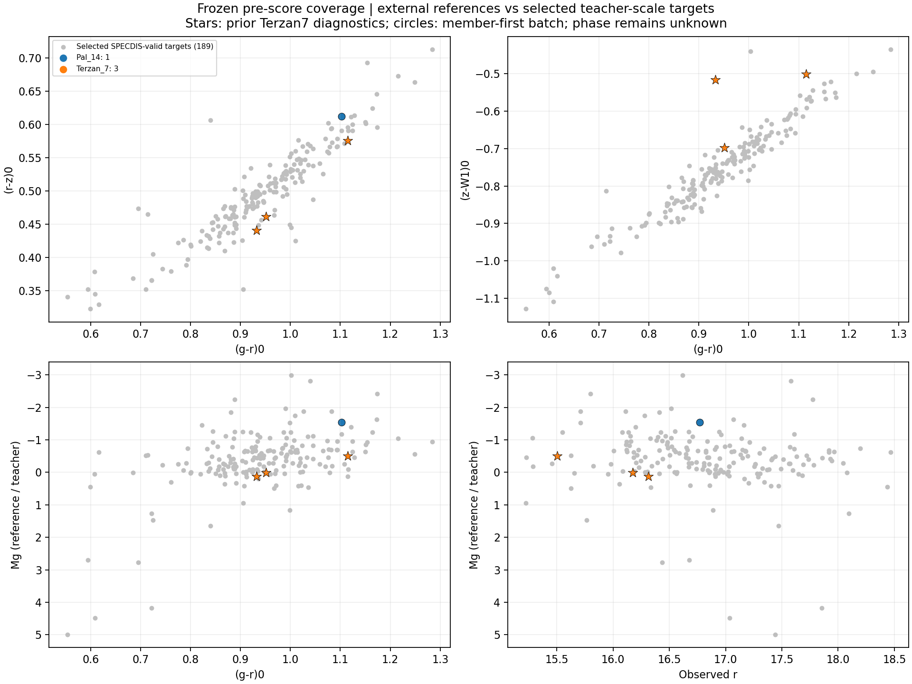
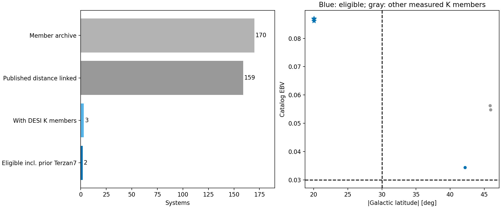
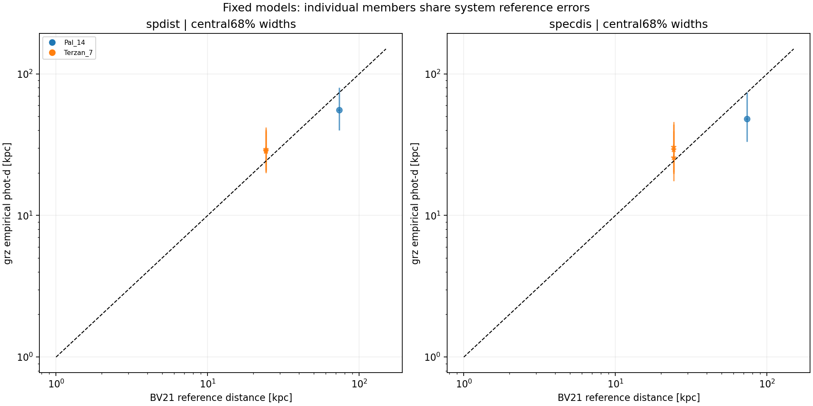
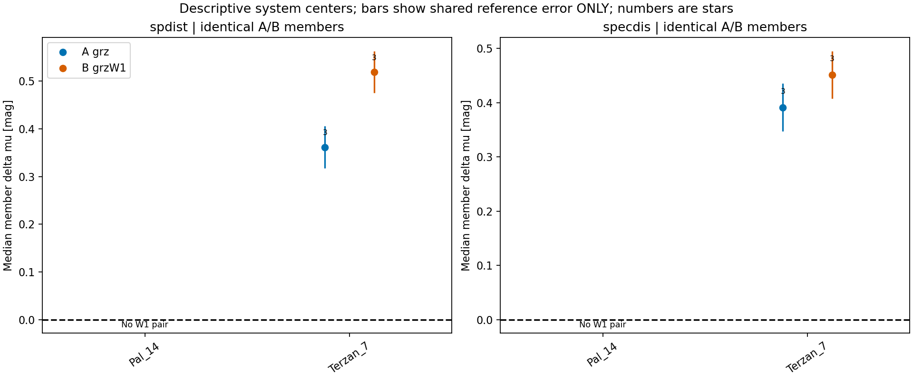
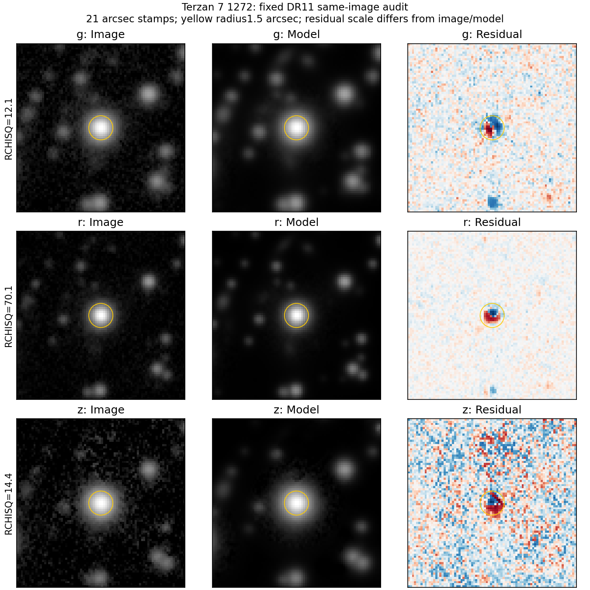
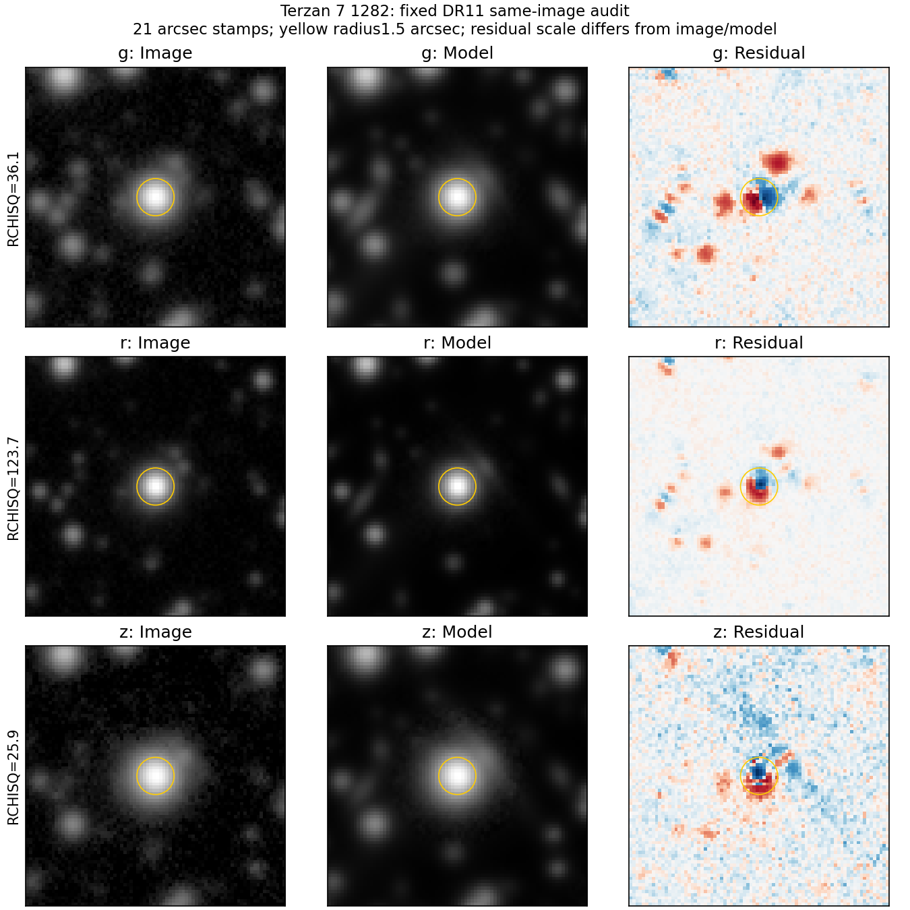
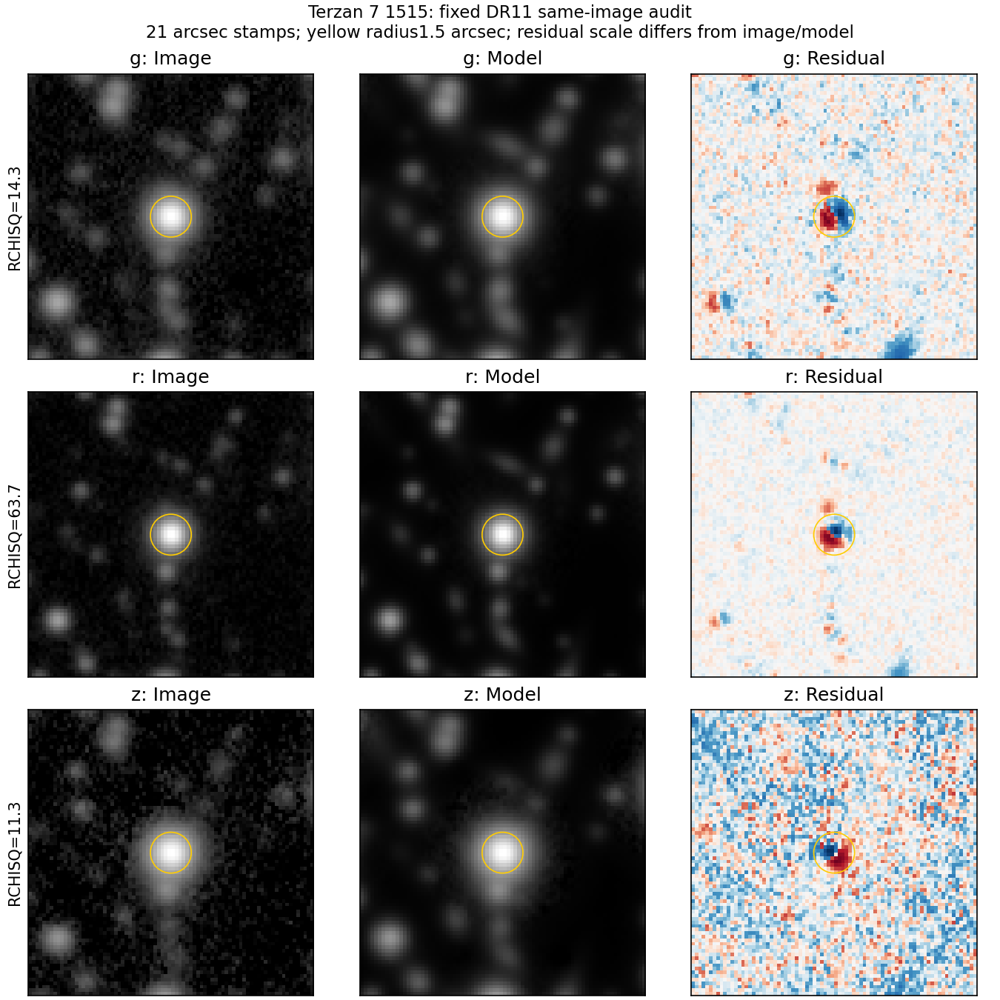

# 固定多系统 K 巨星外部参照批次

本轮落实 [Pro 对35009d2的评审](pro_review_35009d2.md)，以 **grz 为距离主基线**，W1仅作同星增量对照。保持冷主序、历史RGB、分类器及两套K巨星教师模型不变。协议见[固定批次方案](kgiant_reference_batch_protocol_v1.md)。

## 1. 从固定母表出发，已评估DESI通道的覆盖缺口已经量化

距离参照来自 [Baumgardt & Vasiliev 2021 Table 2 的固定作者稿v2](https://arxiv.org/html/2105.09526v2)，包含162个系统及各方法分量。出版DOI为[10.1093/mnras/stab1474](https://doi.org/10.1093/mnras/stab1474)。本次解析并保存的是版本化作者稿及其哈希，没有使用持续更新的作者距离网页；出版页面/CDS未能直接下载，因此不声称逐单元独立核对了期刊排版版。

162个距离系统与既有170个成员系统关联159个；11个成员系统无距离表对应，3个距离系统无既有成员档案，均保留在[参照清单](../manifests/kgiant_bv21_reference_v1.json)。Gaia视差、运动学、子矮星、星计数和文献距离分别保留，不将它们重复当成独立测量合并。表中未显示有效视差距离，不代表综合距离完全不依赖Gaia；方法间协方差未提供。

本次从全部参考成员反向关联完整DESI DR1 MWS类型表，再只读取候选所在的三个DR11 sweep；没有重新匹配190颗已选目标来冒充新增证据。159个距离—成员关联系统中只有18个有DESI成员光谱，141个没有通过本通道进入类型/光度检查；120条可靠巨星光谱中112条未通过固定温窗进入此次光度盘点。光谱行数不自动等于唯一恒星数。

| 步骤 | 数量与含义 |
|---|---|
| 既有成员资源 | 170个系统，1,078,216条概率≥0.5的成员记录 |
| 距离与成员均具备 | 159个系统，1,077,346条成员记录 |
| DESI身份关联 | 18/159系统有2,712条成员光谱；其中16系统有120条满足可靠巨星条件的光谱 |
| 固定K温度范围 | 8颗唯一成员，分布于3个系统 |
| 实际DR11检查 | NGC 2419：5颗BASS/MzLS；Pal 5：2颗光学质量失败；Pal 14：1颗DECam grz合格 |
| 新增评分对象 | Pal 14的1颗星，只能做无颜色/grz比较 |
| 历史诊断对象 | Terzan 7的3颗星，保留原18组预测 |
| 本批总计 | 4颗星、2个系统、22组教师/输入配置；其中仅4组是新增预测 |

可靠巨星类型仍要求独立光谱证据；成员身份不代替类型。光谱重力支持巨星，但具体演化阶段未知，不能将其称作已确认下RGB。原有成员概率、质量与温度条件没有为得到更多系统而放宽。

## 2. 先冻结覆盖，再查看距离残差

逐星身份、测光、类型、丰度和范围标志在提交`9c023fa`冻结；评分作业在该提交同步后才启动。[逐星清单](../manifests/kgiant_reference_inventory_v1.json)保留所有通过及失败对象。



灰点为189颗SPECDIS有效的已选目标，其纵轴使用教师光度；彩色对象使用外部系统距离。两者均用于覆盖比较，不能把教师光度当成独立真值。星形为历史Terzan 7对象，圆点为新增Pal 14对象；Pal 14没有W1，因此颜色图中的缺点不是零色。

Pal 14的Gaia源为`4464703441466064512`，成员概率0.99999，DESI温度4874.7±27.1K、logg=2.280、S/N=33.4；校正后的[Fe/H]=−1.095，原始值−0.803，阶段未知。其(g−r)₀=1.103、(r−z)₀=0.612，r=16.768，参考M_g=−1.538。它补充了较明亮光度与较红光学颜色的一个点，并未均匀覆盖目标人群。

Pal 5两颗的z波段FRACMASKED分别为0.556、0.607，且有z饱和标志，未通过冻结的光学规则；没有按距离残差剔除对象。NGC 2419五颗属于DR11 north的BASS/MzLS原生系统，保留数量，不混入DECam模型检验。



Pal 14的b=42.174°，满足旧银纬范围，但目录EBV=0.03442超过旧0.03边界；Terzan 7三颗同时超出旧银纬与低消光范围。因此此次没有新增同时满足两项旧范围条件的校准对象。范围外预测保留，不能据此宣称原范围内已验证，也不能把偏移全部归因于消光。

## 3. 固定模型评分

固定教师资格与核参数未变，训练池为77颗SPDist、258颗SPECDIS对象。排除了全部固定参照成员及跨系统身份歧义对象，外部对象与训练身份零重叠。

Pal 14采用BV21距离73.579(+1.645/−1.609)kpc，即μ=19.33377±约0.04801mag。表中区间为经验教师混合分布的中央68%范围，并非独立校准后的真实距离区间。

| 教师 | 输入 | 距离中位数/kpc | 中央68%范围/kpc | Δμ/mag | N_eff |
|---|---|---:|---|---:|---:|
| SPDist | 无颜色 | 32.33 | 22.02–51.00 | −1.785 | 77.0 |
| SPDist | grz | 55.68 | 39.91–79.97 | −0.605 | 12.52 |
| SPECDIS | 无颜色 | 41.18 | 22.77–66.07 | −1.260 | 258.0 |
| SPECDIS | grz | 48.22 | 33.16–74.47 | −0.918 | 107.70 |

颜色使该对象的中心比无颜色结果更接近参照，但两个grz中心仍分别偏近约24.3%、34.5%。参照位于两支公开CDF约78.7%和83.4%处，并非极端尾部；只用参照的小误差不能把中位数差解释为高显著性失败。它落在两个宽68%区间内，并不能说明概率预测已校准；一颗星也没有可估计的星间散布（机器清单的一点NMAD为代数上的0，不是零误差）。

SPDist支线在(g−r)₀、(r−z)₀分别高出训练逐维范围0.0714、0.0433mag；虽然DESI温度在训练温度范围内，测光颜色仍是外推。最新同星文献提示明显参数来源冲突，故不能据此认定为物理参数可靠、可比的暖K验证点；新增证据见[参数与覆盖审计](giant_parameter_audit_result_v1.md)，本表及原预测保持不变。SPECDIS逐维颜色盒内、N_eff较大，却仍有明显中心差。因此“温度合格”“颜色盒内”或“大N_eff”都不等于外部距离尺度准确。阶段、成员纯度、丰度、教师尺度和测光系统误差尚不能由此单点分离。



纵向误差条为单星经验分布全宽，横向为同一系统共享的参照误差。四颗星不适合做密度估计，故采用带区间的散点图；此前大样本phot-d/Gaia-d/spec-d密度图和CMD保持原样。

| 系统 | 星数 | SPDist grz中心Δμ | SPECDIS grz中心Δμ |
|---|---:|---:|---:|
| Terzan 7，历史对象、BV21参照 | 3 | +0.362 | +0.392 |
| Pal 14，新增 | 1 | −0.605 | −0.918 |

这里“中心”仅为成员点预测残差的中位数，不是共同距离后验。两系统描述性中心方向相反，但四颗星和宽分布不足以进行可靠的总体零点检验；现有数据不支持估计或采用统一零点修正。参照误差作为系统共同量传播，未除以√N；方法间相关性未获知，不能把其形式误差当成全部外部尺度不确定度。Pal 14与Terzan 7主要显示文献距离分量，不应统称几何距离。

Pal 14的目录EBV±0.01敏感性令grz中心移动约±0.067mag（SPDist）或±0.053mag（SPECDIS）。这是保持BV21参照不变的输入灵敏度，不是重新标定BV21全部文献距离的联合物理情景，不能拿它抵消实际残差。



Pal 14没有W1配对，图中明确留空；唯一A/B证据仍是历史Terzan 7三颗。改用BV21参照后，SPDist系统描述中心由grz的+0.362变为grzW1的+0.519mag，SPECDIS由+0.392变为+0.451mag。没有新增支持W1改善绝对距离的系统证据。图中误差条只显示共同参照误差，不包含模型全部不确定度。

逐星量化结果及201点PDF/CDF见[预测清单](../manifests/kgiant_reference_predictions_v1.json)。原18组五分位预测与历史记录逐项一致至1e−10mag；改变的是比较参照及附加诊断。

## 4. 已有三颗星的图像检查

固定三个历史身份，分别读取DR11的grz图像、模型和残差，共9个FITS切图；URLs、字节哈希与孔径统计见[图像清单](../manifests/kgiant_external_image_audit_v1.json)。原始切图保存在NERSC，未对图像作事后筛选。





三个对象均可见中心正负相邻残差，与位置/PSF失配相容，但不能仅凭图像唯一归因。1.5角秒孔径内净残差/模型通量的绝对值均小于0.64%，3角秒也小于0.58%；正负残差相消，绝对残差量更大。这些是相同成像资料内部的拟合诊断，不是独立测光校准，也不能作为总通量修正系数。没有改变身份、质量门槛、测光误差或原预测。

原18组结果的BV21替代参照、银纬、有效分量数及有符号颜色越界量已列入[结果补充](kgiant_external_addendum_v1.md)。Terzan 7替代距离24.278(+0.496/−0.487)kpc使原残差统一增加0.123935mag，预测本身不变。1282的SPDist+W1有效分量数仅4.41，区间变窄不能解释为外推更可靠。文献颜色温度与DESI温度标度不同，支持判断同时看联合颜色、光度、丰度及质量。

## 5. 结束条件与下一步

本轮结束于固定母表的匹配及全部合格对象评分。三个可比较系统是设计目标，本批实际只得到一个新系统、加上一个历史系统；不为了达标继续追加星团，也不调整模型或筛选阈值。

本次已评估的DESI合格K巨星资源通道仍不足以校准当前K巨星人群的绝对距离；这不是对141个无DESI系统或温窗外巨星资源的否定。后续需要的具体证据是：在目标联合颜色、较亮光度及丰度范围内，具有可靠身份、阶段信息与外部距离的DECam成员，并有可用的亮端测光；若走北方路线，应另行建立同原生系统的模型与验证。Pal 5的亮端质量、NGC 2419的测光系统差异、Pal 14的单星及W1缺失是不同缺口，不能以统一放宽条件解决。

当前保留grz教师尺度条件混合原型，W1保持增量对照。不发布经绝对精度校准的场星巨星距离产品，不将分类分数直接拼接成全星族距离概率；项目多星族目标及已完成的冷主序分支继续保留。

## 6. 可复现性与验证

数据及全高斯分量保存在NERSC `/pscratch/sd/y/yunao/photdis_pipeline/data/kgiant_reference_batch_v1/`。小型参照、冻结名单、预测分布和校验清单随仓库保存。执行入口：

```bash
# 在NERSC仓库提交，实际扫描与评分在分配的CPU资源上执行
sbatch scripts/run_kgiant_reference_batch.sh inventory
# 冻结inventory/覆盖图并提交后，再运行
sbatch scripts/run_kgiant_reference_batch.sh score
# 本地生成公开图
python scripts/kgiant_reference_report.py
```

评分脚本拒绝覆盖已有预测。历史数据保持原样；重现应在独立输出目录进行，不能删除原始产物来强行重跑。

实际验证：6项固定混合模型测试通过，11项真实产物检查通过，包括母表完整性、身份关联、全部参照成员训练隔离、A不受W1门槛限制、完整高斯分量CDF/分位数/单位、源哈希及18组历史结果不变。见[验证清单](../manifests/kgiant_reference_validation_v1.json)。7张本轮图已逐张检查。

NERSC作业：首次清单60679575因无效校正丰度的NaN序列化失败，在读取光度前停止；改为既有null-safe写入器并保留有效标志后，60679723完成（4分51秒，0:0）。评分与校验60680017完成（1分32秒，0:0）。均运行于分配的CPU节点。失败没有改变科学资格。原始版本化参考HTML、9个FITS切图、成员ID及完整混合分量留存在远端，公开清单保存其来源和哈希。
