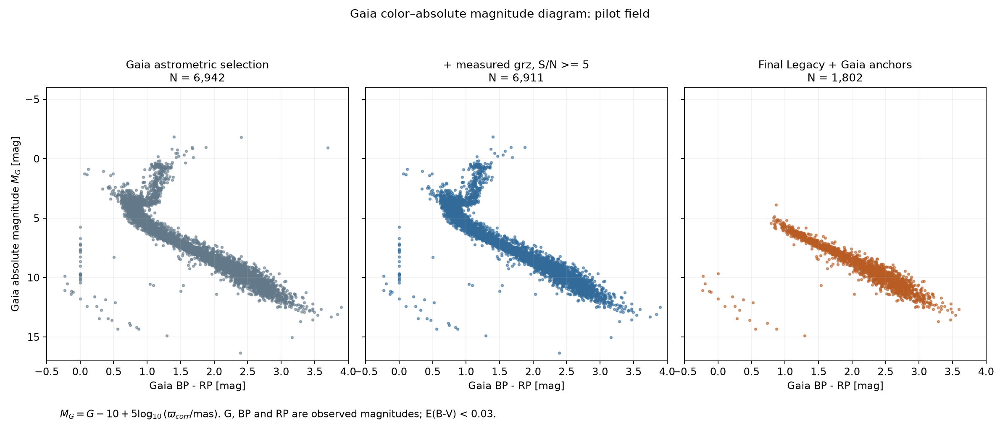
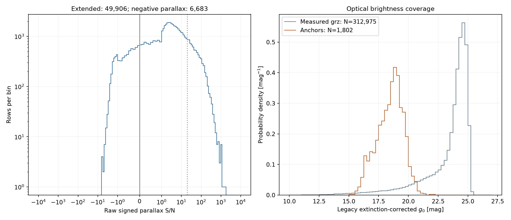
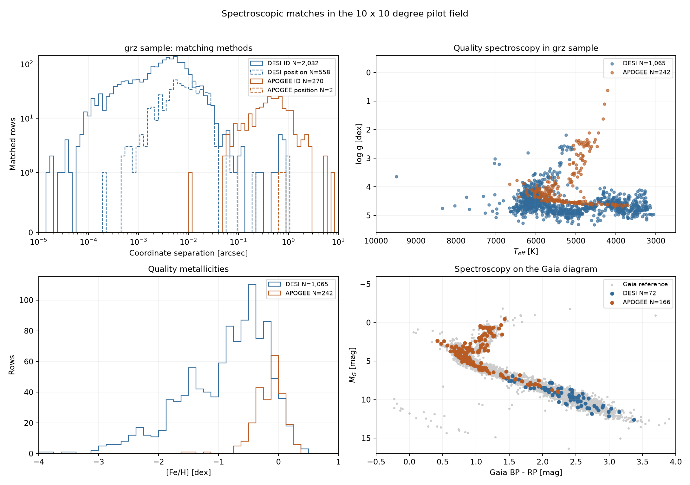
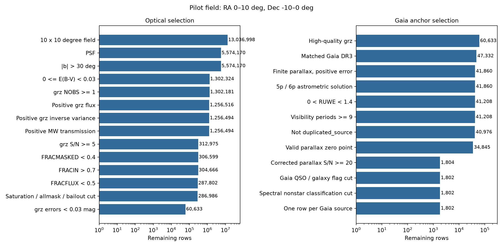

# 10°×10°天区检查：RA 0°–10°，Dec −10°–0°

天区边界为 `0≤RA<10°`、`−10≤Dec<0°`，球面面积约99.5平方度。使用4个DR11 south sweep，处理耗时285.8秒。

主要结果：312,975条有效grz记录；1,802颗Gaia锚点；49,906条视差扩展记录，其中6,683条负视差。

## 1. 光学筛选

以下各行依次施加，剩余数为累计结果。g、r、z的条件均要求三个波段同时满足。

| 条件 | 剩余记录 | 本步剔除 |
|---|---:|---:|
| RA∈[0,10)°，Dec∈[-10,0)° | 13,036,998 | 0 |
| TYPE=PSF | 5,574,170 | 7,462,828 |
| |b|>30° | 5,574,170 | 0 |
| E(B−V)有限且0≤E(B−V)<0.03 | 1,302,324 | 4,271,846 |
| g、r、z各波段NOBS≥1 | 1,302,181 | 143 |
| g、r、z流量有限且>0 | 1,256,516 | 45,665 |
| g、r、z逆方差有限且>0 | 1,256,494 | 22 |
| g、r、z消光透射率有限且>0 | 1,256,494 | 0 |
| g、r、z各波段S/N≥5 | 312,975 | 943,519 |
| g、r、z各波段FRACMASKED<0.4 | 306,599 | 6,376 |
| g、r、z各波段FRACIN>0.7 | 304,666 | 1,933 |
| g、r、z各波段FRACFLUX<0.5 | 287,802 | 16,864 |
| MASKBITS的2、3、4、5、6、7、10位为0 | 286,986 | 816 |
| g、r、z各波段星等误差<0.03 mag | 60,633 | 226,353 |

`FRACMASKED`衡量掩膜影响，`FRACIN`衡量成像范围覆盖，`FRACFLUX`衡量邻源贡献。MASKBITS的2–4位为grz饱和标记，5–7位为grz ALLMASK，10位为BAILOUT。

## 2. Gaia锚点筛选

| 条件 | 剩余记录 | 本步剔除 |
|---|---:|---:|
| 光学高质量样本 | 60,633 | 0 |
| 匹配Gaia DR3 | 47,332 | 13,301 |
| 视差有限，误差有限且>0 | 41,860 | 5,472 |
| 五或六参数解（31或95） | 41,860 | 0 |
| 0<RUWE<1.4 | 41,208 | 652 |
| visibility_periods_used≥9 | 41,208 | 0 |
| duplicated_source=False | 40,976 | 232 |
| 零点修正适用域内且修正值有效 | 34,845 | 6,131 |
| 修正视差S/N≥20 | 1,804 | 33,041 |
| Gaia QSO和galaxy候选标记均为False | 1,802 | 2 |
| 光谱分类未标为QSO或GALAXY | 1,802 | 0 |
| 每个Gaia source_id保留测光误差最小的一行 | 1,802 | 0 |

视差采用 `πcorr=π−zpt`，单位mas。修正适用域：`6<G<21`；五参数解使用`1.1≤nu_eff≤1.9`，六参数解使用`1.24≤pseudocolour≤1.72`；黄道纬度有效且修正函数返回有限值。

## 3. Gaia颜色—绝对星等图

横轴是由有效 Gaia BP、RP 测量重新计算的 `BP−RP`，纵轴为
`M_G=G−10+5log10(πcorr/mas)`。G、BP、RP 采用观测星等；样本的
E(B−V)<0.03。颜色有效性检查见[同天区测光审计](pilot_audit.md)。

三幅面板依次绘出 6,920、6,889、1,801 颗有效 Gaia 颜色对象。对应的
全部对象数仍为 6,942 颗 Gaia 高精度参考星、6,911 颗有效 grz 参考星、
1,802 颗最终锚点。

图中明亮主序、转折点和巨星分支在光学质量筛选后大量消失。最终锚点主要位于较冷主序，同时保留蓝暗分支。

6,942颗Gaia参考星中的光学条件失败数如下，各条件在这组参考星上单独检查：

| 条件 | 失败数 |
|---|---:|
| FRACMASKED<0.4 | 4,629 |
| FRACIN>0.7 | 118 |
| FRACFLUX<0.5 | 38 |
| MASKBITS指定各位为0 | 5,082 |
| 三个波段星等误差<0.03 mag | 35 |

其中5,079颗参考星带有z波段饱和标记。Legacy光学高质量条件保留1,804颗参考星，保留比例26.0%；Gaia候选污染标记再剔除2颗，得到1,802颗。

## 4. 弱和负视差扩展层

从有效grz记录出发，选择已匹配Gaia、视差有限且误差有限并大于零的记录。

| 项目 | 数量 |
|---|---:|
| 扩展记录 | 49,906 |
| 对应唯一Gaia source_id | 49,903 |
| 负视差记录 | 6,683 |
| 零视差记录 | 0 |
| 有效修正视差S/N<5 | 25,729 |
| 扩展质量子集 | 33,243 |
| 质量子集中的负视差 | 4,586 |

扩展质量子集采用Gaia解类型、RUWE、可见期、重复源、零点、光学clean和分类标记条件。

## 5. 光谱匹配

先按Gaia ID关联，缺少ID时使用1角秒坐标匹配。DESI使用MWS PRIMARY记录；APOGEE使用DR17校准参数，并在重复观测中保留最高S/N记录。

以下统计对应312,975条有效grz记录。

| 星表 | 匹配记录 | 唯一光谱目标 | ID匹配 | 坐标匹配 | 质量合格记录 | 质量合格目标 |
|---|---:|---:|---:|---:|---:|---:|
| DESI | 2,590 | 2,589 | 2,032 | 558 | 1,065 | 1,064 |
| APOGEE | 272 | 270 | 270 | 2 | 242 | 240 |

DESI分类：STAR 1,321条、QSO 1,117条、GALAXY 152条。两个星表在该grz样本中的匹配交集为0条。

### DESI质量筛选

| 条件 | 剩余记录 | 本步剔除 |
|---|---:|---:|
| grz母样本内光谱匹配 | 2,590 | 0 |
| 坐标关联无歧义 | 2,590 | 0 |
| PRIMARY=True | 2,590 | 0 |
| RR_SPECTYPE=STAR | 1,321 | 1,269 |
| RVS_WARN=0且SUCCESS=True | 1,276 | 45 |
| SN_R≥10 | 1,078 | 198 |
| 0≤VSINI<30 km/s | 1,065 | 13 |
| Teff、logg、[Fe/H]有效且误差>0 | 1,065 | 0 |
| 光谱坐标有效 | 1,065 | 0 |

### APOGEE质量筛选

| 条件 | 剩余记录 | 本步剔除 |
|---|---:|---:|
| grz母样本内光谱匹配 | 272 | 0 |
| 坐标关联无歧义 | 272 | 0 |
| ASPCAPFLAG的23、24、31、32、33、36、40、41位和STARFLAG的0、3、18、22位为0 | 257 | 15 |
| SNR≥50 | 247 | 10 |
| FE_H_FLAG=0 | 242 | 5 |
| Teff、logg、[Fe/H]有效且误差>0 | 242 | 0 |
| 光谱坐标有效 | 242 | 0 |

### 参数与锚点覆盖

| 项目 | DESI | APOGEE |
|---|---:|---:|
| 质量合格且logg<3.2的记录 | 19 | 41 |
| 质量合格且[Fe/H]<−1.5的记录 | 205 | 1 |
| 质量合格且满足Gaia锚点天体测量条件 | 72 | 164 |
| 质量合格且满足光学高质量条件 | 1,020 | 0 |
| 最终锚点内的质量合格光谱 | 55 | 0 |

APOGEE的242条质量合格grz匹配全部未通过光学质量条件；其中164条满足Gaia高精度条件。最终55颗DESI质量合格锚点的Teff为3,129–4,659 K、logg为4.18–5.15。

APOGEE按ID匹配目标的角距较宽。最大的三个为5.14″、5.56″、7.66″，对应Gaia自行分别约293、328、448 mas/yr；这些记录使用Gaia ID关联。

## 6. 红外分层与文件

有效grz样本中，W1质量层有73,044条，W1+W2质量层有44,806条。

程序：[pilot_field.py](../scripts/pilot_field.py)；天区配置：[pilot_10deg.json](../configs/pilot_10deg.json)；全部数量：[结果清单](../manifests/pilot_10deg.json)；写出后复核：[检查清单](../manifests/pilot_10deg_inspection.json)。

NERSC数据：`/pscratch/sd/y/yunao/photdis_pipeline/data/pilot_10deg_v1/field_diagnostics.fits`。

本次检查通过：天区边界、Legacy ID唯一性、锚点Gaia ID唯一性、逐步grz与锚点条件一致性、写出后的锚点/扩展/负视差数量复核。

筛选定义及来源见[第一阶段条件说明](stage1_selection.md)。
