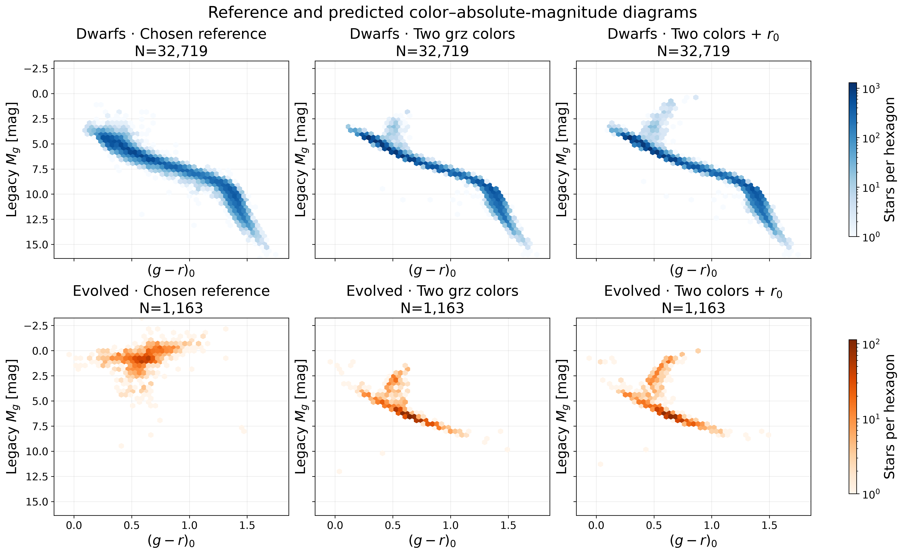

# GPT Pro review of 0001fd8

Source chat: 6aebf8d9-e120-83e8-9e68-0476dc31e0ba
Source message: 26ed9779-1cd0-55c4-bdf5-c93c57e5c9fc

对，我核对的就是 Photdis 项目里那个 **“建议与下一步”** 对话。

先说明衔接情况：原对话页面没有成功读取到逐条全文，但 GitHub 保存了那段对话的多轮完整审查正文，包括从统一多星族 baseline 的转向，到最后一轮对 `63cdbaa` 的建议。我已经把这些记录与 `WORKLOG`、结果文档、数值清单和相关代码对照起来了。**这足以恢复主要决策链，但我不能说已经读到了所有原始用户与助手消息。**

这次核对的最新提交是 **[`0001fd8d`](https://github.com/xiaoyunao/photdis/commit/0001fd8d26df1a36cea5cb290f4a16991f4a6d64)**，时间为 **2026 年 11 月 5 日北京时间 11:18**；结束检查时，远端 `main` 仍然指向它。

**我的判断是：上一轮提出的任务已经完成。加入 \(r_0\) 确实救回了一部分演化星，但没有解决主要失败，也没有改善最关心的暗、无合格 WISE 演化星样本。这一版对照可以收束，暂不替换现有模型。下一轮最值得做的是一次范围明确的弱 WISE 通量实验，同时补清现有报告里两项容易被误读的结果。**

下面把依据和下一步具体说明。

## 一、先把上一对话已经确定的方向接稳

我特别回看了 11 月 2 日那次方向调整：当时你指出，任务连续围绕几个星团、几颗星核查，整体测距反而迟迟没有推进。那次审查已经明确把主线改为：

> **研究 grz、grzW1、grzW1W2 对不同星族分别提供多少类型和光度信息，以及这些收益在实际光学母样本中能够覆盖多少对象。**

所以，后面的工作应继续保持 **多星族、完整流程、grz 为主入口、WISE 为可选增强**。当前巨星困难，不应使整个项目重新退回只做冷矮星；局部星团检查也不应重新成为所有工作的前置条件。[当时的方向调整原文](https://github.com/xiaoyunao/photdis/blob/0001fd8d26df1a36cea5cb290f4a16991f4a6d64/docs/pro_review_60f65d5.md)

目前这条主线已经推进到：

| 阶段 | 已经得到的结果 | 本轮应如何接续 |
|---|---|---|
| 统一 baseline v0/v1 | 已完成已有 14 场、约 939 万行的内部目录流程；保留多解、质量和模型适用状态 | 已具备完整流程，不需要重新从小样本起步 |
| 分支、门控与分类实验 | 条件距离在已知类型下可以明显改善，但实际测光分类的混入使完整候选组风险仍然很高 | 不能再笼统建议“加分类器，然后分别测距” |
| 分类与距离入口拆分 | 已释放原先被距离资格连带排除的类别标签 | 这项已完成 |
| v1.4 广域参考与 \(i\) 波段 | 已完成 1,600 个 sweep 的参考构建、新天区和固定数据对照；总体收益较小 | 继续扩大同性质训练量和加入 \(i\)，都已有实际答案 |
| 八组科学诊断 | 距离对比、CMD、颜色、天区、丰度、概率分布等 29 张图已完成 | 已有足够证据选择下一项模型实验 |
| 最新 \(r_0\) 对照 | 同训练身份、同评估身份、共享误差传播的对照已完成 | 现在应判断其价值，不能再次把“试加 \(r_0\)”列为待办 |

上述过程分别记录在[目录说明](https://github.com/xiaoyunao/photdis/blob/0001fd8d26df1a36cea5cb290f4a16991f4a6d64/docs/baseline_v1_catalog.md)、[v1.3 结果](https://github.com/xiaoyunao/photdis/blob/0001fd8d26df1a36cea5cb290f4a16991f4a6d64/docs/baseline_v1_3_result.md)、[v1.4 结果](https://github.com/xiaoyunao/photdis/blob/0001fd8d26df1a36cea5cb290f4a16991f4a6d64/docs/baseline_v1_4_result.md)和[科学诊断报告](https://github.com/xiaoyunao/photdis/blob/0001fd8d26df1a36cea5cb290f4a16991f4a6d64/docs/baseline_v1_4_science_result.md)中。

需要区分一下规模：**1,600 个 sweep 指广域参考数据构建，不代表已经用最新实验模型重算整个 DR11 光学母星表。** 当前保留的内部全目录版本仍是 v1。

## 二、上一轮要求的修改，Codex 已经落实了

这次代码检查没有发现一个新增的明显实现错误，能够解释演化星现在的大规模失败。上一轮的关键要求基本都做到了：

- 新特征明确写成了 \((g-r)_0,(r-z)_0,r_0\)，没有把“第三维”误用成旧 B 模型的 \(z-W1\)。
- 颜色、\(r_0\) 和最后距离模数中的 \(g_0\)，使用同一组逐星测光扰动。
- 新旧模型沿用相同训练身份、顺序、目标和评估对象，并检查训练与评估身份不交叉。
- 覆盖图已经区分实际训练身份、分类评估、点距离评估和带符号视差证据。
- 原始 RVS 丰度、限制到校正适用域后的原始丰度、校正丰度，已经分别列出。
- W1 颜色图使用的是仅光学模型的残差，这一点也已经说明。

这些可以直接在[新实验实现](https://github.com/xiaoyunao/photdis/blob/0001fd8d26df1a36cea5cb290f4a16991f4a6d64/scripts/baseline_v1_5_r0.py)、[共享误差传播](https://github.com/xiaoyunao/photdis/blob/0001fd8d26df1a36cea5cb290f4a16991f4a6d64/src/photdis/baseline_v1.py)和[覆盖计算](https://github.com/xiaoyunao/photdis/blob/0001fd8d26df1a36cea5cb290f4a16991f4a6d64/scripts/baseline_v1_4_coverage.py)中核实。

还有一个已经披露的细节：固定 `max_features=0.75`，在两个特征和三个特征时，实际每次分裂考虑的候选特征数由 1 变为 2。因此，这次结果不能严格解释为完全排除了算法维数影响的“纯 \(r_0\) 信息增益”。**但当前结果已经不足以采用，没有必要为了这一点再追加一轮重训。** 如果以后要把 \(r_0\) 的独立收益写成方法学结论，再控制这个因素即可。[实验协议](https://github.com/xiaoyunao/photdis/blob/0001fd8d26df1a36cea5cb290f4a16991f4a6d64/docs/baseline_v1_5_r0_protocol.md)

## 三、最新结果：有局部改善，但主体问题仍然存在

下面全部是 **`expanded_A` 与新增 \(r_0\) 模型的同星比较**，没有混用另一批 `matched_griz` 样本。

定义

\[
\Delta\mu=\mu_{\rm phot,50}-\mu_{\rm ref},
\]

严重错误为 \(|\Delta\mu|>1\) mag。`chosen` 参考沿用已有规则：合格的高精度 Gaia 锚优先，否则采用 SpecDis。

| 子样本 | 数量 | 严重错误率：原模型 → 加 \(r_0\) | 中位 \(\Delta\mu\)：原模型 → 加 \(r_0\) |
|---|---:|---:|---:|
| 全体 chosen | 47,756 | 9.68% → 9.46% | −0.006 → −0.003 mag |
| 矮星 | 32,719 | **1.95% → 2.16%** | +0.032 → +0.037 mag |
| 演化星 | 1,163 | **96.56% → 89.85%** | **−5.301 → −5.160 mag** |
| 其他／过渡类 | 6,408 | 21.36% → 20.27% | −0.314 → −0.304 mag |
| 未知类 | 7,466 | 19.98% → 19.62% | +0.003 → −0.030 mag |
| 校正域内贫金属矮星 | 2,343 | **7.98% → 8.11%** | **+0.451 → +0.427 mag** |
| 18–20 等、无合格 W1 | 3,162 | 17.39% → 17.11% | +0.019 → −0.002 mag |

来源：[结果报告](https://github.com/xiaoyunao/photdis/blob/0001fd8d26df1a36cea5cb290f4a16991f4a6d64/docs/baseline_v1_5_r0_result.md)及[逐组完整数值](https://github.com/xiaoyunao/photdis/blob/0001fd8d26df1a36cea5cb290f4a16991f4a6d64/manifests/baseline_v1_5_r0_result.json)。贫金属行是矮星的子集，不能与其他行相加。

### 1. 演化星确实救回了一部分，但大多数距离仍然错得很远

演化星中：

- **85 颗**从严重错误变为非严重错误；
- **7 颗**反向变化；
- 净救回 **78 颗**；
- 仍然有 **1,045／1,163 颗**严重错误。

尾率下降 6.71 个百分点，按天区整块重采样得到的描述性 95% 区间为 \([-10.94,-3.55]\) 个百分点。这个局部改善应当承认。

但新模型的演化星中位距离比仍然只有

\[
\operatorname{median}\left(\frac{d_{\rm phot}}{d_{\rm ref}}\right)
=0.0929,
\]

即典型预测距离仍只有参考距离的约 **十一分之一**。[演化星完整统计](https://github.com/xiaoyunao/photdis/blob/0001fd8d26df1a36cea5cb290f4a16991f4a6d64/manifests/baseline_v1_5_r0_result.json)

还有一个报告正文没有突出、但很有解释力的量：逐星绝对残差变化

\[
|\Delta\mu_{\rm new}|-|\Delta\mu_{\rm old}|
\]

的**均值改善约 0.337 mag，中位数却只改善约 0.021 mag**。同时，演化星 NMAD 从 1.727 增到 2.017 mag。

这更符合“少量对象改变了分支选择”的情形，主体分布并没有被整体修正。

这张最新 CMD 已经把问题展示得很清楚：

下排右图相比中图，较亮解有所增加，但大量演化星仍被压到主序附近。五张新图的风格与可读性已经足够支持判断，这一轮无需再安排通用美化。

这些演化星的 chosen 参考来自 SpecDis，没有合格高精度 Gaia 距离锚。SPDist 比较方向一致，但两份目录具有共同数据与选择，仍应称为参考一致性检查，而非两套完全独立的距离真值。[参考来源说明](https://github.com/xiaoyunao/photdis/blob/0001fd8d26df1a36cea5cb290f4a16991f4a6d64/docs/baseline_v1_5_r0_result.md)

### 2. 更值得强调的新发现：改善没有落在关键的暗、无 W1 演化星上

我专门检查了结果清单中的：

`class1:r18_20:no_W1`

这个交叉分层比“全部演化星”更贴近此前希望扩展的应用人群。

| 18–20 等、无合格 W1 的演化星 | 原模型 | 加入 \(r_0\) |
|---|---:|---:|
| 样本数 | 47 | 同样 47 |
| 严重错误数 | **44** | **44** |
| 严重错误率 | **93.62%** | **93.62%** |
| 中位 \(\Delta\mu\) | −4.933 mag | **−5.185 mag** |
| 68% 区间覆盖率 | 25.53% | **17.02%** |

这里是**救回 1 颗、损伤 1 颗，没有净收益**。样本较小，不能据此宣称 \(r_0\) 对所有类似对象有负作用；但它明确不支持“全体演化星改善，所以暗、无 WISE 的演化星也受益”。[对应逐组数值](https://github.com/xiaoyunao/photdis/blob/0001fd8d26df1a36cea5cb290f4a16991f4a6d64/manifests/baseline_v1_5_r0_result.json)

再按 WISE 可用性，把全部样本的净改善拆开：

- 原本 W1、W2 都合格的对象：净减少 **108** 个严重错误；
- 无合格 W1 的对象：净减少 **10** 个；
- 只有 W1 合格的对象：净增加 **12** 个；
- 合计净减少 **106** 个。

这里的新模型本身没有用 WISE，因此不能作 WISE 导致改善的因果解释。它说明：**当前 \(r_0\) 收益主要发生在原本就有较好 WISE 的参照人群中，尚未解决最希望拓展的那部分对象。**

我建议把这一点补进报告正文，这是本次最值得新增的科学解释。

### 3. 贫金属矮星问题依然需要保留为主评价项

校正适用域内的贫金属矮星，加入 \(r_0\) 后：

- 中位距离比由 **1.231 降到 1.218**，仍偏大约 **21.8%**；
- 严重错误率略升；
- 68% 覆盖由 **43.28% 降到 42.98%**；
- 95% 覆盖由 **92.23% 降到 89.07%**。

因此，偏差下降约 0.024 mag，并没有让这一层达到满意状态。[贫金属子样本统计](https://github.com/xiaoyunao/photdis/blob/0001fd8d26df1a36cea5cb290f4a16991f4a6d64/manifests/baseline_v1_5_r0_result.json)

对你的银河晕应用，这个问题仍然比全样本中位残差是否更接近零重要。评价时继续使用光谱丰度分层是合理的；应用端则不能依赖真实光谱丰度给没有光谱的对象做事后修正。

## 四、现在最需要补清的另一点：覆盖率提高，不等于距离更准

最新报告提到一些暗端子样本的区间覆盖率提高。我检查后发现，需要把**区间宽度**一起列出来。

| 子样本 | 68% 覆盖：旧 → 新 | 68% 区间中位全宽：旧 → 新 | 严重错误率：旧 → 新 |
|---|---:|---:|---:|
| 18–20 等、无 W1，3,162 颗 | 61.04% → 65.56% | **0.844 → 1.054 mag，增宽约 25%** | 17.39% → 17.11% |
| 20–22 等，618 颗 | 55.50% → 67.80% | **0.980 → 1.677 mag，增宽约 71%** | **25.89% → 26.38%** |

第一行的 NMAD 几乎没变：0.4808 → 0.4816 mag。第二行虽然覆盖率接近 68%，点距离严重错误反而多了 3 颗。[区间与配对统计](https://github.com/xiaoyunao/photdis/blob/0001fd8d26df1a36cea5cb290f4a16991f4a6d64/manifests/baseline_v1_5_r0_result.json)

**区间更宽、对不确定性表达更谨慎，可以是有价值的变化；但应当与距离精度提高分别报告。** 这里补一张小表、两三句话就够，不需要重新做一整套诊断。

完整 Gaia 视差评分也支持“收益与损伤并存”的判断：49,327 个测试对象中，平均 log predictive density 只从 0.05322 到 0.05408，而 PIT 极端比例从 **11.58% 升到 12.36%**。演化星有所改善，矮星有所退步。[Gaia 评分](https://github.com/xiaoyunao/photdis/blob/0001fd8d26df1a36cea5cb290f4a16991f4a6d64/docs/baseline_v1_5_r0_result.md)

这也提醒我们：不能只选一个看起来变好的总指标来决定换模型。

## 五、下一轮主实验：检验真实弱 WISE 通量是否还有可用信息

上一轮审查已经写了一个明确的后续分支：如果 \(r_0\) 仍只有有限总体收益、演化星继续大面积失败，就结束这次输入扩展，转向独立的弱 WISE 通量实验。**现在的结果已经满足这个条件。**[上一轮最后的建议](https://github.com/xiaoyunao/photdis/blob/0001fd8d26df1a36cea5cb290f4a16991f4a6d64/docs/pro_review_63cdbaa.md)

我建议下一轮回答一个具体问题：

> **在保留现有测量质量条件的情况下，被 S/N 门槛排除的 W1/W2 通量，能否为光度分支提供可检验的信息，并改善真实弱测量对象的距离分布？**

### 1. 改动应发生在通量处理，而不是单纯降低 S/N 门槛

保留有效的原始 flux、ivar 和测量状态，允许零、负观测通量进入似然。一个基本表达是

\[
f_b^{\rm obs}\sim
\mathcal N\!\left(f_b^{\rm model}(\theta),\,\sigma_{f,b}^{2}\right),
\qquad b\in\{W1,W2\}.
\]

这里负的是带噪观测值；模型预测的物理通量仍为正。这样弱观测可以提供很弱的约束，也可以基本没有信息。

当前高 S/N 颜色模型不能通过“把门槛从 5 改成 2，再继续高斯星等扰动”直接承担这个任务。新的处理需要让通量误差、缺测和质量失败具有明确含义。

### 2. 同一次实验里，保持信息增益比较清楚

如果为了支持弱通量而引入了新的概率表示，建议在**同一个固定实现、同一批训练模板和同一批评价对象**上比较：

| 对照 | 使用的信息 | 回答的问题 |
|---|---|---|
| 光学对照 | grz | 新表示本身表现如何 |
| 加 W1 通量 | grz＋有效 W1 测量 | W1 提供多少额外信息 |
| 加 W1/W2 通量 | grz＋有效 W1、W2 测量 | W2 在相同条件下再增加多少信息 |

已冻结的 `expanded_A` 可以作为旁边的基线，但如果训练集合或模型表示发生变化，不能把“新方法相对旧 A 的全部变化”都归因于 WISE。

实现上，有一个需要预先讲清的概率关系：**仅有 \(p(M_g\mid grz)\) 还不足以预测每个光度解对应的 WISE 通量。** 需要保留绝对光度与红外颜色之间的联合关系，例如

\[
q\!\left(M_g,\mathbf c_{\rm IR}\mid\mathbf c_{\rm opt}\right),
\]

再用 WISE 测量似然更新。可以先采用一个固定的联合经验模板方案；光学对照与加入 WISE 的版本共享模板和权重定义。不要在没有联合关系的情况下，仅凭某个 \(M_g\) 解就任意赋予 WISE 预测。

这个设计是我对下一轮的建议，尚不是仓库已有实现。

### 3. 优先评价真实弱测量，人工降噪只承担方法检查

高 S/N 星人工降噪，可以检验算法是否按预期退化、是否保留共享误差。但真实低 S/N 对象的人群组成、拥挤程度和选择可能不同。

因此，主结果应至少把这些对象分开：

- 质量通过、S/N 较高；
- 质量通过、S/N 较低，包括负通量；
- 测量质量失败或缺测，继续走光学路径。

核心统计仍然复用已有体系：**演化星、贫金属矮星、其他／过渡类、未知类，分别看救回／损伤、完整概率评分、区间覆盖与宽度。** 18–20 等真实弱 WISE 人群应成为主评价层之一。

这次有意义的成功，应表现为目标人群得到明确收益，且其他人群的代价可以接受；只看到总体尾率下降几个千分点，或区间大幅变宽后的覆盖提高，还不足以推进全目录应用。

### 4. 对它能扩展多少覆盖，要保持现实预期

现有独立交叉统计已经给出边界：

| 保留当前质量条件 | W1 | W2 |
|---|---:|---:|
| 质量通过且 S/N≥5 | 31.51% | 19.00% |
| 质量通过、不限制 S/N | **39.01%** | **42.72%** |

这是原 DECam 母样本的加权测量比例，两列分别对应各波段。[WISE 统计与解释](https://github.com/xiaoyunao/photdis/blob/0001fd8d26df1a36cea5cb290f4a16991f4a6d64/docs/pro_review_63cdbaa.md)

所以，保留质量规则时，W1 最多增加约 **7.5 个百分点**的可纳入测量；W2 的潜在增量更大，但 42.72% 不是两波段联合覆盖率，也不代表每个弱测量都提供有效信息。

**这一实验值得做，是因为它能回答尚未实测的输入信息问题。它不会自动覆盖所有“无合格 W1”的对象。** 当前质量失败的测量，尤其涉及邻源贡献的部分，需要与单纯低 S/N 分开处理。

## 六、多峰输出可以继续改进，但现有成果应准确继承

仓库已经保存完整经验 PDF，并在目录里提供模式位置和局部概率质量，所以不能再把“开始输出多峰信息”当作尚未做过的任务。[现有目录字段](https://github.com/xiaoyunao/photdis/blob/0001fd8d26df1a36cea5cb290f4a16991f4a6d64/docs/baseline_v1_catalog.md)

真正可以进一步改进的是**分支摘要的定义**：

- 当前 `local_mass` 是峰附近 ±0.5 mag 的积分；
- 它不是互斥、完备的分支概率；
- 也不是已经校准的矮星／巨星类别概率。

如果下一轮要把多峰结果做得更适合科学使用，可以先在评价样本上，按固定规则划分互不重叠的距离区间，再报告各区间的概率质量和区间内分位数。只有在物理类别关系得到验证时，才把某个距离分支直接称为巨星支或矮星支。

但要继续保留上一轮已经讲清的限制：**多峰表达更完整，不会自动修复参考样本选择，也不会自动知道每颗星应该取哪个峰。** 真实类别只用于评价，不能在应用时偷偷据此挑选正确分支。

此外，最新覆盖勘误后，22–25 等测试仍只有 **7 个 chosen 距离参考、0 个可靠类别参考**；原 DECam 母样本约 **66.04%** 的权重落在没有任何分类或距离测试证据的固定颜色—星等格中。这是验证范围的限制，不能解释为相同比例的对象必然错误，也不能解释为相同比例的天空没有数据。[覆盖勘误](https://github.com/xiaoyunao/photdis/blob/0001fd8d26df1a36cea5cb290f4a16991f4a6d64/docs/baseline_v1_5_r0_result.md)

近期原型可以继续利用已有开发样本推进；真正出现有应用价值的版本后，再用未参与方法选择的新天区检验迁移。

## 七、我建议交给 Codex 的下一轮任务范围

这次可以明确限定为以下四项：

1. **完成 \(r_0\) 结果解释的收尾。**  
   在正文补上“18–20 等、无 W1 的演化星没有净收益”，并将暗端的区间宽度与覆盖率并列。当前 \(r_0\) 原型作为开发实验保留。

2. **实现一个固定的弱 WISE 通量原型。**  
   保留现有质量规则，明确零／负通量与缺测的处理；光学、加 W1、加 W1/W2 的比较共享相同训练与评价条件。

3. **复用现有统计，交付少量有判别力的结果。**  
   重点是实际弱测量样本的分星族距离变化、救回／损伤、完整 Gaia 评分，以及收益能覆盖的母样本比例。两三张关键图和对应数值表足够。

4. **依据原型结果决定是否推进。**  
   若核心弱测量人群有明确且可解释的收益，再做独立天区验证；若仍只有很小总体变化，就记录这个结论，结束当前原型。全目录重算留给确实值得采用的新版本。

**现在最有价值的推进，是把弱 WISE 测量中剩余的信息量测出来，并把“能输出距离分布”与“能提供可靠单值距离”的适用范围写清楚。** 最新这轮 \(r_0\) 实验已经完成了它的任务，继续围绕它调参的优先级很低。
