# Photdis v2.0 图集

主诊断expanded_A，应用范围baseline_v1。每图附300dpi PNG、PDF、CSV和元数据。PDF可用于投影或排版。对象数量、分箱、缺失和图外数量以实际输出表为准。

## 主图

### 01_scope

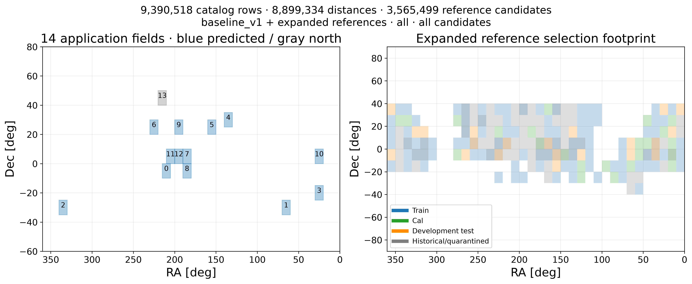

Application rectangles are configuration boundaries, not masked effective area. Reference cells show selection footprint; counts and stars/deg² are in CSV.

[PDF](../figures/v2_0/main/01_scope.pdf) · [CSV](../manifests/v2_0/figures/01_scope.csv) · [元数据](../manifests/v2_0/figures/01_scope.json)

### 02a_brightness_coverage

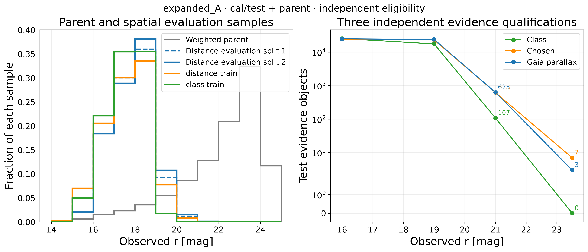

Parent retains original probability weights. No common reference mask is used for class, chosen or signed Gaia evidence.

[PDF](../figures/v2_0/main/02a_brightness_coverage.pdf) · [CSV](../manifests/v2_0/figures/02a_brightness_coverage.csv) · [元数据](../manifests/v2_0/figures/02a_brightness_coverage.json)

### 02b_color_magnitude_coverage

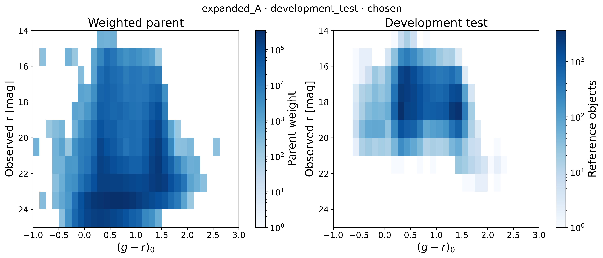

Same displayed bins; white cells have no evidence. Counts and out-of-range objects are saved. Parent density represents old DECam scope.

[PDF](../figures/v2_0/main/02b_color_magnitude_coverage.pdf) · [CSV](../manifests/v2_0/figures/02b_color_magnitude_coverage.csv) · [元数据](../manifests/v2_0/figures/02b_color_magnitude_coverage.json)

### 03_distance_all

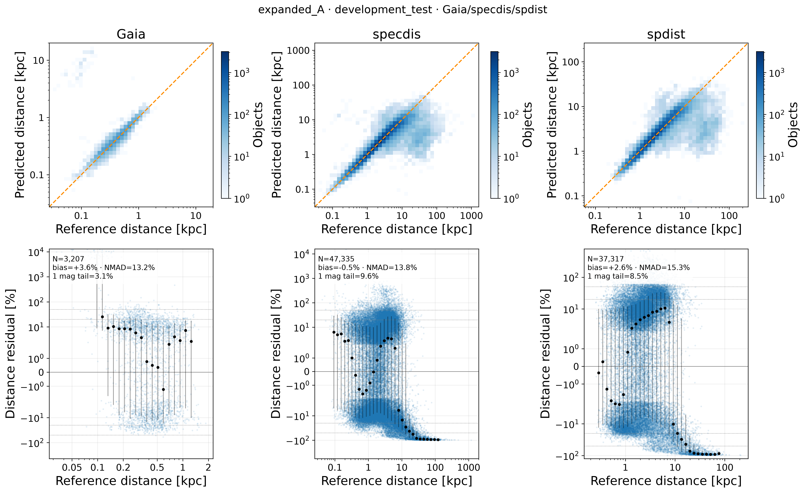

expanded_A, all, all eligible source-specific objects. Full residuals retained with symlog. Lines at 0, ±20%, ±50%. Black marks show median and 16–84% object spread, not confidence limits.

[PDF](../figures/v2_0/main/03_distance_all.pdf) · [CSV](../manifests/v2_0/figures/03_distance_all.csv) · [元数据](../manifests/v2_0/figures/03_distance_all.json)

### 04_cmd_all

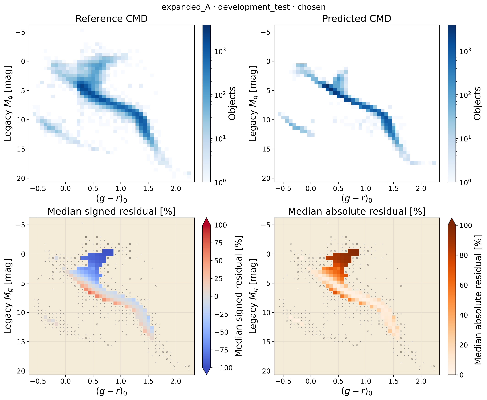

Same 47,756 objects, expanded_A chosen references. Mg_phot-Mg_ref=-delta_mu. Both CMD coordinates and residuals share distance estimates; associations do not establish physical causes.

[PDF](../figures/v2_0/main/04_cmd_all.pdf) · [CSV](../manifests/v2_0/figures/04_cmd_all.csv) · [元数据](../manifests/v2_0/figures/04_cmd_all.json)

### 05_colors_grz_all

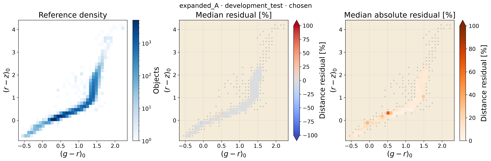

expanded_A optical residuals in grz coordinates, all; WISE colors require state4, i colors require usable i. No negative flux-to-magnitude conversion. Full coordinate extents, N>=20 performance cells.

[PDF](../figures/v2_0/main/05_colors_grz_all.pdf) · [CSV](../manifests/v2_0/figures/05_colors_grz_all.csv) · [元数据](../manifests/v2_0/figures/05_colors_grz_all.json)

### 06a_kiel

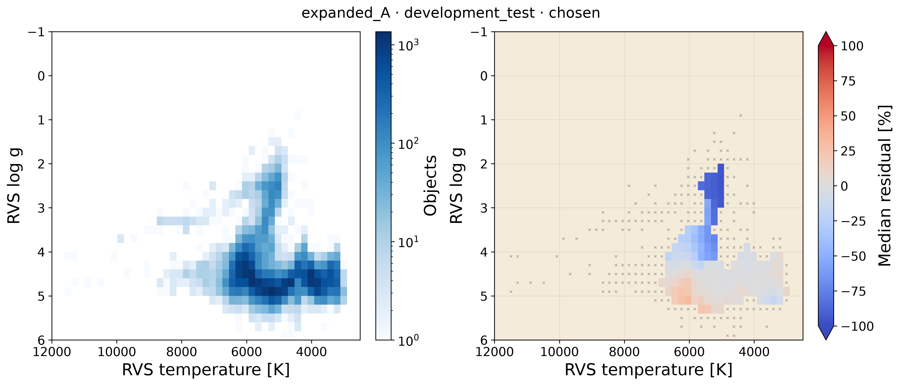

Qualified continuous RVS parameters, expanded_A. Fixed display ranges and excluded counts retained; coarse evolved/other labels do not assign RGB/RC/HB phases.

[PDF](../figures/v2_0/main/06a_kiel.pdf) · [CSV](../manifests/v2_0/figures/06a_kiel.csv) · [元数据](../manifests/v2_0/figures/06a_kiel.json)

### 06b_metallicity

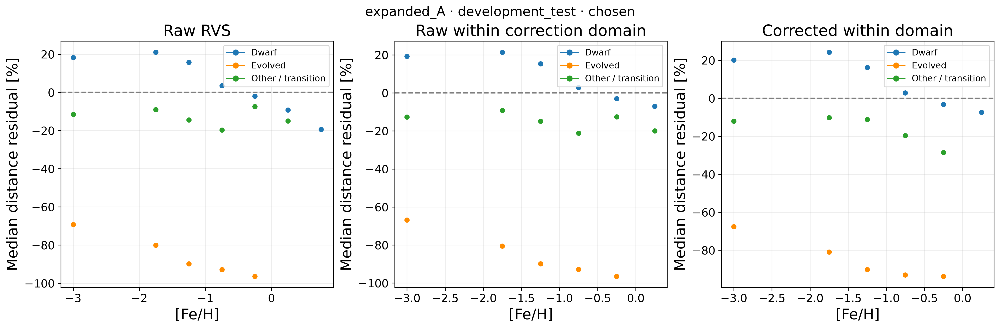

RVS abundance correction restricted to 4200<=Teff<6600 and 1.8<=logg<5.5. Raw/domain/raw-corrected comparisons use finite FeH and positive formal error. Metal-poor is not halo membership.

[PDF](../figures/v2_0/main/06b_metallicity.pdf) · [CSV](../manifests/v2_0/figures/06b_metallicity.csv) · [元数据](../manifests/v2_0/figures/06b_metallicity.json)

### 06c_spectral_trends

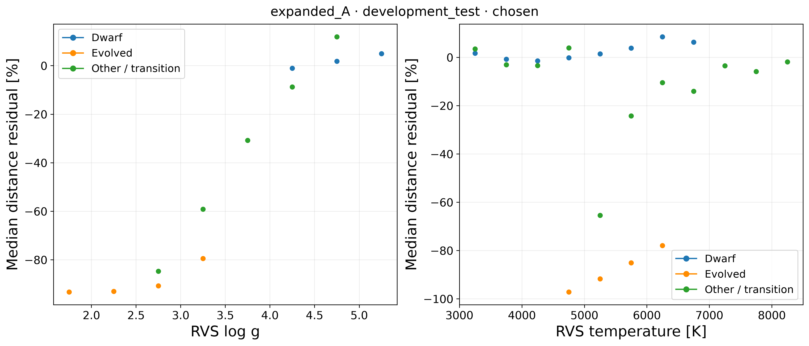

RVS-qualified sources, N>=20 bins. Per-class counts and full percentage metrics in CSV.

[PDF](../figures/v2_0/main/06c_spectral_trends.pdf) · [CSV](../manifests/v2_0/figures/06c_spectral_trends.csv) · [元数据](../manifests/v2_0/figures/06c_spectral_trends.json)

### 07_conditions_r

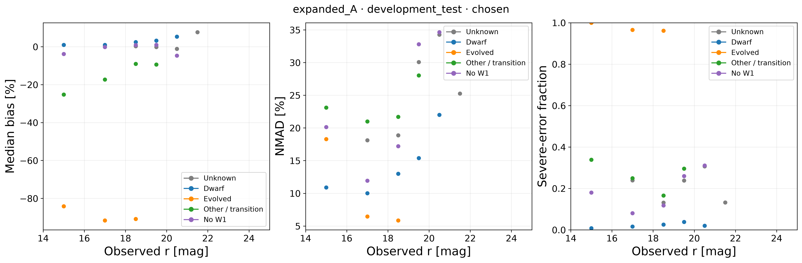

expanded_A by class and no-W1 group. Separate markers show occupied bins; sparse layers not interpolated. Complete bin counts and percentage metrics are in CSV.

[PDF](../figures/v2_0/main/07_conditions_r.pdf) · [CSV](../manifests/v2_0/figures/07_conditions_r.csv) · [元数据](../manifests/v2_0/figures/07_conditions_r.json)

### 07b_intervals_and_counts

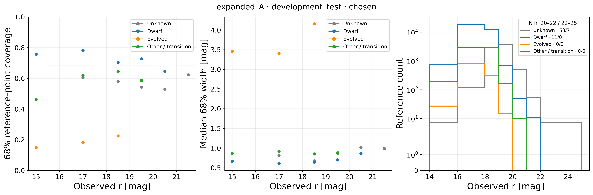

Width and coverage are displayed together. Sparse faint layers retain actual N and do not imply broad validation.

[PDF](../figures/v2_0/main/07b_intervals_and_counts.pdf) · [CSV](../manifests/v2_0/figures/07b_intervals_and_counts.csv) · [元数据](../manifests/v2_0/figures/07b_intervals_and_counts.json)

### 08a_coverage_width

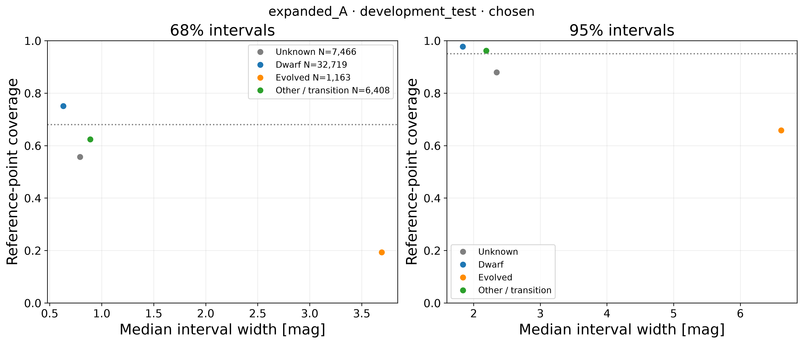

Raw expanded_A intervals relative to chosen catalog point estimates. Catalog uncertainties and common upstream information are not removed.

[PDF](../figures/v2_0/main/08a_coverage_width.pdf) · [CSV](../manifests/v2_0/figures/08a_coverage_width.csv) · [元数据](../manifests/v2_0/figures/08a_coverage_width.json)

### 08b_gaia_pit

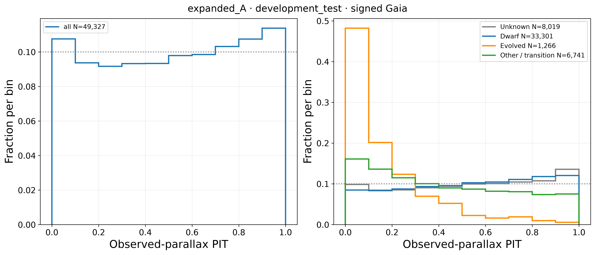

All signed eligible Gaia parallaxes from refined sidecars. Negative observations retained. Class-conditional PIT is diagnostic and does not alone prove unconditional mixture weights wrong.

[PDF](../figures/v2_0/main/08b_gaia_pit.pdf) · [CSV](../manifests/v2_0/figures/08b_gaia_pit.csv) · [元数据](../manifests/v2_0/figures/08b_gaia_pit.json)

### 09a_band_availability

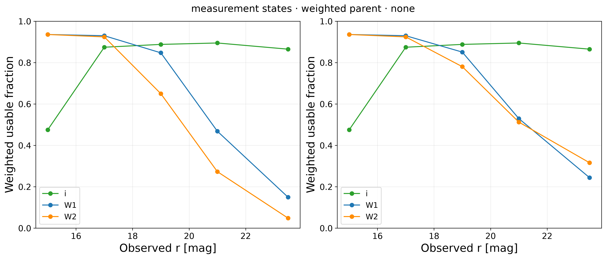

Original26000 probability sample, original DECam weights. High S/N and signed valid measurements separated. Exact application route counts are a different population statistic.

[PDF](../figures/v2_0/main/09a_band_availability.pdf) · [CSV](../manifests/v2_0/figures/09a_band_availability.csv) · [元数据](../manifests/v2_0/figures/09a_band_availability.json)

### 09b_wise_states

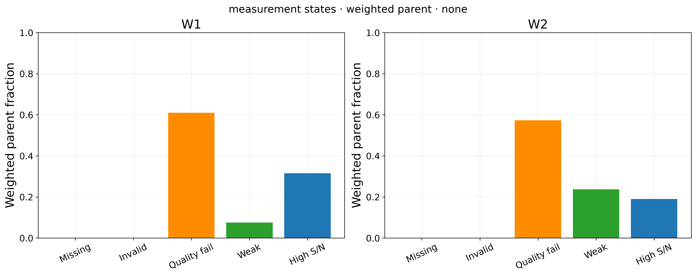

Five states retain missing, invalid and quality failure apart from signed weak and high-S/N measurements. Joint W1-only/W2-only/both/neither in CSV.

[PDF](../figures/v2_0/main/09b_wise_states.pdf) · [CSV](../manifests/v2_0/figures/09b_wise_states.csv) · [元数据](../manifests/v2_0/figures/09b_wise_states.json)

### 09c_joint_states

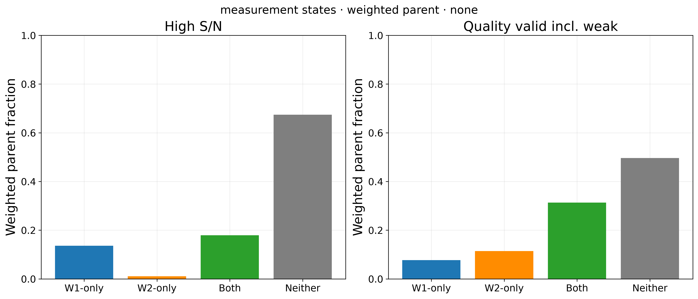

Independent per-band measurement availability; quality failures remain excluded. Original weighted parent, not exact deployment routing.

[PDF](../figures/v2_0/main/09c_joint_states.pdf) · [CSV](../manifests/v2_0/figures/09c_joint_states.csv) · [元数据](../manifests/v2_0/figures/09c_joint_states.json)

### 10a_experiment_tradeoffs

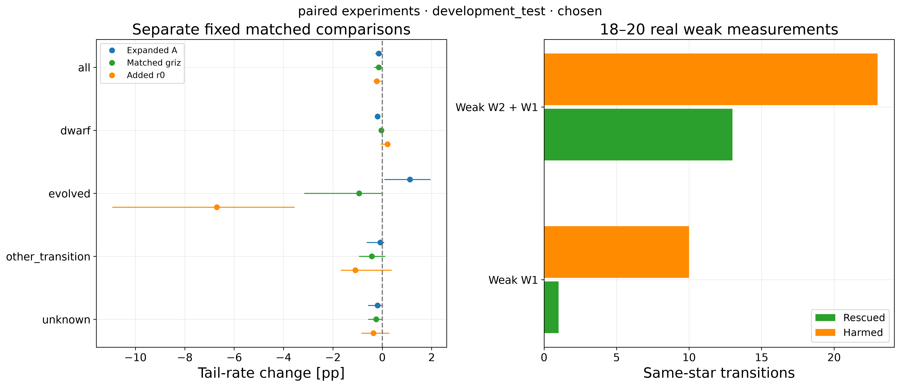

Each experiment has its own matched identities, training controls and N in CSV. These are not a continuous version ranking. r0 preserves max_features0.75, changing realized split candidates1→2.

[PDF](../figures/v2_0/main/10a_experiment_tradeoffs.pdf) · [CSV](../manifests/v2_0/figures/10a_experiment_tradeoffs.csv) · [元数据](../manifests/v2_0/figures/10a_experiment_tradeoffs.json)

### 10c_interval_tradeoffs

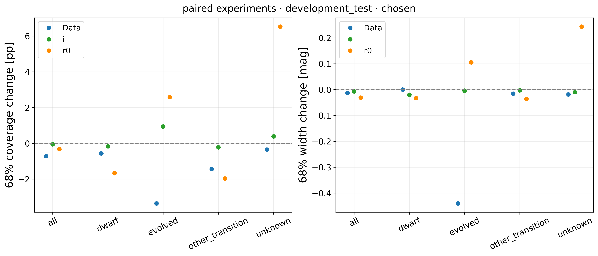

Paired data/i/r0 effects on reference-point coverage and width are displayed together. Each has its own fixed sample.

[PDF](../figures/v2_0/main/10c_interval_tradeoffs.pdf) · [CSV](../manifests/v2_0/figures/10c_interval_tradeoffs.csv) · [元数据](../manifests/v2_0/figures/10c_interval_tradeoffs.json)

### 10b_high_snr_information

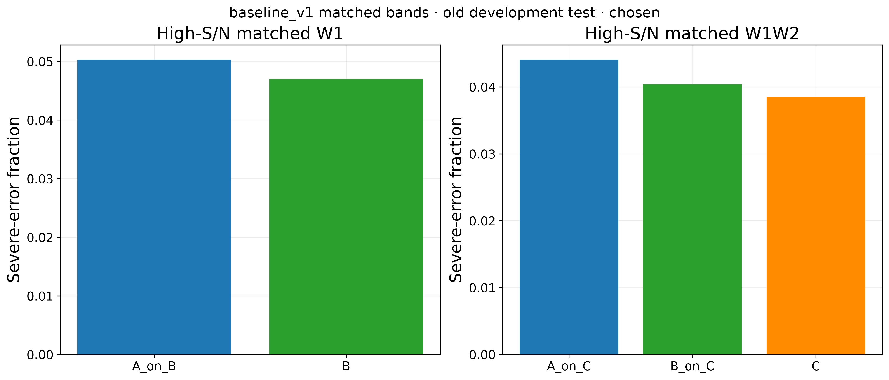

Existing v1 A_on_B/B and A_on_C/B_on_C/C matched training and source controls. Original specific model identifiers retained.

[PDF](../figures/v2_0/main/10b_high_snr_information.pdf) · [CSV](../manifests/v2_0/figures/10b_high_snr_information.csv) · [元数据](../manifests/v2_0/figures/10b_high_snr_information.json)

## 附图

### 03_distance_dwarf

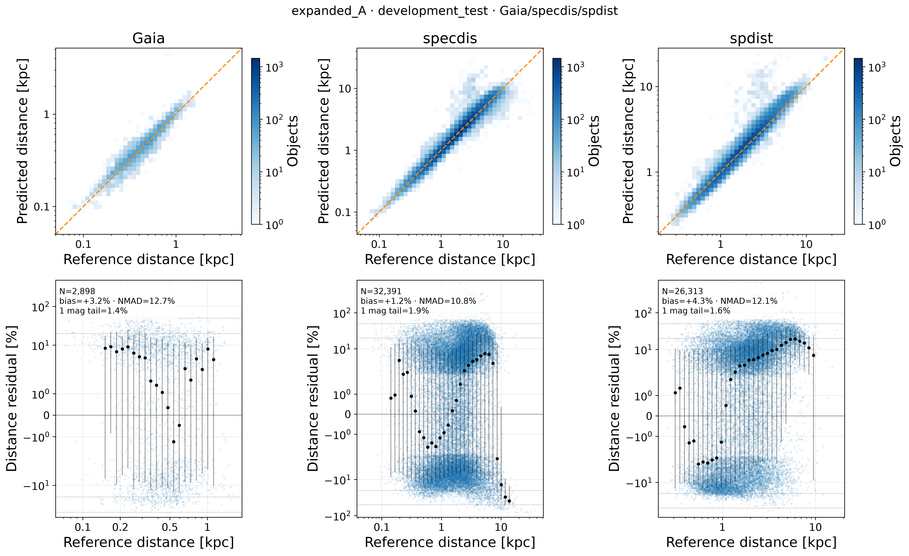

expanded_A, dwarf, all eligible source-specific objects. Full residuals retained with symlog. Lines at 0, ±20%, ±50%. Black marks show median and 16–84% object spread, not confidence limits.

[PDF](../figures/v2_0/appendix/03_distance_dwarf.pdf) · [CSV](../manifests/v2_0/figures/03_distance_dwarf.csv) · [元数据](../manifests/v2_0/figures/03_distance_dwarf.json)

### 04_cmd_dwarf

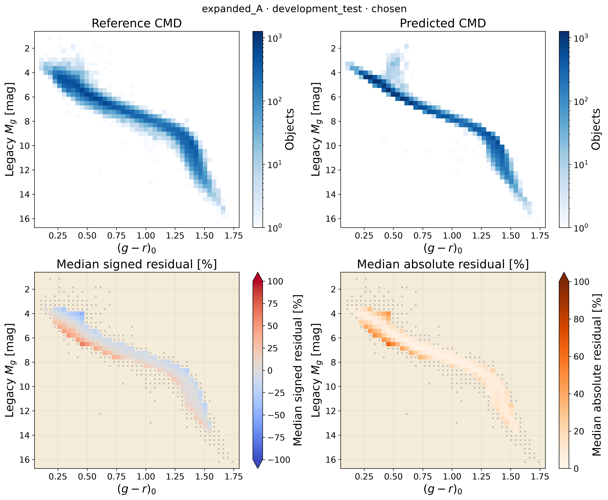

Same 32,719 objects, expanded_A chosen references. Mg_phot-Mg_ref=-delta_mu. Both CMD coordinates and residuals share distance estimates; associations do not establish physical causes.

[PDF](../figures/v2_0/appendix/04_cmd_dwarf.pdf) · [CSV](../manifests/v2_0/figures/04_cmd_dwarf.csv) · [元数据](../manifests/v2_0/figures/04_cmd_dwarf.json)

### 03_distance_evolved

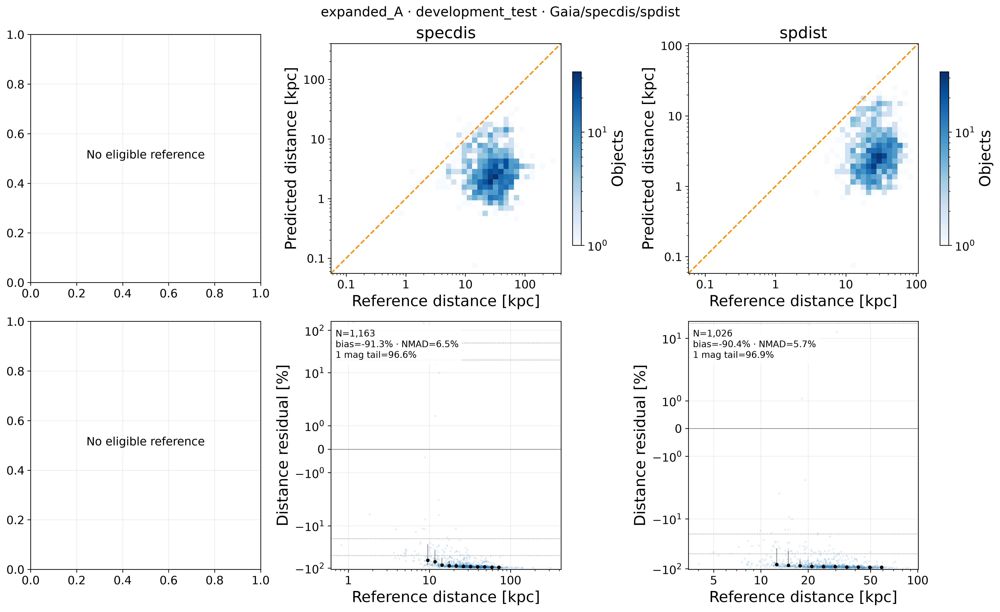

expanded_A, evolved, all eligible source-specific objects. Full residuals retained with symlog. Lines at 0, ±20%, ±50%. Black marks show median and 16–84% object spread, not confidence limits.

[PDF](../figures/v2_0/appendix/03_distance_evolved.pdf) · [CSV](../manifests/v2_0/figures/03_distance_evolved.csv) · [元数据](../manifests/v2_0/figures/03_distance_evolved.json)

### 04_cmd_evolved

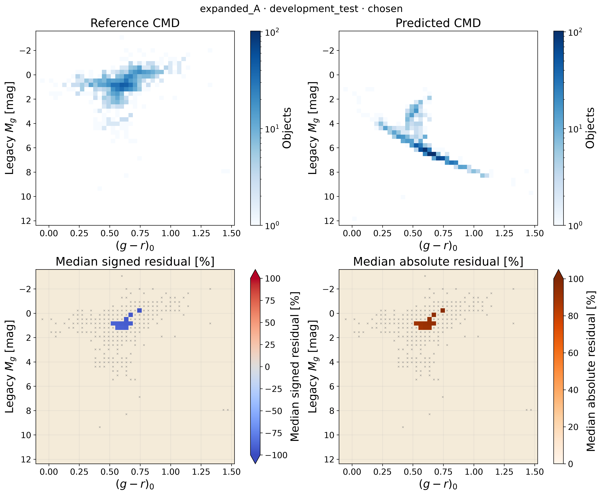

Same 1,163 objects, expanded_A chosen references. Mg_phot-Mg_ref=-delta_mu. Both CMD coordinates and residuals share distance estimates; associations do not establish physical causes.

[PDF](../figures/v2_0/appendix/04_cmd_evolved.pdf) · [CSV](../manifests/v2_0/figures/04_cmd_evolved.csv) · [元数据](../manifests/v2_0/figures/04_cmd_evolved.json)

### 03_distance_other

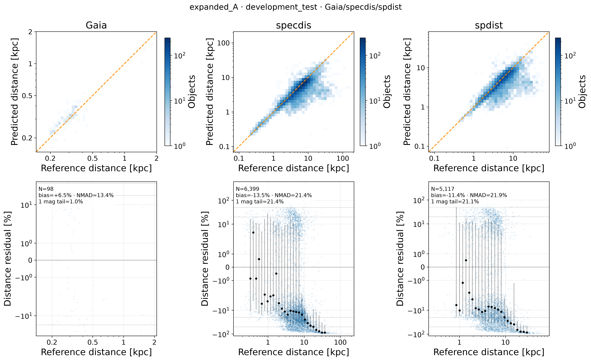

expanded_A, other, all eligible source-specific objects. Full residuals retained with symlog. Lines at 0, ±20%, ±50%. Black marks show median and 16–84% object spread, not confidence limits.

[PDF](../figures/v2_0/appendix/03_distance_other.pdf) · [CSV](../manifests/v2_0/figures/03_distance_other.csv) · [元数据](../manifests/v2_0/figures/03_distance_other.json)

### 04_cmd_other

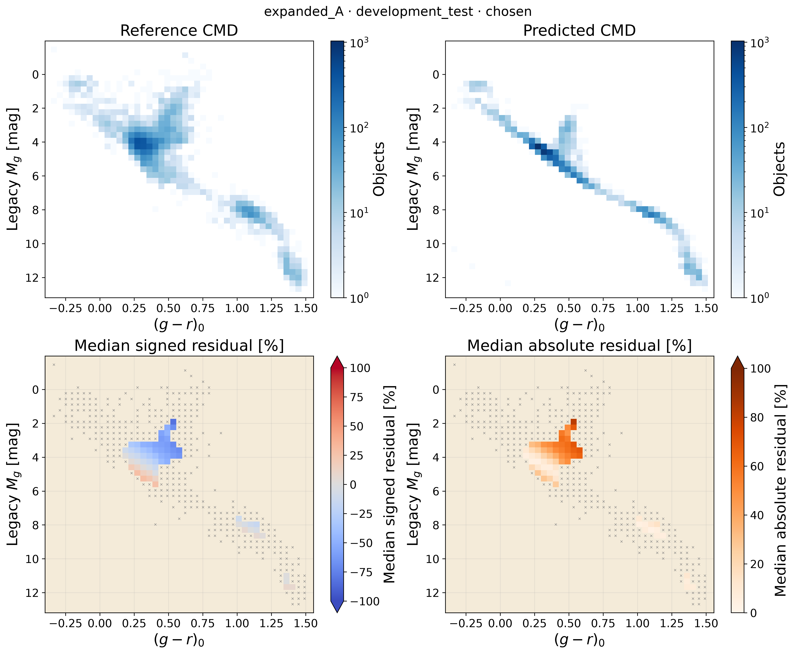

Same 6,408 objects, expanded_A chosen references. Mg_phot-Mg_ref=-delta_mu. Both CMD coordinates and residuals share distance estimates; associations do not establish physical causes.

[PDF](../figures/v2_0/appendix/04_cmd_other.pdf) · [CSV](../manifests/v2_0/figures/04_cmd_other.csv) · [元数据](../manifests/v2_0/figures/04_cmd_other.json)

### 03_distance_unknown

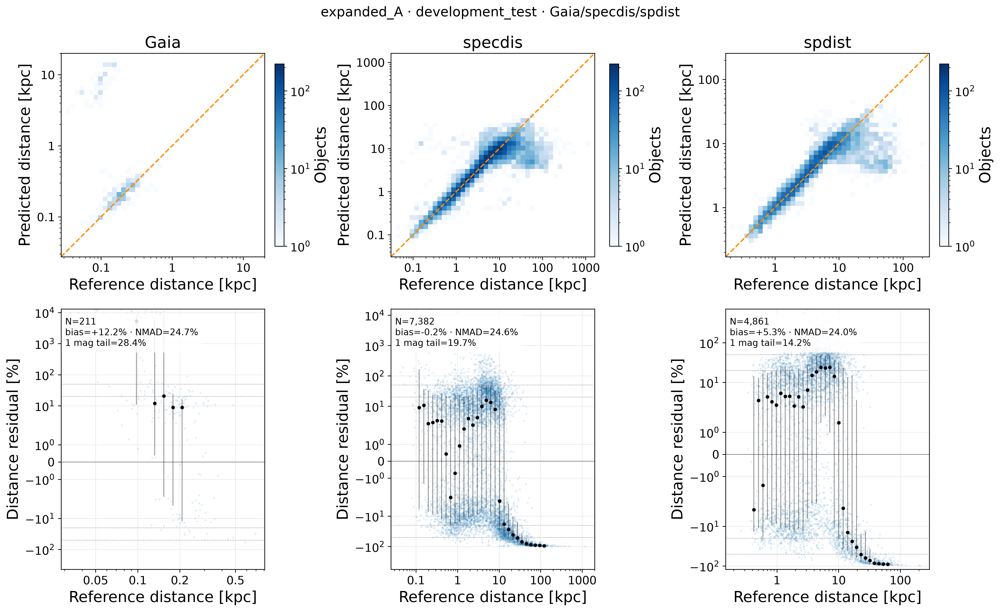

expanded_A, unknown, all eligible source-specific objects. Full residuals retained with symlog. Lines at 0, ±20%, ±50%. Black marks show median and 16–84% object spread, not confidence limits.

[PDF](../figures/v2_0/appendix/03_distance_unknown.pdf) · [CSV](../manifests/v2_0/figures/03_distance_unknown.csv) · [元数据](../manifests/v2_0/figures/03_distance_unknown.json)

### 04_cmd_unknown

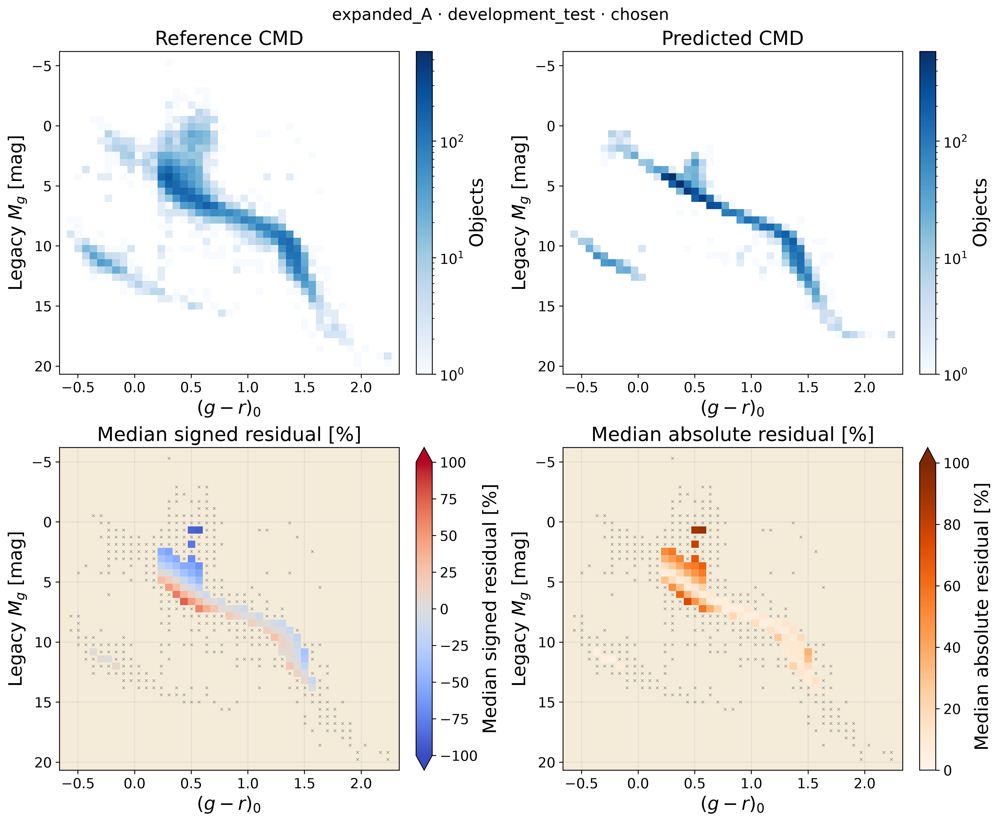

Same 7,466 objects, expanded_A chosen references. Mg_phot-Mg_ref=-delta_mu. Both CMD coordinates and residuals share distance estimates; associations do not establish physical causes.

[PDF](../figures/v2_0/appendix/04_cmd_unknown.pdf) · [CSV](../manifests/v2_0/figures/04_cmd_unknown.csv) · [元数据](../manifests/v2_0/figures/04_cmd_unknown.json)

### 05_colors_grz_dwarf

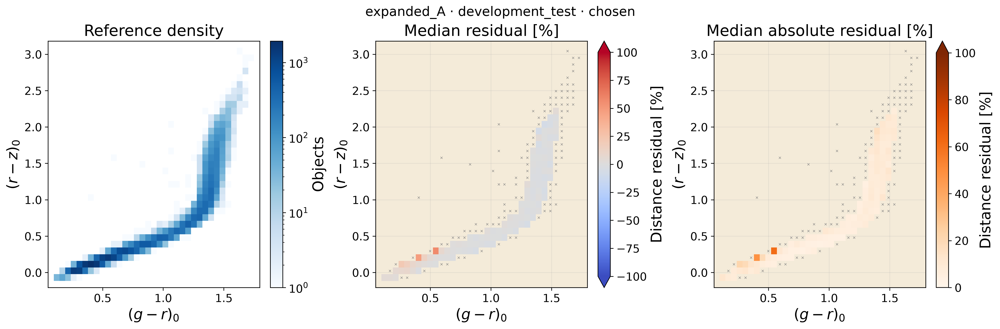

expanded_A optical residuals in grz coordinates, dwarf; WISE colors require state4, i colors require usable i. No negative flux-to-magnitude conversion. Full coordinate extents, N>=20 performance cells.

[PDF](../figures/v2_0/appendix/05_colors_grz_dwarf.pdf) · [CSV](../manifests/v2_0/figures/05_colors_grz_dwarf.csv) · [元数据](../manifests/v2_0/figures/05_colors_grz_dwarf.json)

### 05_colors_grz_evolved

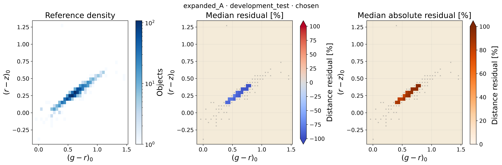

expanded_A optical residuals in grz coordinates, evolved; WISE colors require state4, i colors require usable i. No negative flux-to-magnitude conversion. Full coordinate extents, N>=20 performance cells.

[PDF](../figures/v2_0/appendix/05_colors_grz_evolved.pdf) · [CSV](../manifests/v2_0/figures/05_colors_grz_evolved.csv) · [元数据](../manifests/v2_0/figures/05_colors_grz_evolved.json)

### 05_colors_grz_other

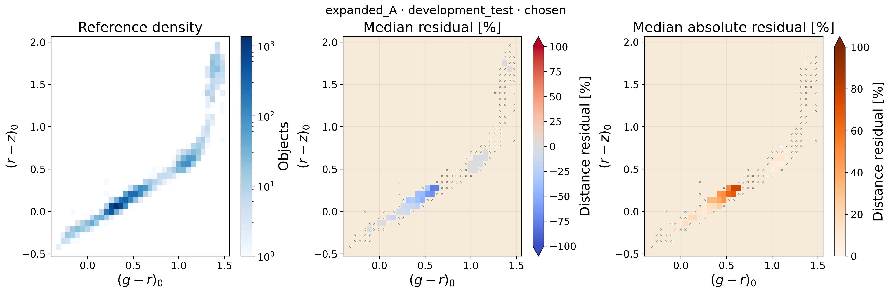

expanded_A optical residuals in grz coordinates, other; WISE colors require state4, i colors require usable i. No negative flux-to-magnitude conversion. Full coordinate extents, N>=20 performance cells.

[PDF](../figures/v2_0/appendix/05_colors_grz_other.pdf) · [CSV](../manifests/v2_0/figures/05_colors_grz_other.csv) · [元数据](../manifests/v2_0/figures/05_colors_grz_other.json)

### 05_colors_grz_unknown

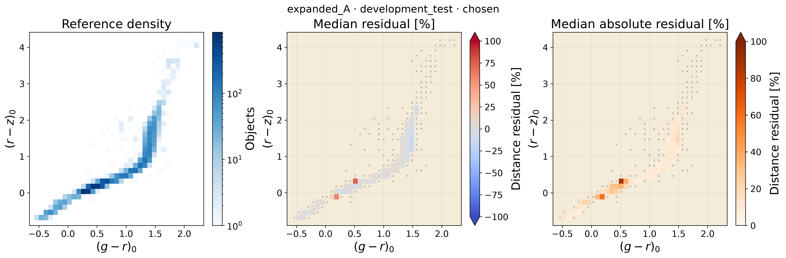

expanded_A optical residuals in grz coordinates, unknown; WISE colors require state4, i colors require usable i. No negative flux-to-magnitude conversion. Full coordinate extents, N>=20 performance cells.

[PDF](../figures/v2_0/appendix/05_colors_grz_unknown.pdf) · [CSV](../manifests/v2_0/figures/05_colors_grz_unknown.csv) · [元数据](../manifests/v2_0/figures/05_colors_grz_unknown.json)

### 05_colors_grW1_all

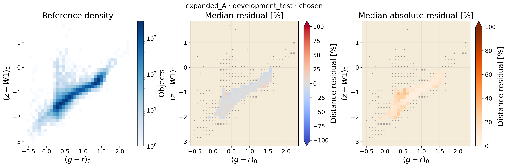

expanded_A optical residuals in grW1 coordinates, all; WISE colors require state4, i colors require usable i. No negative flux-to-magnitude conversion. Full coordinate extents, N>=20 performance cells.

[PDF](../figures/v2_0/appendix/05_colors_grW1_all.pdf) · [CSV](../manifests/v2_0/figures/05_colors_grW1_all.csv) · [元数据](../manifests/v2_0/figures/05_colors_grW1_all.json)

### 05_colors_grW1_dwarf

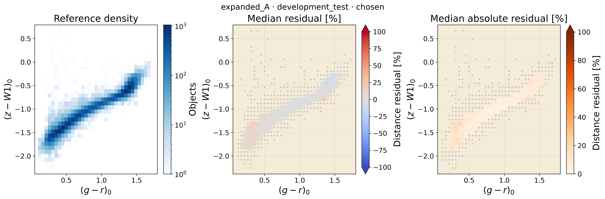

expanded_A optical residuals in grW1 coordinates, dwarf; WISE colors require state4, i colors require usable i. No negative flux-to-magnitude conversion. Full coordinate extents, N>=20 performance cells.

[PDF](../figures/v2_0/appendix/05_colors_grW1_dwarf.pdf) · [CSV](../manifests/v2_0/figures/05_colors_grW1_dwarf.csv) · [元数据](../manifests/v2_0/figures/05_colors_grW1_dwarf.json)

### 05_colors_grW1_evolved

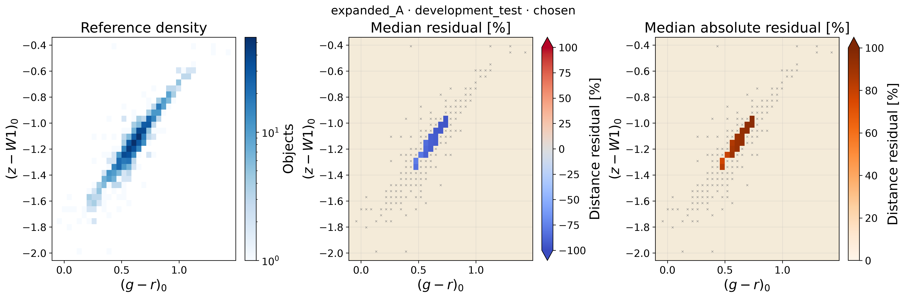

expanded_A optical residuals in grW1 coordinates, evolved; WISE colors require state4, i colors require usable i. No negative flux-to-magnitude conversion. Full coordinate extents, N>=20 performance cells.

[PDF](../figures/v2_0/appendix/05_colors_grW1_evolved.pdf) · [CSV](../manifests/v2_0/figures/05_colors_grW1_evolved.csv) · [元数据](../manifests/v2_0/figures/05_colors_grW1_evolved.json)

### 05_colors_grW1_other

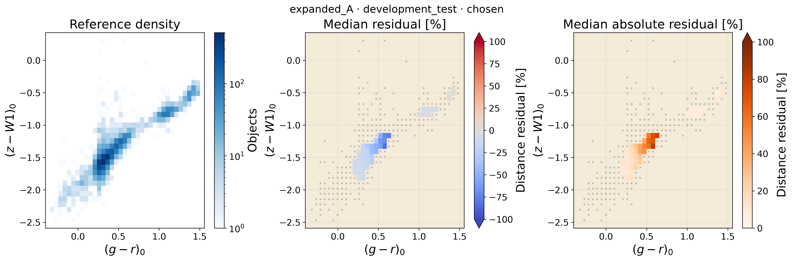

expanded_A optical residuals in grW1 coordinates, other; WISE colors require state4, i colors require usable i. No negative flux-to-magnitude conversion. Full coordinate extents, N>=20 performance cells.

[PDF](../figures/v2_0/appendix/05_colors_grW1_other.pdf) · [CSV](../manifests/v2_0/figures/05_colors_grW1_other.csv) · [元数据](../manifests/v2_0/figures/05_colors_grW1_other.json)

### 05_colors_grW1_unknown

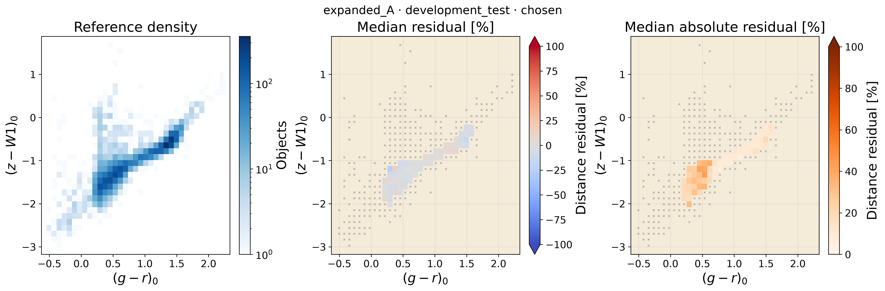

expanded_A optical residuals in grW1 coordinates, unknown; WISE colors require state4, i colors require usable i. No negative flux-to-magnitude conversion. Full coordinate extents, N>=20 performance cells.

[PDF](../figures/v2_0/appendix/05_colors_grW1_unknown.pdf) · [CSV](../manifests/v2_0/figures/05_colors_grW1_unknown.csv) · [元数据](../manifests/v2_0/figures/05_colors_grW1_unknown.json)

### 05_colors_WISE_all

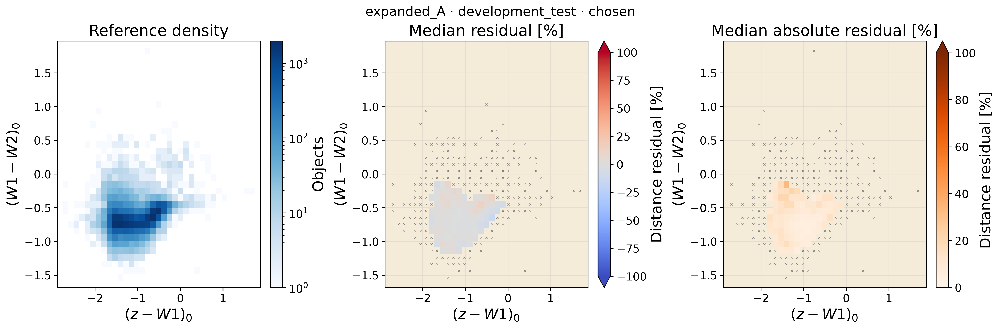

expanded_A optical residuals in WISE coordinates, all; WISE colors require state4, i colors require usable i. No negative flux-to-magnitude conversion. Full coordinate extents, N>=20 performance cells.

[PDF](../figures/v2_0/appendix/05_colors_WISE_all.pdf) · [CSV](../manifests/v2_0/figures/05_colors_WISE_all.csv) · [元数据](../manifests/v2_0/figures/05_colors_WISE_all.json)

### 05_colors_WISE_dwarf

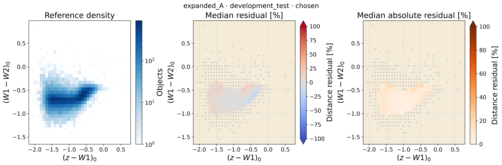

expanded_A optical residuals in WISE coordinates, dwarf; WISE colors require state4, i colors require usable i. No negative flux-to-magnitude conversion. Full coordinate extents, N>=20 performance cells.

[PDF](../figures/v2_0/appendix/05_colors_WISE_dwarf.pdf) · [CSV](../manifests/v2_0/figures/05_colors_WISE_dwarf.csv) · [元数据](../manifests/v2_0/figures/05_colors_WISE_dwarf.json)

### 05_colors_WISE_evolved

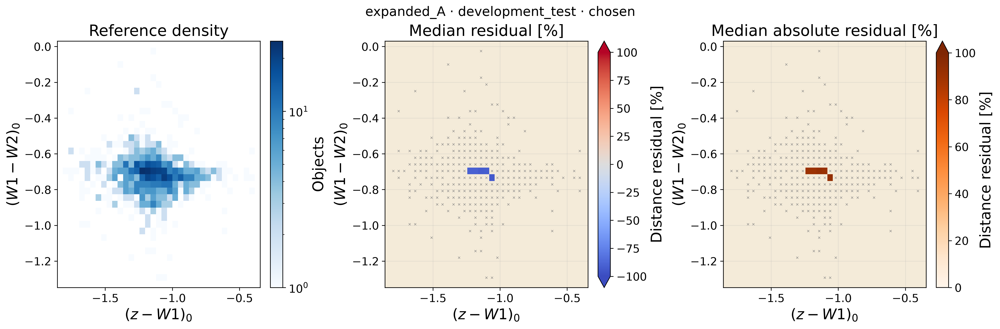

expanded_A optical residuals in WISE coordinates, evolved; WISE colors require state4, i colors require usable i. No negative flux-to-magnitude conversion. Full coordinate extents, N>=20 performance cells.

[PDF](../figures/v2_0/appendix/05_colors_WISE_evolved.pdf) · [CSV](../manifests/v2_0/figures/05_colors_WISE_evolved.csv) · [元数据](../manifests/v2_0/figures/05_colors_WISE_evolved.json)

### 05_colors_WISE_other

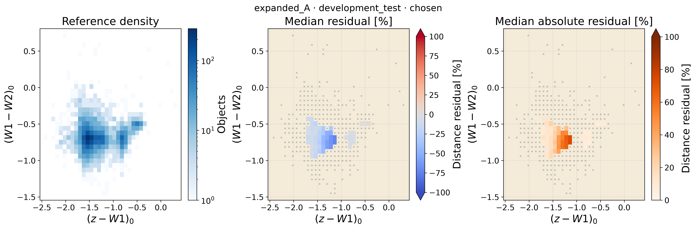

expanded_A optical residuals in WISE coordinates, other; WISE colors require state4, i colors require usable i. No negative flux-to-magnitude conversion. Full coordinate extents, N>=20 performance cells.

[PDF](../figures/v2_0/appendix/05_colors_WISE_other.pdf) · [CSV](../manifests/v2_0/figures/05_colors_WISE_other.csv) · [元数据](../manifests/v2_0/figures/05_colors_WISE_other.json)

### 05_colors_WISE_unknown

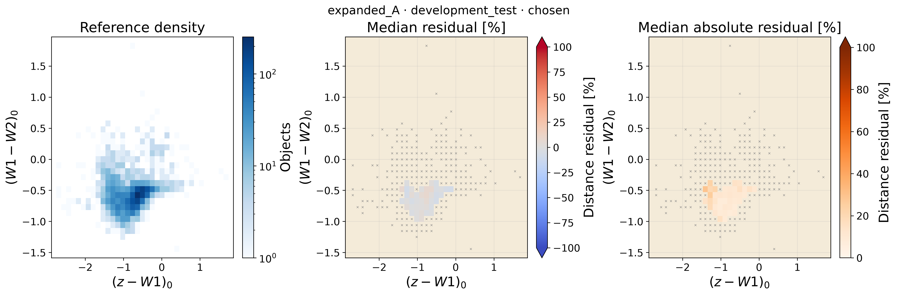

expanded_A optical residuals in WISE coordinates, unknown; WISE colors require state4, i colors require usable i. No negative flux-to-magnitude conversion. Full coordinate extents, N>=20 performance cells.

[PDF](../figures/v2_0/appendix/05_colors_WISE_unknown.pdf) · [CSV](../manifests/v2_0/figures/05_colors_WISE_unknown.csv) · [元数据](../manifests/v2_0/figures/05_colors_WISE_unknown.json)

### 05_colors_griz_all

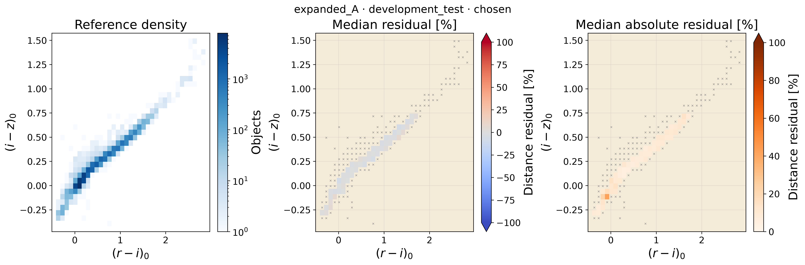

expanded_A optical residuals in griz coordinates, all; WISE colors require state4, i colors require usable i. No negative flux-to-magnitude conversion. Full coordinate extents, N>=20 performance cells.

[PDF](../figures/v2_0/appendix/05_colors_griz_all.pdf) · [CSV](../manifests/v2_0/figures/05_colors_griz_all.csv) · [元数据](../manifests/v2_0/figures/05_colors_griz_all.json)

### 05_colors_griz_dwarf

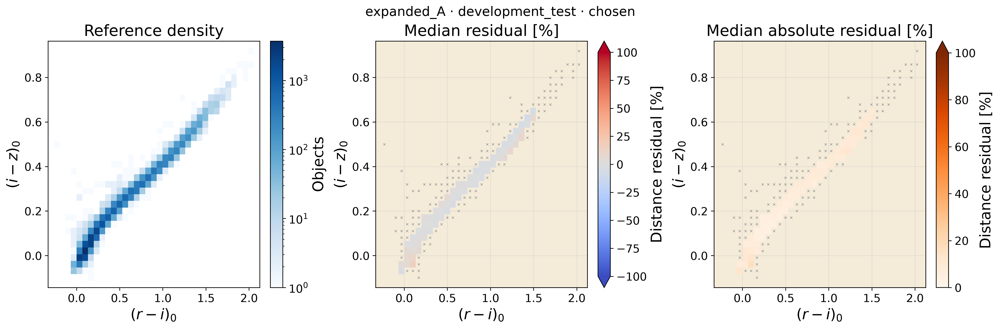

expanded_A optical residuals in griz coordinates, dwarf; WISE colors require state4, i colors require usable i. No negative flux-to-magnitude conversion. Full coordinate extents, N>=20 performance cells.

[PDF](../figures/v2_0/appendix/05_colors_griz_dwarf.pdf) · [CSV](../manifests/v2_0/figures/05_colors_griz_dwarf.csv) · [元数据](../manifests/v2_0/figures/05_colors_griz_dwarf.json)

### 05_colors_griz_evolved

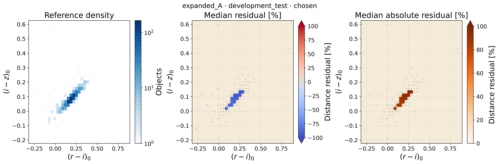

expanded_A optical residuals in griz coordinates, evolved; WISE colors require state4, i colors require usable i. No negative flux-to-magnitude conversion. Full coordinate extents, N>=20 performance cells.

[PDF](../figures/v2_0/appendix/05_colors_griz_evolved.pdf) · [CSV](../manifests/v2_0/figures/05_colors_griz_evolved.csv) · [元数据](../manifests/v2_0/figures/05_colors_griz_evolved.json)

### 05_colors_griz_other

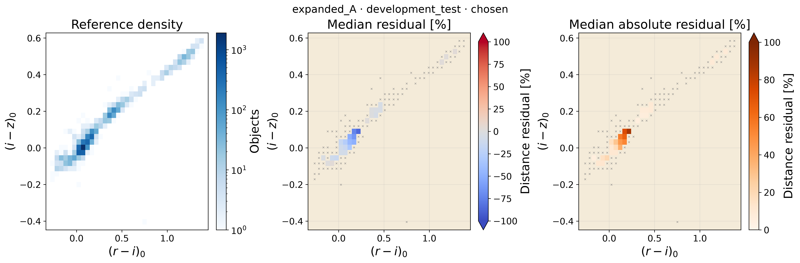

expanded_A optical residuals in griz coordinates, other; WISE colors require state4, i colors require usable i. No negative flux-to-magnitude conversion. Full coordinate extents, N>=20 performance cells.

[PDF](../figures/v2_0/appendix/05_colors_griz_other.pdf) · [CSV](../manifests/v2_0/figures/05_colors_griz_other.csv) · [元数据](../manifests/v2_0/figures/05_colors_griz_other.json)

### 05_colors_griz_unknown

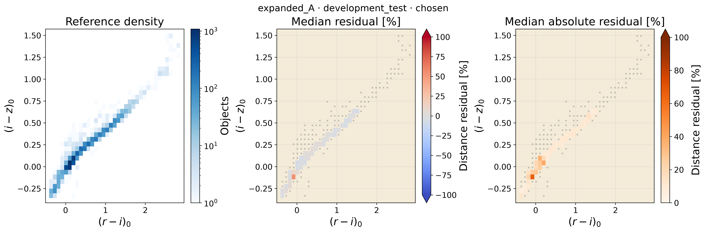

expanded_A optical residuals in griz coordinates, unknown; WISE colors require state4, i colors require usable i. No negative flux-to-magnitude conversion. Full coordinate extents, N>=20 performance cells.

[PDF](../figures/v2_0/appendix/05_colors_griz_unknown.pdf) · [CSV](../manifests/v2_0/figures/05_colors_griz_unknown.csv) · [元数据](../manifests/v2_0/figures/05_colors_griz_unknown.json)

### 07_conditions_ref_distance

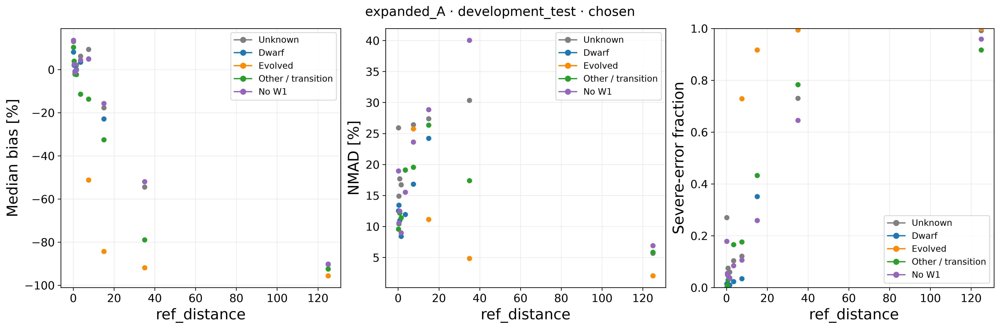

expanded_A by class and no-W1 group. Separate markers show occupied bins; sparse layers not interpolated. Complete bin counts and percentage metrics are in CSV.

[PDF](../figures/v2_0/appendix/07_conditions_ref_distance.pdf) · [CSV](../manifests/v2_0/figures/07_conditions_ref_distance.csv) · [元数据](../manifests/v2_0/figures/07_conditions_ref_distance.json)

### 07_conditions_optical_error

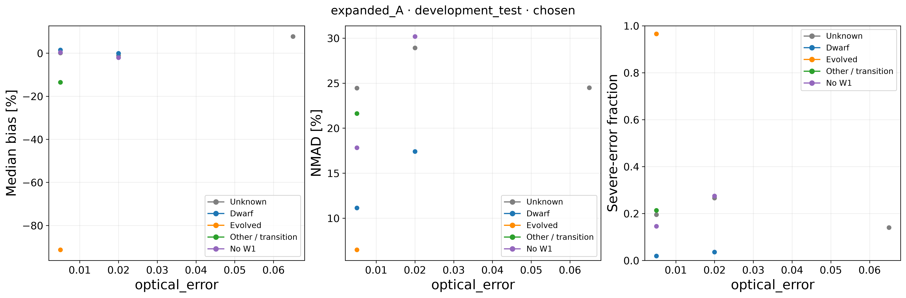

expanded_A by class and no-W1 group. Separate markers show occupied bins; sparse layers not interpolated. Complete bin counts and percentage metrics are in CSV.

[PDF](../figures/v2_0/appendix/07_conditions_optical_error.pdf) · [CSV](../manifests/v2_0/figures/07_conditions_optical_error.csv) · [元数据](../manifests/v2_0/figures/07_conditions_optical_error.json)

### 07_conditions_snr_w1

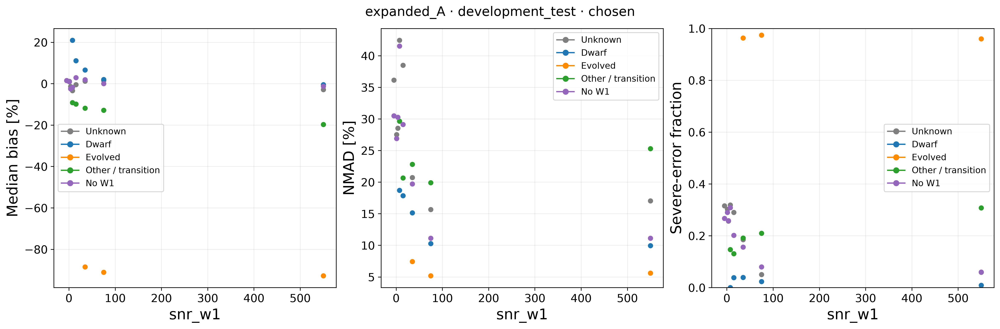

expanded_A by class and no-W1 group. Separate markers show occupied bins; sparse layers not interpolated. Complete bin counts and percentage metrics are in CSV.

[PDF](../figures/v2_0/appendix/07_conditions_snr_w1.pdf) · [CSV](../manifests/v2_0/figures/07_conditions_snr_w1.csv) · [元数据](../manifests/v2_0/figures/07_conditions_snr_w1.json)

### 07_conditions_EBV

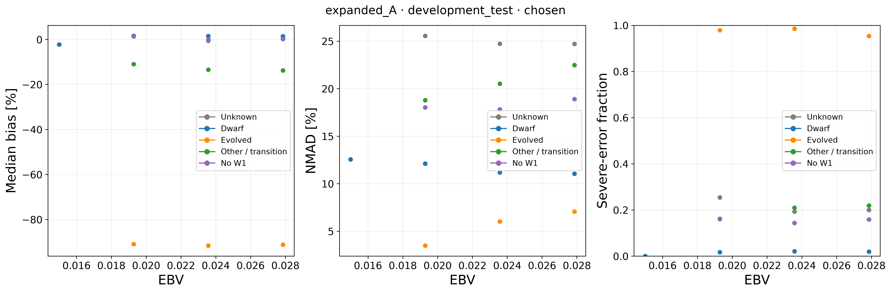

expanded_A by class and no-W1 group. Separate markers show occupied bins; sparse layers not interpolated. Complete bin counts and percentage metrics are in CSV.

[PDF](../figures/v2_0/appendix/07_conditions_EBV.pdf) · [CSV](../manifests/v2_0/figures/07_conditions_EBV.csv) · [元数据](../manifests/v2_0/figures/07_conditions_EBV.json)

### A_flags

Model-state groups do not define a reliable single-distance catalog. Rows may overlap; all counts and risks retained.

[PDF](../figures/v2_0/appendix/A_flags.pdf) · [CSV](../manifests/v2_0/figures/A_flags.csv) · [元数据](../manifests/v2_0/figures/A_flags.json)

### A_sky

Chosen test selection only. Sparse cells hatched. Per-cell solid-angle area is retained for density comparisons. No interpolation.

[PDF](../figures/v2_0/appendix/A_sky.pdf) · [CSV](../manifests/v2_0/figures/A_sky.csv) · [元数据](../manifests/v2_0/figures/A_sky.json)

### A_quality_retention

Existing fixed v1 quality grid; no re-optimization. All-class adoption failed. Raw/calibrated intervals remain distinct in the original source.

[PDF](../figures/v2_0/appendix/A_quality_retention.pdf) · [CSV](../manifests/v2_0/figures/A_quality_retention.csv) · [元数据](../manifests/v2_0/figures/A_quality_retention.json)

### A_flux_depth_stress

Existing fixed real-template artificial flux degradation. Stress-test sources are reused; it does not supply new faint-population truth.

[PDF](../figures/v2_0/appendix/A_flux_depth_stress.pdf) · [CSV](../manifests/v2_0/figures/A_flux_depth_stress.csv) · [元数据](../manifests/v2_0/figures/A_flux_depth_stress.json)

### A_fixed_pdf_examples

One object per preregistered group, fixed hash order. Four forward calls to frozen expanded_A, same Sobol128, quantiles reproduced within1e-6. Shading shows catalog reference error; examples do not estimate mechanism frequency.

[PDF](../figures/v2_0/appendix/A_fixed_pdf_examples.pdf) · [CSV](../manifests/v2_0/figures/A_fixed_pdf_examples.csv) · [元数据](../manifests/v2_0/figures/A_fixed_pdf_examples.json)

## 已有外部证据索引

- [早期统一基线](baseline_v0_result.md)、[当前应用目录范围](baseline_v1_catalog.md)和历次cluster_rgb文档保留其开发身份。外部目标未被纳入当前主模型的独立绝对精度证明。
- 固定PDF附图包含普通矮星、校正域贫金属矮星、演化星失败和宽/多峰，身份由固定哈希规则选取。
