# v2.0 修订图集 01

[完整目录](v2_0_revision_atlas.md)

## anomaly_colors

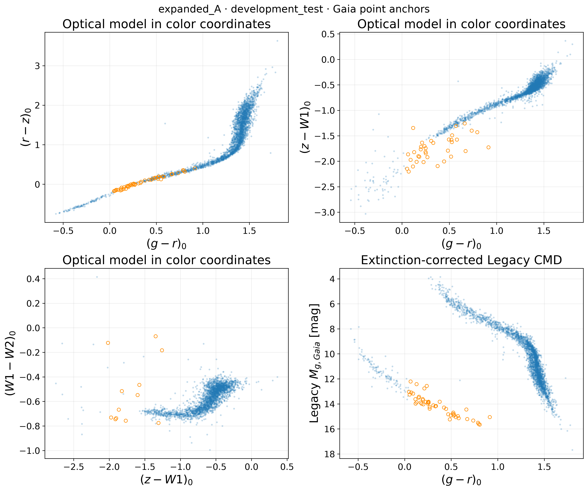

Legacy magnitudes extinction corrected. WISE colors require their own state4. Model remains expanded_A grz. Highlight is a residual-selected diagnostic set, not a WD classification.

[PNG](../figures/v2_0_revision/anomalies/anomaly_colors.png) · [PDF](../figures/v2_0_revision/anomalies/anomaly_colors.pdf) · [CSV](../manifests/v2_0_revision/figures/anomaly_colors.csv) · [元数据](../manifests/v2_0_revision/figures/anomaly_colors.json)

## anomaly_gaia

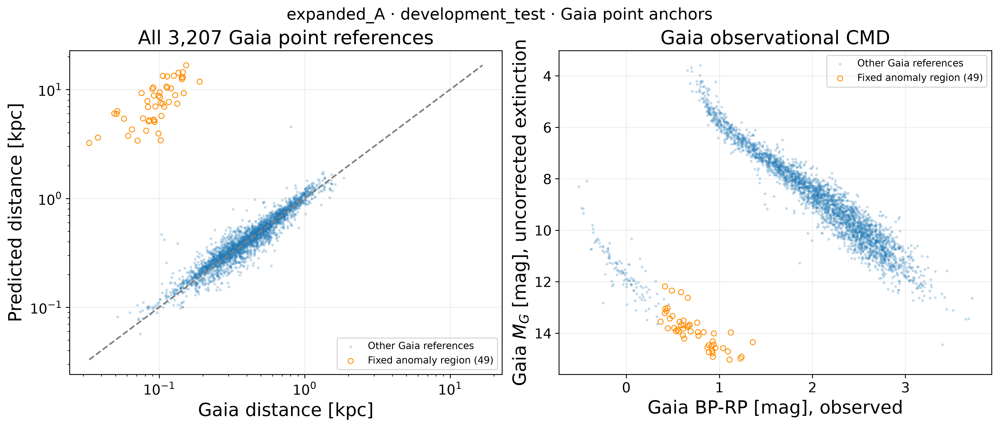

Exactly predeclared d_Gaia<0.2 kpc and d_phot,50>2 kpc. Gaia M_G uses corrected-parallax distance modulus but observed G, without extinction correction. No anomaly removed.

[PNG](../figures/v2_0_revision/anomalies/anomaly_gaia.png) · [PDF](../figures/v2_0_revision/anomalies/anomaly_gaia.pdf) · [CSV](../manifests/v2_0_revision/figures/anomaly_gaia.csv) · [元数据](../manifests/v2_0_revision/figures/anomaly_gaia.json)

## anomaly_pdf_examples

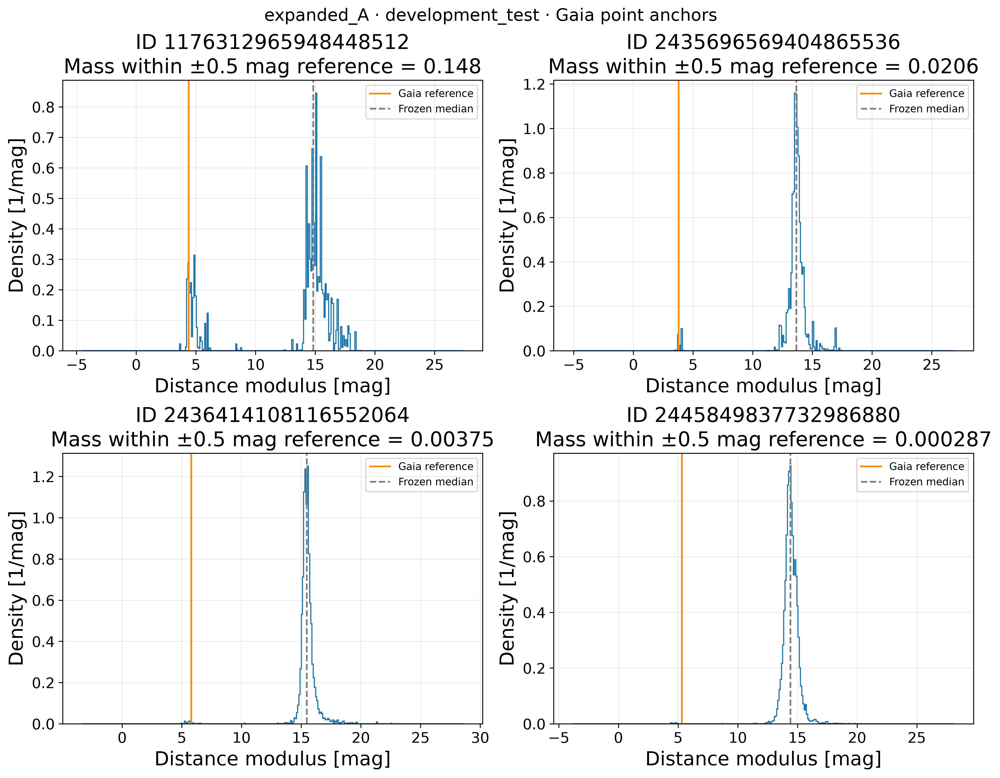

Four lowest Gaia IDs from the fixed 49-object list. Frozen expanded_A and shared Sobol128; all original quantiles reproduced within1e-6. Reference-window mass is descriptive, not class probability.

[PNG](../figures/v2_0_revision/anomalies/anomaly_pdf_examples.png) · [PDF](../figures/v2_0_revision/anomalies/anomaly_pdf_examples.pdf) · [CSV](../manifests/v2_0_revision/figures/anomaly_pdf_examples.csv) · [元数据](../manifests/v2_0_revision/figures/anomaly_pdf_examples.json)

## anomaly_quality

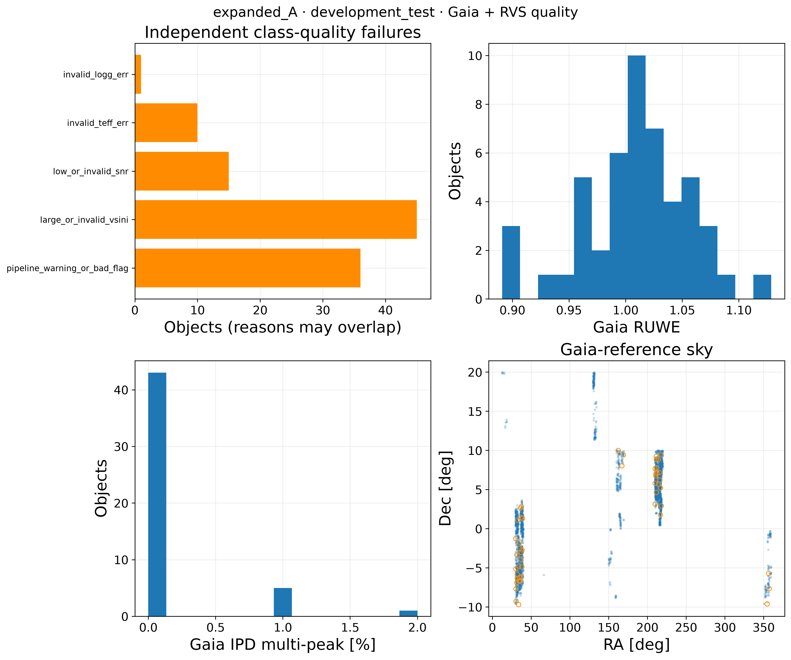

Class reasons follow frozen v3 quality, including Teff/logg validity independently of FeH. Finite but unqualified spectral parameters are not physical labels. Sky distribution does not imply population.

[PNG](../figures/v2_0_revision/anomalies/anomaly_quality.png) · [PDF](../figures/v2_0_revision/anomalies/anomaly_quality.pdf) · [CSV](../manifests/v2_0_revision/figures/anomaly_quality.csv) · [元数据](../manifests/v2_0_revision/figures/anomaly_quality.json)

## 03_distance_dwarf

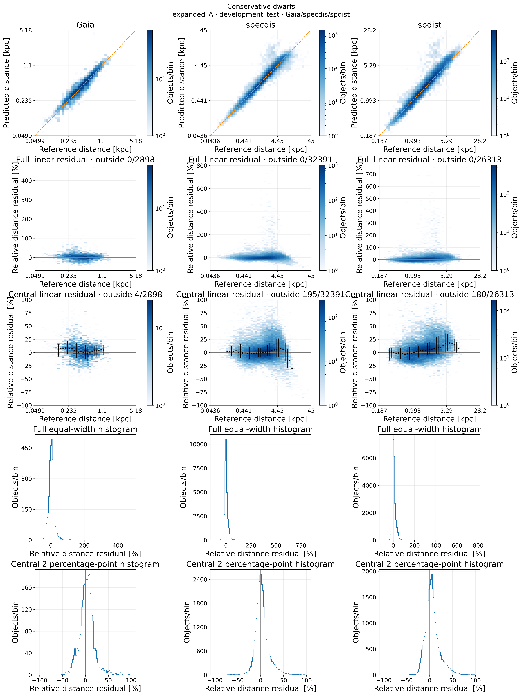

Frozen expanded_A. Source-specific same-star overlaps are allowed; source N cannot be summed as independent stars. Every residual y-axis and histogram count axis is linear. Center window uses 2 percentage-point bins. Trend bars are P16–P84 object spread, not median confidence intervals. Complete sample retained.

[PNG](../figures/v2_0_revision/appendix/03_distance_dwarf.png) · [PDF](../figures/v2_0_revision/appendix/03_distance_dwarf.pdf) · [CSV](../manifests/v2_0_revision/figures/03_distance_dwarf.csv) · [元数据](../manifests/v2_0_revision/figures/03_distance_dwarf.json)

## 03_distance_evolved

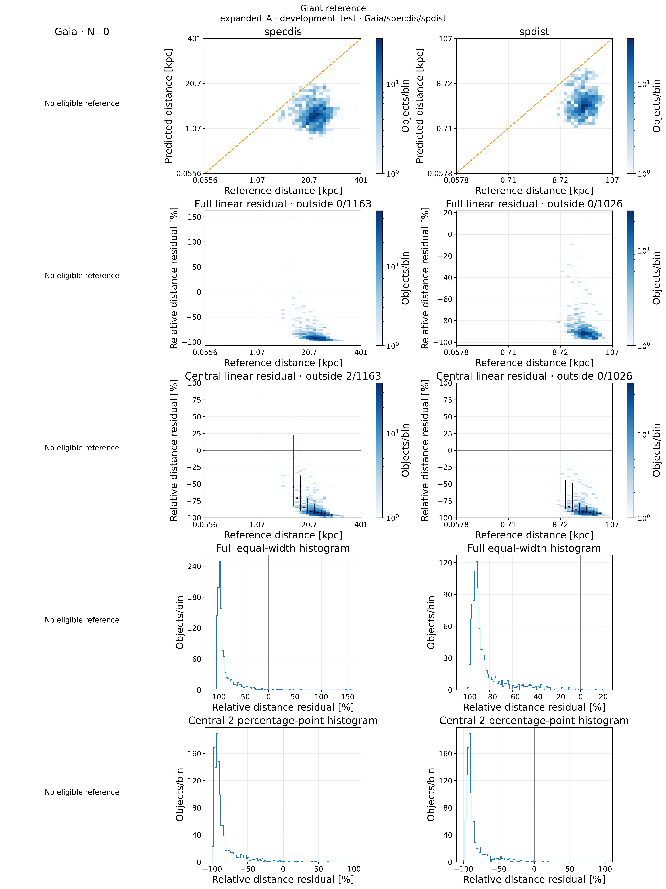

Frozen expanded_A. Source-specific same-star overlaps are allowed; source N cannot be summed as independent stars. Every residual y-axis and histogram count axis is linear. Center window uses 2 percentage-point bins. Trend bars are P16–P84 object spread, not median confidence intervals. Complete sample retained.

[PNG](../figures/v2_0_revision/appendix/03_distance_evolved.png) · [PDF](../figures/v2_0_revision/appendix/03_distance_evolved.pdf) · [CSV](../manifests/v2_0_revision/figures/03_distance_evolved.csv) · [元数据](../manifests/v2_0_revision/figures/03_distance_evolved.json)

## 03_distance_other

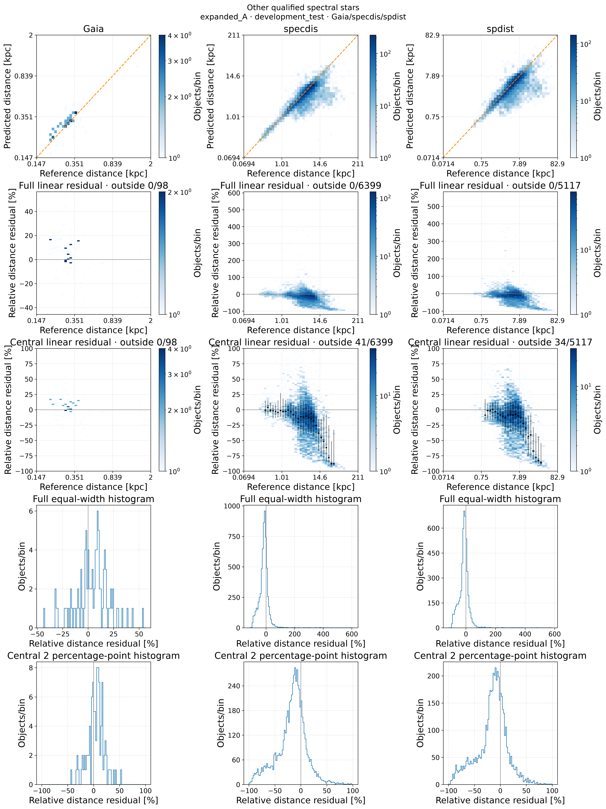

Frozen expanded_A. Source-specific same-star overlaps are allowed; source N cannot be summed as independent stars. Every residual y-axis and histogram count axis is linear. Center window uses 2 percentage-point bins. Trend bars are P16–P84 object spread, not median confidence intervals. Complete sample retained.

[PNG](../figures/v2_0_revision/appendix/03_distance_other.png) · [PDF](../figures/v2_0_revision/appendix/03_distance_other.pdf) · [CSV](../manifests/v2_0_revision/figures/03_distance_other.csv) · [元数据](../manifests/v2_0_revision/figures/03_distance_other.json)

## 03_distance_unknown

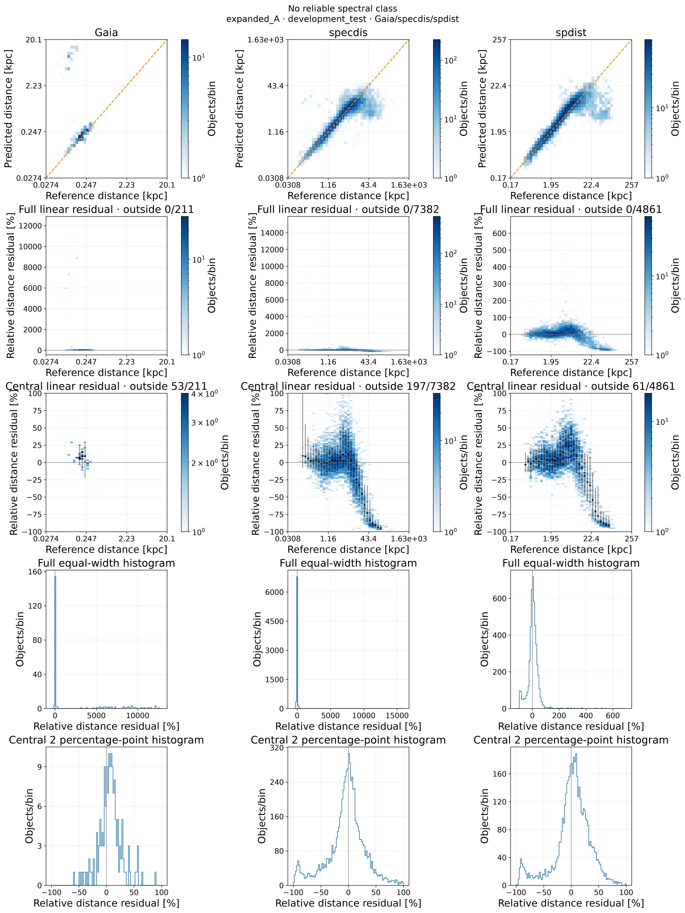

Frozen expanded_A. Source-specific same-star overlaps are allowed; source N cannot be summed as independent stars. Every residual y-axis and histogram count axis is linear. Center window uses 2 percentage-point bins. Trend bars are P16–P84 object spread, not median confidence intervals. Complete sample retained.

[PNG](../figures/v2_0_revision/appendix/03_distance_unknown.png) · [PDF](../figures/v2_0_revision/appendix/03_distance_unknown.pdf) · [CSV](../manifests/v2_0_revision/figures/03_distance_unknown.csv) · [元数据](../manifests/v2_0_revision/figures/03_distance_unknown.json)

## 04_cmd_dwarf

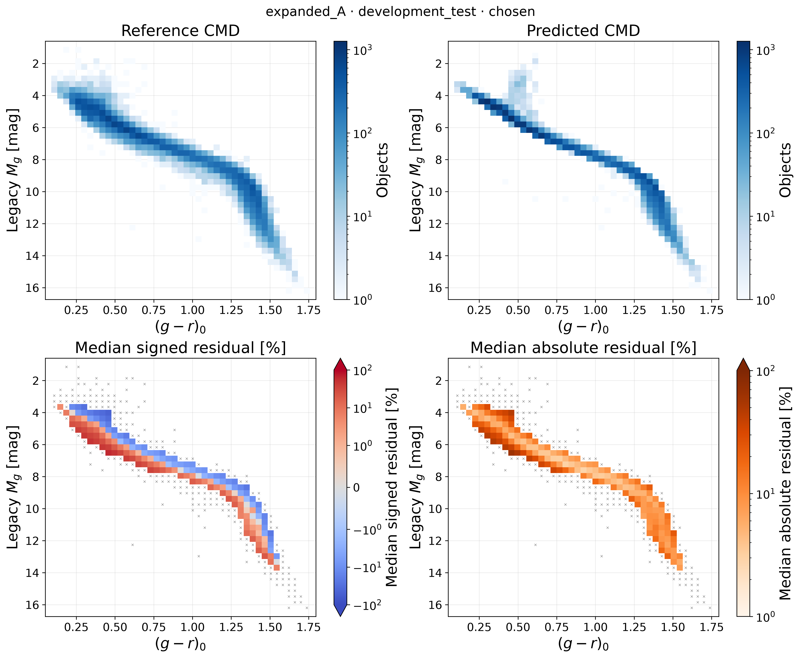

Same 32,719 objects, expanded_A chosen references. Mg_phot-Mg_ref=-delta_mu. Both CMD coordinates and residuals share distance estimates; associations do not establish physical causes.

[PNG](../figures/v2_0_revision/appendix/04_cmd_dwarf.png) · [PDF](../figures/v2_0_revision/appendix/04_cmd_dwarf.pdf) · [CSV](../manifests/v2_0_revision/figures/04_cmd_dwarf.csv) · [元数据](../manifests/v2_0_revision/figures/04_cmd_dwarf.json)

## 04_cmd_evolved

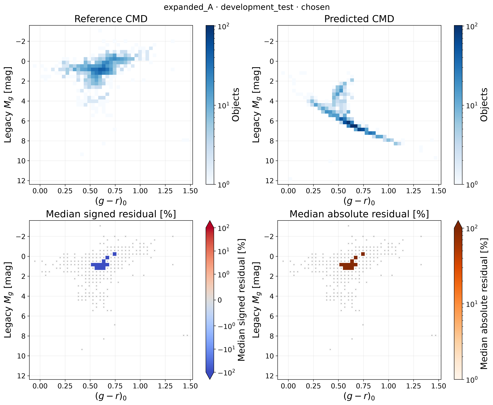

Same 1,163 objects, expanded_A chosen references. Mg_phot-Mg_ref=-delta_mu. Both CMD coordinates and residuals share distance estimates; associations do not establish physical causes.

[PNG](../figures/v2_0_revision/appendix/04_cmd_evolved.png) · [PDF](../figures/v2_0_revision/appendix/04_cmd_evolved.pdf) · [CSV](../manifests/v2_0_revision/figures/04_cmd_evolved.csv) · [元数据](../manifests/v2_0_revision/figures/04_cmd_evolved.json)

## 04_cmd_other

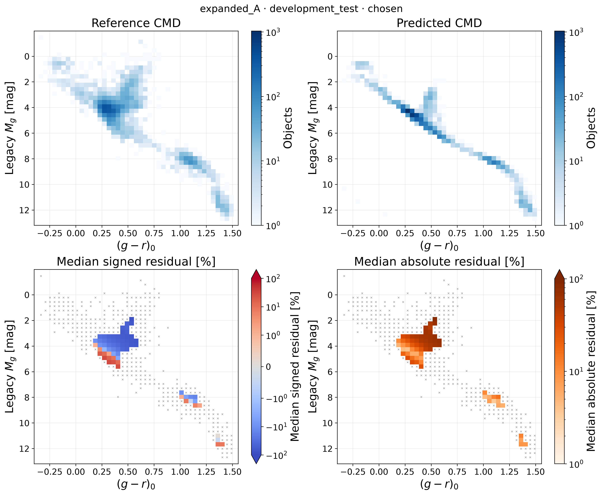

Same 6,408 objects, expanded_A chosen references. Mg_phot-Mg_ref=-delta_mu. Both CMD coordinates and residuals share distance estimates; associations do not establish physical causes.

[PNG](../figures/v2_0_revision/appendix/04_cmd_other.png) · [PDF](../figures/v2_0_revision/appendix/04_cmd_other.pdf) · [CSV](../manifests/v2_0_revision/figures/04_cmd_other.csv) · [元数据](../manifests/v2_0_revision/figures/04_cmd_other.json)

## 04_cmd_unknown

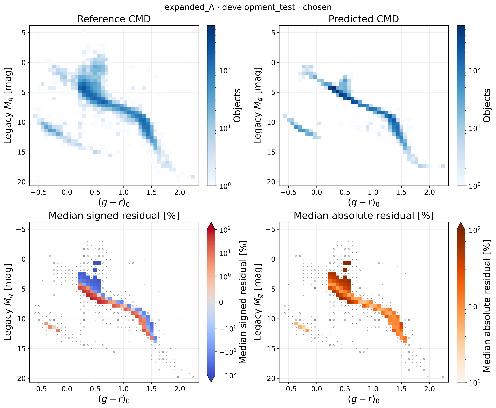

Same 7,466 objects, expanded_A chosen references. Mg_phot-Mg_ref=-delta_mu. Both CMD coordinates and residuals share distance estimates; associations do not establish physical causes.

[PNG](../figures/v2_0_revision/appendix/04_cmd_unknown.png) · [PDF](../figures/v2_0_revision/appendix/04_cmd_unknown.pdf) · [CSV](../manifests/v2_0_revision/figures/04_cmd_unknown.csv) · [元数据](../manifests/v2_0_revision/figures/04_cmd_unknown.json)

## 05_colors_WISE_all

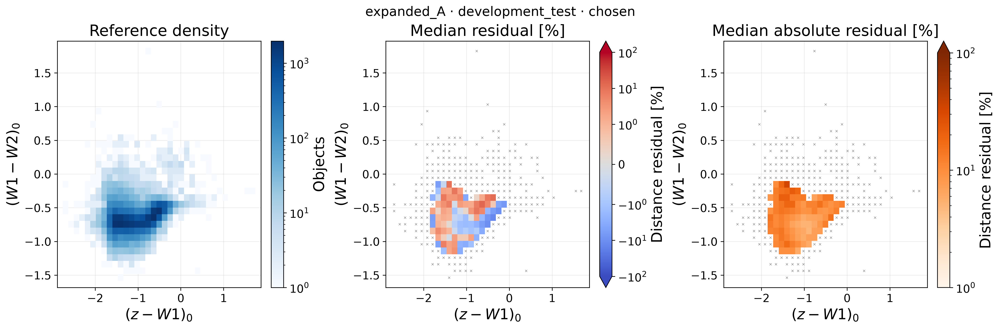

expanded_A optical residuals in WISE coordinates, all; WISE colors require state4, i colors require usable i. No negative flux-to-magnitude conversion. Full coordinate extents, N>=20 performance cells.

[PNG](../figures/v2_0_revision/appendix/05_colors_WISE_all.png) · [PDF](../figures/v2_0_revision/appendix/05_colors_WISE_all.pdf) · [CSV](../manifests/v2_0_revision/figures/05_colors_WISE_all.csv) · [元数据](../manifests/v2_0_revision/figures/05_colors_WISE_all.json)

## 05_colors_WISE_dwarf

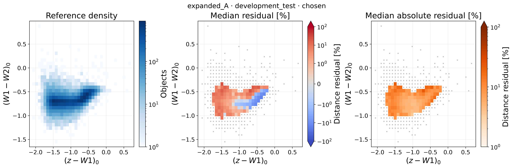

expanded_A optical residuals in WISE coordinates, dwarf; WISE colors require state4, i colors require usable i. No negative flux-to-magnitude conversion. Full coordinate extents, N>=20 performance cells.

[PNG](../figures/v2_0_revision/appendix/05_colors_WISE_dwarf.png) · [PDF](../figures/v2_0_revision/appendix/05_colors_WISE_dwarf.pdf) · [CSV](../manifests/v2_0_revision/figures/05_colors_WISE_dwarf.csv) · [元数据](../manifests/v2_0_revision/figures/05_colors_WISE_dwarf.json)

## 05_colors_WISE_evolved

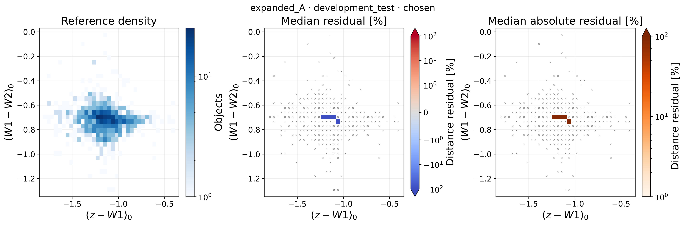

expanded_A optical residuals in WISE coordinates, giant reference; WISE colors require state4, i colors require usable i. No negative flux-to-magnitude conversion. Full coordinate extents, N>=20 performance cells.

[PNG](../figures/v2_0_revision/appendix/05_colors_WISE_evolved.png) · [PDF](../figures/v2_0_revision/appendix/05_colors_WISE_evolved.pdf) · [CSV](../manifests/v2_0_revision/figures/05_colors_WISE_evolved.csv) · [元数据](../manifests/v2_0_revision/figures/05_colors_WISE_evolved.json)

## 05_colors_WISE_other

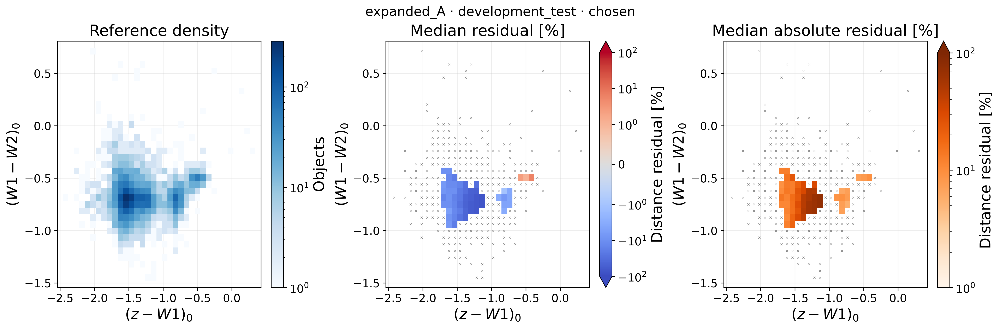

expanded_A optical residuals in WISE coordinates, other; WISE colors require state4, i colors require usable i. No negative flux-to-magnitude conversion. Full coordinate extents, N>=20 performance cells.

[PNG](../figures/v2_0_revision/appendix/05_colors_WISE_other.png) · [PDF](../figures/v2_0_revision/appendix/05_colors_WISE_other.pdf) · [CSV](../manifests/v2_0_revision/figures/05_colors_WISE_other.csv) · [元数据](../manifests/v2_0_revision/figures/05_colors_WISE_other.json)

## 05_colors_WISE_unknown

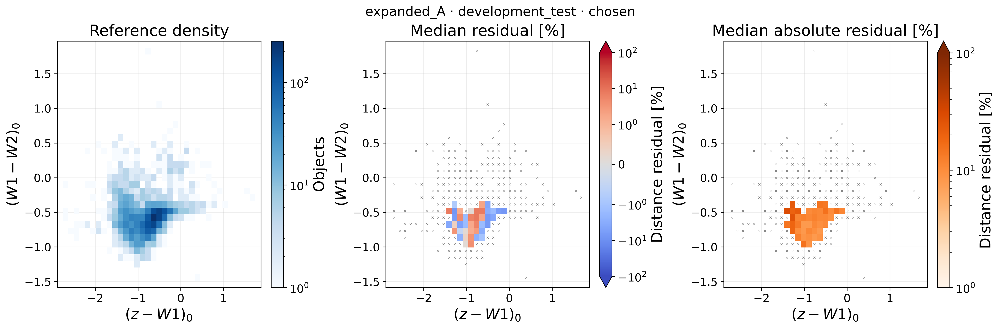

expanded_A optical residuals in WISE coordinates, no reliable spectral class; WISE colors require state4, i colors require usable i. No negative flux-to-magnitude conversion. Full coordinate extents, N>=20 performance cells.

[PNG](../figures/v2_0_revision/appendix/05_colors_WISE_unknown.png) · [PDF](../figures/v2_0_revision/appendix/05_colors_WISE_unknown.pdf) · [CSV](../manifests/v2_0_revision/figures/05_colors_WISE_unknown.csv) · [元数据](../manifests/v2_0_revision/figures/05_colors_WISE_unknown.json)

## 05_colors_grW1_all

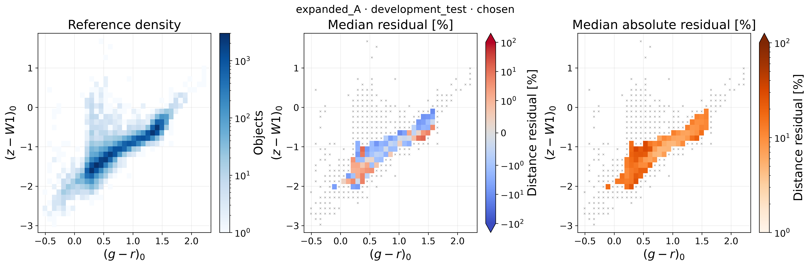

expanded_A optical residuals in grW1 coordinates, all; WISE colors require state4, i colors require usable i. No negative flux-to-magnitude conversion. Full coordinate extents, N>=20 performance cells.

[PNG](../figures/v2_0_revision/appendix/05_colors_grW1_all.png) · [PDF](../figures/v2_0_revision/appendix/05_colors_grW1_all.pdf) · [CSV](../manifests/v2_0_revision/figures/05_colors_grW1_all.csv) · [元数据](../manifests/v2_0_revision/figures/05_colors_grW1_all.json)

## 05_colors_grW1_dwarf

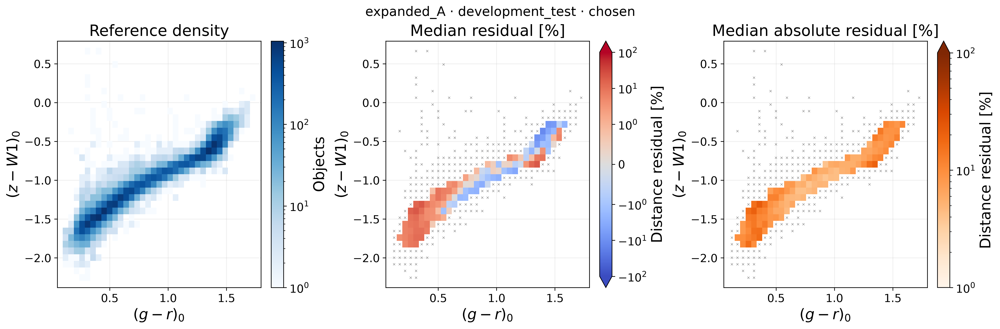

expanded_A optical residuals in grW1 coordinates, dwarf; WISE colors require state4, i colors require usable i. No negative flux-to-magnitude conversion. Full coordinate extents, N>=20 performance cells.

[PNG](../figures/v2_0_revision/appendix/05_colors_grW1_dwarf.png) · [PDF](../figures/v2_0_revision/appendix/05_colors_grW1_dwarf.pdf) · [CSV](../manifests/v2_0_revision/figures/05_colors_grW1_dwarf.csv) · [元数据](../manifests/v2_0_revision/figures/05_colors_grW1_dwarf.json)

## 05_colors_grW1_evolved

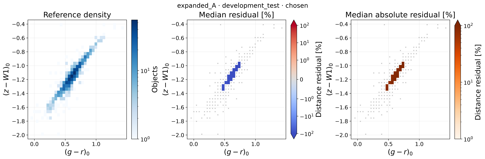

expanded_A optical residuals in grW1 coordinates, giant reference; WISE colors require state4, i colors require usable i. No negative flux-to-magnitude conversion. Full coordinate extents, N>=20 performance cells.

[PNG](../figures/v2_0_revision/appendix/05_colors_grW1_evolved.png) · [PDF](../figures/v2_0_revision/appendix/05_colors_grW1_evolved.pdf) · [CSV](../manifests/v2_0_revision/figures/05_colors_grW1_evolved.csv) · [元数据](../manifests/v2_0_revision/figures/05_colors_grW1_evolved.json)

## 05_colors_grW1_other

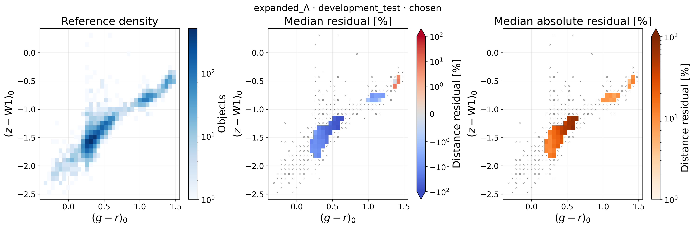

expanded_A optical residuals in grW1 coordinates, other; WISE colors require state4, i colors require usable i. No negative flux-to-magnitude conversion. Full coordinate extents, N>=20 performance cells.

[PNG](../figures/v2_0_revision/appendix/05_colors_grW1_other.png) · [PDF](../figures/v2_0_revision/appendix/05_colors_grW1_other.pdf) · [CSV](../manifests/v2_0_revision/figures/05_colors_grW1_other.csv) · [元数据](../manifests/v2_0_revision/figures/05_colors_grW1_other.json)

## 05_colors_grW1_unknown

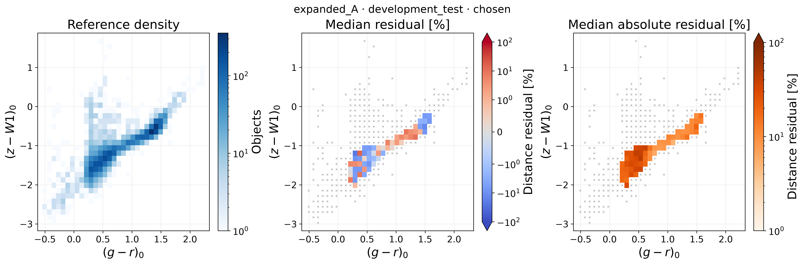

expanded_A optical residuals in grW1 coordinates, no reliable spectral class; WISE colors require state4, i colors require usable i. No negative flux-to-magnitude conversion. Full coordinate extents, N>=20 performance cells.

[PNG](../figures/v2_0_revision/appendix/05_colors_grW1_unknown.png) · [PDF](../figures/v2_0_revision/appendix/05_colors_grW1_unknown.pdf) · [CSV](../manifests/v2_0_revision/figures/05_colors_grW1_unknown.csv) · [元数据](../manifests/v2_0_revision/figures/05_colors_grW1_unknown.json)

## 05_colors_griz_all

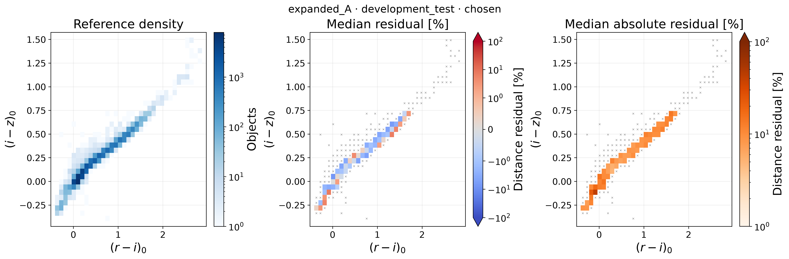

expanded_A optical residuals in griz coordinates, all; WISE colors require state4, i colors require usable i. No negative flux-to-magnitude conversion. Full coordinate extents, N>=20 performance cells.

[PNG](../figures/v2_0_revision/appendix/05_colors_griz_all.png) · [PDF](../figures/v2_0_revision/appendix/05_colors_griz_all.pdf) · [CSV](../manifests/v2_0_revision/figures/05_colors_griz_all.csv) · [元数据](../manifests/v2_0_revision/figures/05_colors_griz_all.json)

## 05_colors_griz_dwarf

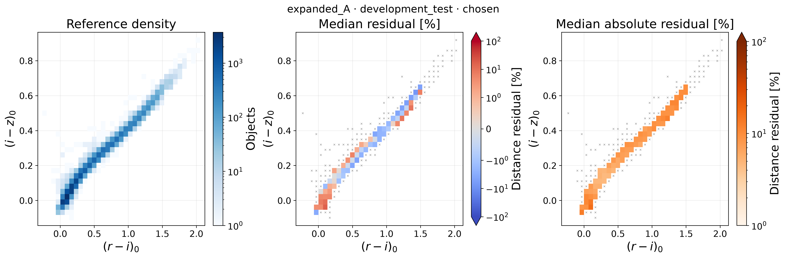

expanded_A optical residuals in griz coordinates, dwarf; WISE colors require state4, i colors require usable i. No negative flux-to-magnitude conversion. Full coordinate extents, N>=20 performance cells.

[PNG](../figures/v2_0_revision/appendix/05_colors_griz_dwarf.png) · [PDF](../figures/v2_0_revision/appendix/05_colors_griz_dwarf.pdf) · [CSV](../manifests/v2_0_revision/figures/05_colors_griz_dwarf.csv) · [元数据](../manifests/v2_0_revision/figures/05_colors_griz_dwarf.json)

## 05_colors_griz_evolved

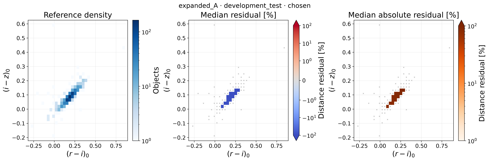

expanded_A optical residuals in griz coordinates, giant reference; WISE colors require state4, i colors require usable i. No negative flux-to-magnitude conversion. Full coordinate extents, N>=20 performance cells.

[PNG](../figures/v2_0_revision/appendix/05_colors_griz_evolved.png) · [PDF](../figures/v2_0_revision/appendix/05_colors_griz_evolved.pdf) · [CSV](../manifests/v2_0_revision/figures/05_colors_griz_evolved.csv) · [元数据](../manifests/v2_0_revision/figures/05_colors_griz_evolved.json)

## 05_colors_griz_other

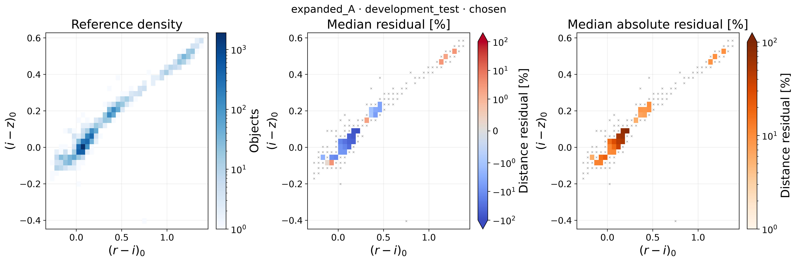

expanded_A optical residuals in griz coordinates, other; WISE colors require state4, i colors require usable i. No negative flux-to-magnitude conversion. Full coordinate extents, N>=20 performance cells.

[PNG](../figures/v2_0_revision/appendix/05_colors_griz_other.png) · [PDF](../figures/v2_0_revision/appendix/05_colors_griz_other.pdf) · [CSV](../manifests/v2_0_revision/figures/05_colors_griz_other.csv) · [元数据](../manifests/v2_0_revision/figures/05_colors_griz_other.json)

## 05_colors_griz_unknown

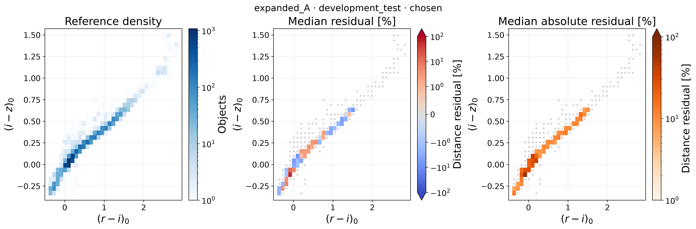

expanded_A optical residuals in griz coordinates, no reliable spectral class; WISE colors require state4, i colors require usable i. No negative flux-to-magnitude conversion. Full coordinate extents, N>=20 performance cells.

[PNG](../figures/v2_0_revision/appendix/05_colors_griz_unknown.png) · [PDF](../figures/v2_0_revision/appendix/05_colors_griz_unknown.pdf) · [CSV](../manifests/v2_0_revision/figures/05_colors_griz_unknown.csv) · [元数据](../manifests/v2_0_revision/figures/05_colors_griz_unknown.json)

## 05_colors_grz_dwarf

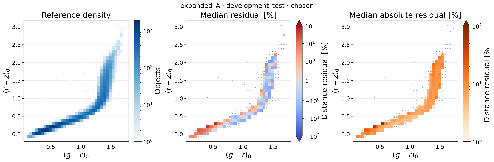

expanded_A optical residuals in grz coordinates, dwarf; WISE colors require state4, i colors require usable i. No negative flux-to-magnitude conversion. Full coordinate extents, N>=20 performance cells.

[PNG](../figures/v2_0_revision/appendix/05_colors_grz_dwarf.png) · [PDF](../figures/v2_0_revision/appendix/05_colors_grz_dwarf.pdf) · [CSV](../manifests/v2_0_revision/figures/05_colors_grz_dwarf.csv) · [元数据](../manifests/v2_0_revision/figures/05_colors_grz_dwarf.json)

## 05_colors_grz_evolved

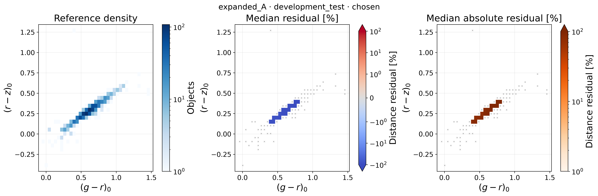

expanded_A optical residuals in grz coordinates, giant reference; WISE colors require state4, i colors require usable i. No negative flux-to-magnitude conversion. Full coordinate extents, N>=20 performance cells.

[PNG](../figures/v2_0_revision/appendix/05_colors_grz_evolved.png) · [PDF](../figures/v2_0_revision/appendix/05_colors_grz_evolved.pdf) · [CSV](../manifests/v2_0_revision/figures/05_colors_grz_evolved.csv) · [元数据](../manifests/v2_0_revision/figures/05_colors_grz_evolved.json)

## 05_colors_grz_other

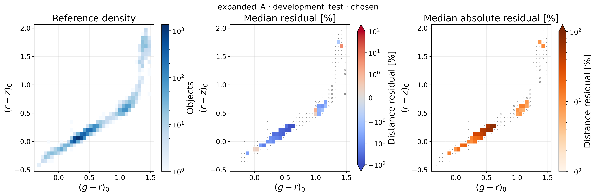

expanded_A optical residuals in grz coordinates, other; WISE colors require state4, i colors require usable i. No negative flux-to-magnitude conversion. Full coordinate extents, N>=20 performance cells.

[PNG](../figures/v2_0_revision/appendix/05_colors_grz_other.png) · [PDF](../figures/v2_0_revision/appendix/05_colors_grz_other.pdf) · [CSV](../manifests/v2_0_revision/figures/05_colors_grz_other.csv) · [元数据](../manifests/v2_0_revision/figures/05_colors_grz_other.json)

## 05_colors_grz_unknown

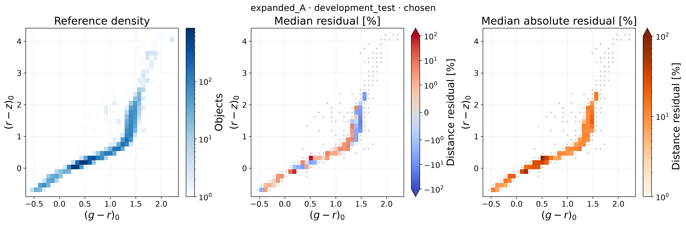

expanded_A optical residuals in grz coordinates, no reliable spectral class; WISE colors require state4, i colors require usable i. No negative flux-to-magnitude conversion. Full coordinate extents, N>=20 performance cells.

[PNG](../figures/v2_0_revision/appendix/05_colors_grz_unknown.png) · [PDF](../figures/v2_0_revision/appendix/05_colors_grz_unknown.pdf) · [CSV](../manifests/v2_0_revision/figures/05_colors_grz_unknown.csv) · [元数据](../manifests/v2_0_revision/figures/05_colors_grz_unknown.json)

## 07_conditions_EBV

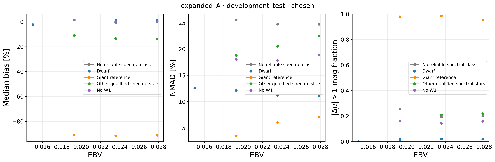

expanded_A by class and no-W1 group. Separate markers show occupied bins; sparse layers not interpolated. Complete bin counts and percentage metrics are in CSV.

[PNG](../figures/v2_0_revision/appendix/07_conditions_EBV.png) · [PDF](../figures/v2_0_revision/appendix/07_conditions_EBV.pdf) · [CSV](../manifests/v2_0_revision/figures/07_conditions_EBV.csv) · [元数据](../manifests/v2_0_revision/figures/07_conditions_EBV.json)

## 07_conditions_optical_error

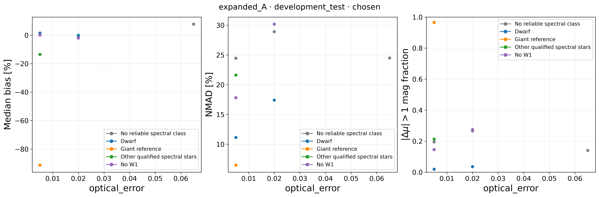

expanded_A by class and no-W1 group. Separate markers show occupied bins; sparse layers not interpolated. Complete bin counts and percentage metrics are in CSV.

[PNG](../figures/v2_0_revision/appendix/07_conditions_optical_error.png) · [PDF](../figures/v2_0_revision/appendix/07_conditions_optical_error.pdf) · [CSV](../manifests/v2_0_revision/figures/07_conditions_optical_error.csv) · [元数据](../manifests/v2_0_revision/figures/07_conditions_optical_error.json)

## 07_conditions_ref_distance

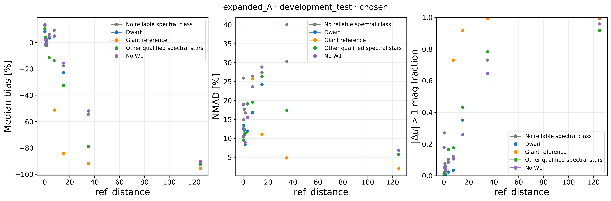

expanded_A by class and no-W1 group. Separate markers show occupied bins; sparse layers not interpolated. Complete bin counts and percentage metrics are in CSV.

[PNG](../figures/v2_0_revision/appendix/07_conditions_ref_distance.png) · [PDF](../figures/v2_0_revision/appendix/07_conditions_ref_distance.pdf) · [CSV](../manifests/v2_0_revision/figures/07_conditions_ref_distance.csv) · [元数据](../manifests/v2_0_revision/figures/07_conditions_ref_distance.json)

## 07_conditions_snr_w1

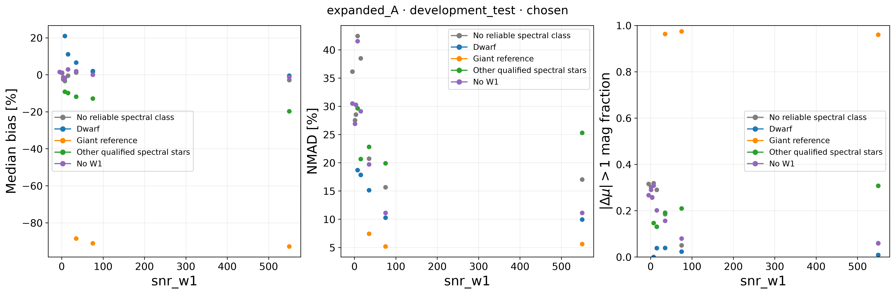

expanded_A by class and no-W1 group. Separate markers show occupied bins; sparse layers not interpolated. Complete bin counts and percentage metrics are in CSV.

[PNG](../figures/v2_0_revision/appendix/07_conditions_snr_w1.png) · [PDF](../figures/v2_0_revision/appendix/07_conditions_snr_w1.pdf) · [CSV](../manifests/v2_0_revision/figures/07_conditions_snr_w1.csv) · [元数据](../manifests/v2_0_revision/figures/07_conditions_snr_w1.json)

## A_fixed_pdf_examples

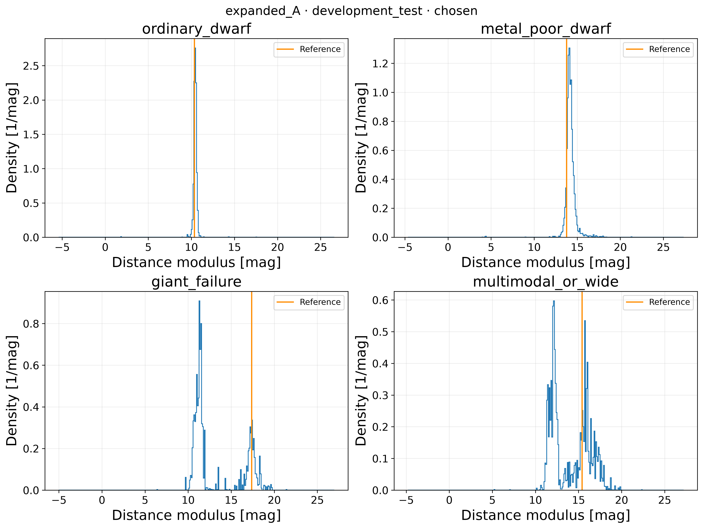

Existing four frozen PDF cases, original bin values and reference unchanged. User-visible giant terminology updated.

[PNG](../figures/v2_0_revision/appendix/A_fixed_pdf_examples.png) · [PDF](../figures/v2_0_revision/appendix/A_fixed_pdf_examples.pdf) · [CSV](../manifests/v2_0_revision/figures/A_fixed_pdf_examples.csv) · [元数据](../manifests/v2_0_revision/figures/A_fixed_pdf_examples.json)

## A_flags

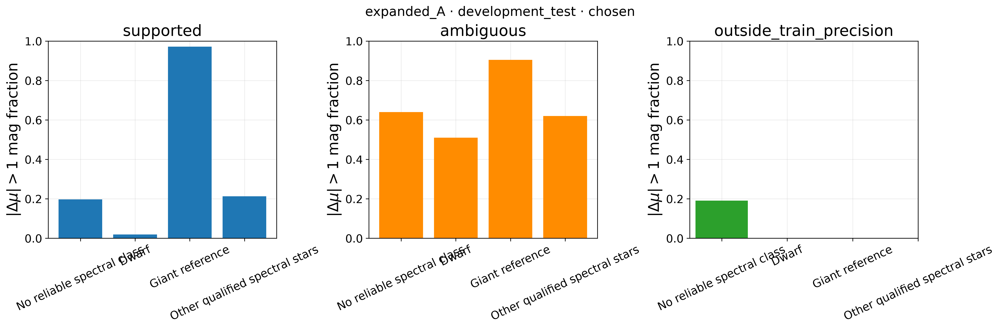

Model-state groups do not define a reliable single-distance catalog. Rows may overlap; all counts and risks retained.

[PNG](../figures/v2_0_revision/appendix/A_flags.png) · [PDF](../figures/v2_0_revision/appendix/A_flags.pdf) · [CSV](../manifests/v2_0_revision/figures/A_flags.csv) · [元数据](../manifests/v2_0_revision/figures/A_flags.json)

## A_flux_depth_stress

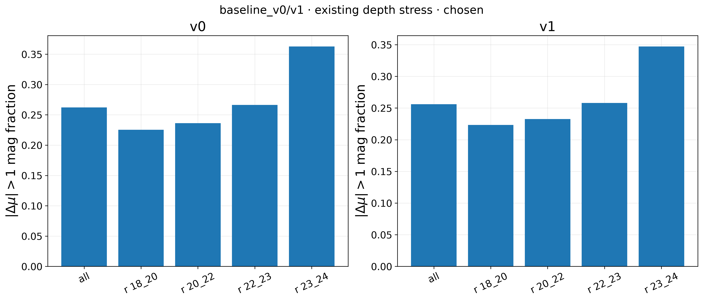

Existing fixed real-template artificial flux degradation. Stress-test sources are reused; it does not supply new faint-population truth.

[PNG](../figures/v2_0_revision/appendix/A_flux_depth_stress.png) · [PDF](../figures/v2_0_revision/appendix/A_flux_depth_stress.pdf) · [CSV](../manifests/v2_0_revision/figures/A_flux_depth_stress.csv) · [元数据](../manifests/v2_0_revision/figures/A_flux_depth_stress.json)

## A_quality_retention

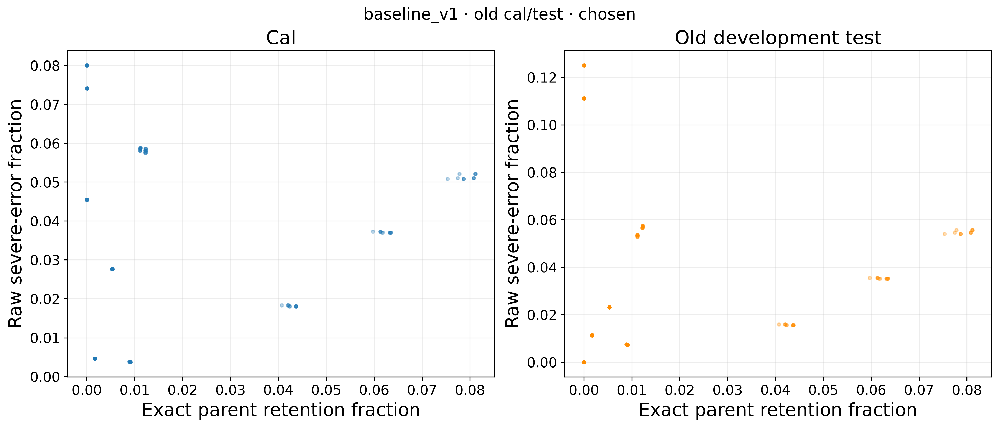

Existing fixed v1 quality grid; no re-optimization. All-class adoption failed. Raw/calibrated intervals remain distinct in the original source.

[PNG](../figures/v2_0_revision/appendix/A_quality_retention.png) · [PDF](../figures/v2_0_revision/appendix/A_quality_retention.pdf) · [CSV](../manifests/v2_0_revision/figures/A_quality_retention.csv) · [元数据](../manifests/v2_0_revision/figures/A_quality_retention.json)

## A_sky

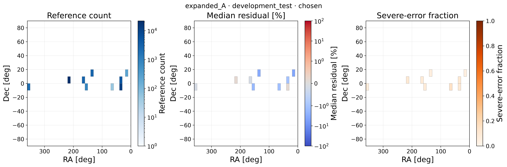

Chosen test selection only. Sparse cells hatched. Per-cell solid-angle area is retained for density comparisons. No interpolation.

[PNG](../figures/v2_0_revision/appendix/A_sky.png) · [PDF](../figures/v2_0_revision/appendix/A_sky.pdf) · [CSV](../manifests/v2_0_revision/figures/A_sky.csv) · [元数据](../manifests/v2_0_revision/figures/A_sky.json)
