# v2.0 修订图集 02

[完整目录](v2_0_revision_atlas.md)

## 01_scope

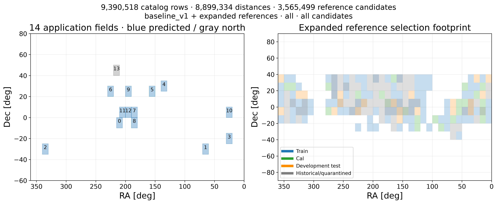

Application rectangles are configuration boundaries, not masked effective area. Reference cells show selection footprint; counts and stars/deg² are in CSV.

[PNG](../figures/v2_0_revision/main/01_scope.png) · [PDF](../figures/v2_0_revision/main/01_scope.pdf) · [CSV](../manifests/v2_0_revision/figures/01_scope.csv) · [元数据](../manifests/v2_0_revision/figures/01_scope.json)

## 02a_brightness_coverage

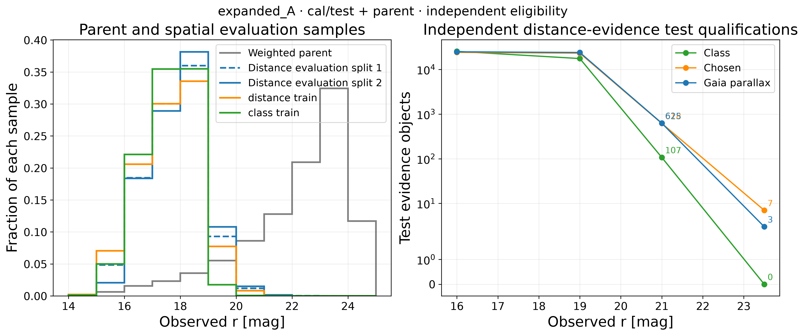

Parent retains original probability weights. No common reference mask is used for class, chosen or signed Gaia evidence.

[PNG](../figures/v2_0_revision/main/02a_brightness_coverage.png) · [PDF](../figures/v2_0_revision/main/02a_brightness_coverage.pdf) · [CSV](../manifests/v2_0_revision/figures/02a_brightness_coverage.csv) · [元数据](../manifests/v2_0_revision/figures/02a_brightness_coverage.json)

## 02b_color_magnitude_coverage

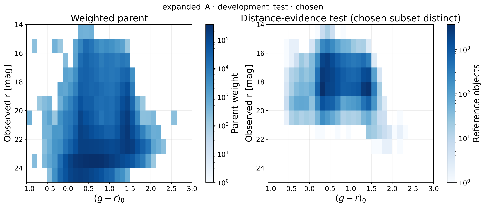

Same displayed bins; white cells have no evidence. Counts and out-of-range objects are saved. Parent density represents old DECam scope.

[PNG](../figures/v2_0_revision/main/02b_color_magnitude_coverage.png) · [PDF](../figures/v2_0_revision/main/02b_color_magnitude_coverage.pdf) · [CSV](../manifests/v2_0_revision/figures/02b_color_magnitude_coverage.csv) · [元数据](../manifests/v2_0_revision/figures/02b_color_magnitude_coverage.json)

## 03_distance_all

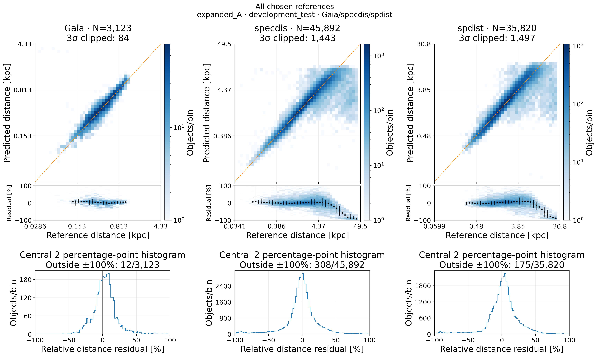

Frozen expanded_A. Display-only simultaneous 3-sigma selection on reference x and predicted y distances in linear kpc: arithmetic mean +/- 3 population standard deviations (ddof=0), one pass, independently for each population/reference pair. All three panels use the same retained objects. Narrow attached residual axis is linear from -100% to 100%; its x-axis is shared with the main distance panel. Central histogram uses 2 percentage-point bins. Out-of-window and sigma-exclusion counts are retained in CSV/JSON. Trend bars are P16-P84 object spread, not median confidence intervals. Original uncut scientific metrics and anomaly audit remain unchanged. Reference-source samples overlap.

[PNG](../figures/v2_0_revision/main/03_distance_all.png) · [PDF](../figures/v2_0_revision/main/03_distance_all.pdf) · [CSV](../manifests/v2_0_revision/figures/03_distance_all.csv) · [元数据](../manifests/v2_0_revision/figures/03_distance_all.json)

## 04_cmd_all

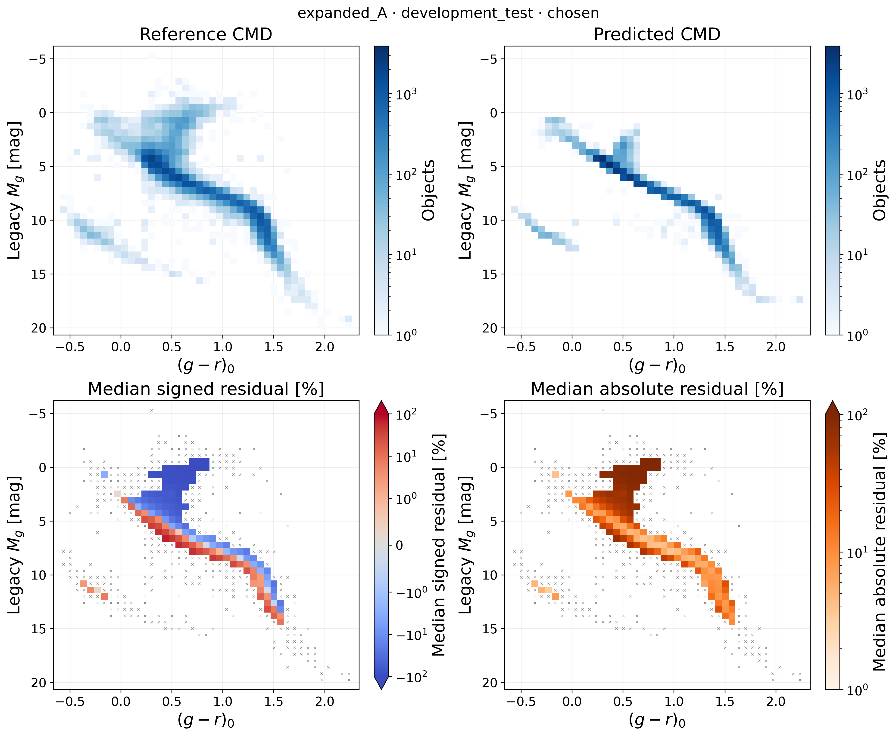

Same 47,756 objects, expanded_A chosen references. Mg_phot-Mg_ref=-delta_mu. Both CMD coordinates and residuals share distance estimates; associations do not establish physical causes.

[PNG](../figures/v2_0_revision/main/04_cmd_all.png) · [PDF](../figures/v2_0_revision/main/04_cmd_all.pdf) · [CSV](../manifests/v2_0_revision/figures/04_cmd_all.csv) · [元数据](../manifests/v2_0_revision/figures/04_cmd_all.json)

## 05_colors_grz_all

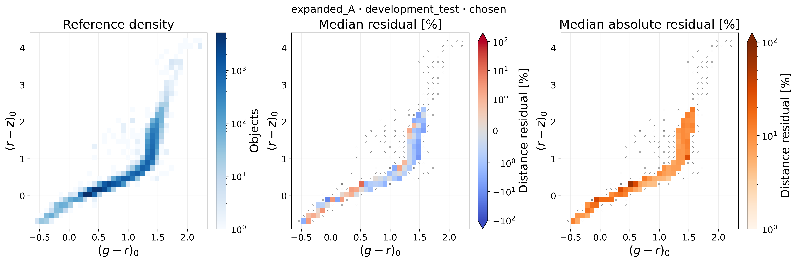

expanded_A optical residuals in grz coordinates, all; WISE colors require state4, i colors require usable i. No negative flux-to-magnitude conversion. Full coordinate extents, N>=20 performance cells.

[PNG](../figures/v2_0_revision/main/05_colors_grz_all.png) · [PDF](../figures/v2_0_revision/main/05_colors_grz_all.pdf) · [CSV](../manifests/v2_0_revision/figures/05_colors_grz_all.csv) · [元数据](../manifests/v2_0_revision/figures/05_colors_grz_all.json)

## 06a_kiel

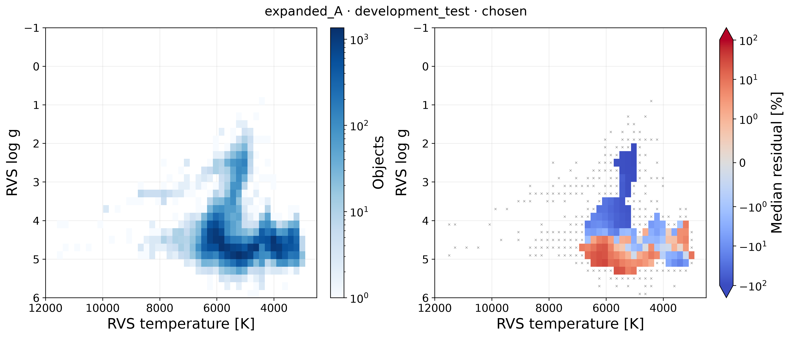

Qualified continuous RVS parameters, expanded_A. Fixed display ranges and excluded counts retained; coarse giant reference/other labels do not assign RGB/RC/HB phases.

[PNG](../figures/v2_0_revision/main/06a_kiel.png) · [PDF](../figures/v2_0_revision/main/06a_kiel.pdf) · [CSV](../manifests/v2_0_revision/figures/06a_kiel.csv) · [元数据](../manifests/v2_0_revision/figures/06a_kiel.json)

## 06b_metallicity

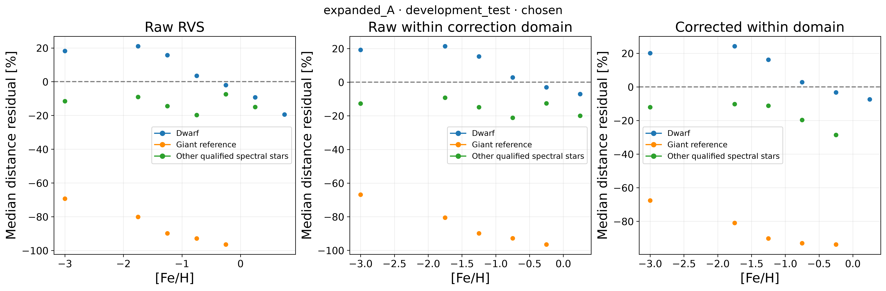

RVS abundance correction restricted to 4200<=Teff<6600 and 1.8<=logg<5.5. Raw/domain/raw-corrected comparisons use finite FeH and positive formal error. Metal-poor is not halo membership.

[PNG](../figures/v2_0_revision/main/06b_metallicity.png) · [PDF](../figures/v2_0_revision/main/06b_metallicity.pdf) · [CSV](../manifests/v2_0_revision/figures/06b_metallicity.csv) · [元数据](../manifests/v2_0_revision/figures/06b_metallicity.json)

## 06c_spectral_trends

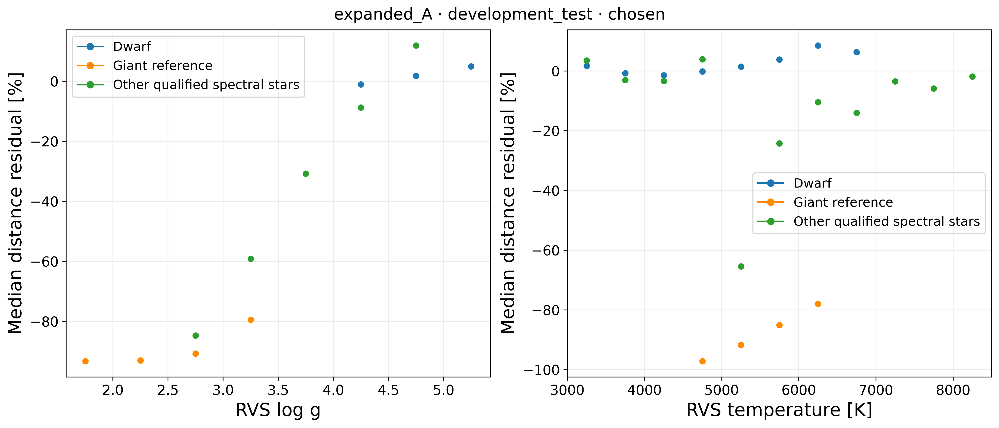

RVS-qualified sources, N>=20 bins. Per-class counts and full percentage metrics in CSV.

[PNG](../figures/v2_0_revision/main/06c_spectral_trends.png) · [PDF](../figures/v2_0_revision/main/06c_spectral_trends.pdf) · [CSV](../manifests/v2_0_revision/figures/06c_spectral_trends.csv) · [元数据](../manifests/v2_0_revision/figures/06c_spectral_trends.json)

## 07_conditions_r

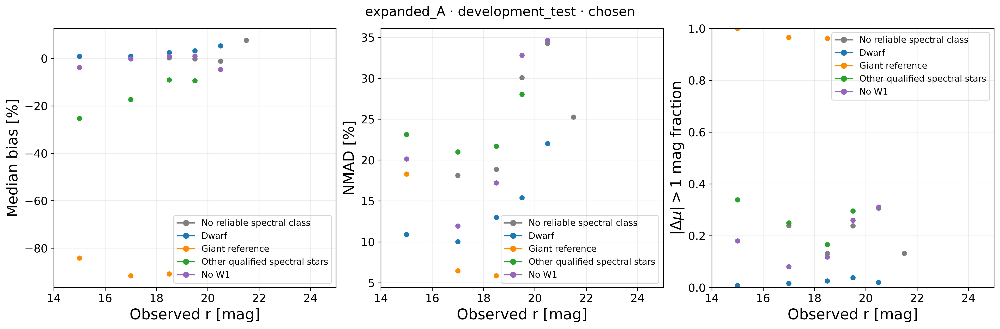

expanded_A by class and no-W1 group. Separate markers show occupied bins; sparse layers not interpolated. Complete bin counts and percentage metrics are in CSV.

[PNG](../figures/v2_0_revision/main/07_conditions_r.png) · [PDF](../figures/v2_0_revision/main/07_conditions_r.pdf) · [CSV](../manifests/v2_0_revision/figures/07_conditions_r.csv) · [元数据](../manifests/v2_0_revision/figures/07_conditions_r.json)

## 07b_intervals_and_counts

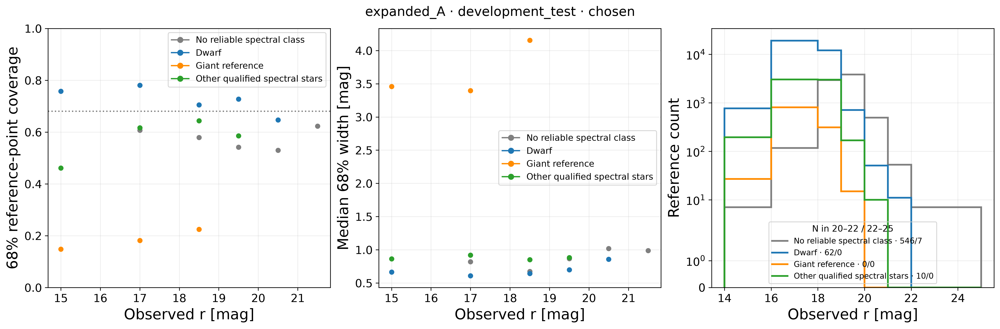

Width and coverage are displayed together. Sparse faint layers retain actual N and do not imply broad validation.

[PNG](../figures/v2_0_revision/main/07b_intervals_and_counts.png) · [PDF](../figures/v2_0_revision/main/07b_intervals_and_counts.pdf) · [CSV](../manifests/v2_0_revision/figures/07b_intervals_and_counts.csv) · [元数据](../manifests/v2_0_revision/figures/07b_intervals_and_counts.json)

## 08a_coverage_width

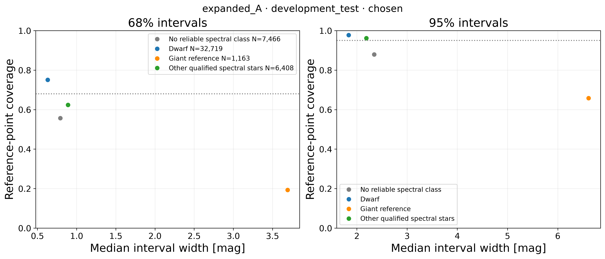

Raw expanded_A intervals relative to chosen catalog point estimates. Catalog uncertainties and common upstream information are not removed.

[PNG](../figures/v2_0_revision/main/08a_coverage_width.png) · [PDF](../figures/v2_0_revision/main/08a_coverage_width.pdf) · [CSV](../manifests/v2_0_revision/figures/08a_coverage_width.csv) · [元数据](../manifests/v2_0_revision/figures/08a_coverage_width.json)

## 08b_gaia_pit

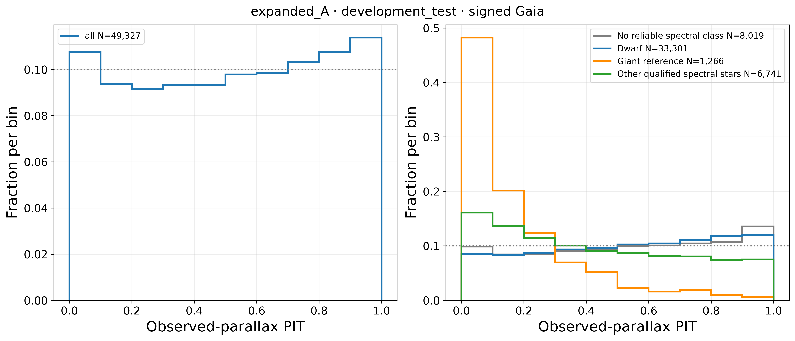

All signed eligible Gaia parallaxes from refined sidecars. Negative observations retained. Class-conditional PIT is diagnostic and does not alone prove unconditional mixture weights wrong.

[PNG](../figures/v2_0_revision/main/08b_gaia_pit.png) · [PDF](../figures/v2_0_revision/main/08b_gaia_pit.pdf) · [CSV](../manifests/v2_0_revision/figures/08b_gaia_pit.csv) · [元数据](../manifests/v2_0_revision/figures/08b_gaia_pit.json)

## 09a_band_availability

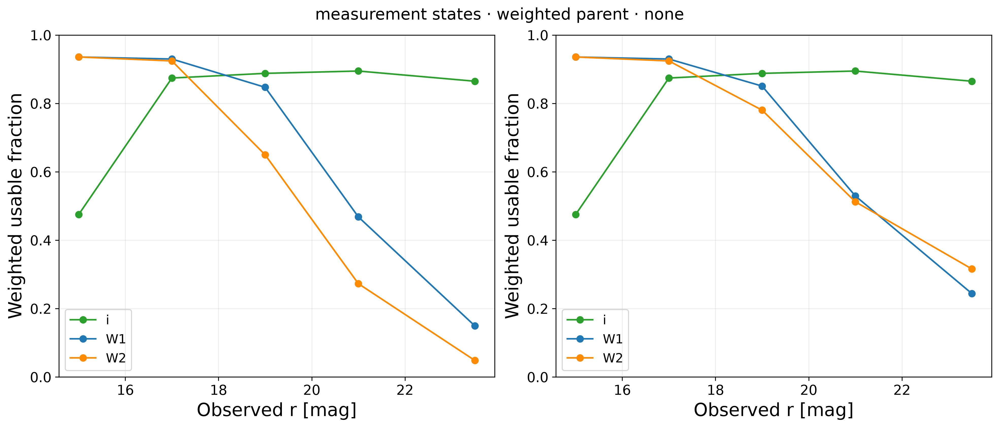

Original26000 probability sample, original DECam weights. High S/N and signed valid measurements separated. Exact application route counts are a different population statistic.

[PNG](../figures/v2_0_revision/main/09a_band_availability.png) · [PDF](../figures/v2_0_revision/main/09a_band_availability.pdf) · [CSV](../manifests/v2_0_revision/figures/09a_band_availability.csv) · [元数据](../manifests/v2_0_revision/figures/09a_band_availability.json)

## 09b_wise_states

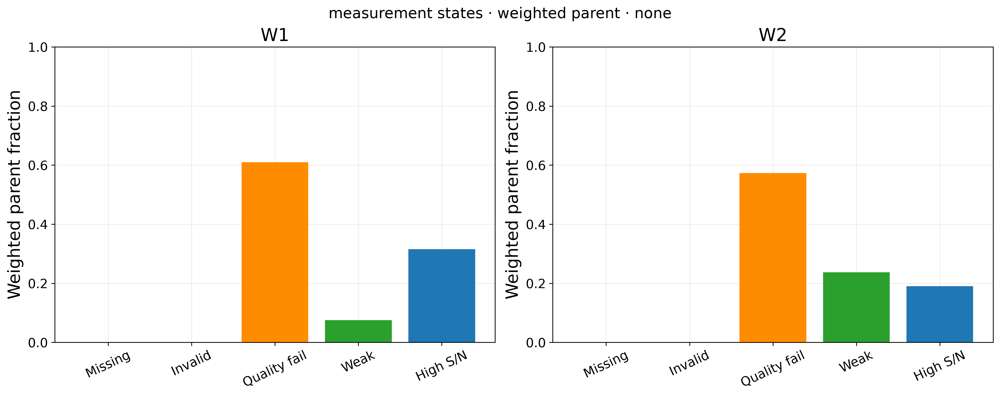

Five states retain missing, invalid and quality failure apart from signed weak and high-S/N measurements. Joint W1-only/W2-only/both/neither in CSV.

[PNG](../figures/v2_0_revision/main/09b_wise_states.png) · [PDF](../figures/v2_0_revision/main/09b_wise_states.pdf) · [CSV](../manifests/v2_0_revision/figures/09b_wise_states.csv) · [元数据](../manifests/v2_0_revision/figures/09b_wise_states.json)

## 09c_joint_states

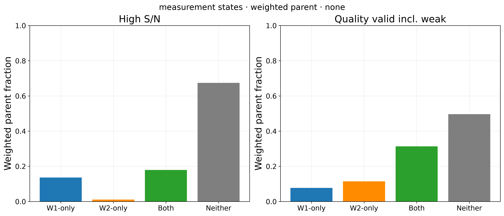

Independent per-band measurement availability; quality failures remain excluded. Original weighted parent, not exact deployment routing.

[PNG](../figures/v2_0_revision/main/09c_joint_states.png) · [PDF](../figures/v2_0_revision/main/09c_joint_states.pdf) · [CSV](../manifests/v2_0_revision/figures/09c_joint_states.csv) · [元数据](../manifests/v2_0_revision/figures/09c_joint_states.json)

## 10a_experiment_tradeoffs

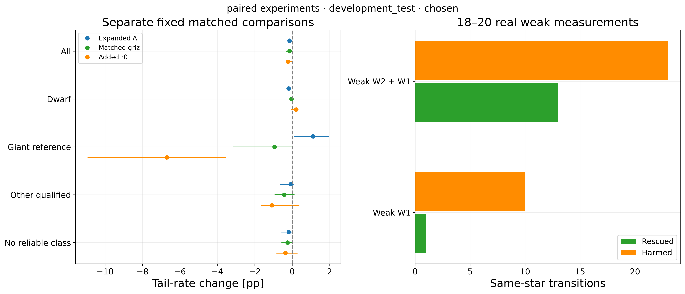

Each experiment has its own matched identities, training controls and N in CSV. These are not a continuous version ranking. r0 preserves max_features0.75, changing realized split candidates1→2.

[PNG](../figures/v2_0_revision/main/10a_experiment_tradeoffs.png) · [PDF](../figures/v2_0_revision/main/10a_experiment_tradeoffs.pdf) · [CSV](../manifests/v2_0_revision/figures/10a_experiment_tradeoffs.csv) · [元数据](../manifests/v2_0_revision/figures/10a_experiment_tradeoffs.json)

## 10b_high_snr_information

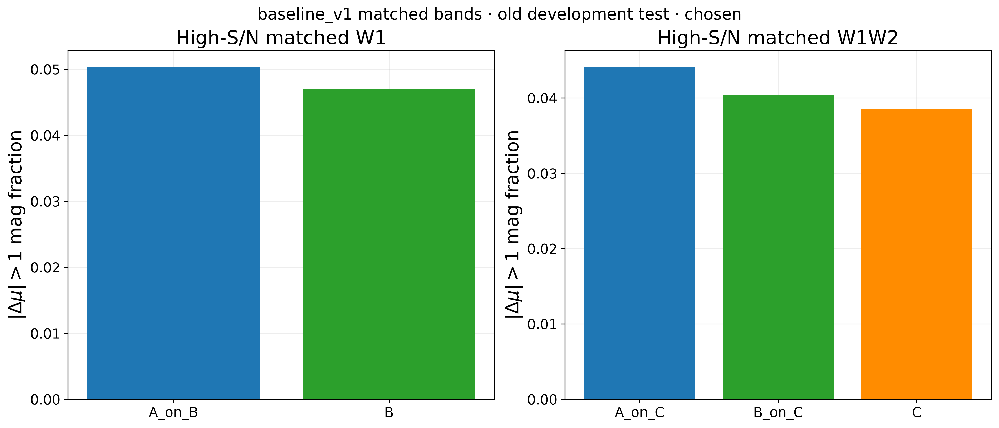

Existing v1 A_on_B/B and A_on_C/B_on_C/C matched training and source controls. Original specific model identifiers retained.

[PNG](../figures/v2_0_revision/main/10b_high_snr_information.png) · [PDF](../figures/v2_0_revision/main/10b_high_snr_information.pdf) · [CSV](../manifests/v2_0_revision/figures/10b_high_snr_information.csv) · [元数据](../manifests/v2_0_revision/figures/10b_high_snr_information.json)

## 10c_interval_tradeoffs

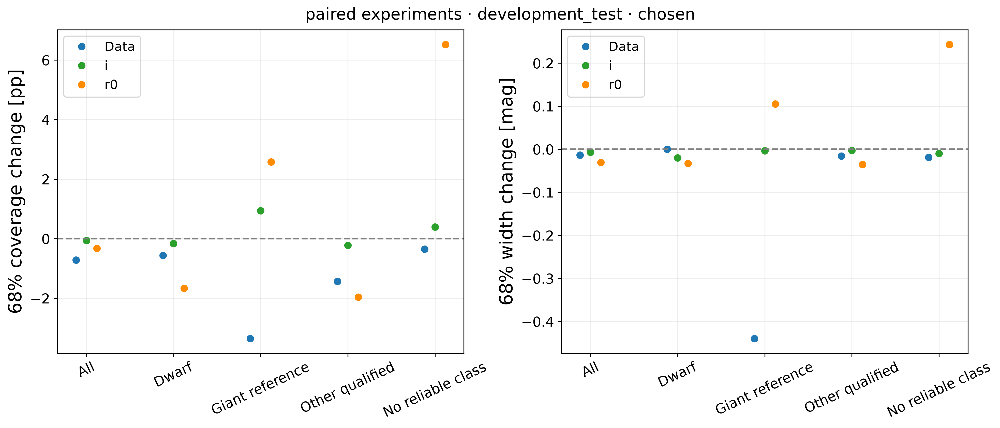

Paired data/i/r0 effects on reference-point coverage and width are displayed together. Each has its own fixed sample.

[PNG](../figures/v2_0_revision/main/10c_interval_tradeoffs.png) · [PDF](../figures/v2_0_revision/main/10c_interval_tradeoffs.pdf) · [CSV](../manifests/v2_0_revision/figures/10c_interval_tradeoffs.csv) · [元数据](../manifests/v2_0_revision/figures/10c_interval_tradeoffs.json)

## separate_reference_application_flows

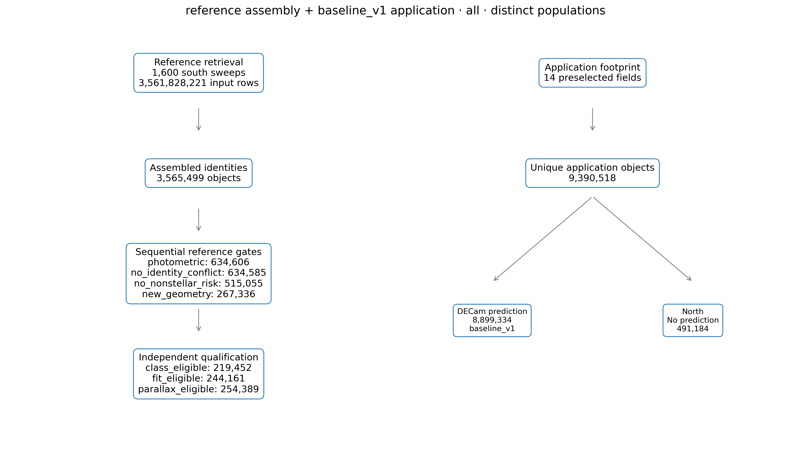

Two distinct pipelines. The DR11 scale ratios are not same-cut retention fractions. Class/fit/parallax qualifications are parallel, and their counts overlap. Full-DR11 same-cut denominator and effective masked area remain uncomputed.

[PNG](../figures/v2_0_revision/main/separate_reference_application_flows.png) · [PDF](../figures/v2_0_revision/main/separate_reference_application_flows.pdf) · [CSV](../manifests/v2_0_revision/figures/separate_reference_application_flows.csv) · [元数据](../manifests/v2_0_revision/figures/separate_reference_application_flows.json)

## kiel_body_all

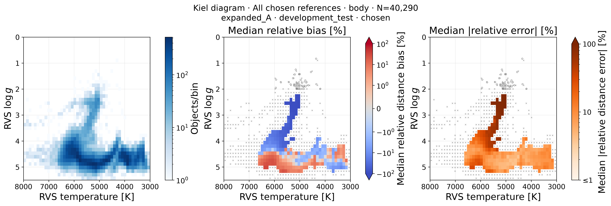

Reliable RVS only. Full range retains every finite parameter, body is an explicit zoom. Low-gravity points remain visible irrespective of performance-cell N. No post-hoc point rejection.

[PNG](../figures/v2_0_revision/physical/kiel_body_all.png) · [PDF](../figures/v2_0_revision/physical/kiel_body_all.pdf) · [CSV](../manifests/v2_0_revision/figures/kiel_body_all.csv) · [元数据](../manifests/v2_0_revision/figures/kiel_body_all.json)

## kiel_body_dwarf

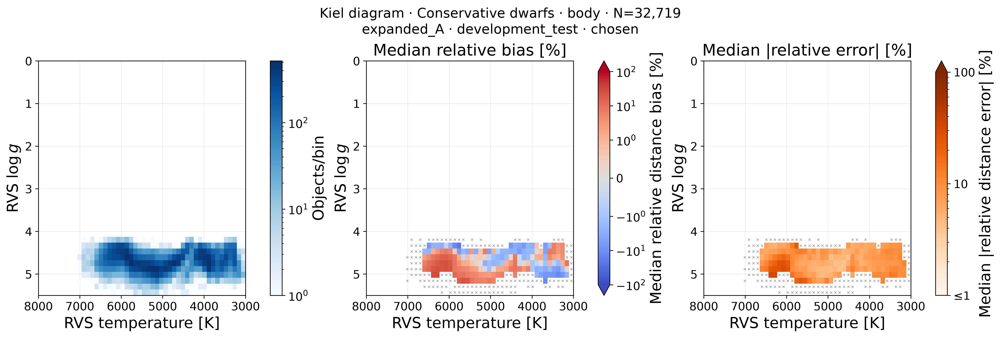

Reliable RVS only. Full range retains every finite parameter, body is an explicit zoom. Low-gravity points remain visible irrespective of performance-cell N. No post-hoc point rejection.

[PNG](../figures/v2_0_revision/physical/kiel_body_dwarf.png) · [PDF](../figures/v2_0_revision/physical/kiel_body_dwarf.pdf) · [CSV](../manifests/v2_0_revision/figures/kiel_body_dwarf.csv) · [元数据](../manifests/v2_0_revision/figures/kiel_body_dwarf.json)

## kiel_body_giant

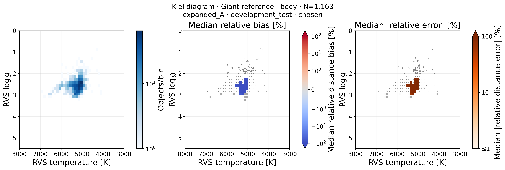

Reliable RVS only. Full range retains every finite parameter, body is an explicit zoom. Low-gravity points remain visible irrespective of performance-cell N. No post-hoc point rejection.

[PNG](../figures/v2_0_revision/physical/kiel_body_giant.png) · [PDF](../figures/v2_0_revision/physical/kiel_body_giant.pdf) · [CSV](../manifests/v2_0_revision/figures/kiel_body_giant.csv) · [元数据](../manifests/v2_0_revision/figures/kiel_body_giant.json)

## kiel_body_other

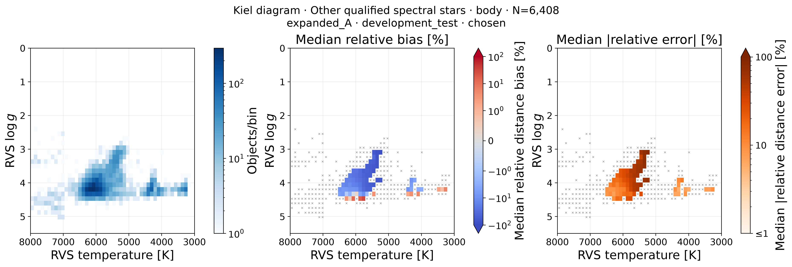

Reliable RVS only. Full range retains every finite parameter, body is an explicit zoom. Low-gravity points remain visible irrespective of performance-cell N. No post-hoc point rejection.

[PNG](../figures/v2_0_revision/physical/kiel_body_other.png) · [PDF](../figures/v2_0_revision/physical/kiel_body_other.pdf) · [CSV](../manifests/v2_0_revision/figures/kiel_body_other.csv) · [元数据](../manifests/v2_0_revision/figures/kiel_body_other.json)

## kiel_body_unknown

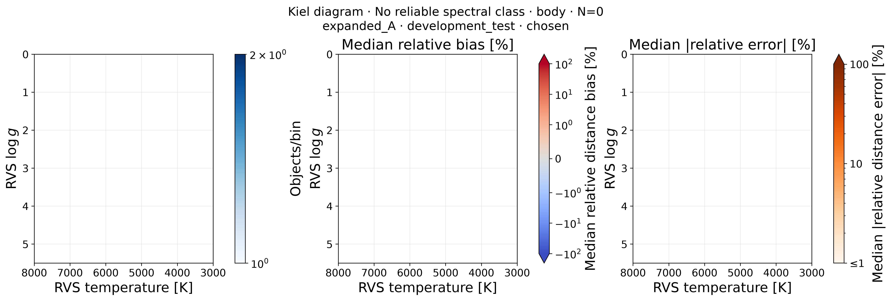

Reliable RVS only. Full range retains every finite parameter, body is an explicit zoom. Low-gravity points remain visible irrespective of performance-cell N. No post-hoc point rejection.

[PNG](../figures/v2_0_revision/physical/kiel_body_unknown.png) · [PDF](../figures/v2_0_revision/physical/kiel_body_unknown.pdf) · [CSV](../manifests/v2_0_revision/figures/kiel_body_unknown.csv) · [元数据](../manifests/v2_0_revision/figures/kiel_body_unknown.json)

## kiel_full_all

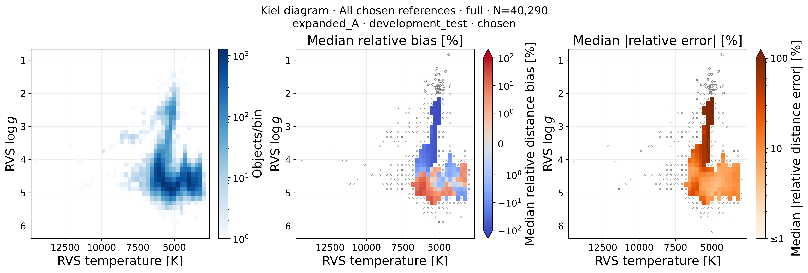

Reliable RVS only. Full range retains every finite parameter, body is an explicit zoom. Low-gravity points remain visible irrespective of performance-cell N. No post-hoc point rejection.

[PNG](../figures/v2_0_revision/physical/kiel_full_all.png) · [PDF](../figures/v2_0_revision/physical/kiel_full_all.pdf) · [CSV](../manifests/v2_0_revision/figures/kiel_full_all.csv) · [元数据](../manifests/v2_0_revision/figures/kiel_full_all.json)

## kiel_full_dwarf

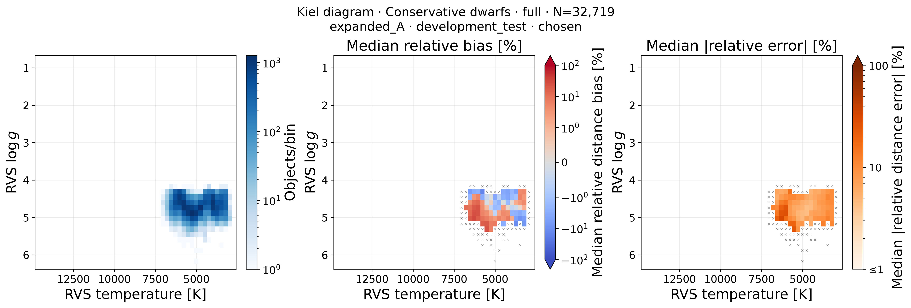

Reliable RVS only. Full range retains every finite parameter, body is an explicit zoom. Low-gravity points remain visible irrespective of performance-cell N. No post-hoc point rejection.

[PNG](../figures/v2_0_revision/physical/kiel_full_dwarf.png) · [PDF](../figures/v2_0_revision/physical/kiel_full_dwarf.pdf) · [CSV](../manifests/v2_0_revision/figures/kiel_full_dwarf.csv) · [元数据](../manifests/v2_0_revision/figures/kiel_full_dwarf.json)

## kiel_full_giant

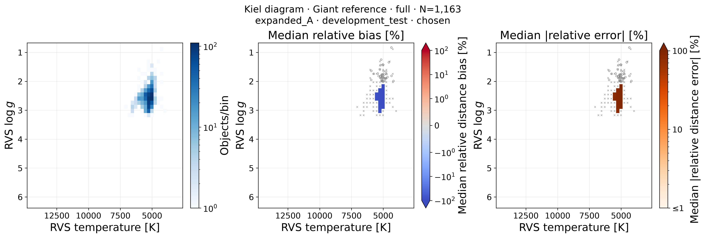

Reliable RVS only. Full range retains every finite parameter, body is an explicit zoom. Low-gravity points remain visible irrespective of performance-cell N. No post-hoc point rejection.

[PNG](../figures/v2_0_revision/physical/kiel_full_giant.png) · [PDF](../figures/v2_0_revision/physical/kiel_full_giant.pdf) · [CSV](../manifests/v2_0_revision/figures/kiel_full_giant.csv) · [元数据](../manifests/v2_0_revision/figures/kiel_full_giant.json)

## kiel_full_other

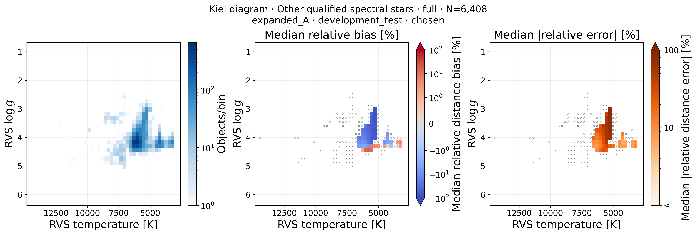

Reliable RVS only. Full range retains every finite parameter, body is an explicit zoom. Low-gravity points remain visible irrespective of performance-cell N. No post-hoc point rejection.

[PNG](../figures/v2_0_revision/physical/kiel_full_other.png) · [PDF](../figures/v2_0_revision/physical/kiel_full_other.pdf) · [CSV](../manifests/v2_0_revision/figures/kiel_full_other.csv) · [元数据](../manifests/v2_0_revision/figures/kiel_full_other.json)

## kiel_full_unknown

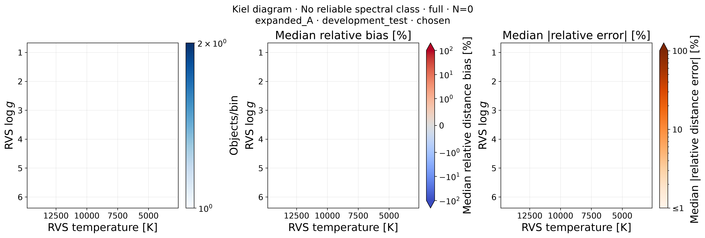

Reliable RVS only. Full range retains every finite parameter, body is an explicit zoom. Low-gravity points remain visible irrespective of performance-cell N. No post-hoc point rejection.

[PNG](../figures/v2_0_revision/physical/kiel_full_unknown.png) · [PDF](../figures/v2_0_revision/physical/kiel_full_unknown.pdf) · [CSV](../manifests/v2_0_revision/figures/kiel_full_unknown.csv) · [元数据](../manifests/v2_0_revision/figures/kiel_full_unknown.json)

## temperature_Mg_all

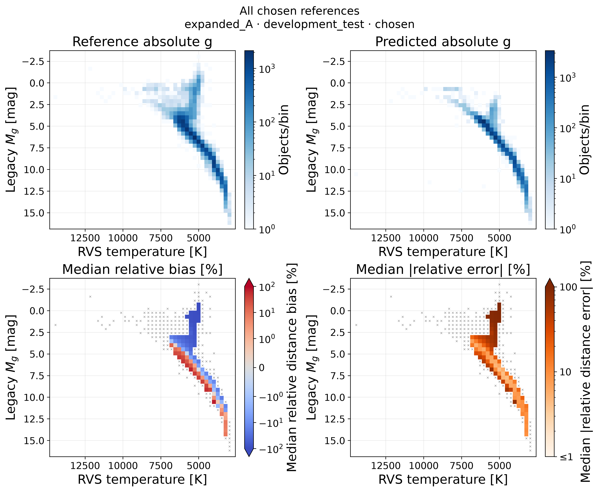

Temperature versus absolute Legacy g, not bolometric luminosity. Reference M=g0-mu_chosen; predicted M=g0-mu50. Reliable RVS parameter gate retained.

[PNG](../figures/v2_0_revision/physical/temperature_Mg_all.png) · [PDF](../figures/v2_0_revision/physical/temperature_Mg_all.pdf) · [CSV](../manifests/v2_0_revision/figures/temperature_Mg_all.csv) · [元数据](../manifests/v2_0_revision/figures/temperature_Mg_all.json)

## temperature_Mg_dwarf

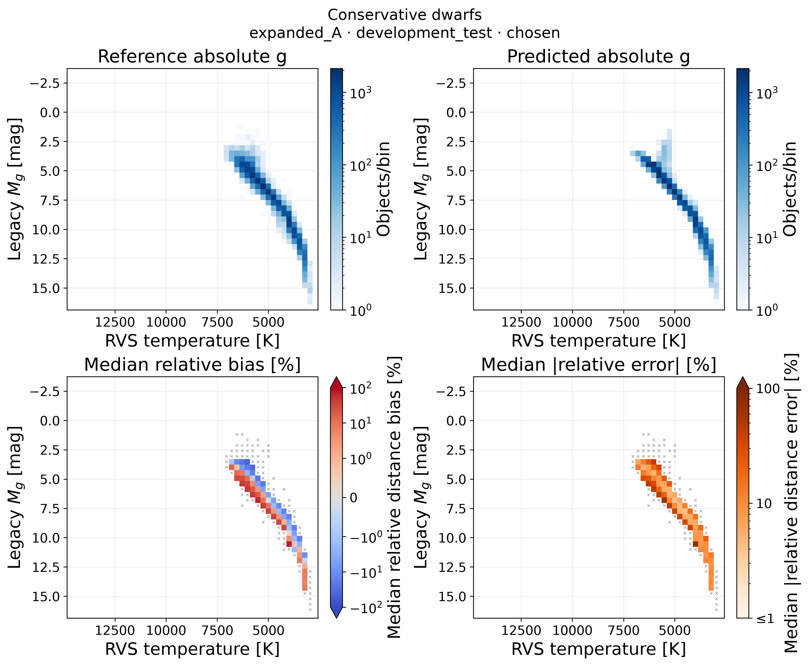

Temperature versus absolute Legacy g, not bolometric luminosity. Reference M=g0-mu_chosen; predicted M=g0-mu50. Reliable RVS parameter gate retained.

[PNG](../figures/v2_0_revision/physical/temperature_Mg_dwarf.png) · [PDF](../figures/v2_0_revision/physical/temperature_Mg_dwarf.pdf) · [CSV](../manifests/v2_0_revision/figures/temperature_Mg_dwarf.csv) · [元数据](../manifests/v2_0_revision/figures/temperature_Mg_dwarf.json)

## temperature_Mg_giant

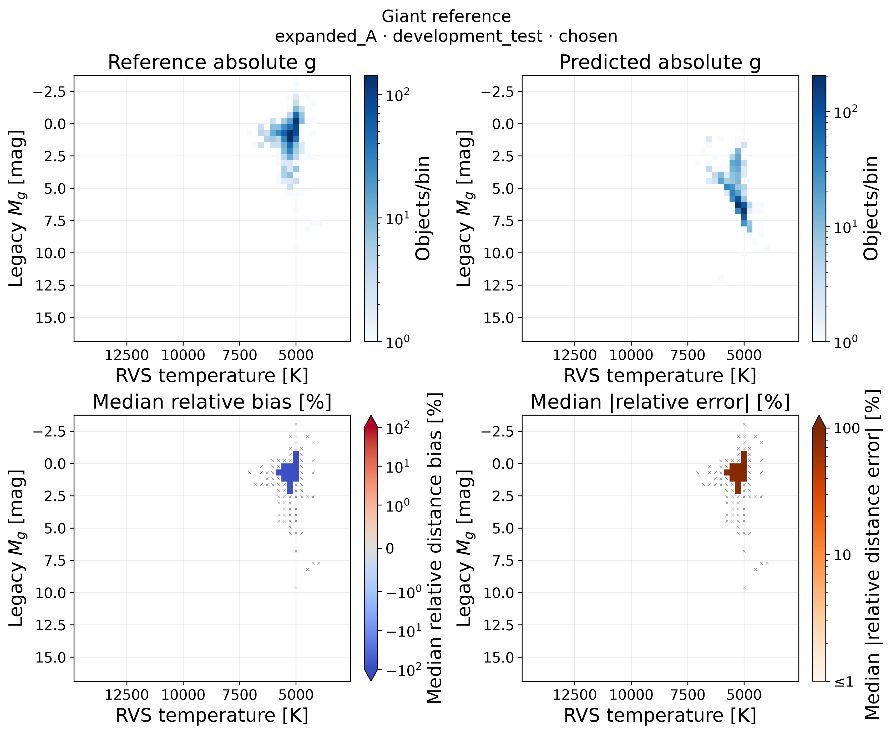

Temperature versus absolute Legacy g, not bolometric luminosity. Reference M=g0-mu_chosen; predicted M=g0-mu50. Reliable RVS parameter gate retained.

[PNG](../figures/v2_0_revision/physical/temperature_Mg_giant.png) · [PDF](../figures/v2_0_revision/physical/temperature_Mg_giant.pdf) · [CSV](../manifests/v2_0_revision/figures/temperature_Mg_giant.csv) · [元数据](../manifests/v2_0_revision/figures/temperature_Mg_giant.json)

## temperature_Mg_other

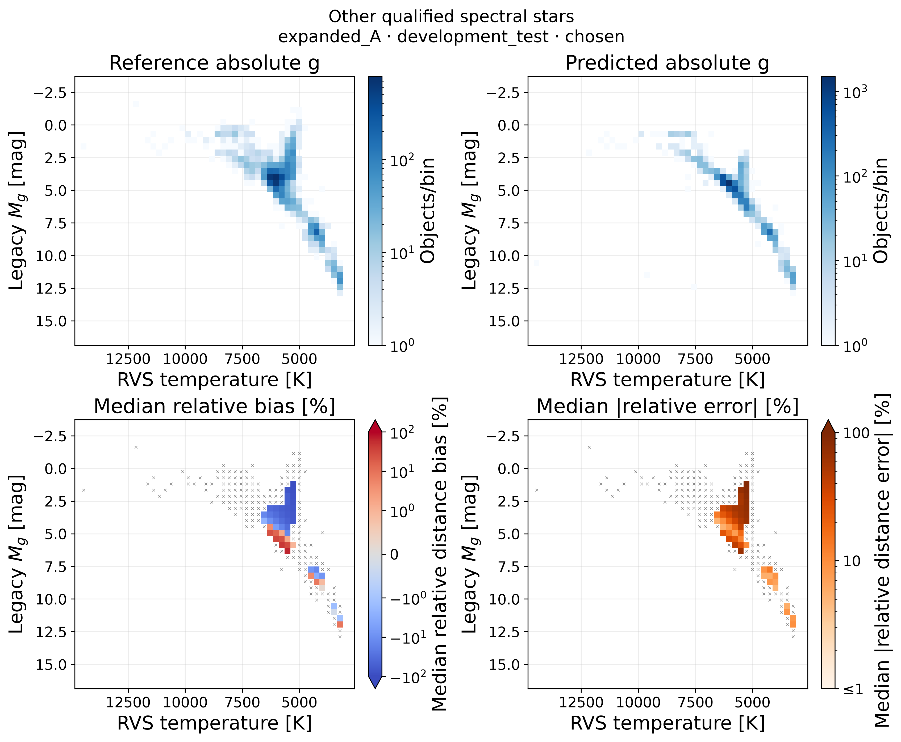

Temperature versus absolute Legacy g, not bolometric luminosity. Reference M=g0-mu_chosen; predicted M=g0-mu50. Reliable RVS parameter gate retained.

[PNG](../figures/v2_0_revision/physical/temperature_Mg_other.png) · [PDF](../figures/v2_0_revision/physical/temperature_Mg_other.pdf) · [CSV](../manifests/v2_0_revision/figures/temperature_Mg_other.csv) · [元数据](../manifests/v2_0_revision/figures/temperature_Mg_other.json)

## temperature_Mg_unknown

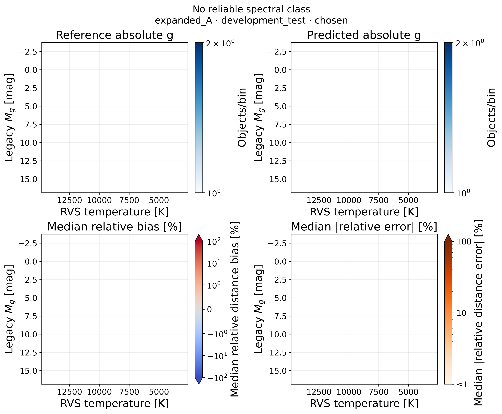

Temperature versus absolute Legacy g, not bolometric luminosity. Reference M=g0-mu_chosen; predicted M=g0-mu50. Reliable RVS parameter gate retained.

[PNG](../figures/v2_0_revision/physical/temperature_Mg_unknown.png) · [PDF](../figures/v2_0_revision/physical/temperature_Mg_unknown.pdf) · [CSV](../manifests/v2_0_revision/figures/temperature_Mg_unknown.csv) · [元数据](../manifests/v2_0_revision/figures/temperature_Mg_unknown.json)

## cmd_g_g_i_all

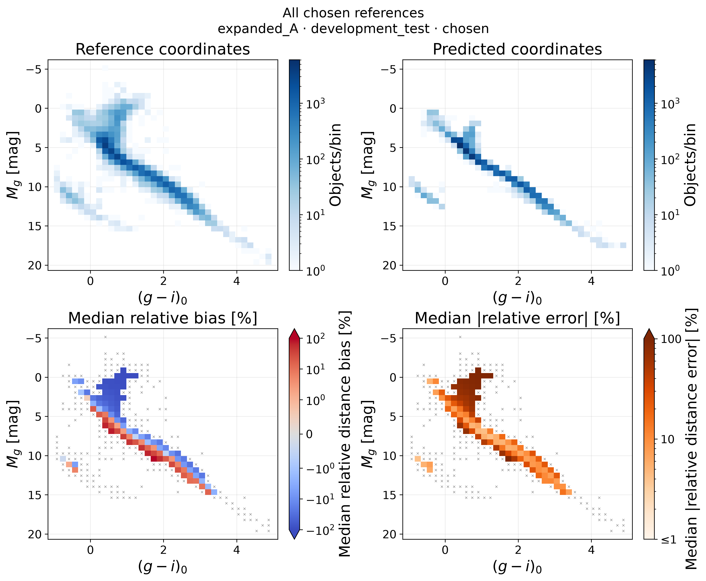

Each panel uses only its required valid bands. Reference M=m0-mu_chosen, predicted M=m0-mu50. Residual statistics are in reference coordinates. Signed=median(epsilon), absolute=median(abs(epsilon)), both percent. N>=20 performance cells, sparse gray crosses, zero cells transparent. Shared edges and density scale across classes. Frozen historical TYPE exceptions retained for audit.

[PNG](../figures/v2_0_revision/combinations/cmd_g_g_i_all.png) · [PDF](../figures/v2_0_revision/combinations/cmd_g_g_i_all.pdf) · [CSV](../manifests/v2_0_revision/figures/cmd_g_g_i_all.csv) · [元数据](../manifests/v2_0_revision/figures/cmd_g_g_i_all.json)

## cmd_g_g_i_dwarf

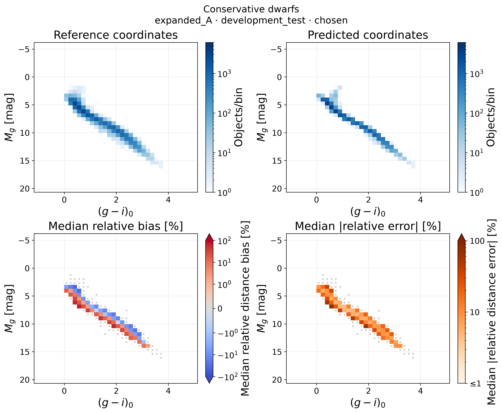

Each panel uses only its required valid bands. Reference M=m0-mu_chosen, predicted M=m0-mu50. Residual statistics are in reference coordinates. Signed=median(epsilon), absolute=median(abs(epsilon)), both percent. N>=20 performance cells, sparse gray crosses, zero cells transparent. Shared edges and density scale across classes. Frozen historical TYPE exceptions retained for audit.

[PNG](../figures/v2_0_revision/combinations/cmd_g_g_i_dwarf.png) · [PDF](../figures/v2_0_revision/combinations/cmd_g_g_i_dwarf.pdf) · [CSV](../manifests/v2_0_revision/figures/cmd_g_g_i_dwarf.csv) · [元数据](../manifests/v2_0_revision/figures/cmd_g_g_i_dwarf.json)

## cmd_g_g_i_giant

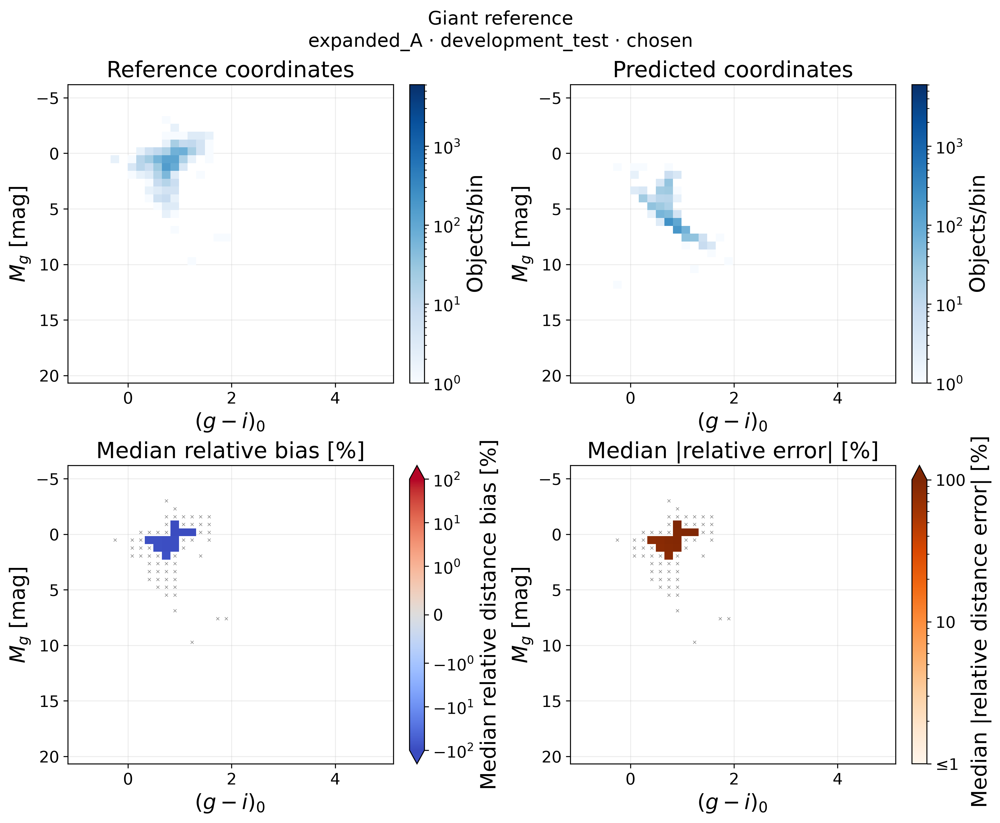

Each panel uses only its required valid bands. Reference M=m0-mu_chosen, predicted M=m0-mu50. Residual statistics are in reference coordinates. Signed=median(epsilon), absolute=median(abs(epsilon)), both percent. N>=20 performance cells, sparse gray crosses, zero cells transparent. Shared edges and density scale across classes. Frozen historical TYPE exceptions retained for audit.

[PNG](../figures/v2_0_revision/combinations/cmd_g_g_i_giant.png) · [PDF](../figures/v2_0_revision/combinations/cmd_g_g_i_giant.pdf) · [CSV](../manifests/v2_0_revision/figures/cmd_g_g_i_giant.csv) · [元数据](../manifests/v2_0_revision/figures/cmd_g_g_i_giant.json)

## cmd_g_g_i_other

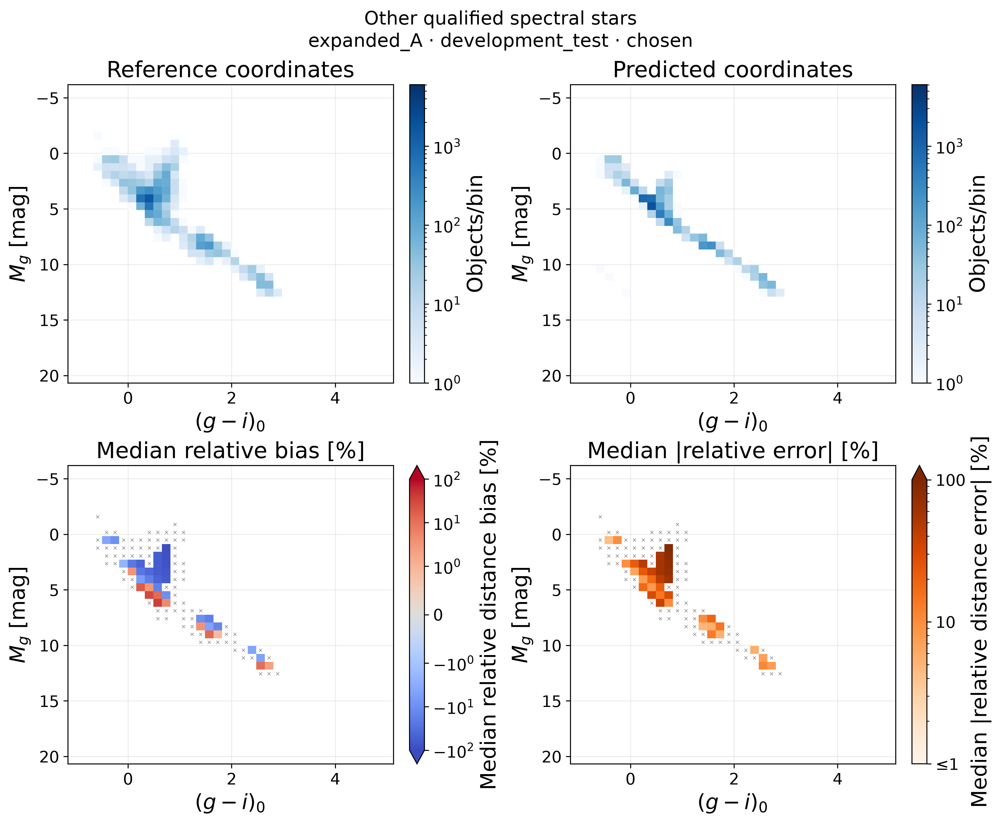

Each panel uses only its required valid bands. Reference M=m0-mu_chosen, predicted M=m0-mu50. Residual statistics are in reference coordinates. Signed=median(epsilon), absolute=median(abs(epsilon)), both percent. N>=20 performance cells, sparse gray crosses, zero cells transparent. Shared edges and density scale across classes. Frozen historical TYPE exceptions retained for audit.

[PNG](../figures/v2_0_revision/combinations/cmd_g_g_i_other.png) · [PDF](../figures/v2_0_revision/combinations/cmd_g_g_i_other.pdf) · [CSV](../manifests/v2_0_revision/figures/cmd_g_g_i_other.csv) · [元数据](../manifests/v2_0_revision/figures/cmd_g_g_i_other.json)

## cmd_g_g_i_unknown

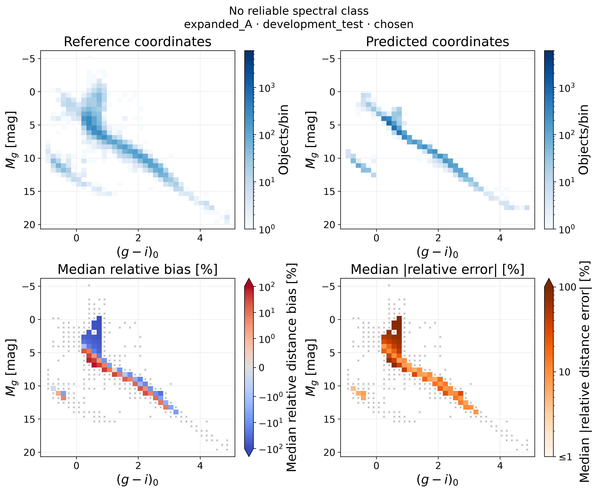

Each panel uses only its required valid bands. Reference M=m0-mu_chosen, predicted M=m0-mu50. Residual statistics are in reference coordinates. Signed=median(epsilon), absolute=median(abs(epsilon)), both percent. N>=20 performance cells, sparse gray crosses, zero cells transparent. Shared edges and density scale across classes. Frozen historical TYPE exceptions retained for audit.

[PNG](../figures/v2_0_revision/combinations/cmd_g_g_i_unknown.png) · [PDF](../figures/v2_0_revision/combinations/cmd_g_g_i_unknown.pdf) · [CSV](../manifests/v2_0_revision/figures/cmd_g_g_i_unknown.csv) · [元数据](../manifests/v2_0_revision/figures/cmd_g_g_i_unknown.json)
