# v2.0 修订图集 09

[完整目录](v2_0_revision_atlas.md)

## cmd_w1_g_z_all

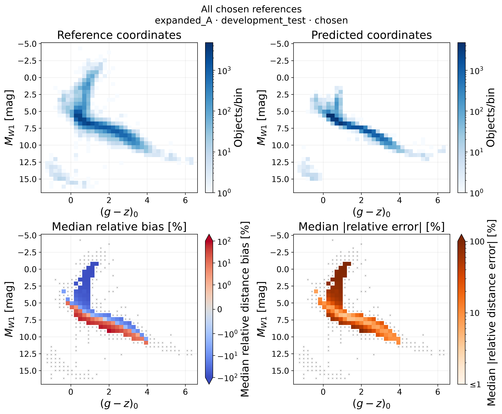

Each panel uses only its required valid bands. Reference M=m0-mu_chosen, predicted M=m0-mu50. Residual statistics are in reference coordinates. Signed=median(epsilon), absolute=median(abs(epsilon)), both percent. N>=20 performance cells, sparse gray crosses, zero cells transparent. Shared edges and density scale across classes. Frozen historical TYPE exceptions retained for audit.

[PNG](../figures/v2_0_revision/combinations/cmd_w1_g_z_all.png) · [PDF](../figures/v2_0_revision/combinations/cmd_w1_g_z_all.pdf) · [CSV](../manifests/v2_0_revision/figures/cmd_w1_g_z_all.csv) · [元数据](../manifests/v2_0_revision/figures/cmd_w1_g_z_all.json)

## cmd_w1_g_z_dwarf

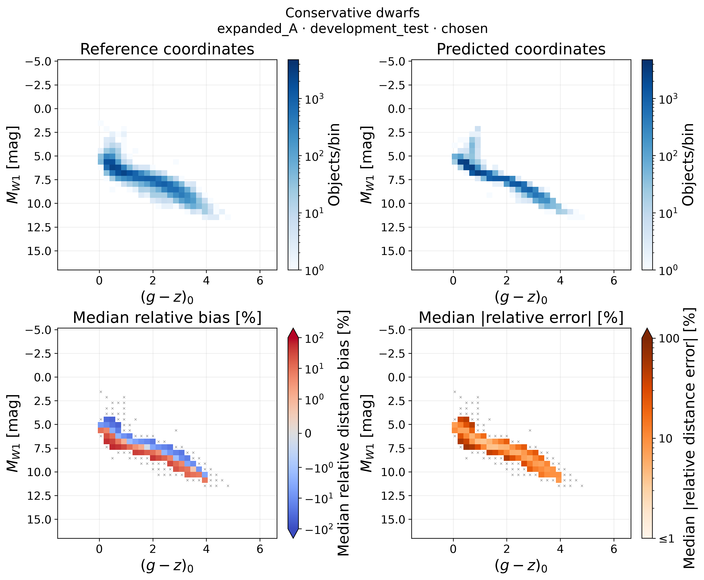

Each panel uses only its required valid bands. Reference M=m0-mu_chosen, predicted M=m0-mu50. Residual statistics are in reference coordinates. Signed=median(epsilon), absolute=median(abs(epsilon)), both percent. N>=20 performance cells, sparse gray crosses, zero cells transparent. Shared edges and density scale across classes. Frozen historical TYPE exceptions retained for audit.

[PNG](../figures/v2_0_revision/combinations/cmd_w1_g_z_dwarf.png) · [PDF](../figures/v2_0_revision/combinations/cmd_w1_g_z_dwarf.pdf) · [CSV](../manifests/v2_0_revision/figures/cmd_w1_g_z_dwarf.csv) · [元数据](../manifests/v2_0_revision/figures/cmd_w1_g_z_dwarf.json)

## cmd_w1_g_z_giant

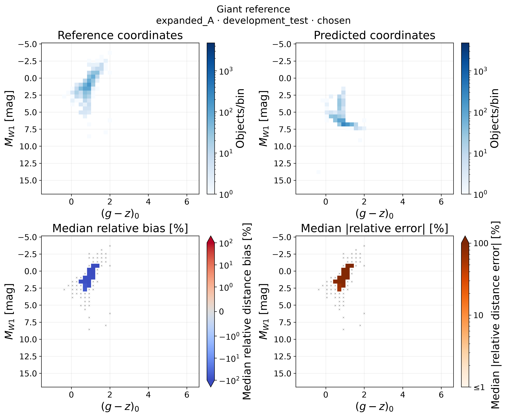

Each panel uses only its required valid bands. Reference M=m0-mu_chosen, predicted M=m0-mu50. Residual statistics are in reference coordinates. Signed=median(epsilon), absolute=median(abs(epsilon)), both percent. N>=20 performance cells, sparse gray crosses, zero cells transparent. Shared edges and density scale across classes. Frozen historical TYPE exceptions retained for audit.

[PNG](../figures/v2_0_revision/combinations/cmd_w1_g_z_giant.png) · [PDF](../figures/v2_0_revision/combinations/cmd_w1_g_z_giant.pdf) · [CSV](../manifests/v2_0_revision/figures/cmd_w1_g_z_giant.csv) · [元数据](../manifests/v2_0_revision/figures/cmd_w1_g_z_giant.json)

## cmd_w1_g_z_other

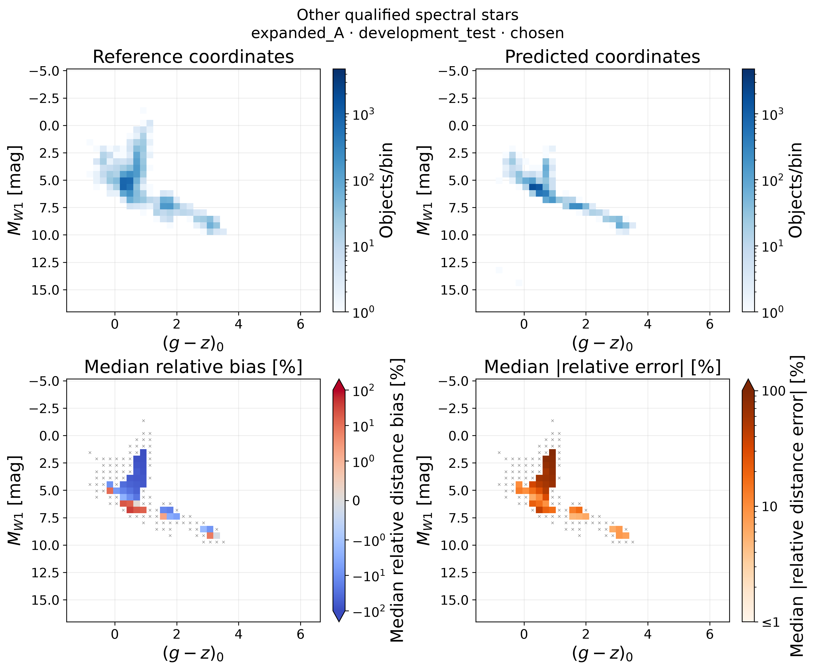

Each panel uses only its required valid bands. Reference M=m0-mu_chosen, predicted M=m0-mu50. Residual statistics are in reference coordinates. Signed=median(epsilon), absolute=median(abs(epsilon)), both percent. N>=20 performance cells, sparse gray crosses, zero cells transparent. Shared edges and density scale across classes. Frozen historical TYPE exceptions retained for audit.

[PNG](../figures/v2_0_revision/combinations/cmd_w1_g_z_other.png) · [PDF](../figures/v2_0_revision/combinations/cmd_w1_g_z_other.pdf) · [CSV](../manifests/v2_0_revision/figures/cmd_w1_g_z_other.csv) · [元数据](../manifests/v2_0_revision/figures/cmd_w1_g_z_other.json)

## cmd_w1_g_z_unknown

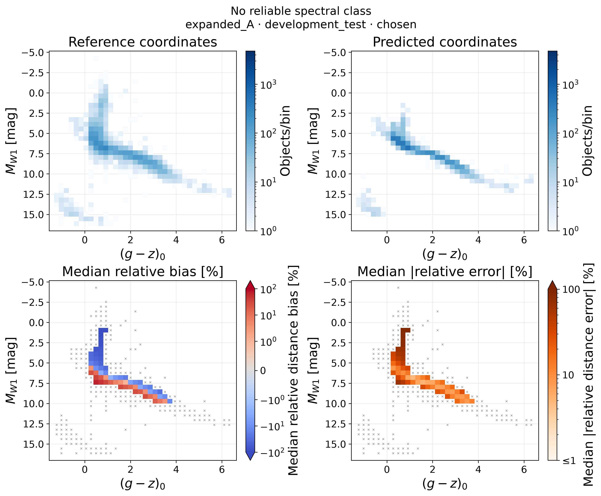

Each panel uses only its required valid bands. Reference M=m0-mu_chosen, predicted M=m0-mu50. Residual statistics are in reference coordinates. Signed=median(epsilon), absolute=median(abs(epsilon)), both percent. N>=20 performance cells, sparse gray crosses, zero cells transparent. Shared edges and density scale across classes. Frozen historical TYPE exceptions retained for audit.

[PNG](../figures/v2_0_revision/combinations/cmd_w1_g_z_unknown.png) · [PDF](../figures/v2_0_revision/combinations/cmd_w1_g_z_unknown.pdf) · [CSV](../manifests/v2_0_revision/figures/cmd_w1_g_z_unknown.csv) · [元数据](../manifests/v2_0_revision/figures/cmd_w1_g_z_unknown.json)

## cmd_w1_i_w1_all

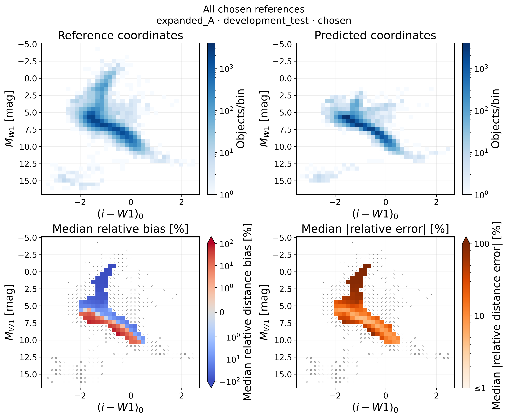

Each panel uses only its required valid bands. Reference M=m0-mu_chosen, predicted M=m0-mu50. Residual statistics are in reference coordinates. Signed=median(epsilon), absolute=median(abs(epsilon)), both percent. N>=20 performance cells, sparse gray crosses, zero cells transparent. Shared edges and density scale across classes. Frozen historical TYPE exceptions retained for audit.

[PNG](../figures/v2_0_revision/combinations/cmd_w1_i_w1_all.png) · [PDF](../figures/v2_0_revision/combinations/cmd_w1_i_w1_all.pdf) · [CSV](../manifests/v2_0_revision/figures/cmd_w1_i_w1_all.csv) · [元数据](../manifests/v2_0_revision/figures/cmd_w1_i_w1_all.json)

## cmd_w1_i_w1_dwarf

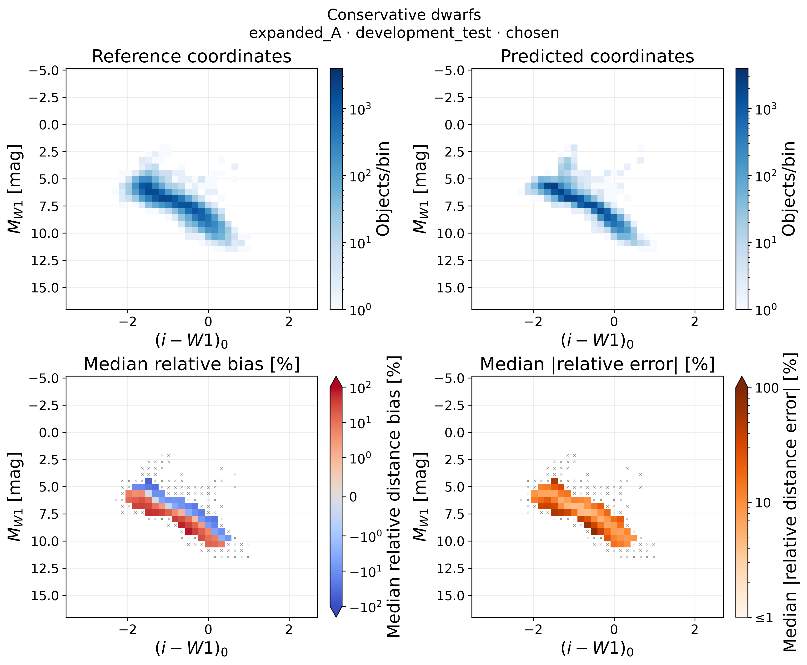

Each panel uses only its required valid bands. Reference M=m0-mu_chosen, predicted M=m0-mu50. Residual statistics are in reference coordinates. Signed=median(epsilon), absolute=median(abs(epsilon)), both percent. N>=20 performance cells, sparse gray crosses, zero cells transparent. Shared edges and density scale across classes. Frozen historical TYPE exceptions retained for audit.

[PNG](../figures/v2_0_revision/combinations/cmd_w1_i_w1_dwarf.png) · [PDF](../figures/v2_0_revision/combinations/cmd_w1_i_w1_dwarf.pdf) · [CSV](../manifests/v2_0_revision/figures/cmd_w1_i_w1_dwarf.csv) · [元数据](../manifests/v2_0_revision/figures/cmd_w1_i_w1_dwarf.json)

## cmd_w1_i_w1_giant

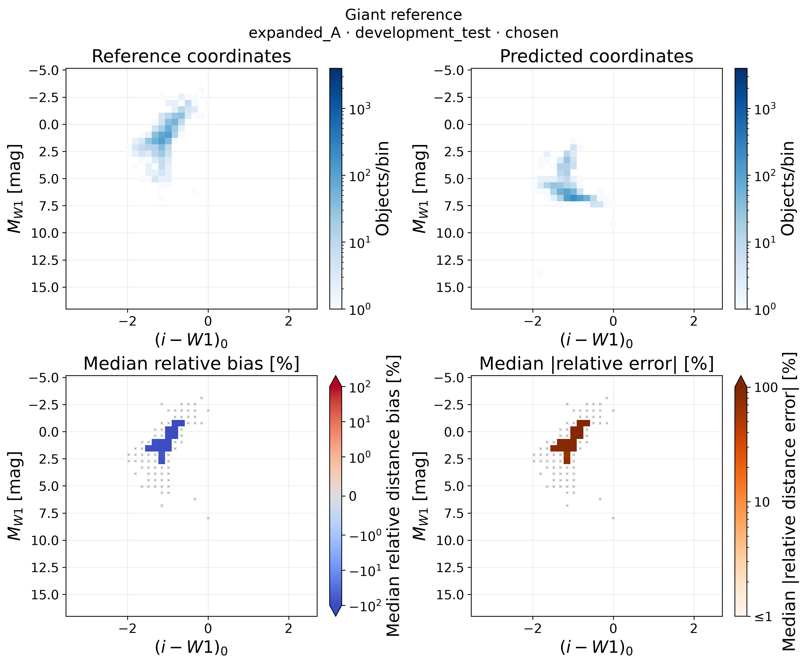

Each panel uses only its required valid bands. Reference M=m0-mu_chosen, predicted M=m0-mu50. Residual statistics are in reference coordinates. Signed=median(epsilon), absolute=median(abs(epsilon)), both percent. N>=20 performance cells, sparse gray crosses, zero cells transparent. Shared edges and density scale across classes. Frozen historical TYPE exceptions retained for audit.

[PNG](../figures/v2_0_revision/combinations/cmd_w1_i_w1_giant.png) · [PDF](../figures/v2_0_revision/combinations/cmd_w1_i_w1_giant.pdf) · [CSV](../manifests/v2_0_revision/figures/cmd_w1_i_w1_giant.csv) · [元数据](../manifests/v2_0_revision/figures/cmd_w1_i_w1_giant.json)

## cmd_w1_i_w1_other

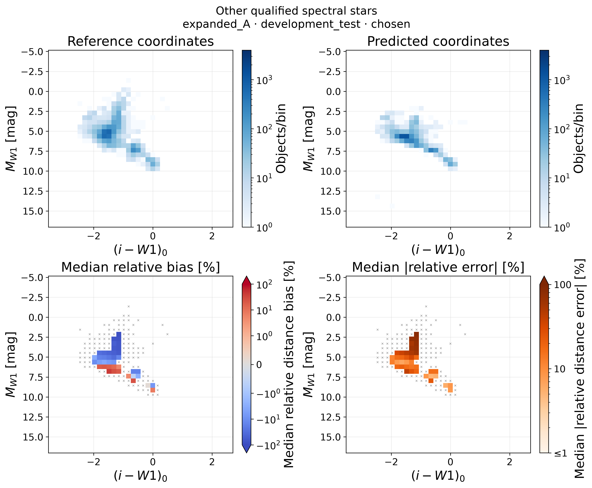

Each panel uses only its required valid bands. Reference M=m0-mu_chosen, predicted M=m0-mu50. Residual statistics are in reference coordinates. Signed=median(epsilon), absolute=median(abs(epsilon)), both percent. N>=20 performance cells, sparse gray crosses, zero cells transparent. Shared edges and density scale across classes. Frozen historical TYPE exceptions retained for audit.

[PNG](../figures/v2_0_revision/combinations/cmd_w1_i_w1_other.png) · [PDF](../figures/v2_0_revision/combinations/cmd_w1_i_w1_other.pdf) · [CSV](../manifests/v2_0_revision/figures/cmd_w1_i_w1_other.csv) · [元数据](../manifests/v2_0_revision/figures/cmd_w1_i_w1_other.json)

## cmd_w1_i_w1_unknown

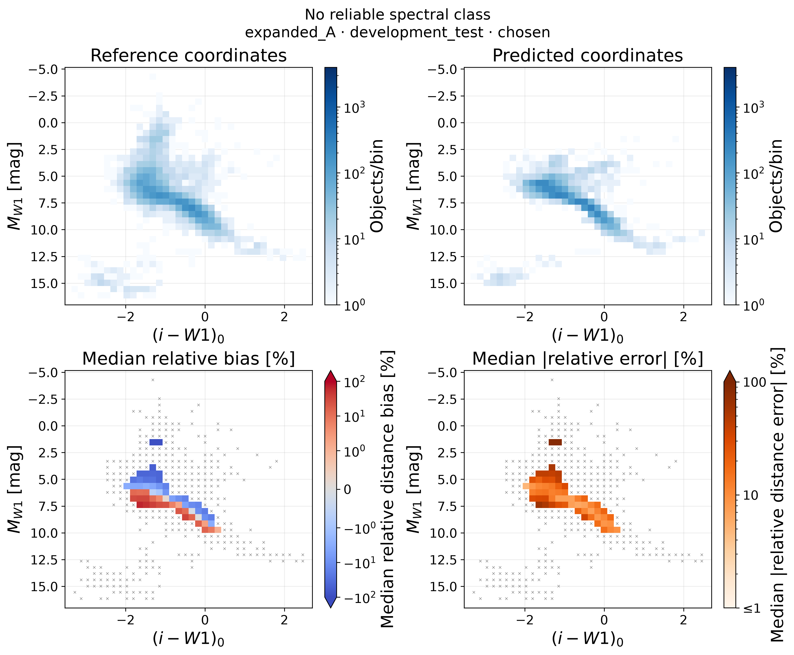

Each panel uses only its required valid bands. Reference M=m0-mu_chosen, predicted M=m0-mu50. Residual statistics are in reference coordinates. Signed=median(epsilon), absolute=median(abs(epsilon)), both percent. N>=20 performance cells, sparse gray crosses, zero cells transparent. Shared edges and density scale across classes. Frozen historical TYPE exceptions retained for audit.

[PNG](../figures/v2_0_revision/combinations/cmd_w1_i_w1_unknown.png) · [PDF](../figures/v2_0_revision/combinations/cmd_w1_i_w1_unknown.pdf) · [CSV](../manifests/v2_0_revision/figures/cmd_w1_i_w1_unknown.csv) · [元数据](../manifests/v2_0_revision/figures/cmd_w1_i_w1_unknown.json)

## cmd_w1_i_w2_all

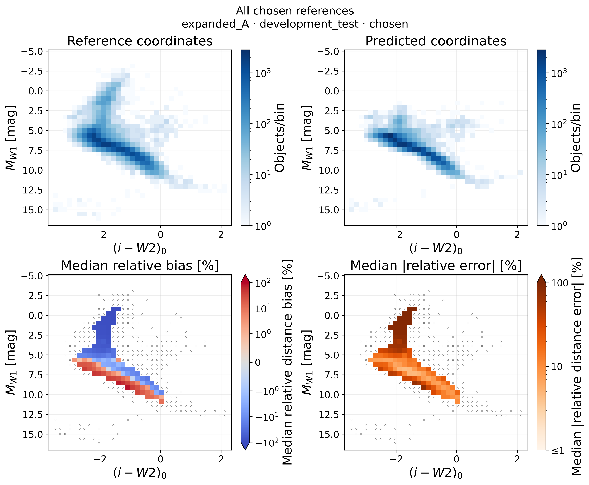

Each panel uses only its required valid bands. Reference M=m0-mu_chosen, predicted M=m0-mu50. Residual statistics are in reference coordinates. Signed=median(epsilon), absolute=median(abs(epsilon)), both percent. N>=20 performance cells, sparse gray crosses, zero cells transparent. Shared edges and density scale across classes. Frozen historical TYPE exceptions retained for audit.

[PNG](../figures/v2_0_revision/combinations/cmd_w1_i_w2_all.png) · [PDF](../figures/v2_0_revision/combinations/cmd_w1_i_w2_all.pdf) · [CSV](../manifests/v2_0_revision/figures/cmd_w1_i_w2_all.csv) · [元数据](../manifests/v2_0_revision/figures/cmd_w1_i_w2_all.json)

## cmd_w1_i_w2_dwarf

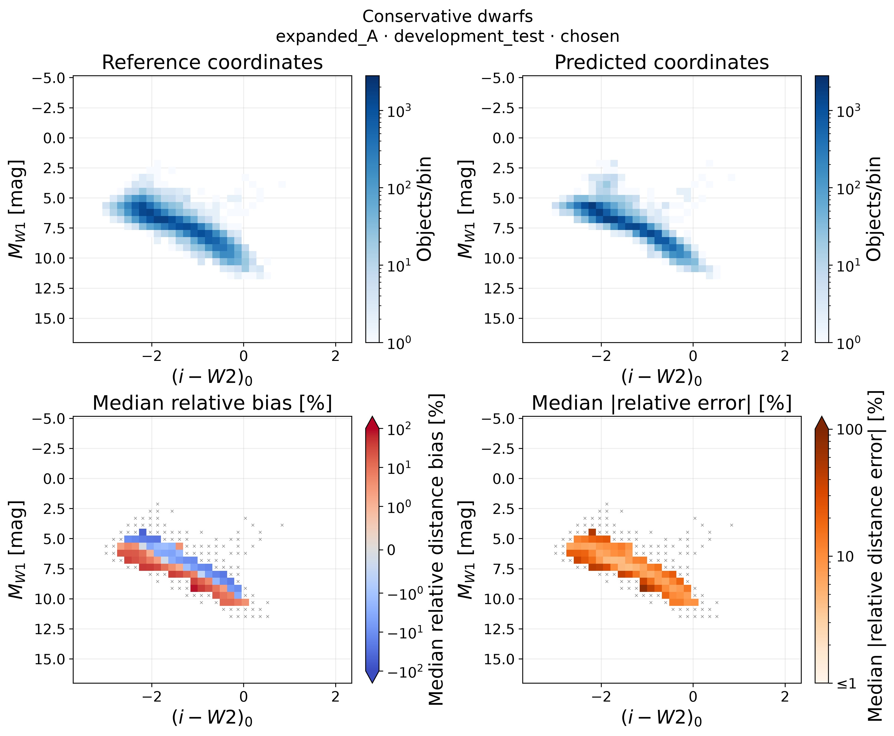

Each panel uses only its required valid bands. Reference M=m0-mu_chosen, predicted M=m0-mu50. Residual statistics are in reference coordinates. Signed=median(epsilon), absolute=median(abs(epsilon)), both percent. N>=20 performance cells, sparse gray crosses, zero cells transparent. Shared edges and density scale across classes. Frozen historical TYPE exceptions retained for audit.

[PNG](../figures/v2_0_revision/combinations/cmd_w1_i_w2_dwarf.png) · [PDF](../figures/v2_0_revision/combinations/cmd_w1_i_w2_dwarf.pdf) · [CSV](../manifests/v2_0_revision/figures/cmd_w1_i_w2_dwarf.csv) · [元数据](../manifests/v2_0_revision/figures/cmd_w1_i_w2_dwarf.json)

## cmd_w1_i_w2_giant

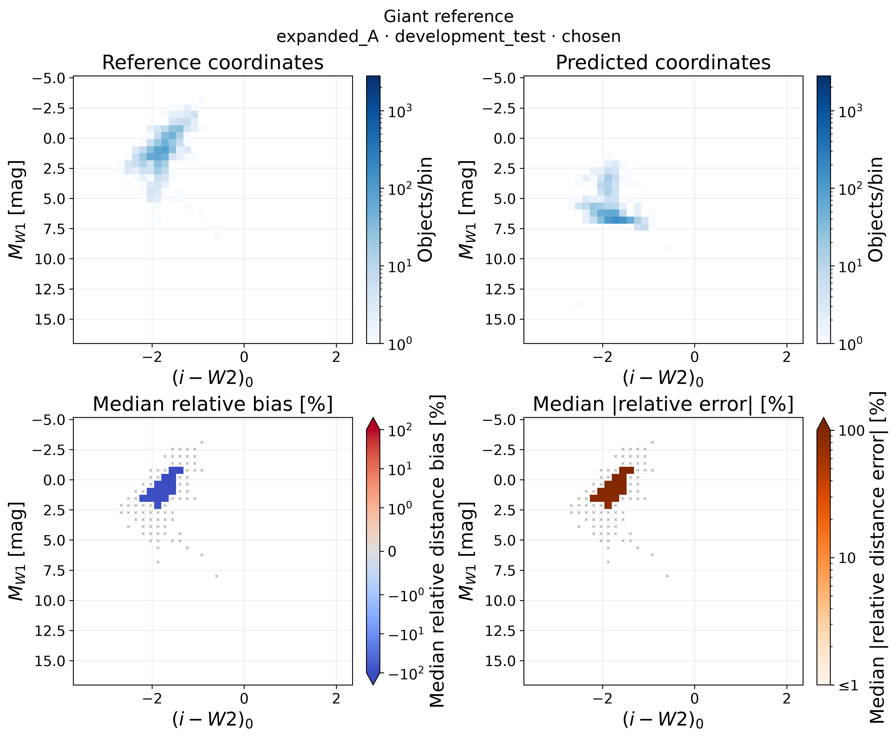

Each panel uses only its required valid bands. Reference M=m0-mu_chosen, predicted M=m0-mu50. Residual statistics are in reference coordinates. Signed=median(epsilon), absolute=median(abs(epsilon)), both percent. N>=20 performance cells, sparse gray crosses, zero cells transparent. Shared edges and density scale across classes. Frozen historical TYPE exceptions retained for audit.

[PNG](../figures/v2_0_revision/combinations/cmd_w1_i_w2_giant.png) · [PDF](../figures/v2_0_revision/combinations/cmd_w1_i_w2_giant.pdf) · [CSV](../manifests/v2_0_revision/figures/cmd_w1_i_w2_giant.csv) · [元数据](../manifests/v2_0_revision/figures/cmd_w1_i_w2_giant.json)

## cmd_w1_i_w2_other

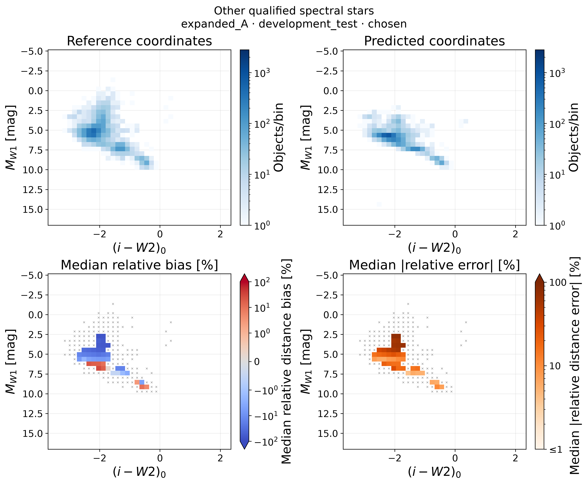

Each panel uses only its required valid bands. Reference M=m0-mu_chosen, predicted M=m0-mu50. Residual statistics are in reference coordinates. Signed=median(epsilon), absolute=median(abs(epsilon)), both percent. N>=20 performance cells, sparse gray crosses, zero cells transparent. Shared edges and density scale across classes. Frozen historical TYPE exceptions retained for audit.

[PNG](../figures/v2_0_revision/combinations/cmd_w1_i_w2_other.png) · [PDF](../figures/v2_0_revision/combinations/cmd_w1_i_w2_other.pdf) · [CSV](../manifests/v2_0_revision/figures/cmd_w1_i_w2_other.csv) · [元数据](../manifests/v2_0_revision/figures/cmd_w1_i_w2_other.json)

## cmd_w1_i_w2_unknown

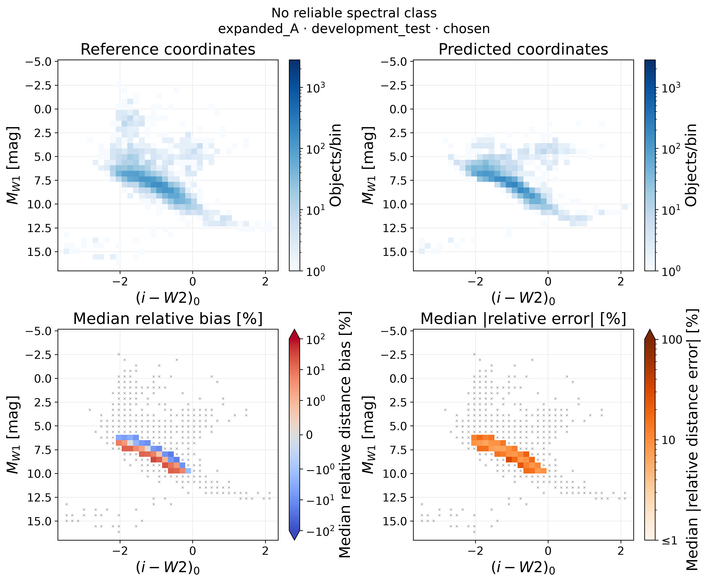

Each panel uses only its required valid bands. Reference M=m0-mu_chosen, predicted M=m0-mu50. Residual statistics are in reference coordinates. Signed=median(epsilon), absolute=median(abs(epsilon)), both percent. N>=20 performance cells, sparse gray crosses, zero cells transparent. Shared edges and density scale across classes. Frozen historical TYPE exceptions retained for audit.

[PNG](../figures/v2_0_revision/combinations/cmd_w1_i_w2_unknown.png) · [PDF](../figures/v2_0_revision/combinations/cmd_w1_i_w2_unknown.pdf) · [CSV](../manifests/v2_0_revision/figures/cmd_w1_i_w2_unknown.csv) · [元数据](../manifests/v2_0_revision/figures/cmd_w1_i_w2_unknown.json)

## cmd_w1_i_z_all

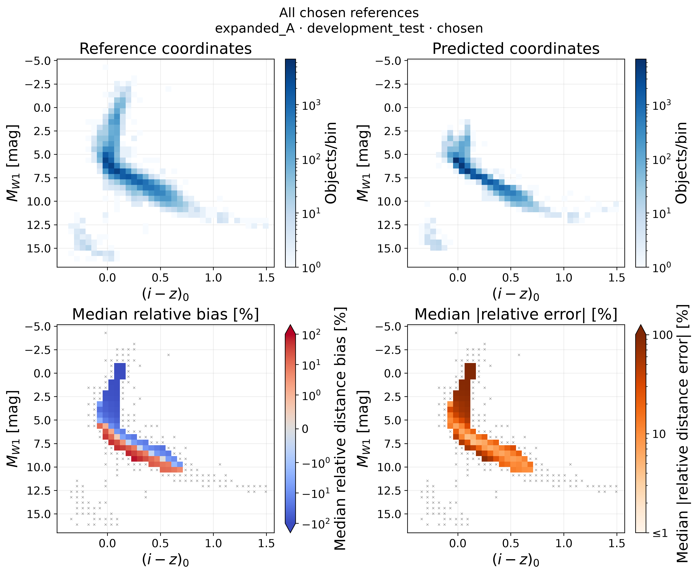

Each panel uses only its required valid bands. Reference M=m0-mu_chosen, predicted M=m0-mu50. Residual statistics are in reference coordinates. Signed=median(epsilon), absolute=median(abs(epsilon)), both percent. N>=20 performance cells, sparse gray crosses, zero cells transparent. Shared edges and density scale across classes. Frozen historical TYPE exceptions retained for audit.

[PNG](../figures/v2_0_revision/combinations/cmd_w1_i_z_all.png) · [PDF](../figures/v2_0_revision/combinations/cmd_w1_i_z_all.pdf) · [CSV](../manifests/v2_0_revision/figures/cmd_w1_i_z_all.csv) · [元数据](../manifests/v2_0_revision/figures/cmd_w1_i_z_all.json)

## cmd_w1_i_z_dwarf

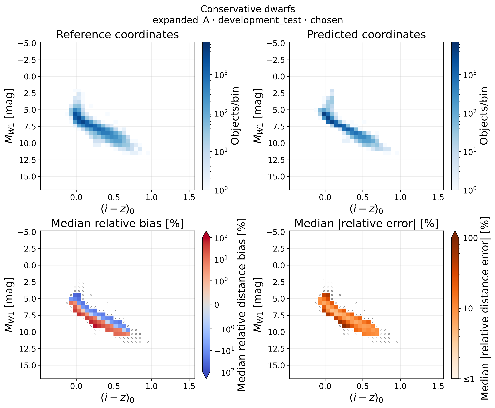

Each panel uses only its required valid bands. Reference M=m0-mu_chosen, predicted M=m0-mu50. Residual statistics are in reference coordinates. Signed=median(epsilon), absolute=median(abs(epsilon)), both percent. N>=20 performance cells, sparse gray crosses, zero cells transparent. Shared edges and density scale across classes. Frozen historical TYPE exceptions retained for audit.

[PNG](../figures/v2_0_revision/combinations/cmd_w1_i_z_dwarf.png) · [PDF](../figures/v2_0_revision/combinations/cmd_w1_i_z_dwarf.pdf) · [CSV](../manifests/v2_0_revision/figures/cmd_w1_i_z_dwarf.csv) · [元数据](../manifests/v2_0_revision/figures/cmd_w1_i_z_dwarf.json)

## cmd_w1_i_z_giant

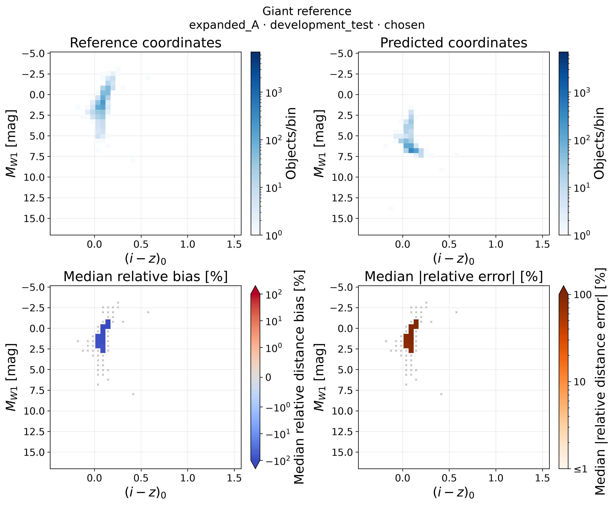

Each panel uses only its required valid bands. Reference M=m0-mu_chosen, predicted M=m0-mu50. Residual statistics are in reference coordinates. Signed=median(epsilon), absolute=median(abs(epsilon)), both percent. N>=20 performance cells, sparse gray crosses, zero cells transparent. Shared edges and density scale across classes. Frozen historical TYPE exceptions retained for audit.

[PNG](../figures/v2_0_revision/combinations/cmd_w1_i_z_giant.png) · [PDF](../figures/v2_0_revision/combinations/cmd_w1_i_z_giant.pdf) · [CSV](../manifests/v2_0_revision/figures/cmd_w1_i_z_giant.csv) · [元数据](../manifests/v2_0_revision/figures/cmd_w1_i_z_giant.json)

## cmd_w1_i_z_other

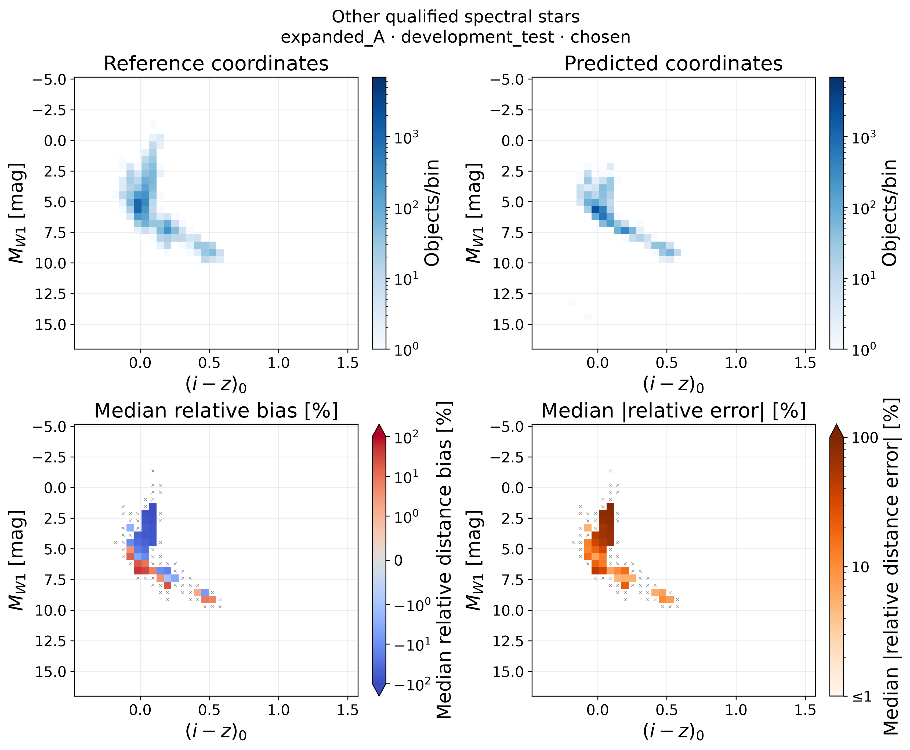

Each panel uses only its required valid bands. Reference M=m0-mu_chosen, predicted M=m0-mu50. Residual statistics are in reference coordinates. Signed=median(epsilon), absolute=median(abs(epsilon)), both percent. N>=20 performance cells, sparse gray crosses, zero cells transparent. Shared edges and density scale across classes. Frozen historical TYPE exceptions retained for audit.

[PNG](../figures/v2_0_revision/combinations/cmd_w1_i_z_other.png) · [PDF](../figures/v2_0_revision/combinations/cmd_w1_i_z_other.pdf) · [CSV](../manifests/v2_0_revision/figures/cmd_w1_i_z_other.csv) · [元数据](../manifests/v2_0_revision/figures/cmd_w1_i_z_other.json)

## cmd_w1_i_z_unknown

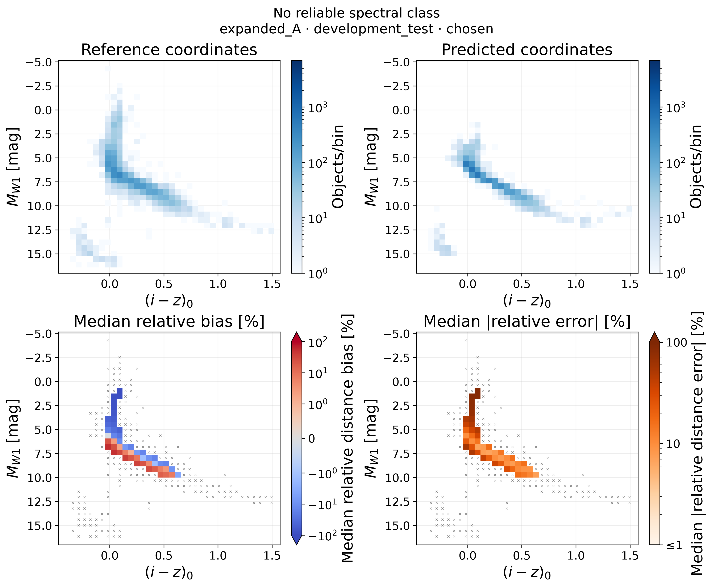

Each panel uses only its required valid bands. Reference M=m0-mu_chosen, predicted M=m0-mu50. Residual statistics are in reference coordinates. Signed=median(epsilon), absolute=median(abs(epsilon)), both percent. N>=20 performance cells, sparse gray crosses, zero cells transparent. Shared edges and density scale across classes. Frozen historical TYPE exceptions retained for audit.

[PNG](../figures/v2_0_revision/combinations/cmd_w1_i_z_unknown.png) · [PDF](../figures/v2_0_revision/combinations/cmd_w1_i_z_unknown.pdf) · [CSV](../manifests/v2_0_revision/figures/cmd_w1_i_z_unknown.csv) · [元数据](../manifests/v2_0_revision/figures/cmd_w1_i_z_unknown.json)

## cmd_w1_r_i_all

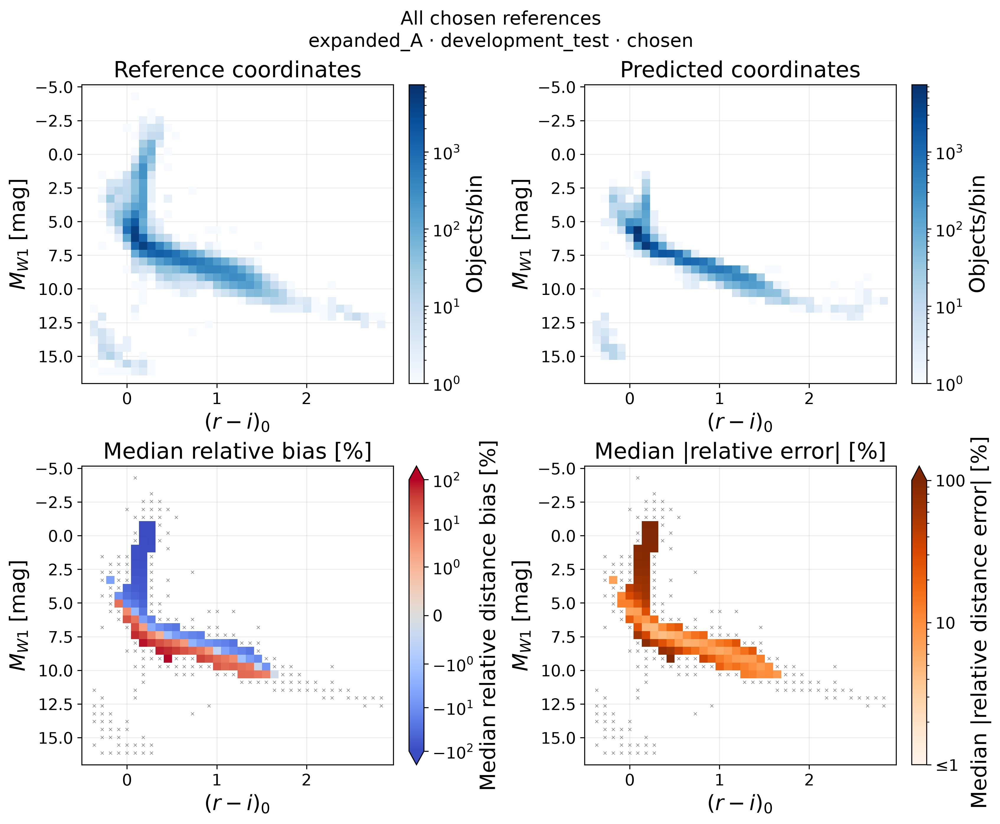

Each panel uses only its required valid bands. Reference M=m0-mu_chosen, predicted M=m0-mu50. Residual statistics are in reference coordinates. Signed=median(epsilon), absolute=median(abs(epsilon)), both percent. N>=20 performance cells, sparse gray crosses, zero cells transparent. Shared edges and density scale across classes. Frozen historical TYPE exceptions retained for audit.

[PNG](../figures/v2_0_revision/combinations/cmd_w1_r_i_all.png) · [PDF](../figures/v2_0_revision/combinations/cmd_w1_r_i_all.pdf) · [CSV](../manifests/v2_0_revision/figures/cmd_w1_r_i_all.csv) · [元数据](../manifests/v2_0_revision/figures/cmd_w1_r_i_all.json)

## cmd_w1_r_i_dwarf

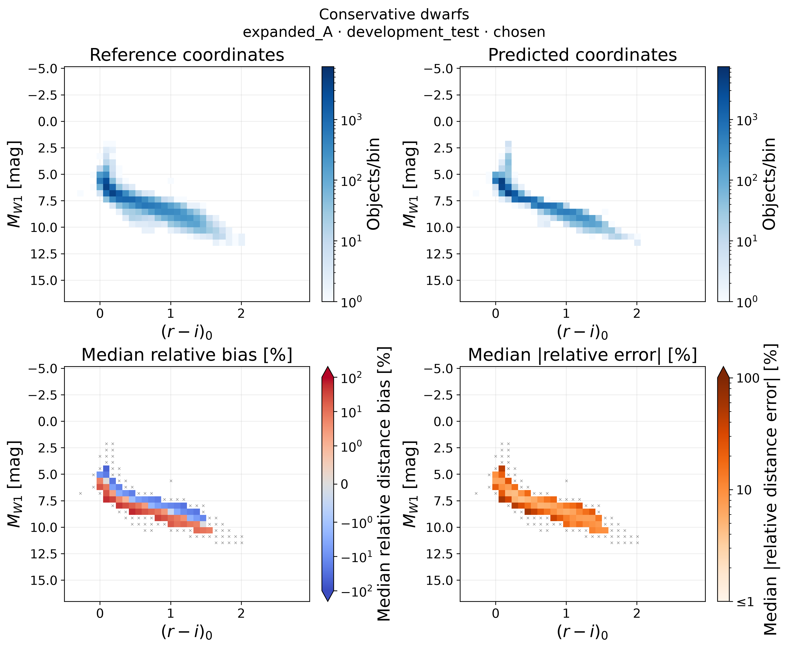

Each panel uses only its required valid bands. Reference M=m0-mu_chosen, predicted M=m0-mu50. Residual statistics are in reference coordinates. Signed=median(epsilon), absolute=median(abs(epsilon)), both percent. N>=20 performance cells, sparse gray crosses, zero cells transparent. Shared edges and density scale across classes. Frozen historical TYPE exceptions retained for audit.

[PNG](../figures/v2_0_revision/combinations/cmd_w1_r_i_dwarf.png) · [PDF](../figures/v2_0_revision/combinations/cmd_w1_r_i_dwarf.pdf) · [CSV](../manifests/v2_0_revision/figures/cmd_w1_r_i_dwarf.csv) · [元数据](../manifests/v2_0_revision/figures/cmd_w1_r_i_dwarf.json)

## cmd_w1_r_i_giant

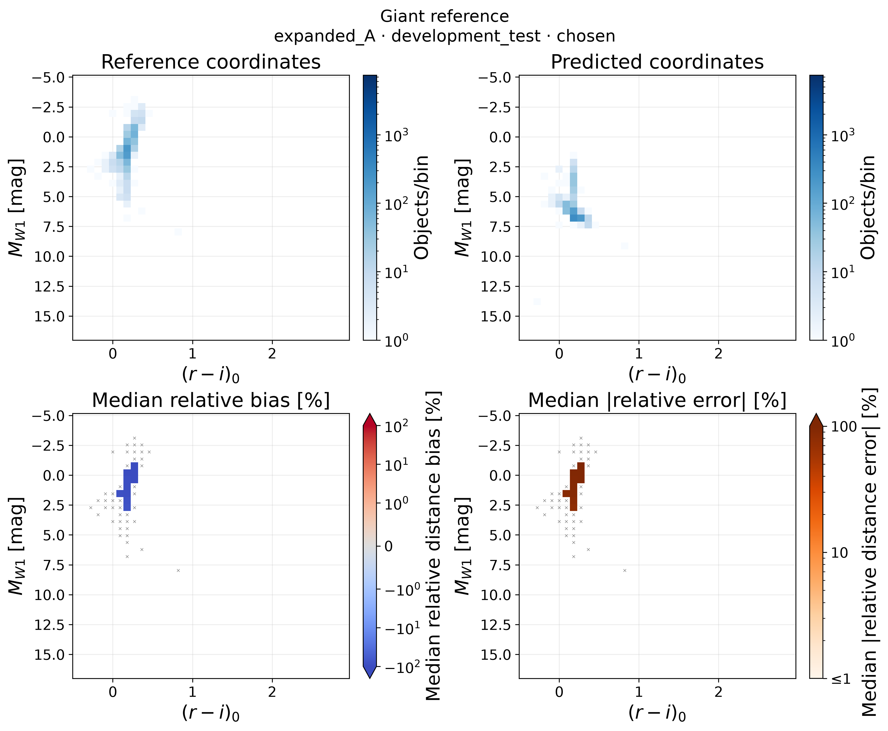

Each panel uses only its required valid bands. Reference M=m0-mu_chosen, predicted M=m0-mu50. Residual statistics are in reference coordinates. Signed=median(epsilon), absolute=median(abs(epsilon)), both percent. N>=20 performance cells, sparse gray crosses, zero cells transparent. Shared edges and density scale across classes. Frozen historical TYPE exceptions retained for audit.

[PNG](../figures/v2_0_revision/combinations/cmd_w1_r_i_giant.png) · [PDF](../figures/v2_0_revision/combinations/cmd_w1_r_i_giant.pdf) · [CSV](../manifests/v2_0_revision/figures/cmd_w1_r_i_giant.csv) · [元数据](../manifests/v2_0_revision/figures/cmd_w1_r_i_giant.json)

## cmd_w1_r_i_other

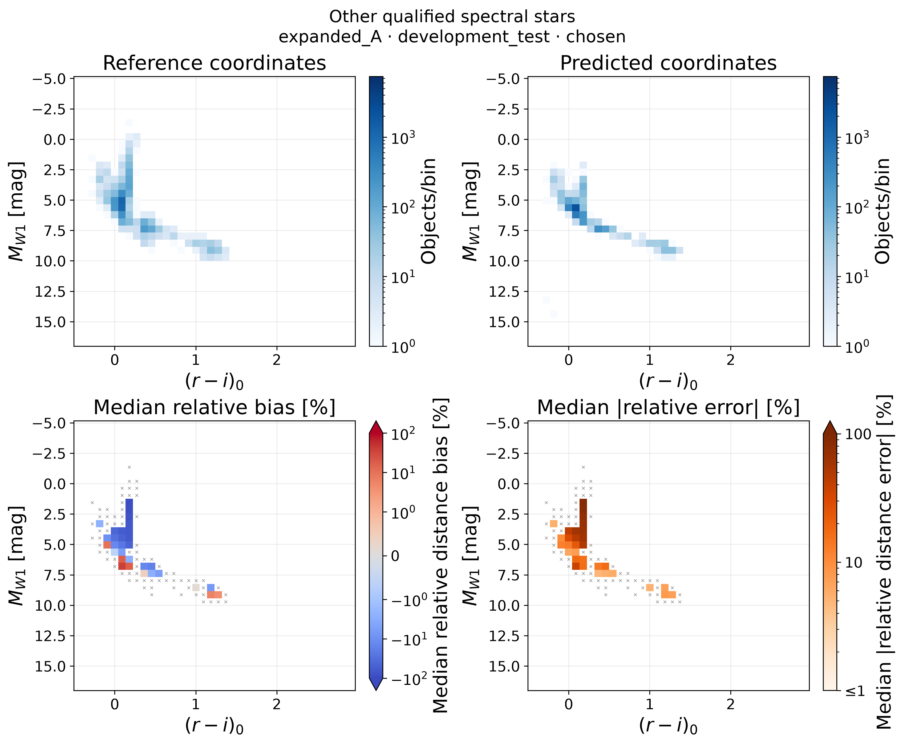

Each panel uses only its required valid bands. Reference M=m0-mu_chosen, predicted M=m0-mu50. Residual statistics are in reference coordinates. Signed=median(epsilon), absolute=median(abs(epsilon)), both percent. N>=20 performance cells, sparse gray crosses, zero cells transparent. Shared edges and density scale across classes. Frozen historical TYPE exceptions retained for audit.

[PNG](../figures/v2_0_revision/combinations/cmd_w1_r_i_other.png) · [PDF](../figures/v2_0_revision/combinations/cmd_w1_r_i_other.pdf) · [CSV](../manifests/v2_0_revision/figures/cmd_w1_r_i_other.csv) · [元数据](../manifests/v2_0_revision/figures/cmd_w1_r_i_other.json)

## cmd_w1_r_i_unknown

Each panel uses only its required valid bands. Reference M=m0-mu_chosen, predicted M=m0-mu50. Residual statistics are in reference coordinates. Signed=median(epsilon), absolute=median(abs(epsilon)), both percent. N>=20 performance cells, sparse gray crosses, zero cells transparent. Shared edges and density scale across classes. Frozen historical TYPE exceptions retained for audit.

[PNG](../figures/v2_0_revision/combinations/cmd_w1_r_i_unknown.png) · [PDF](../figures/v2_0_revision/combinations/cmd_w1_r_i_unknown.pdf) · [CSV](../manifests/v2_0_revision/figures/cmd_w1_r_i_unknown.csv) · [元数据](../manifests/v2_0_revision/figures/cmd_w1_r_i_unknown.json)

## cmd_w1_r_w1_all

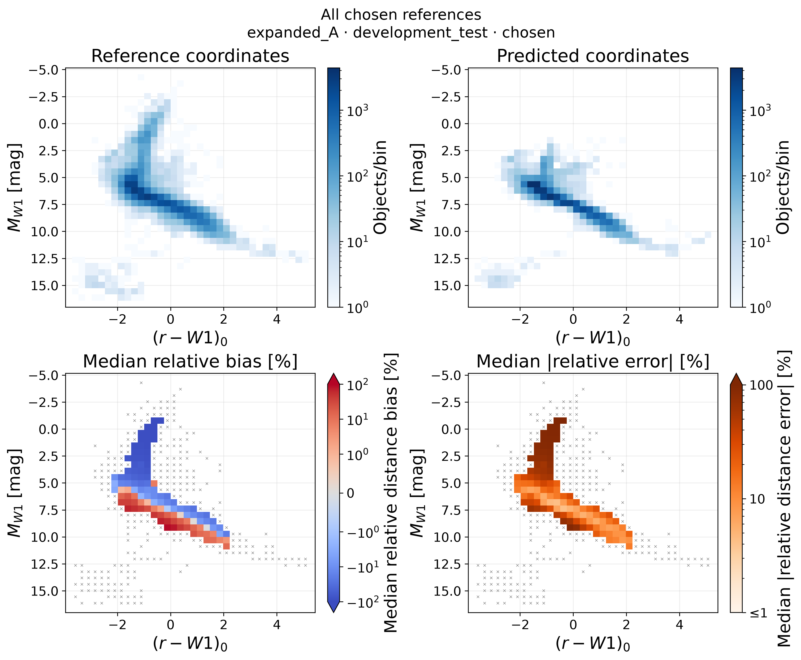

Each panel uses only its required valid bands. Reference M=m0-mu_chosen, predicted M=m0-mu50. Residual statistics are in reference coordinates. Signed=median(epsilon), absolute=median(abs(epsilon)), both percent. N>=20 performance cells, sparse gray crosses, zero cells transparent. Shared edges and density scale across classes. Frozen historical TYPE exceptions retained for audit.

[PNG](../figures/v2_0_revision/combinations/cmd_w1_r_w1_all.png) · [PDF](../figures/v2_0_revision/combinations/cmd_w1_r_w1_all.pdf) · [CSV](../manifests/v2_0_revision/figures/cmd_w1_r_w1_all.csv) · [元数据](../manifests/v2_0_revision/figures/cmd_w1_r_w1_all.json)

## cmd_w1_r_w1_dwarf

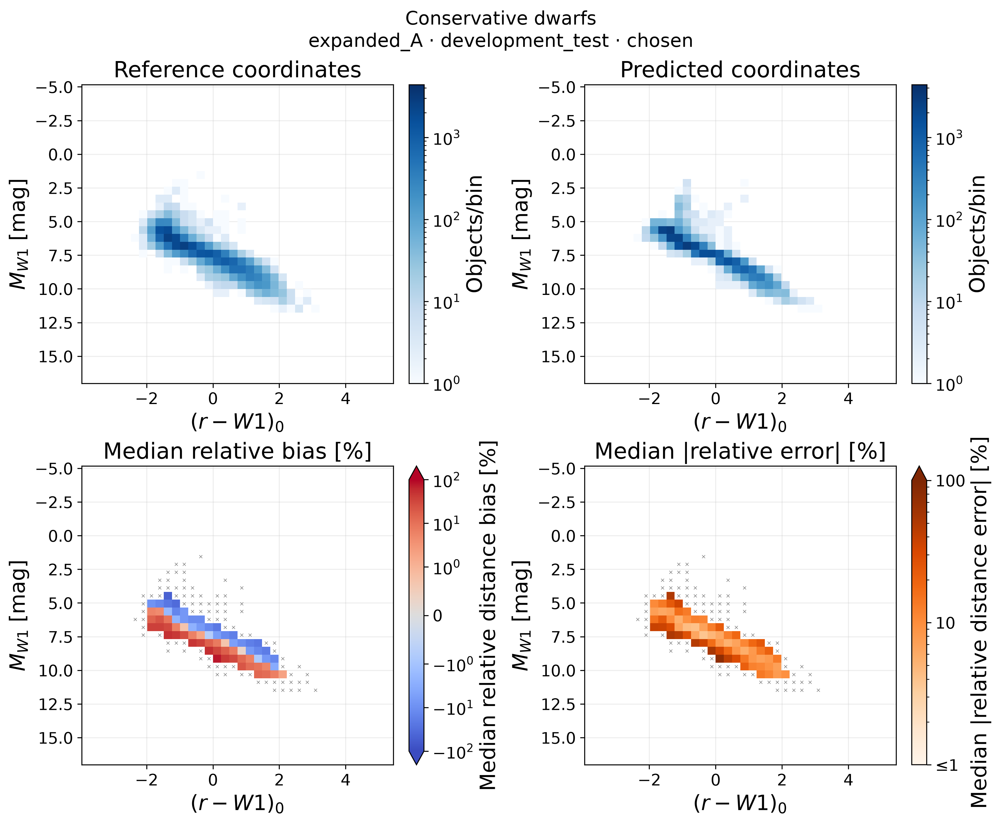

Each panel uses only its required valid bands. Reference M=m0-mu_chosen, predicted M=m0-mu50. Residual statistics are in reference coordinates. Signed=median(epsilon), absolute=median(abs(epsilon)), both percent. N>=20 performance cells, sparse gray crosses, zero cells transparent. Shared edges and density scale across classes. Frozen historical TYPE exceptions retained for audit.

[PNG](../figures/v2_0_revision/combinations/cmd_w1_r_w1_dwarf.png) · [PDF](../figures/v2_0_revision/combinations/cmd_w1_r_w1_dwarf.pdf) · [CSV](../manifests/v2_0_revision/figures/cmd_w1_r_w1_dwarf.csv) · [元数据](../manifests/v2_0_revision/figures/cmd_w1_r_w1_dwarf.json)

## cmd_w1_r_w1_giant

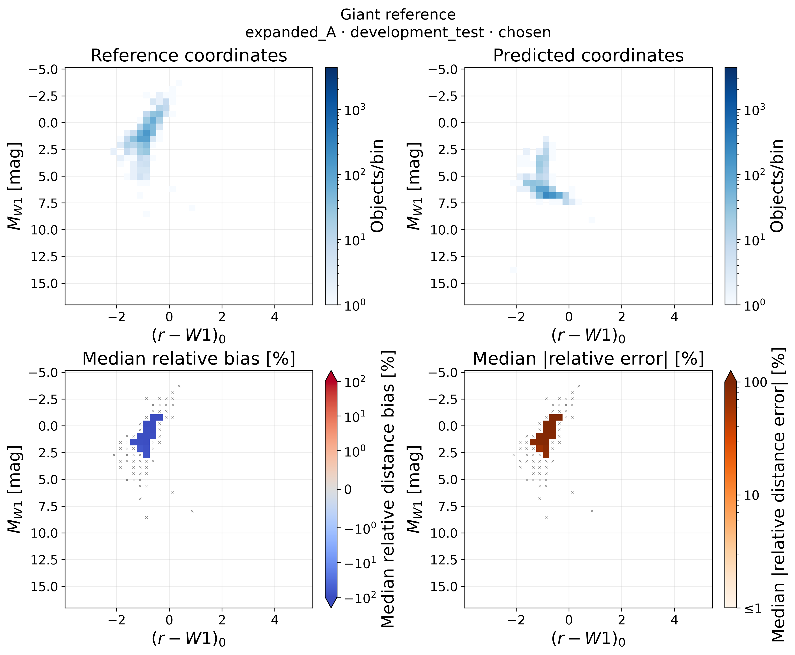

Each panel uses only its required valid bands. Reference M=m0-mu_chosen, predicted M=m0-mu50. Residual statistics are in reference coordinates. Signed=median(epsilon), absolute=median(abs(epsilon)), both percent. N>=20 performance cells, sparse gray crosses, zero cells transparent. Shared edges and density scale across classes. Frozen historical TYPE exceptions retained for audit.

[PNG](../figures/v2_0_revision/combinations/cmd_w1_r_w1_giant.png) · [PDF](../figures/v2_0_revision/combinations/cmd_w1_r_w1_giant.pdf) · [CSV](../manifests/v2_0_revision/figures/cmd_w1_r_w1_giant.csv) · [元数据](../manifests/v2_0_revision/figures/cmd_w1_r_w1_giant.json)

## cmd_w1_r_w1_other

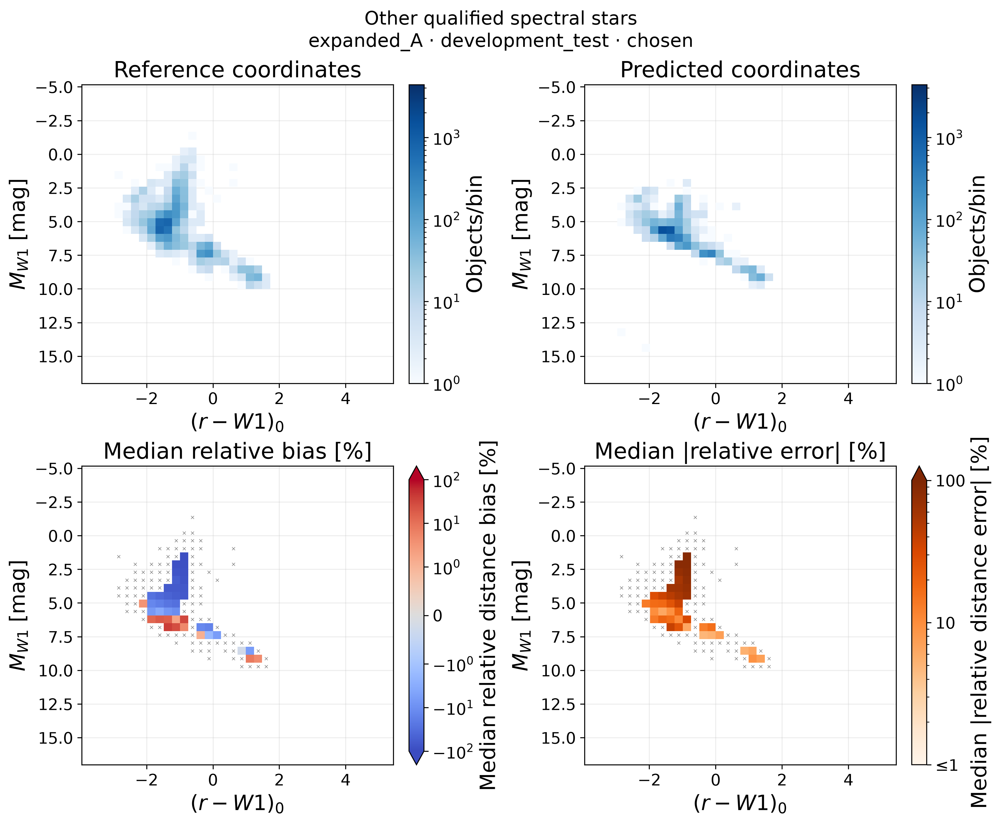

Each panel uses only its required valid bands. Reference M=m0-mu_chosen, predicted M=m0-mu50. Residual statistics are in reference coordinates. Signed=median(epsilon), absolute=median(abs(epsilon)), both percent. N>=20 performance cells, sparse gray crosses, zero cells transparent. Shared edges and density scale across classes. Frozen historical TYPE exceptions retained for audit.

[PNG](../figures/v2_0_revision/combinations/cmd_w1_r_w1_other.png) · [PDF](../figures/v2_0_revision/combinations/cmd_w1_r_w1_other.pdf) · [CSV](../manifests/v2_0_revision/figures/cmd_w1_r_w1_other.csv) · [元数据](../manifests/v2_0_revision/figures/cmd_w1_r_w1_other.json)

## cmd_w1_r_w1_unknown

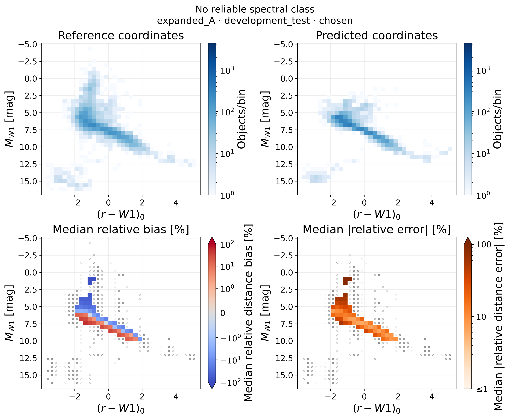

Each panel uses only its required valid bands. Reference M=m0-mu_chosen, predicted M=m0-mu50. Residual statistics are in reference coordinates. Signed=median(epsilon), absolute=median(abs(epsilon)), both percent. N>=20 performance cells, sparse gray crosses, zero cells transparent. Shared edges and density scale across classes. Frozen historical TYPE exceptions retained for audit.

[PNG](../figures/v2_0_revision/combinations/cmd_w1_r_w1_unknown.png) · [PDF](../figures/v2_0_revision/combinations/cmd_w1_r_w1_unknown.pdf) · [CSV](../manifests/v2_0_revision/figures/cmd_w1_r_w1_unknown.csv) · [元数据](../manifests/v2_0_revision/figures/cmd_w1_r_w1_unknown.json)

## cmd_w1_r_w2_all

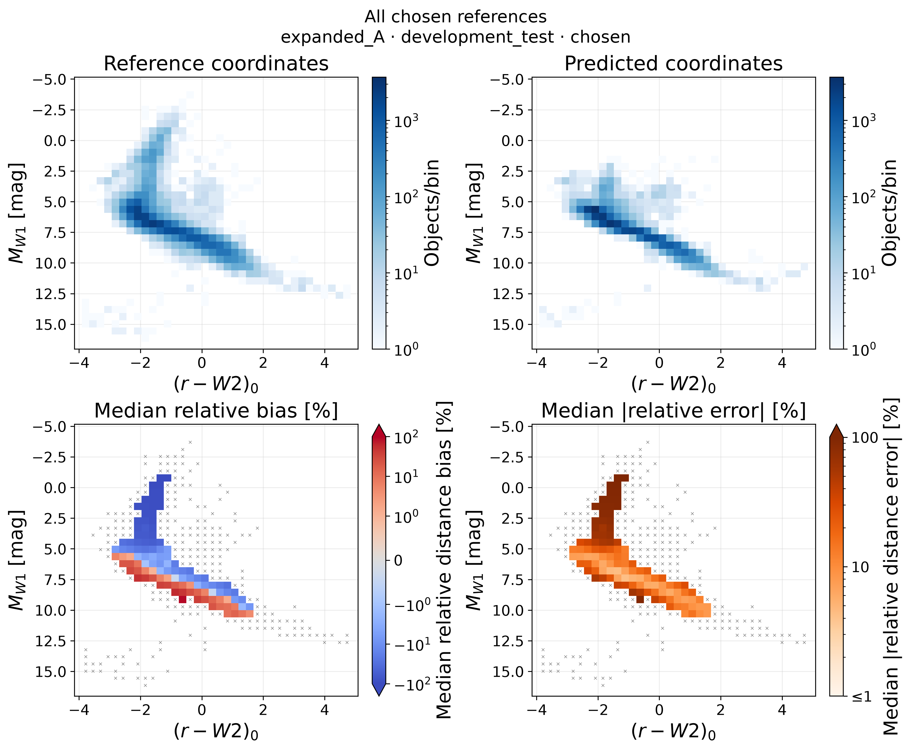

Each panel uses only its required valid bands. Reference M=m0-mu_chosen, predicted M=m0-mu50. Residual statistics are in reference coordinates. Signed=median(epsilon), absolute=median(abs(epsilon)), both percent. N>=20 performance cells, sparse gray crosses, zero cells transparent. Shared edges and density scale across classes. Frozen historical TYPE exceptions retained for audit.

[PNG](../figures/v2_0_revision/combinations/cmd_w1_r_w2_all.png) · [PDF](../figures/v2_0_revision/combinations/cmd_w1_r_w2_all.pdf) · [CSV](../manifests/v2_0_revision/figures/cmd_w1_r_w2_all.csv) · [元数据](../manifests/v2_0_revision/figures/cmd_w1_r_w2_all.json)

## cmd_w1_r_w2_dwarf

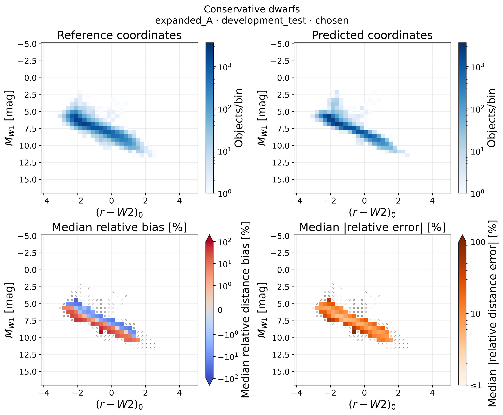

Each panel uses only its required valid bands. Reference M=m0-mu_chosen, predicted M=m0-mu50. Residual statistics are in reference coordinates. Signed=median(epsilon), absolute=median(abs(epsilon)), both percent. N>=20 performance cells, sparse gray crosses, zero cells transparent. Shared edges and density scale across classes. Frozen historical TYPE exceptions retained for audit.

[PNG](../figures/v2_0_revision/combinations/cmd_w1_r_w2_dwarf.png) · [PDF](../figures/v2_0_revision/combinations/cmd_w1_r_w2_dwarf.pdf) · [CSV](../manifests/v2_0_revision/figures/cmd_w1_r_w2_dwarf.csv) · [元数据](../manifests/v2_0_revision/figures/cmd_w1_r_w2_dwarf.json)

## cmd_w1_r_w2_giant

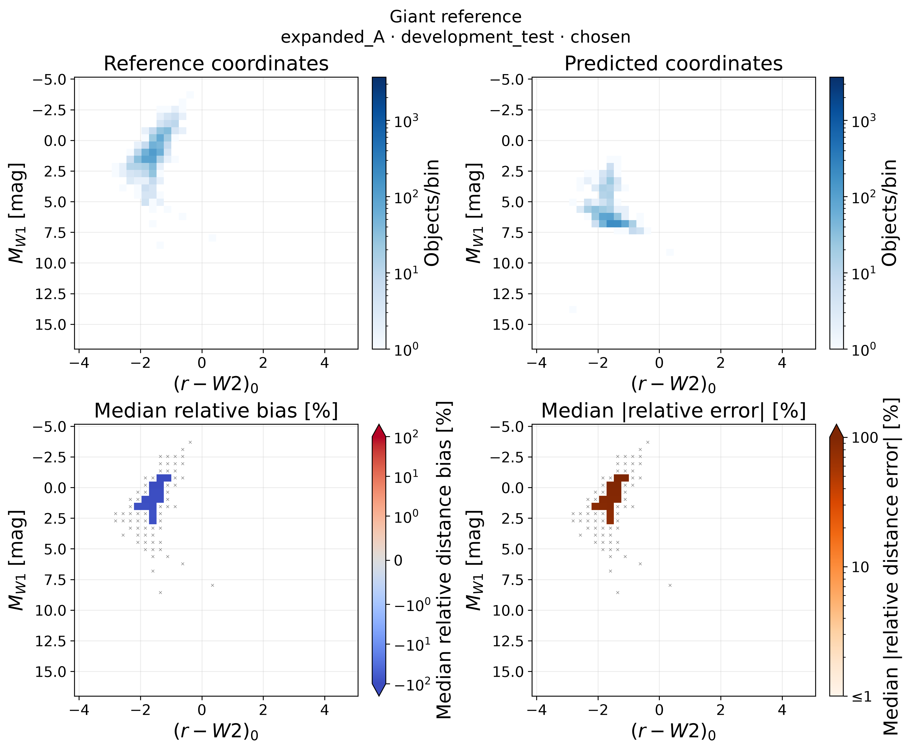

Each panel uses only its required valid bands. Reference M=m0-mu_chosen, predicted M=m0-mu50. Residual statistics are in reference coordinates. Signed=median(epsilon), absolute=median(abs(epsilon)), both percent. N>=20 performance cells, sparse gray crosses, zero cells transparent. Shared edges and density scale across classes. Frozen historical TYPE exceptions retained for audit.

[PNG](../figures/v2_0_revision/combinations/cmd_w1_r_w2_giant.png) · [PDF](../figures/v2_0_revision/combinations/cmd_w1_r_w2_giant.pdf) · [CSV](../manifests/v2_0_revision/figures/cmd_w1_r_w2_giant.csv) · [元数据](../manifests/v2_0_revision/figures/cmd_w1_r_w2_giant.json)

## cmd_w1_r_w2_other

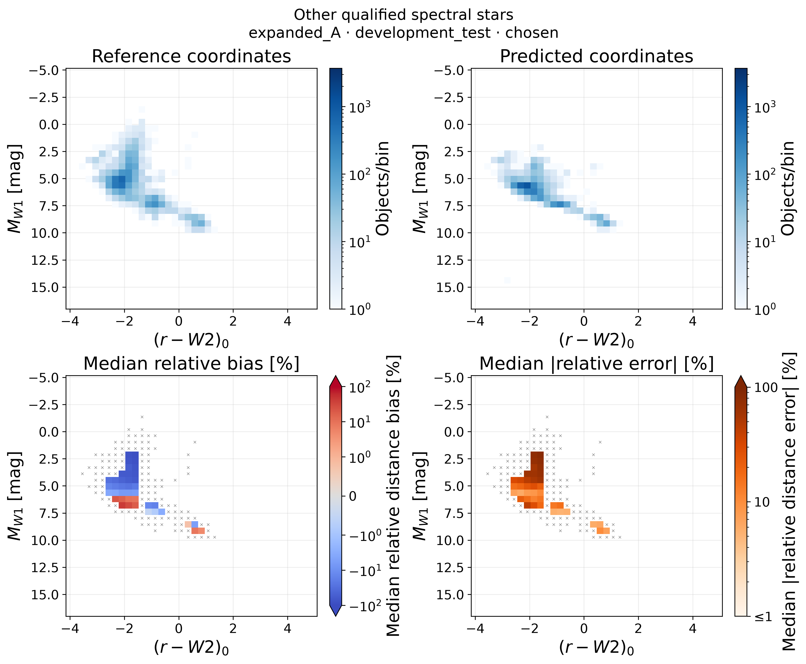

Each panel uses only its required valid bands. Reference M=m0-mu_chosen, predicted M=m0-mu50. Residual statistics are in reference coordinates. Signed=median(epsilon), absolute=median(abs(epsilon)), both percent. N>=20 performance cells, sparse gray crosses, zero cells transparent. Shared edges and density scale across classes. Frozen historical TYPE exceptions retained for audit.

[PNG](../figures/v2_0_revision/combinations/cmd_w1_r_w2_other.png) · [PDF](../figures/v2_0_revision/combinations/cmd_w1_r_w2_other.pdf) · [CSV](../manifests/v2_0_revision/figures/cmd_w1_r_w2_other.csv) · [元数据](../manifests/v2_0_revision/figures/cmd_w1_r_w2_other.json)

## cmd_w1_r_w2_unknown

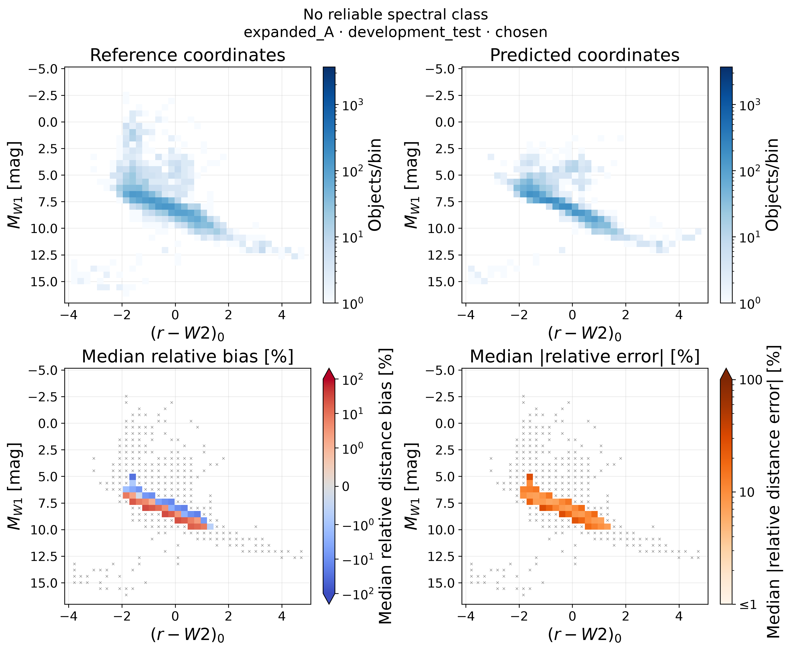

Each panel uses only its required valid bands. Reference M=m0-mu_chosen, predicted M=m0-mu50. Residual statistics are in reference coordinates. Signed=median(epsilon), absolute=median(abs(epsilon)), both percent. N>=20 performance cells, sparse gray crosses, zero cells transparent. Shared edges and density scale across classes. Frozen historical TYPE exceptions retained for audit.

[PNG](../figures/v2_0_revision/combinations/cmd_w1_r_w2_unknown.png) · [PDF](../figures/v2_0_revision/combinations/cmd_w1_r_w2_unknown.pdf) · [CSV](../manifests/v2_0_revision/figures/cmd_w1_r_w2_unknown.csv) · [元数据](../manifests/v2_0_revision/figures/cmd_w1_r_w2_unknown.json)

## cmd_w1_r_z_all

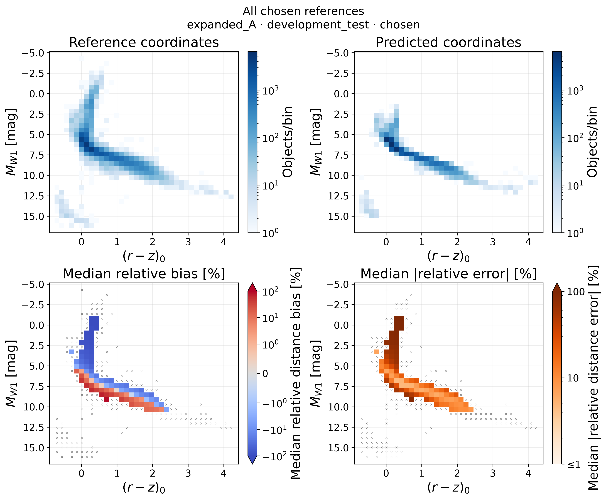

Each panel uses only its required valid bands. Reference M=m0-mu_chosen, predicted M=m0-mu50. Residual statistics are in reference coordinates. Signed=median(epsilon), absolute=median(abs(epsilon)), both percent. N>=20 performance cells, sparse gray crosses, zero cells transparent. Shared edges and density scale across classes. Frozen historical TYPE exceptions retained for audit.

[PNG](../figures/v2_0_revision/combinations/cmd_w1_r_z_all.png) · [PDF](../figures/v2_0_revision/combinations/cmd_w1_r_z_all.pdf) · [CSV](../manifests/v2_0_revision/figures/cmd_w1_r_z_all.csv) · [元数据](../manifests/v2_0_revision/figures/cmd_w1_r_z_all.json)

## cmd_w1_r_z_dwarf

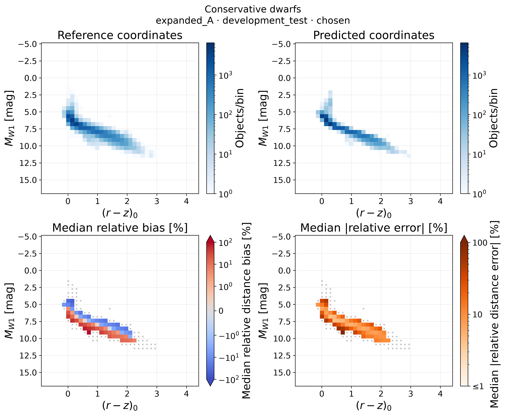

Each panel uses only its required valid bands. Reference M=m0-mu_chosen, predicted M=m0-mu50. Residual statistics are in reference coordinates. Signed=median(epsilon), absolute=median(abs(epsilon)), both percent. N>=20 performance cells, sparse gray crosses, zero cells transparent. Shared edges and density scale across classes. Frozen historical TYPE exceptions retained for audit.

[PNG](../figures/v2_0_revision/combinations/cmd_w1_r_z_dwarf.png) · [PDF](../figures/v2_0_revision/combinations/cmd_w1_r_z_dwarf.pdf) · [CSV](../manifests/v2_0_revision/figures/cmd_w1_r_z_dwarf.csv) · [元数据](../manifests/v2_0_revision/figures/cmd_w1_r_z_dwarf.json)

## cmd_w1_r_z_giant

Each panel uses only its required valid bands. Reference M=m0-mu_chosen, predicted M=m0-mu50. Residual statistics are in reference coordinates. Signed=median(epsilon), absolute=median(abs(epsilon)), both percent. N>=20 performance cells, sparse gray crosses, zero cells transparent. Shared edges and density scale across classes. Frozen historical TYPE exceptions retained for audit.

[PNG](../figures/v2_0_revision/combinations/cmd_w1_r_z_giant.png) · [PDF](../figures/v2_0_revision/combinations/cmd_w1_r_z_giant.pdf) · [CSV](../manifests/v2_0_revision/figures/cmd_w1_r_z_giant.csv) · [元数据](../manifests/v2_0_revision/figures/cmd_w1_r_z_giant.json)

## cmd_w1_r_z_other

Each panel uses only its required valid bands. Reference M=m0-mu_chosen, predicted M=m0-mu50. Residual statistics are in reference coordinates. Signed=median(epsilon), absolute=median(abs(epsilon)), both percent. N>=20 performance cells, sparse gray crosses, zero cells transparent. Shared edges and density scale across classes. Frozen historical TYPE exceptions retained for audit.

[PNG](../figures/v2_0_revision/combinations/cmd_w1_r_z_other.png) · [PDF](../figures/v2_0_revision/combinations/cmd_w1_r_z_other.pdf) · [CSV](../manifests/v2_0_revision/figures/cmd_w1_r_z_other.csv) · [元数据](../manifests/v2_0_revision/figures/cmd_w1_r_z_other.json)

## cmd_w1_r_z_unknown

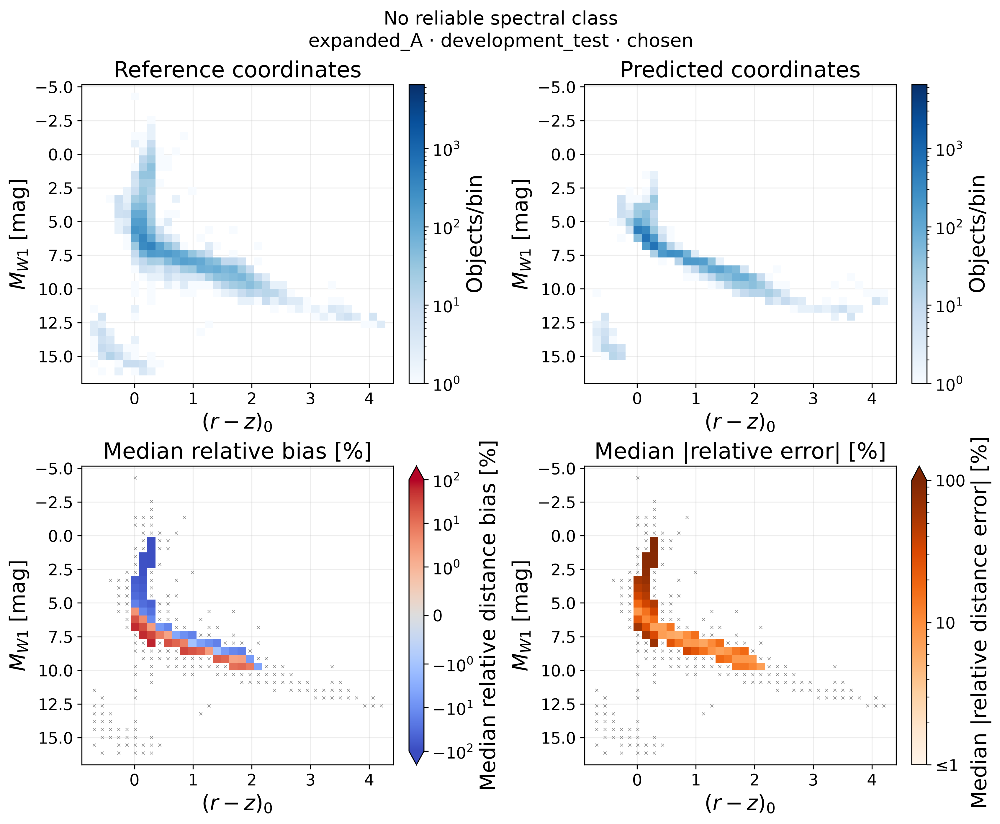

Each panel uses only its required valid bands. Reference M=m0-mu_chosen, predicted M=m0-mu50. Residual statistics are in reference coordinates. Signed=median(epsilon), absolute=median(abs(epsilon)), both percent. N>=20 performance cells, sparse gray crosses, zero cells transparent. Shared edges and density scale across classes. Frozen historical TYPE exceptions retained for audit.

[PNG](../figures/v2_0_revision/combinations/cmd_w1_r_z_unknown.png) · [PDF](../figures/v2_0_revision/combinations/cmd_w1_r_z_unknown.pdf) · [CSV](../manifests/v2_0_revision/figures/cmd_w1_r_z_unknown.csv) · [元数据](../manifests/v2_0_revision/figures/cmd_w1_r_z_unknown.json)
