# v2.0 修订图集 23

[完整目录](v2_0_revision_atlas.md)

## color_i_z__z_w2_all

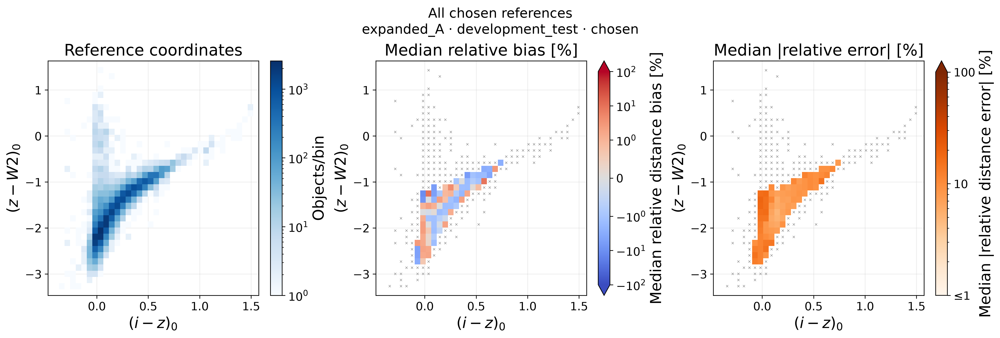

Each panel uses only its required valid bands. Reference M=m0-mu_chosen, predicted M=m0-mu50. Residual statistics are in reference coordinates. Signed=median(epsilon), absolute=median(abs(epsilon)), both percent. N>=20 performance cells, sparse gray crosses, zero cells transparent. Shared edges and density scale across classes. Frozen historical TYPE exceptions retained for audit.

[PNG](../figures/v2_0_revision/combinations/color_i_z__z_w2_all.png) · [PDF](../figures/v2_0_revision/combinations/color_i_z__z_w2_all.pdf) · [CSV](../manifests/v2_0_revision/figures/color_i_z__z_w2_all.csv) · [元数据](../manifests/v2_0_revision/figures/color_i_z__z_w2_all.json)

## color_i_z__z_w2_dwarf

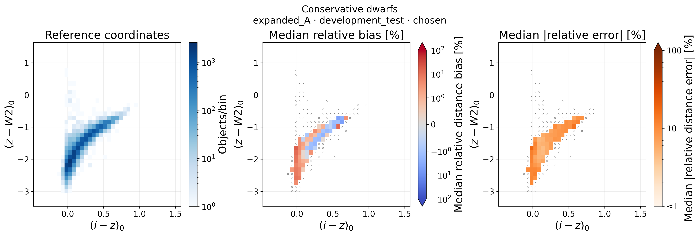

Each panel uses only its required valid bands. Reference M=m0-mu_chosen, predicted M=m0-mu50. Residual statistics are in reference coordinates. Signed=median(epsilon), absolute=median(abs(epsilon)), both percent. N>=20 performance cells, sparse gray crosses, zero cells transparent. Shared edges and density scale across classes. Frozen historical TYPE exceptions retained for audit.

[PNG](../figures/v2_0_revision/combinations/color_i_z__z_w2_dwarf.png) · [PDF](../figures/v2_0_revision/combinations/color_i_z__z_w2_dwarf.pdf) · [CSV](../manifests/v2_0_revision/figures/color_i_z__z_w2_dwarf.csv) · [元数据](../manifests/v2_0_revision/figures/color_i_z__z_w2_dwarf.json)

## color_i_z__z_w2_giant

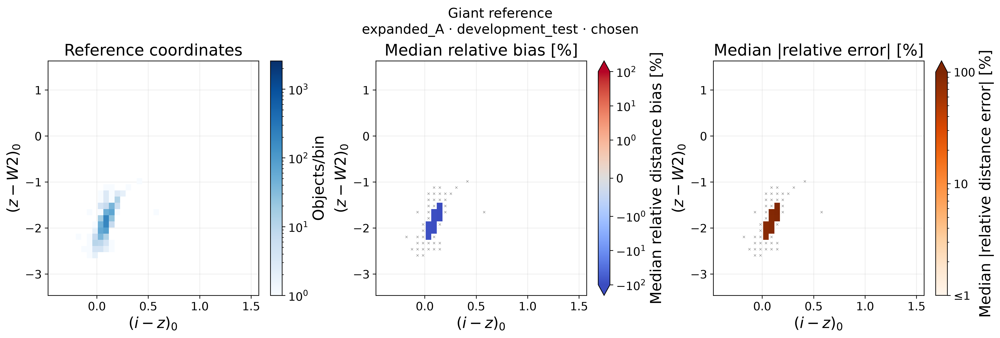

Each panel uses only its required valid bands. Reference M=m0-mu_chosen, predicted M=m0-mu50. Residual statistics are in reference coordinates. Signed=median(epsilon), absolute=median(abs(epsilon)), both percent. N>=20 performance cells, sparse gray crosses, zero cells transparent. Shared edges and density scale across classes. Frozen historical TYPE exceptions retained for audit.

[PNG](../figures/v2_0_revision/combinations/color_i_z__z_w2_giant.png) · [PDF](../figures/v2_0_revision/combinations/color_i_z__z_w2_giant.pdf) · [CSV](../manifests/v2_0_revision/figures/color_i_z__z_w2_giant.csv) · [元数据](../manifests/v2_0_revision/figures/color_i_z__z_w2_giant.json)

## color_i_z__z_w2_other

Each panel uses only its required valid bands. Reference M=m0-mu_chosen, predicted M=m0-mu50. Residual statistics are in reference coordinates. Signed=median(epsilon), absolute=median(abs(epsilon)), both percent. N>=20 performance cells, sparse gray crosses, zero cells transparent. Shared edges and density scale across classes. Frozen historical TYPE exceptions retained for audit.

[PNG](../figures/v2_0_revision/combinations/color_i_z__z_w2_other.png) · [PDF](../figures/v2_0_revision/combinations/color_i_z__z_w2_other.pdf) · [CSV](../manifests/v2_0_revision/figures/color_i_z__z_w2_other.csv) · [元数据](../manifests/v2_0_revision/figures/color_i_z__z_w2_other.json)

## color_i_z__z_w2_unknown

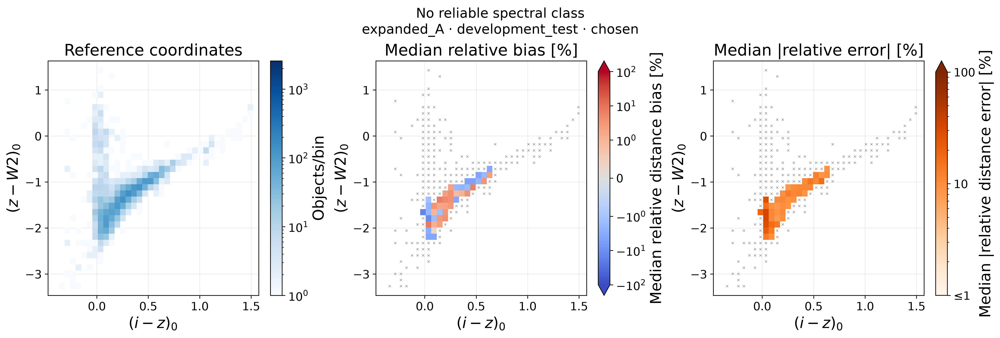

Each panel uses only its required valid bands. Reference M=m0-mu_chosen, predicted M=m0-mu50. Residual statistics are in reference coordinates. Signed=median(epsilon), absolute=median(abs(epsilon)), both percent. N>=20 performance cells, sparse gray crosses, zero cells transparent. Shared edges and density scale across classes. Frozen historical TYPE exceptions retained for audit.

[PNG](../figures/v2_0_revision/combinations/color_i_z__z_w2_unknown.png) · [PDF](../figures/v2_0_revision/combinations/color_i_z__z_w2_unknown.pdf) · [CSV](../manifests/v2_0_revision/figures/color_i_z__z_w2_unknown.csv) · [元数据](../manifests/v2_0_revision/figures/color_i_z__z_w2_unknown.json)

## color_r_i__i_w1_all

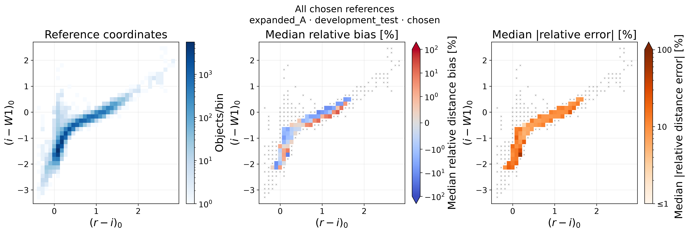

Each panel uses only its required valid bands. Reference M=m0-mu_chosen, predicted M=m0-mu50. Residual statistics are in reference coordinates. Signed=median(epsilon), absolute=median(abs(epsilon)), both percent. N>=20 performance cells, sparse gray crosses, zero cells transparent. Shared edges and density scale across classes. Frozen historical TYPE exceptions retained for audit.

[PNG](../figures/v2_0_revision/combinations/color_r_i__i_w1_all.png) · [PDF](../figures/v2_0_revision/combinations/color_r_i__i_w1_all.pdf) · [CSV](../manifests/v2_0_revision/figures/color_r_i__i_w1_all.csv) · [元数据](../manifests/v2_0_revision/figures/color_r_i__i_w1_all.json)

## color_r_i__i_w1_dwarf

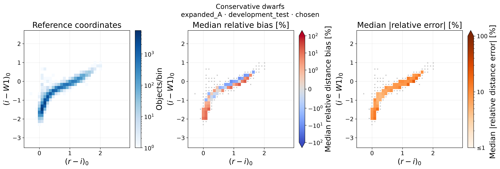

Each panel uses only its required valid bands. Reference M=m0-mu_chosen, predicted M=m0-mu50. Residual statistics are in reference coordinates. Signed=median(epsilon), absolute=median(abs(epsilon)), both percent. N>=20 performance cells, sparse gray crosses, zero cells transparent. Shared edges and density scale across classes. Frozen historical TYPE exceptions retained for audit.

[PNG](../figures/v2_0_revision/combinations/color_r_i__i_w1_dwarf.png) · [PDF](../figures/v2_0_revision/combinations/color_r_i__i_w1_dwarf.pdf) · [CSV](../manifests/v2_0_revision/figures/color_r_i__i_w1_dwarf.csv) · [元数据](../manifests/v2_0_revision/figures/color_r_i__i_w1_dwarf.json)

## color_r_i__i_w1_giant

Each panel uses only its required valid bands. Reference M=m0-mu_chosen, predicted M=m0-mu50. Residual statistics are in reference coordinates. Signed=median(epsilon), absolute=median(abs(epsilon)), both percent. N>=20 performance cells, sparse gray crosses, zero cells transparent. Shared edges and density scale across classes. Frozen historical TYPE exceptions retained for audit.

[PNG](../figures/v2_0_revision/combinations/color_r_i__i_w1_giant.png) · [PDF](../figures/v2_0_revision/combinations/color_r_i__i_w1_giant.pdf) · [CSV](../manifests/v2_0_revision/figures/color_r_i__i_w1_giant.csv) · [元数据](../manifests/v2_0_revision/figures/color_r_i__i_w1_giant.json)

## color_r_i__i_w1_other

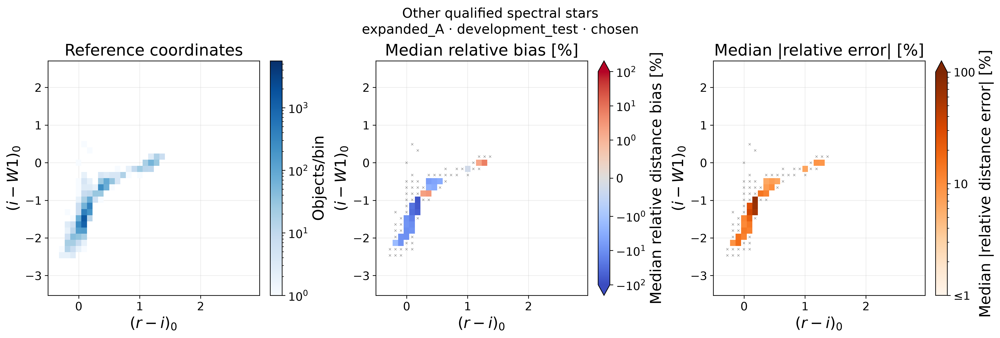

Each panel uses only its required valid bands. Reference M=m0-mu_chosen, predicted M=m0-mu50. Residual statistics are in reference coordinates. Signed=median(epsilon), absolute=median(abs(epsilon)), both percent. N>=20 performance cells, sparse gray crosses, zero cells transparent. Shared edges and density scale across classes. Frozen historical TYPE exceptions retained for audit.

[PNG](../figures/v2_0_revision/combinations/color_r_i__i_w1_other.png) · [PDF](../figures/v2_0_revision/combinations/color_r_i__i_w1_other.pdf) · [CSV](../manifests/v2_0_revision/figures/color_r_i__i_w1_other.csv) · [元数据](../manifests/v2_0_revision/figures/color_r_i__i_w1_other.json)

## color_r_i__i_w1_unknown

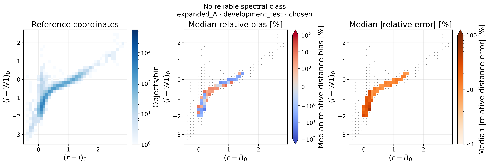

Each panel uses only its required valid bands. Reference M=m0-mu_chosen, predicted M=m0-mu50. Residual statistics are in reference coordinates. Signed=median(epsilon), absolute=median(abs(epsilon)), both percent. N>=20 performance cells, sparse gray crosses, zero cells transparent. Shared edges and density scale across classes. Frozen historical TYPE exceptions retained for audit.

[PNG](../figures/v2_0_revision/combinations/color_r_i__i_w1_unknown.png) · [PDF](../figures/v2_0_revision/combinations/color_r_i__i_w1_unknown.pdf) · [CSV](../manifests/v2_0_revision/figures/color_r_i__i_w1_unknown.csv) · [元数据](../manifests/v2_0_revision/figures/color_r_i__i_w1_unknown.json)

## color_r_i__i_w2_all

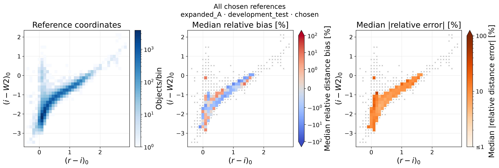

Each panel uses only its required valid bands. Reference M=m0-mu_chosen, predicted M=m0-mu50. Residual statistics are in reference coordinates. Signed=median(epsilon), absolute=median(abs(epsilon)), both percent. N>=20 performance cells, sparse gray crosses, zero cells transparent. Shared edges and density scale across classes. Frozen historical TYPE exceptions retained for audit.

[PNG](../figures/v2_0_revision/combinations/color_r_i__i_w2_all.png) · [PDF](../figures/v2_0_revision/combinations/color_r_i__i_w2_all.pdf) · [CSV](../manifests/v2_0_revision/figures/color_r_i__i_w2_all.csv) · [元数据](../manifests/v2_0_revision/figures/color_r_i__i_w2_all.json)

## color_r_i__i_w2_dwarf

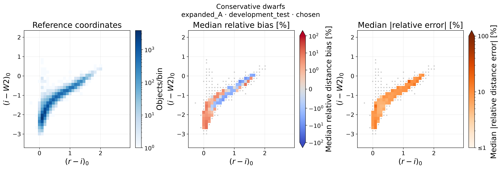

Each panel uses only its required valid bands. Reference M=m0-mu_chosen, predicted M=m0-mu50. Residual statistics are in reference coordinates. Signed=median(epsilon), absolute=median(abs(epsilon)), both percent. N>=20 performance cells, sparse gray crosses, zero cells transparent. Shared edges and density scale across classes. Frozen historical TYPE exceptions retained for audit.

[PNG](../figures/v2_0_revision/combinations/color_r_i__i_w2_dwarf.png) · [PDF](../figures/v2_0_revision/combinations/color_r_i__i_w2_dwarf.pdf) · [CSV](../manifests/v2_0_revision/figures/color_r_i__i_w2_dwarf.csv) · [元数据](../manifests/v2_0_revision/figures/color_r_i__i_w2_dwarf.json)

## color_r_i__i_w2_giant

Each panel uses only its required valid bands. Reference M=m0-mu_chosen, predicted M=m0-mu50. Residual statistics are in reference coordinates. Signed=median(epsilon), absolute=median(abs(epsilon)), both percent. N>=20 performance cells, sparse gray crosses, zero cells transparent. Shared edges and density scale across classes. Frozen historical TYPE exceptions retained for audit.

[PNG](../figures/v2_0_revision/combinations/color_r_i__i_w2_giant.png) · [PDF](../figures/v2_0_revision/combinations/color_r_i__i_w2_giant.pdf) · [CSV](../manifests/v2_0_revision/figures/color_r_i__i_w2_giant.csv) · [元数据](../manifests/v2_0_revision/figures/color_r_i__i_w2_giant.json)

## color_r_i__i_w2_other

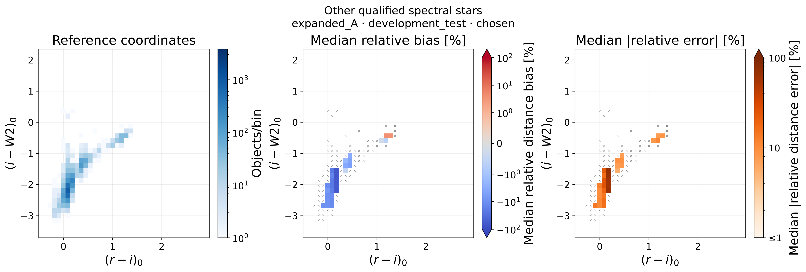

Each panel uses only its required valid bands. Reference M=m0-mu_chosen, predicted M=m0-mu50. Residual statistics are in reference coordinates. Signed=median(epsilon), absolute=median(abs(epsilon)), both percent. N>=20 performance cells, sparse gray crosses, zero cells transparent. Shared edges and density scale across classes. Frozen historical TYPE exceptions retained for audit.

[PNG](../figures/v2_0_revision/combinations/color_r_i__i_w2_other.png) · [PDF](../figures/v2_0_revision/combinations/color_r_i__i_w2_other.pdf) · [CSV](../manifests/v2_0_revision/figures/color_r_i__i_w2_other.csv) · [元数据](../manifests/v2_0_revision/figures/color_r_i__i_w2_other.json)

## color_r_i__i_w2_unknown

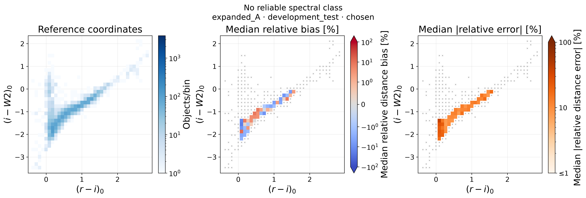

Each panel uses only its required valid bands. Reference M=m0-mu_chosen, predicted M=m0-mu50. Residual statistics are in reference coordinates. Signed=median(epsilon), absolute=median(abs(epsilon)), both percent. N>=20 performance cells, sparse gray crosses, zero cells transparent. Shared edges and density scale across classes. Frozen historical TYPE exceptions retained for audit.

[PNG](../figures/v2_0_revision/combinations/color_r_i__i_w2_unknown.png) · [PDF](../figures/v2_0_revision/combinations/color_r_i__i_w2_unknown.pdf) · [CSV](../manifests/v2_0_revision/figures/color_r_i__i_w2_unknown.csv) · [元数据](../manifests/v2_0_revision/figures/color_r_i__i_w2_unknown.json)

## color_r_i__i_z_all

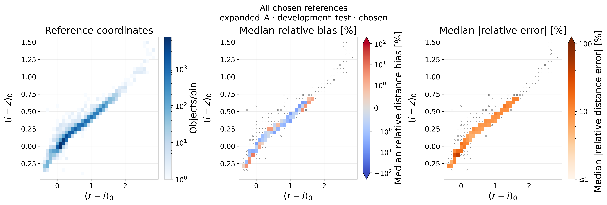

Each panel uses only its required valid bands. Reference M=m0-mu_chosen, predicted M=m0-mu50. Residual statistics are in reference coordinates. Signed=median(epsilon), absolute=median(abs(epsilon)), both percent. N>=20 performance cells, sparse gray crosses, zero cells transparent. Shared edges and density scale across classes. Frozen historical TYPE exceptions retained for audit.

[PNG](../figures/v2_0_revision/combinations/color_r_i__i_z_all.png) · [PDF](../figures/v2_0_revision/combinations/color_r_i__i_z_all.pdf) · [CSV](../manifests/v2_0_revision/figures/color_r_i__i_z_all.csv) · [元数据](../manifests/v2_0_revision/figures/color_r_i__i_z_all.json)

## color_r_i__i_z_dwarf

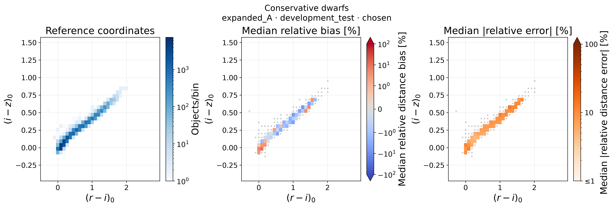

Each panel uses only its required valid bands. Reference M=m0-mu_chosen, predicted M=m0-mu50. Residual statistics are in reference coordinates. Signed=median(epsilon), absolute=median(abs(epsilon)), both percent. N>=20 performance cells, sparse gray crosses, zero cells transparent. Shared edges and density scale across classes. Frozen historical TYPE exceptions retained for audit.

[PNG](../figures/v2_0_revision/combinations/color_r_i__i_z_dwarf.png) · [PDF](../figures/v2_0_revision/combinations/color_r_i__i_z_dwarf.pdf) · [CSV](../manifests/v2_0_revision/figures/color_r_i__i_z_dwarf.csv) · [元数据](../manifests/v2_0_revision/figures/color_r_i__i_z_dwarf.json)

## color_r_i__i_z_giant

Each panel uses only its required valid bands. Reference M=m0-mu_chosen, predicted M=m0-mu50. Residual statistics are in reference coordinates. Signed=median(epsilon), absolute=median(abs(epsilon)), both percent. N>=20 performance cells, sparse gray crosses, zero cells transparent. Shared edges and density scale across classes. Frozen historical TYPE exceptions retained for audit.

[PNG](../figures/v2_0_revision/combinations/color_r_i__i_z_giant.png) · [PDF](../figures/v2_0_revision/combinations/color_r_i__i_z_giant.pdf) · [CSV](../manifests/v2_0_revision/figures/color_r_i__i_z_giant.csv) · [元数据](../manifests/v2_0_revision/figures/color_r_i__i_z_giant.json)

## color_r_i__i_z_other

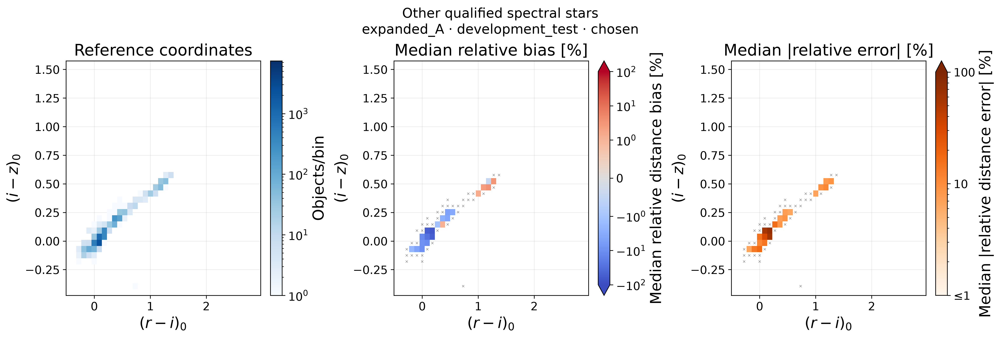

Each panel uses only its required valid bands. Reference M=m0-mu_chosen, predicted M=m0-mu50. Residual statistics are in reference coordinates. Signed=median(epsilon), absolute=median(abs(epsilon)), both percent. N>=20 performance cells, sparse gray crosses, zero cells transparent. Shared edges and density scale across classes. Frozen historical TYPE exceptions retained for audit.

[PNG](../figures/v2_0_revision/combinations/color_r_i__i_z_other.png) · [PDF](../figures/v2_0_revision/combinations/color_r_i__i_z_other.pdf) · [CSV](../manifests/v2_0_revision/figures/color_r_i__i_z_other.csv) · [元数据](../manifests/v2_0_revision/figures/color_r_i__i_z_other.json)

## color_r_i__i_z_unknown

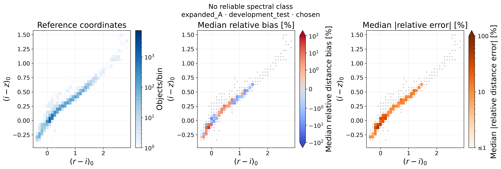

Each panel uses only its required valid bands. Reference M=m0-mu_chosen, predicted M=m0-mu50. Residual statistics are in reference coordinates. Signed=median(epsilon), absolute=median(abs(epsilon)), both percent. N>=20 performance cells, sparse gray crosses, zero cells transparent. Shared edges and density scale across classes. Frozen historical TYPE exceptions retained for audit.

[PNG](../figures/v2_0_revision/combinations/color_r_i__i_z_unknown.png) · [PDF](../figures/v2_0_revision/combinations/color_r_i__i_z_unknown.pdf) · [CSV](../manifests/v2_0_revision/figures/color_r_i__i_z_unknown.csv) · [元数据](../manifests/v2_0_revision/figures/color_r_i__i_z_unknown.json)

## color_r_i__r_w1_all

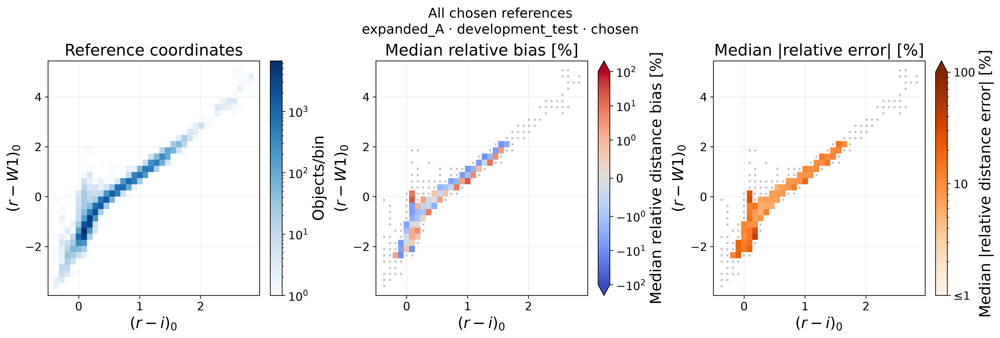

Each panel uses only its required valid bands. Reference M=m0-mu_chosen, predicted M=m0-mu50. Residual statistics are in reference coordinates. Signed=median(epsilon), absolute=median(abs(epsilon)), both percent. N>=20 performance cells, sparse gray crosses, zero cells transparent. Shared edges and density scale across classes. Frozen historical TYPE exceptions retained for audit.

[PNG](../figures/v2_0_revision/combinations/color_r_i__r_w1_all.png) · [PDF](../figures/v2_0_revision/combinations/color_r_i__r_w1_all.pdf) · [CSV](../manifests/v2_0_revision/figures/color_r_i__r_w1_all.csv) · [元数据](../manifests/v2_0_revision/figures/color_r_i__r_w1_all.json)

## color_r_i__r_w1_dwarf

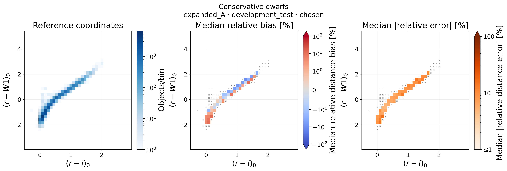

Each panel uses only its required valid bands. Reference M=m0-mu_chosen, predicted M=m0-mu50. Residual statistics are in reference coordinates. Signed=median(epsilon), absolute=median(abs(epsilon)), both percent. N>=20 performance cells, sparse gray crosses, zero cells transparent. Shared edges and density scale across classes. Frozen historical TYPE exceptions retained for audit.

[PNG](../figures/v2_0_revision/combinations/color_r_i__r_w1_dwarf.png) · [PDF](../figures/v2_0_revision/combinations/color_r_i__r_w1_dwarf.pdf) · [CSV](../manifests/v2_0_revision/figures/color_r_i__r_w1_dwarf.csv) · [元数据](../manifests/v2_0_revision/figures/color_r_i__r_w1_dwarf.json)

## color_r_i__r_w1_giant

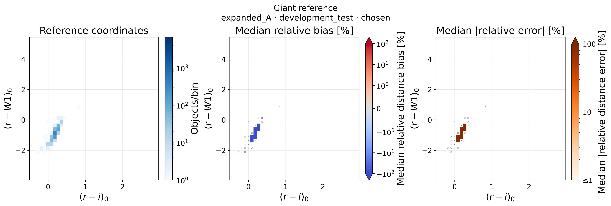

Each panel uses only its required valid bands. Reference M=m0-mu_chosen, predicted M=m0-mu50. Residual statistics are in reference coordinates. Signed=median(epsilon), absolute=median(abs(epsilon)), both percent. N>=20 performance cells, sparse gray crosses, zero cells transparent. Shared edges and density scale across classes. Frozen historical TYPE exceptions retained for audit.

[PNG](../figures/v2_0_revision/combinations/color_r_i__r_w1_giant.png) · [PDF](../figures/v2_0_revision/combinations/color_r_i__r_w1_giant.pdf) · [CSV](../manifests/v2_0_revision/figures/color_r_i__r_w1_giant.csv) · [元数据](../manifests/v2_0_revision/figures/color_r_i__r_w1_giant.json)

## color_r_i__r_w1_other

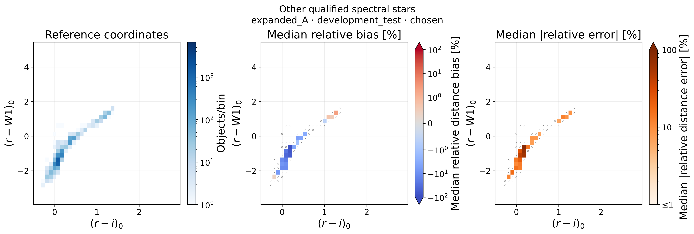

Each panel uses only its required valid bands. Reference M=m0-mu_chosen, predicted M=m0-mu50. Residual statistics are in reference coordinates. Signed=median(epsilon), absolute=median(abs(epsilon)), both percent. N>=20 performance cells, sparse gray crosses, zero cells transparent. Shared edges and density scale across classes. Frozen historical TYPE exceptions retained for audit.

[PNG](../figures/v2_0_revision/combinations/color_r_i__r_w1_other.png) · [PDF](../figures/v2_0_revision/combinations/color_r_i__r_w1_other.pdf) · [CSV](../manifests/v2_0_revision/figures/color_r_i__r_w1_other.csv) · [元数据](../manifests/v2_0_revision/figures/color_r_i__r_w1_other.json)

## color_r_i__r_w1_unknown

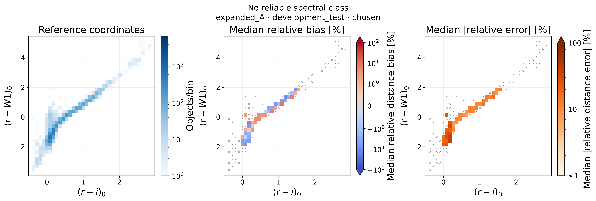

Each panel uses only its required valid bands. Reference M=m0-mu_chosen, predicted M=m0-mu50. Residual statistics are in reference coordinates. Signed=median(epsilon), absolute=median(abs(epsilon)), both percent. N>=20 performance cells, sparse gray crosses, zero cells transparent. Shared edges and density scale across classes. Frozen historical TYPE exceptions retained for audit.

[PNG](../figures/v2_0_revision/combinations/color_r_i__r_w1_unknown.png) · [PDF](../figures/v2_0_revision/combinations/color_r_i__r_w1_unknown.pdf) · [CSV](../manifests/v2_0_revision/figures/color_r_i__r_w1_unknown.csv) · [元数据](../manifests/v2_0_revision/figures/color_r_i__r_w1_unknown.json)

## color_r_i__r_w2_all

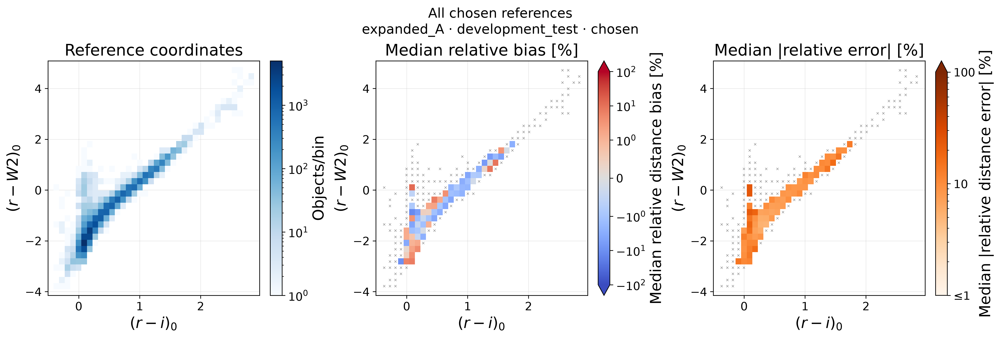

Each panel uses only its required valid bands. Reference M=m0-mu_chosen, predicted M=m0-mu50. Residual statistics are in reference coordinates. Signed=median(epsilon), absolute=median(abs(epsilon)), both percent. N>=20 performance cells, sparse gray crosses, zero cells transparent. Shared edges and density scale across classes. Frozen historical TYPE exceptions retained for audit.

[PNG](../figures/v2_0_revision/combinations/color_r_i__r_w2_all.png) · [PDF](../figures/v2_0_revision/combinations/color_r_i__r_w2_all.pdf) · [CSV](../manifests/v2_0_revision/figures/color_r_i__r_w2_all.csv) · [元数据](../manifests/v2_0_revision/figures/color_r_i__r_w2_all.json)

## color_r_i__r_w2_dwarf

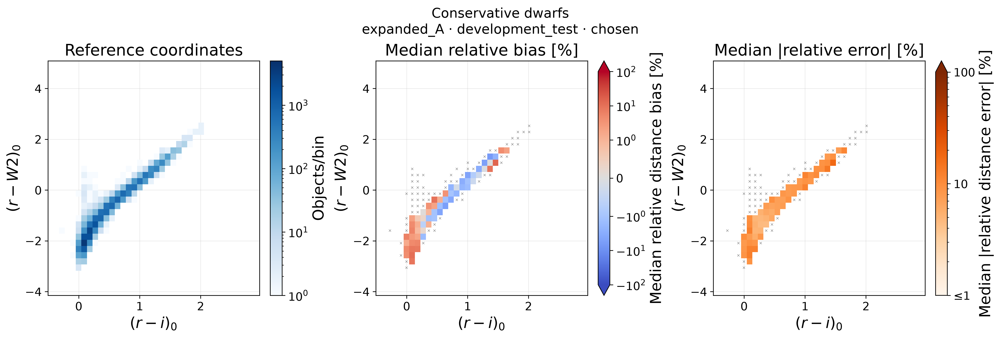

Each panel uses only its required valid bands. Reference M=m0-mu_chosen, predicted M=m0-mu50. Residual statistics are in reference coordinates. Signed=median(epsilon), absolute=median(abs(epsilon)), both percent. N>=20 performance cells, sparse gray crosses, zero cells transparent. Shared edges and density scale across classes. Frozen historical TYPE exceptions retained for audit.

[PNG](../figures/v2_0_revision/combinations/color_r_i__r_w2_dwarf.png) · [PDF](../figures/v2_0_revision/combinations/color_r_i__r_w2_dwarf.pdf) · [CSV](../manifests/v2_0_revision/figures/color_r_i__r_w2_dwarf.csv) · [元数据](../manifests/v2_0_revision/figures/color_r_i__r_w2_dwarf.json)

## color_r_i__r_w2_giant

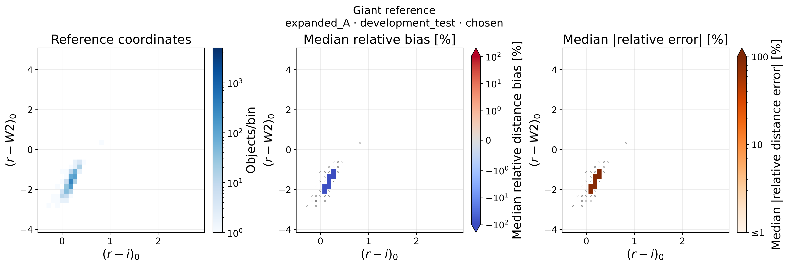

Each panel uses only its required valid bands. Reference M=m0-mu_chosen, predicted M=m0-mu50. Residual statistics are in reference coordinates. Signed=median(epsilon), absolute=median(abs(epsilon)), both percent. N>=20 performance cells, sparse gray crosses, zero cells transparent. Shared edges and density scale across classes. Frozen historical TYPE exceptions retained for audit.

[PNG](../figures/v2_0_revision/combinations/color_r_i__r_w2_giant.png) · [PDF](../figures/v2_0_revision/combinations/color_r_i__r_w2_giant.pdf) · [CSV](../manifests/v2_0_revision/figures/color_r_i__r_w2_giant.csv) · [元数据](../manifests/v2_0_revision/figures/color_r_i__r_w2_giant.json)

## color_r_i__r_w2_other

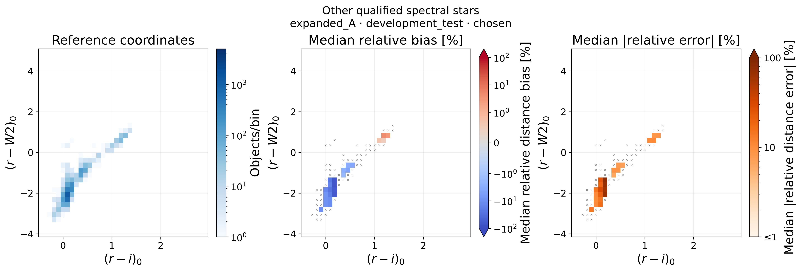

Each panel uses only its required valid bands. Reference M=m0-mu_chosen, predicted M=m0-mu50. Residual statistics are in reference coordinates. Signed=median(epsilon), absolute=median(abs(epsilon)), both percent. N>=20 performance cells, sparse gray crosses, zero cells transparent. Shared edges and density scale across classes. Frozen historical TYPE exceptions retained for audit.

[PNG](../figures/v2_0_revision/combinations/color_r_i__r_w2_other.png) · [PDF](../figures/v2_0_revision/combinations/color_r_i__r_w2_other.pdf) · [CSV](../manifests/v2_0_revision/figures/color_r_i__r_w2_other.csv) · [元数据](../manifests/v2_0_revision/figures/color_r_i__r_w2_other.json)

## color_r_i__r_w2_unknown

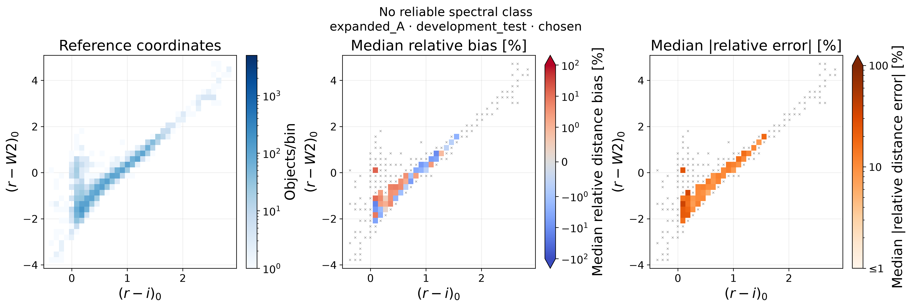

Each panel uses only its required valid bands. Reference M=m0-mu_chosen, predicted M=m0-mu50. Residual statistics are in reference coordinates. Signed=median(epsilon), absolute=median(abs(epsilon)), both percent. N>=20 performance cells, sparse gray crosses, zero cells transparent. Shared edges and density scale across classes. Frozen historical TYPE exceptions retained for audit.

[PNG](../figures/v2_0_revision/combinations/color_r_i__r_w2_unknown.png) · [PDF](../figures/v2_0_revision/combinations/color_r_i__r_w2_unknown.pdf) · [CSV](../manifests/v2_0_revision/figures/color_r_i__r_w2_unknown.csv) · [元数据](../manifests/v2_0_revision/figures/color_r_i__r_w2_unknown.json)

## color_r_i__r_z_all

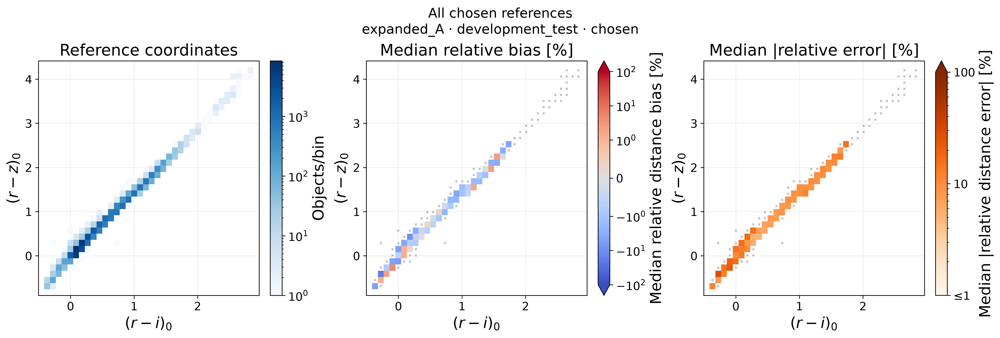

Each panel uses only its required valid bands. Reference M=m0-mu_chosen, predicted M=m0-mu50. Residual statistics are in reference coordinates. Signed=median(epsilon), absolute=median(abs(epsilon)), both percent. N>=20 performance cells, sparse gray crosses, zero cells transparent. Shared edges and density scale across classes. Frozen historical TYPE exceptions retained for audit.

[PNG](../figures/v2_0_revision/combinations/color_r_i__r_z_all.png) · [PDF](../figures/v2_0_revision/combinations/color_r_i__r_z_all.pdf) · [CSV](../manifests/v2_0_revision/figures/color_r_i__r_z_all.csv) · [元数据](../manifests/v2_0_revision/figures/color_r_i__r_z_all.json)

## color_r_i__r_z_dwarf

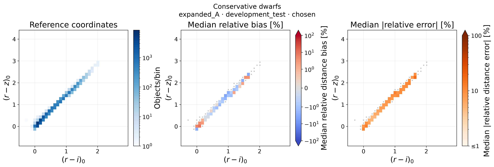

Each panel uses only its required valid bands. Reference M=m0-mu_chosen, predicted M=m0-mu50. Residual statistics are in reference coordinates. Signed=median(epsilon), absolute=median(abs(epsilon)), both percent. N>=20 performance cells, sparse gray crosses, zero cells transparent. Shared edges and density scale across classes. Frozen historical TYPE exceptions retained for audit.

[PNG](../figures/v2_0_revision/combinations/color_r_i__r_z_dwarf.png) · [PDF](../figures/v2_0_revision/combinations/color_r_i__r_z_dwarf.pdf) · [CSV](../manifests/v2_0_revision/figures/color_r_i__r_z_dwarf.csv) · [元数据](../manifests/v2_0_revision/figures/color_r_i__r_z_dwarf.json)

## color_r_i__r_z_giant

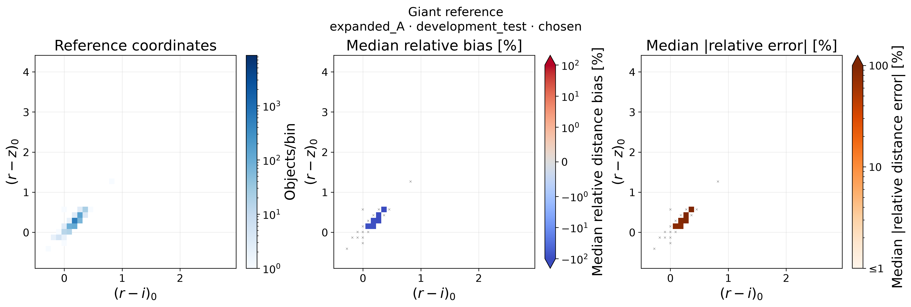

Each panel uses only its required valid bands. Reference M=m0-mu_chosen, predicted M=m0-mu50. Residual statistics are in reference coordinates. Signed=median(epsilon), absolute=median(abs(epsilon)), both percent. N>=20 performance cells, sparse gray crosses, zero cells transparent. Shared edges and density scale across classes. Frozen historical TYPE exceptions retained for audit.

[PNG](../figures/v2_0_revision/combinations/color_r_i__r_z_giant.png) · [PDF](../figures/v2_0_revision/combinations/color_r_i__r_z_giant.pdf) · [CSV](../manifests/v2_0_revision/figures/color_r_i__r_z_giant.csv) · [元数据](../manifests/v2_0_revision/figures/color_r_i__r_z_giant.json)

## color_r_i__r_z_other

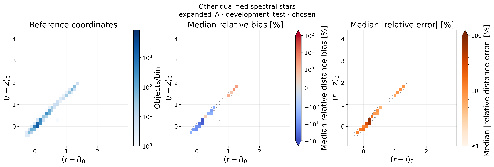

Each panel uses only its required valid bands. Reference M=m0-mu_chosen, predicted M=m0-mu50. Residual statistics are in reference coordinates. Signed=median(epsilon), absolute=median(abs(epsilon)), both percent. N>=20 performance cells, sparse gray crosses, zero cells transparent. Shared edges and density scale across classes. Frozen historical TYPE exceptions retained for audit.

[PNG](../figures/v2_0_revision/combinations/color_r_i__r_z_other.png) · [PDF](../figures/v2_0_revision/combinations/color_r_i__r_z_other.pdf) · [CSV](../manifests/v2_0_revision/figures/color_r_i__r_z_other.csv) · [元数据](../manifests/v2_0_revision/figures/color_r_i__r_z_other.json)

## color_r_i__r_z_unknown

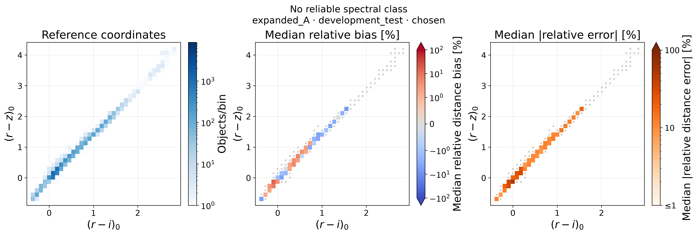

Each panel uses only its required valid bands. Reference M=m0-mu_chosen, predicted M=m0-mu50. Residual statistics are in reference coordinates. Signed=median(epsilon), absolute=median(abs(epsilon)), both percent. N>=20 performance cells, sparse gray crosses, zero cells transparent. Shared edges and density scale across classes. Frozen historical TYPE exceptions retained for audit.

[PNG](../figures/v2_0_revision/combinations/color_r_i__r_z_unknown.png) · [PDF](../figures/v2_0_revision/combinations/color_r_i__r_z_unknown.pdf) · [CSV](../manifests/v2_0_revision/figures/color_r_i__r_z_unknown.csv) · [元数据](../manifests/v2_0_revision/figures/color_r_i__r_z_unknown.json)

## color_r_i__w1_w2_all

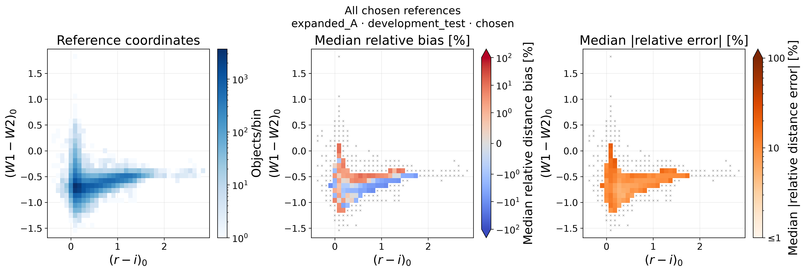

Each panel uses only its required valid bands. Reference M=m0-mu_chosen, predicted M=m0-mu50. Residual statistics are in reference coordinates. Signed=median(epsilon), absolute=median(abs(epsilon)), both percent. N>=20 performance cells, sparse gray crosses, zero cells transparent. Shared edges and density scale across classes. Frozen historical TYPE exceptions retained for audit.

[PNG](../figures/v2_0_revision/combinations/color_r_i__w1_w2_all.png) · [PDF](../figures/v2_0_revision/combinations/color_r_i__w1_w2_all.pdf) · [CSV](../manifests/v2_0_revision/figures/color_r_i__w1_w2_all.csv) · [元数据](../manifests/v2_0_revision/figures/color_r_i__w1_w2_all.json)

## color_r_i__w1_w2_dwarf

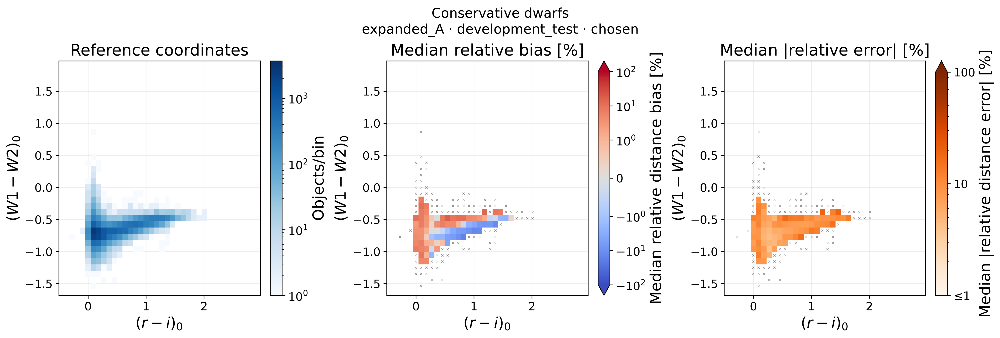

Each panel uses only its required valid bands. Reference M=m0-mu_chosen, predicted M=m0-mu50. Residual statistics are in reference coordinates. Signed=median(epsilon), absolute=median(abs(epsilon)), both percent. N>=20 performance cells, sparse gray crosses, zero cells transparent. Shared edges and density scale across classes. Frozen historical TYPE exceptions retained for audit.

[PNG](../figures/v2_0_revision/combinations/color_r_i__w1_w2_dwarf.png) · [PDF](../figures/v2_0_revision/combinations/color_r_i__w1_w2_dwarf.pdf) · [CSV](../manifests/v2_0_revision/figures/color_r_i__w1_w2_dwarf.csv) · [元数据](../manifests/v2_0_revision/figures/color_r_i__w1_w2_dwarf.json)

## color_r_i__w1_w2_giant

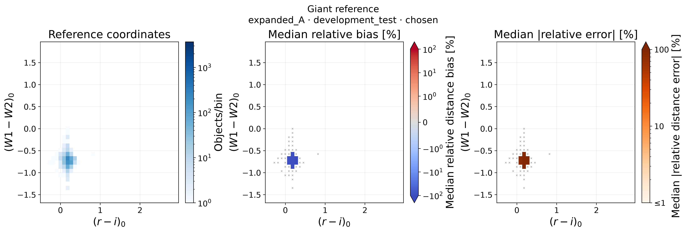

Each panel uses only its required valid bands. Reference M=m0-mu_chosen, predicted M=m0-mu50. Residual statistics are in reference coordinates. Signed=median(epsilon), absolute=median(abs(epsilon)), both percent. N>=20 performance cells, sparse gray crosses, zero cells transparent. Shared edges and density scale across classes. Frozen historical TYPE exceptions retained for audit.

[PNG](../figures/v2_0_revision/combinations/color_r_i__w1_w2_giant.png) · [PDF](../figures/v2_0_revision/combinations/color_r_i__w1_w2_giant.pdf) · [CSV](../manifests/v2_0_revision/figures/color_r_i__w1_w2_giant.csv) · [元数据](../manifests/v2_0_revision/figures/color_r_i__w1_w2_giant.json)

## color_r_i__w1_w2_other

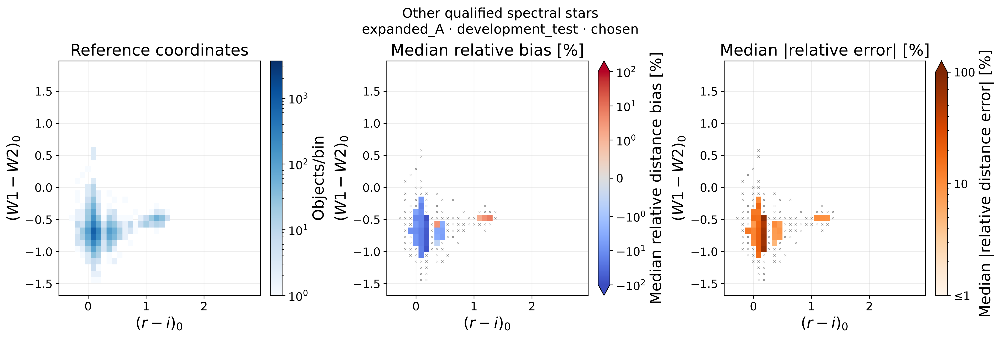

Each panel uses only its required valid bands. Reference M=m0-mu_chosen, predicted M=m0-mu50. Residual statistics are in reference coordinates. Signed=median(epsilon), absolute=median(abs(epsilon)), both percent. N>=20 performance cells, sparse gray crosses, zero cells transparent. Shared edges and density scale across classes. Frozen historical TYPE exceptions retained for audit.

[PNG](../figures/v2_0_revision/combinations/color_r_i__w1_w2_other.png) · [PDF](../figures/v2_0_revision/combinations/color_r_i__w1_w2_other.pdf) · [CSV](../manifests/v2_0_revision/figures/color_r_i__w1_w2_other.csv) · [元数据](../manifests/v2_0_revision/figures/color_r_i__w1_w2_other.json)

## color_r_i__w1_w2_unknown

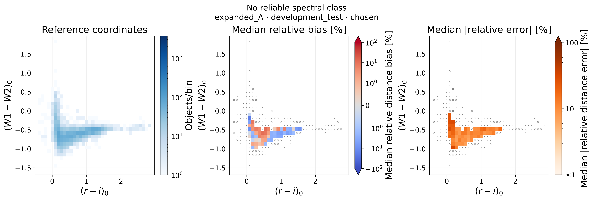

Each panel uses only its required valid bands. Reference M=m0-mu_chosen, predicted M=m0-mu50. Residual statistics are in reference coordinates. Signed=median(epsilon), absolute=median(abs(epsilon)), both percent. N>=20 performance cells, sparse gray crosses, zero cells transparent. Shared edges and density scale across classes. Frozen historical TYPE exceptions retained for audit.

[PNG](../figures/v2_0_revision/combinations/color_r_i__w1_w2_unknown.png) · [PDF](../figures/v2_0_revision/combinations/color_r_i__w1_w2_unknown.pdf) · [CSV](../manifests/v2_0_revision/figures/color_r_i__w1_w2_unknown.csv) · [元数据](../manifests/v2_0_revision/figures/color_r_i__w1_w2_unknown.json)
