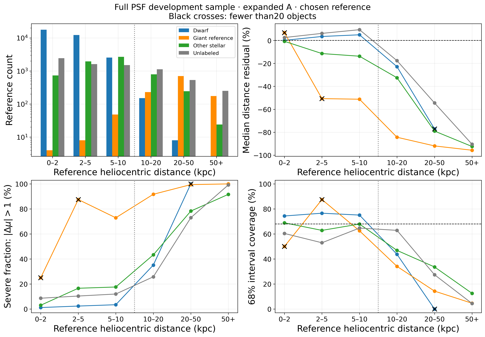
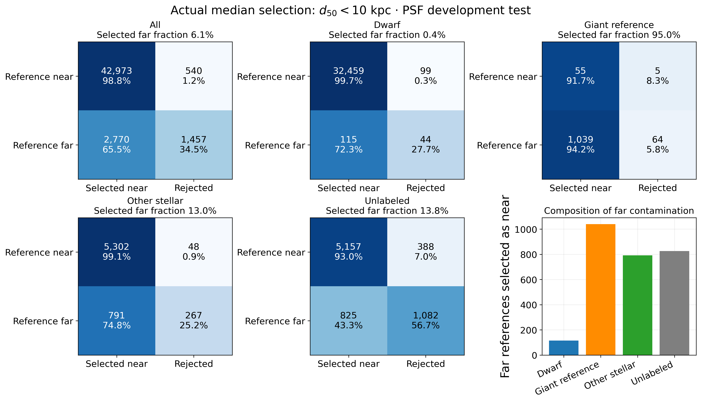
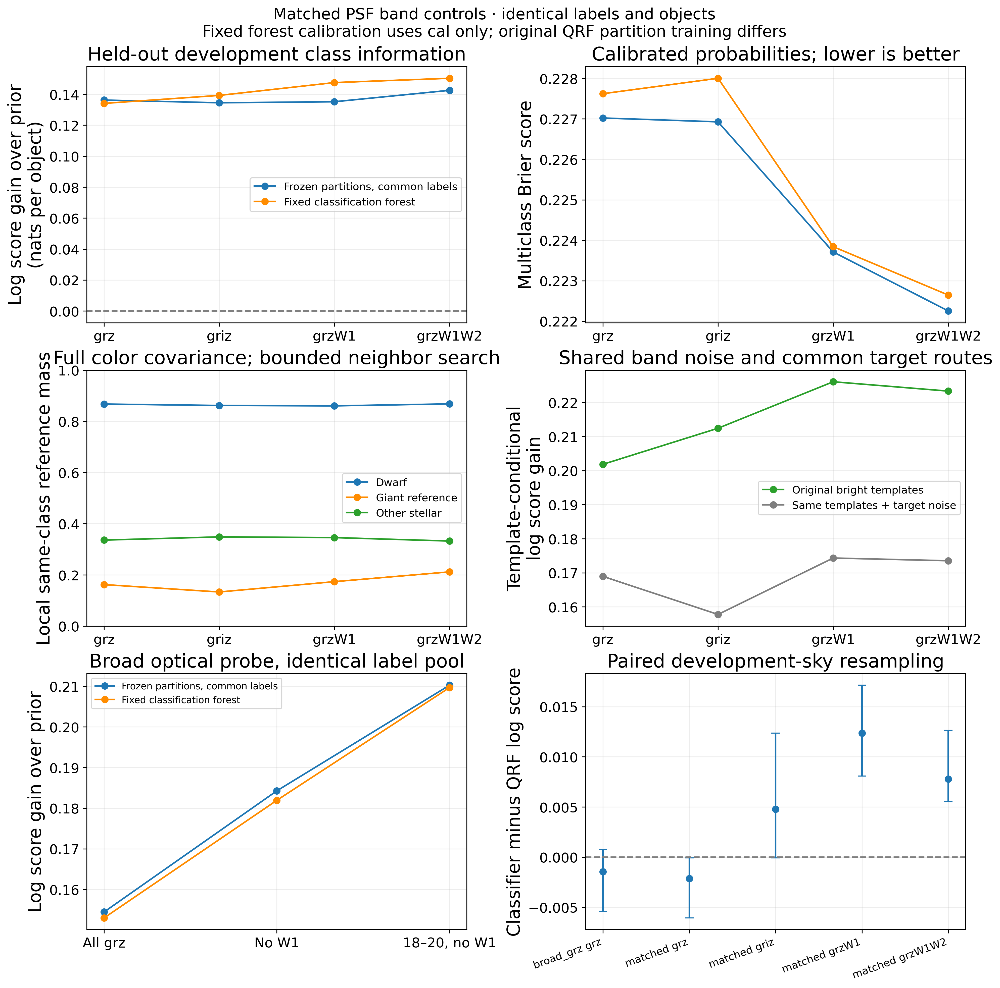
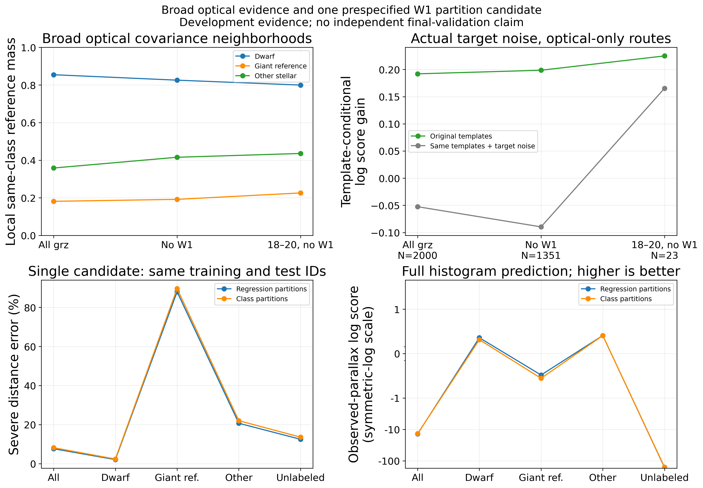
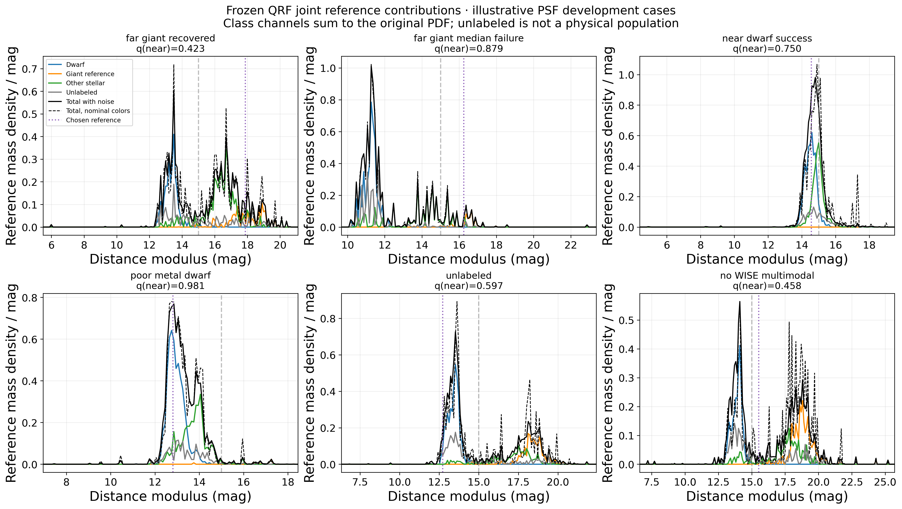
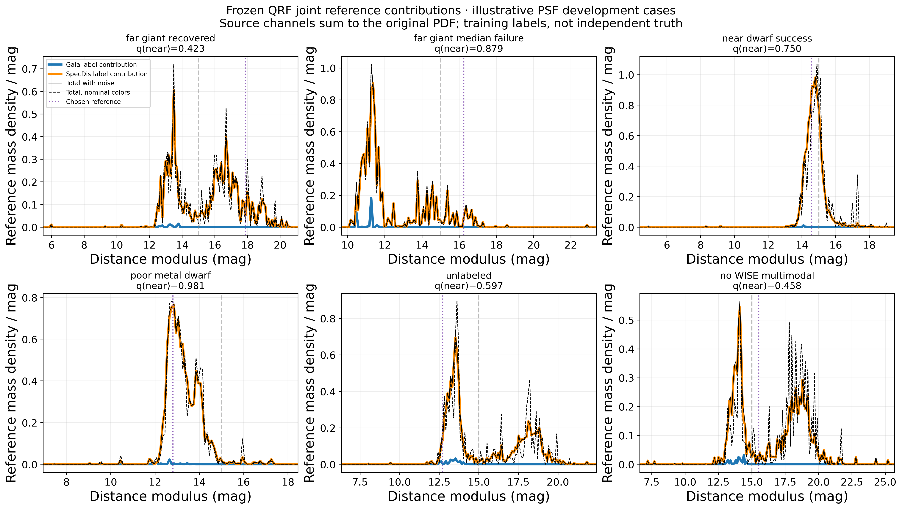
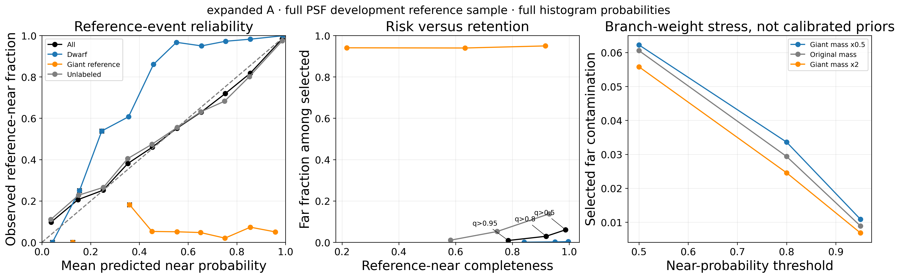
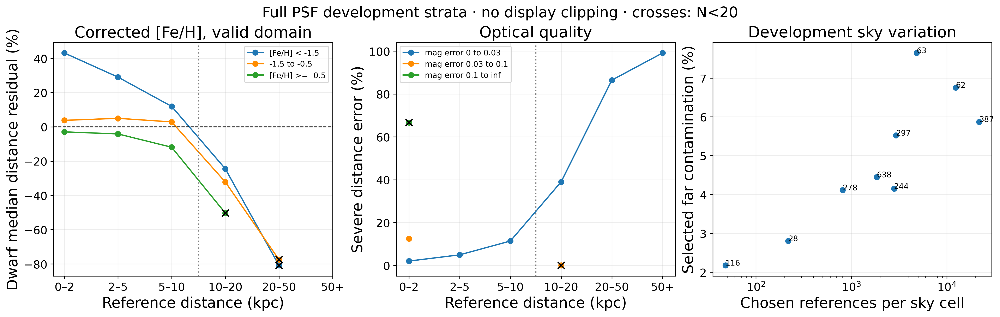

# Photdis v2.1 scientific atlas

Six groups, eight plates. All new scientific samples require verified native DR11 PSF.
No display clipping enters statistics. These are development diagnostics; see the
[Chinese scientific report](v2_1_result.md) and [requirement ledger](v2_1_requirements_result.md).
Every plate has a300dpi PNG, vector PDF, plotted data CSV and selection/provenance JSON.
Existing v2.0 figures remain unchanged.

## 1. Distance × reference population

Chosen-reference counts, median fractional residual, severe tails and68% coverage.
Black crosses flag N<20; class-stratified coverage is diagnostic, not an equal-coverage requirement for an unconditioned mixture.
[PDF](../figures/v2_1/01_distance_population.pdf) · [CSV](../manifests/v2_1/figures/01_distance_population.csv) · [JSON](../manifests/v2_1/figures/01_distance_population.json).

## 2. Actual median-near selection

Rows condition on reference near/far status, columns on prediction-only selection.
Counts and row percentages are shown; class labels are used only after selection.
[PDF](../figures/v2_1/02_near_far_migration.pdf) · [CSV](../manifests/v2_1/figures/02_near_far_migration.csv) · [JSON](../manifests/v2_1/figures/02_near_far_migration.json).

## 3. Color information, measurement degradation and one candidate

Matched labels and evaluation objects for the four band arms; broad optical evidence is separate.
Covariance-aware local comparisons and shared-template noise simulations are conditional diagnostics.
Spatial bootstrap resamples the existing nine development cells, not independent new sky.
[PDF](../figures/v2_1/03_color_information.pdf) · [CSV](../manifests/v2_1/figures/03_color_information.csv) · [JSON](../manifests/v2_1/figures/03_color_information.json).

Top: broad optical/no-WISE neighborhoods and fixed training-template degradation.
Bottom: one W1 distance candidate versus a control with identical PSF training/evaluation identities.
The candidate fails the fixed cal guards. The Gaia-score axis is symmetric-log to retain extreme unlabeled failures and the small known-class differences together.
[PDF](../figures/v2_1/03b_optical_candidate.pdf) · [CSV](../manifests/v2_1/figures/03b_optical_candidate.csv) · [JSON](../manifests/v2_1/figures/03b_optical_candidate.json).

## 4. Full-PDF joint reference decomposition

One deterministic identity-hash example per declared outcome stratum; illustrative, not representative performance estimates.
Class channels sum to the original noisy PDF. Unlabeled means missing reliable class evidence.
[PDF](../figures/v2_1/04_joint_reference_pdf.pdf) · [CSV](../manifests/v2_1/figures/04_joint_reference_pdf.csv) · [JSON](../manifests/v2_1/figures/04_joint_reference_pdf.json).

The same six objects, decomposed by the training distance-label source. Source mass is not independent physical truth.
Dashed black lines show nominal colors; solid totals include shared-g Sobol128 measurement propagation.
[PDF](../figures/v2_1/04b_joint_source_pdf.pdf) · [CSV](../manifests/v2_1/figures/04b_joint_source_pdf.csv) · [JSON](../manifests/v2_1/figures/04b_joint_source_pdf.json).

## 5. Near-event probability

Reference-event reliability, risk versus completeness and prespecified evolved-mass sensitivity.
The cal-selected q>0.5 rule fails the development contamination target; q>0.95 is a prespecified diagnostic.
Stress multipliers are not inferred Galactic priors or count confidence intervals.
[PDF](../figures/v2_1/05_near_probability.pdf) · [CSV](../manifests/v2_1/figures/05_near_probability.csv) · [JSON](../manifests/v2_1/figures/05_near_probability.json).

## 6. Metallicity, quality, sky and nonstellar evidence

Corrected metallicity within its declared domain; optical errors; development-sky variation;
bounded systematic stress; frozen signed-WISE prototype; quality-assessed PSF nonstellar controls.
The last two panels have their own explicitly labeled model/sample scopes.
[PDF](../figures/v2_1/06_distance_quality_sky.pdf) · [CSV](../manifests/v2_1/figures/06_distance_quality_sky.csv) · [JSON](../manifests/v2_1/figures/06_distance_quality_sky.json).

Complete distance/brightness/error/WISE/sky/reference strata, including empty and sparse bins,
remain in the linked source CSVs. The plates summarize them; they do not replace the full evidence ledger.
