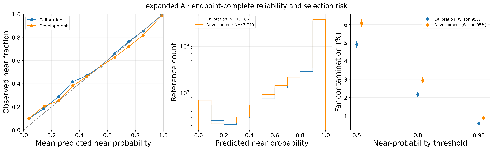
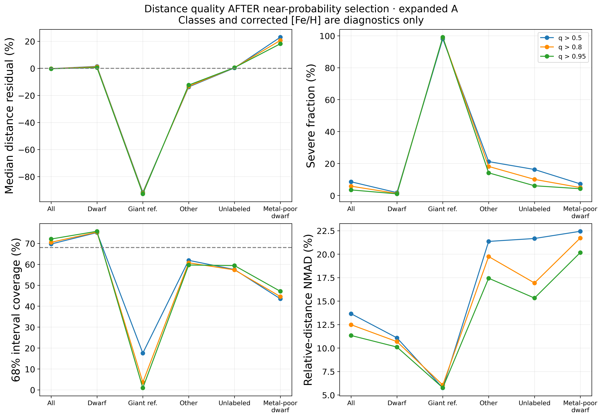
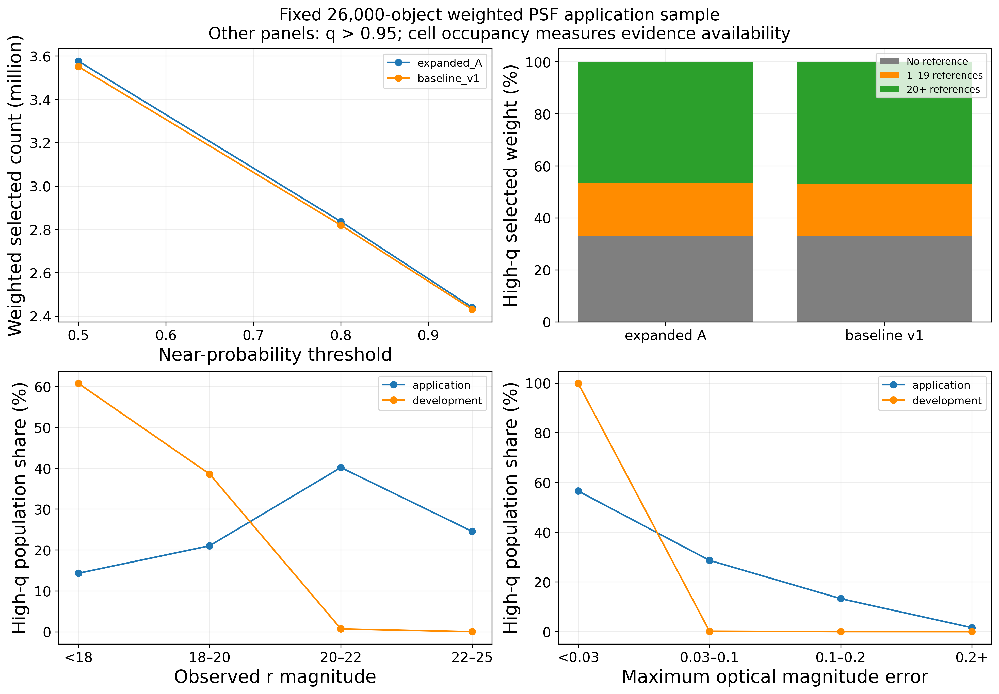
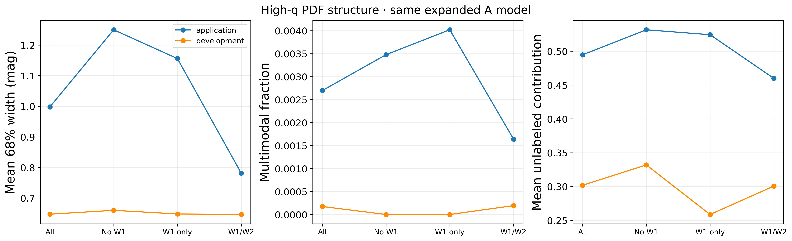
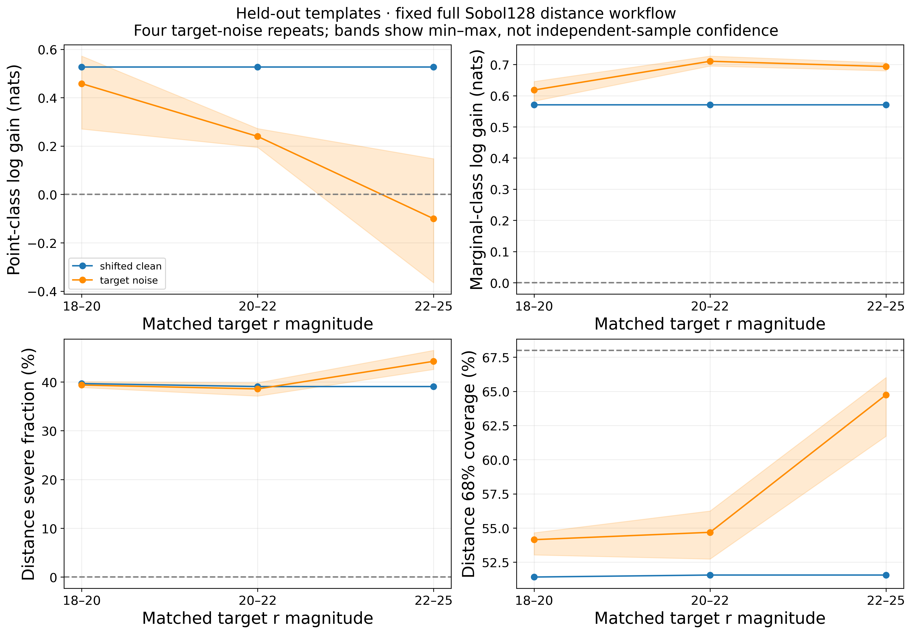
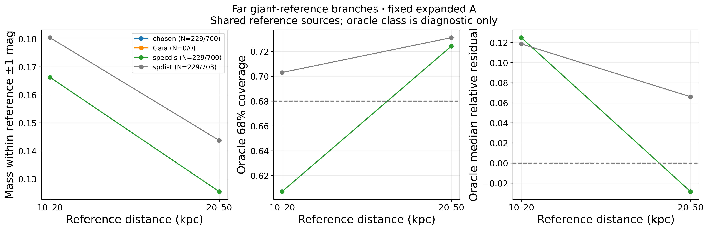
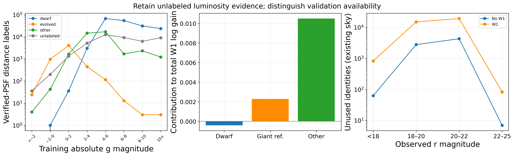

# v2.2 科学图集

图内全部英文，沿用Pal5 New配色、字体、尺寸。PNG300dpi和矢量PDF；每图有对应CSV与来源哈希JSON。全部科学统计未裁剪。

## 修正端点后的可靠性与选择风险

[PDF](../figures/v2_2/01_reliability.pdf) · [表](../manifests/v2_2/figures/01_reliability.csv) · [口径与来源](../manifests/v2_2/figures/01_reliability.json)

## 高q选中后的距离质量

[PDF](../figures/v2_2/02_selected_distance.pdf) · [表](../manifests/v2_2/figures/02_selected_distance.csv) · [口径与来源](../manifests/v2_2/figures/02_selected_distance.json)

## 实际应用人数与参考证据覆盖

[PDF](../figures/v2_2/03_application.pdf) · [表](../manifests/v2_2/figures/03_application.csv) · [口径与来源](../manifests/v2_2/figures/03_application.json)

## 同模型应用/开发PDF结构

[PDF](../figures/v2_2/03b_pdf_structure.pdf) · [表](../manifests/v2_2/figures/03b_pdf_structure.csv) · [口径与来源](../manifests/v2_2/figures/03b_pdf_structure.json)

## 未拟合模板的完整误差迁移

[PDF](../figures/v2_2/04_noise_transfer.pdf) · [表](../manifests/v2_2/figures/04_noise_transfer.csv) · [口径与来源](../manifests/v2_2/figures/04_noise_transfer.json)

## 分参考的远端分支形状

[PDF](../figures/v2_2/05_far_shape.pdf) · [表](../manifests/v2_2/figures/05_far_shape.csv) · [口径与来源](../manifests/v2_2/figures/05_far_shape.json)

## 无类别光度支持、W1收益与验证库存

[PDF](../figures/v2_2/06_evidence_limits.pdf) · [表](../manifests/v2_2/figures/06_evidence_limits.csv) · [口径与来源](../manifests/v2_2/figures/06_evidence_limits.json)

