# v2.4 scientific-use atlas

English-only; Pal5 styling. PNG300dpi, PDF and source CSV/JSON. Scientific samples and denominators are untrimmed.

## 01_anomaly_conditions

Full711objects;147conditional low-PIT flags are diagnostic, not a new selection. Only finite coordinates plotted; panel counts give low-PIT/other shown. QRF and XD are compared on these exact identities. W1 is a population marker, not an input to either grz model.

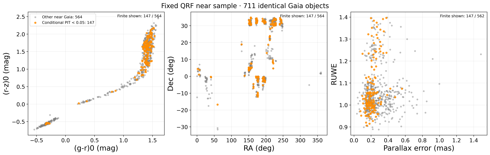

[PNG](../figures/v2_4/01_anomaly_conditions.png) · [PDF](../figures/v2_4/01_anomaly_conditions.pdf) · [CSV](../manifests/v2_4/figures/01_anomaly_conditions.csv) · [JSON](../manifests/v2_4/figures/01_anomaly_conditions.json)

## 02_reference_conflict

196of711have qualified SPDist;60are low-PIT. Combined errors use a first-order SPDist parallax propagation and do not model cross-source covariance. Histogram display±8; all objects retained in CSV and statistics.

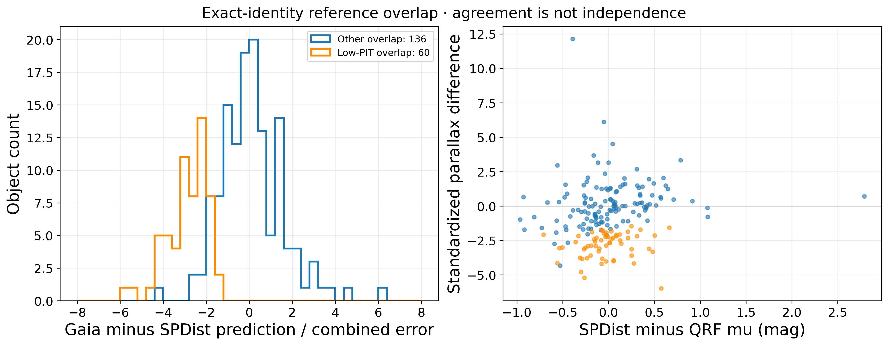

[PNG](../figures/v2_4/02_reference_conflict.png) · [PDF](../figures/v2_4/02_reference_conflict.pdf) · [CSV](../manifests/v2_4/figures/02_reference_conflict.csv) · [JSON](../manifests/v2_4/figures/02_reference_conflict.json)

## 03_same_identity_pdfs

First two identity-ranked examples per group, not hand-picked posterior shapes. Rebinning for display only; native full PDF used for scientific metrics. Display5<mu<22; complete compact bins−5to30 are in CSV.

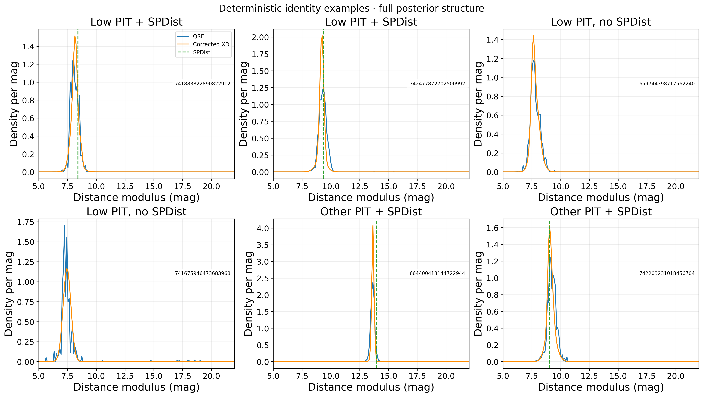

[PNG](../figures/v2_4/03_same_identity_pdfs.png) · [PDF](../figures/v2_4/03_same_identity_pdfs.pdf) · [CSV](../manifests/v2_4/figures/03_same_identity_pdfs.csv) · [JSON](../manifests/v2_4/figures/03_same_identity_pdfs.json)

## 04_metal_source_scales

Original2055pairs; both sides must qualify for each reference and distance range. N=pairs,U=unique ordinary controls. Bars:1000control-ID-cluster bootstrap95%interval; separate sky-pair intervals retained in CSV. Very small Gaia strata cannot establish an independent scale.

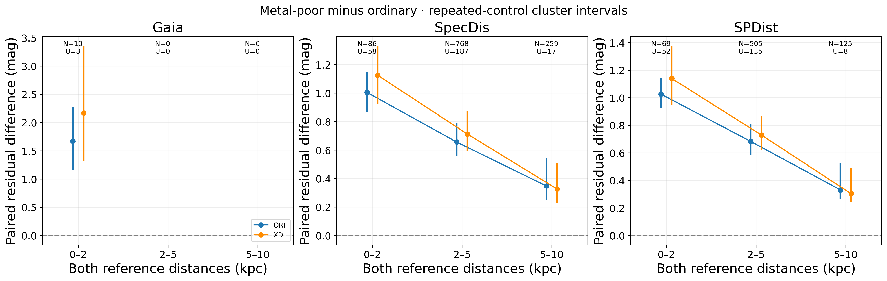

[PNG](../figures/v2_4/04_metal_source_scales.png) · [PDF](../figures/v2_4/04_metal_source_scales.pdf) · [CSV](../manifests/v2_4/figures/04_metal_source_scales.csv) · [JSON](../manifests/v2_4/figures/04_metal_source_scales.json)

## 05_metal_pdf_support

Sources use different pair subsets. Cross-source persistence is descriptive evidence, not an independent causal metallicity effect. Gaia only10pairs; SpecDis/SPDist share inputs/teacher limitations.

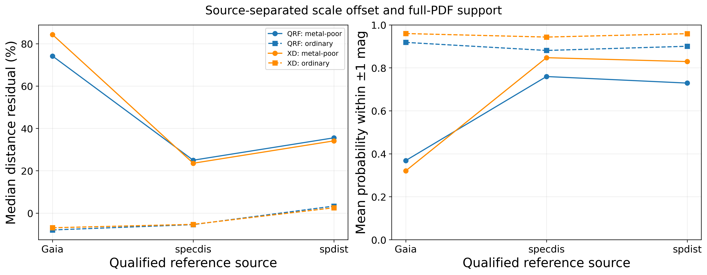

[PNG](../figures/v2_4/05_metal_pdf_support.png) · [PDF](../figures/v2_4/05_metal_pdf_support.pdf) · [CSV](../manifests/v2_4/figures/05_metal_pdf_support.csv) · [JSON](../manifests/v2_4/figures/05_metal_pdf_support.json)

## 06_information_gains

33251same development identities,9sky clusters. r/sky prior fitted only on cal labels; no model refit. Error treatment held at original cache settings. Bars are sky-cluster intervals, not a physical information bound; matched i+WISE coverage is restricted.

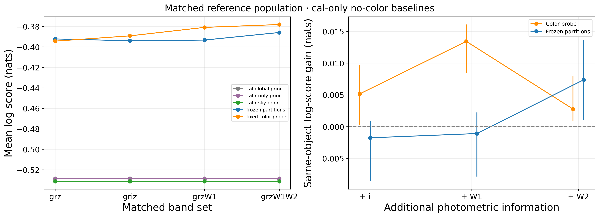

[PNG](../figures/v2_4/06_information_gains.png) · [PDF](../figures/v2_4/06_information_gains.pdf) · [CSV](../manifests/v2_4/figures/06_information_gains.csv) · [JSON](../manifests/v2_4/figures/06_information_gains.json)

## 07_joint_population_counts

Exact frozen QRF leaf-joint marginals, Sobol128 shared errors. Unlabeled denotes missing reference labels, not a physical class. Weighted13field diagnostic sample; conditional uncertainty is not population calibration.

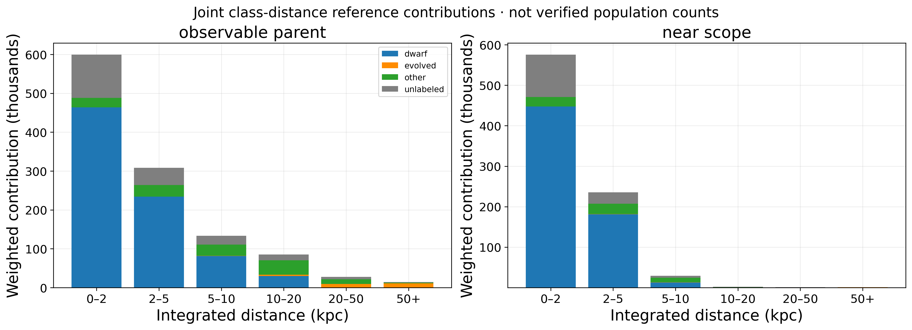

[PNG](../figures/v2_4/07_joint_population_counts.png) · [PDF](../figures/v2_4/07_joint_population_counts.pdf) · [CSV](../manifests/v2_4/figures/07_joint_population_counts.csv) · [JSON](../manifests/v2_4/figures/07_joint_population_counts.json)

## 08_count_dependence_coverage

Direct reference flags and observed Gaia are distinct from observable-cell support. Cell counts are descriptive availability, not guarantees of reliability; cells omit sky. Marginal-product discrepancy demonstrates why joint contributions are required.

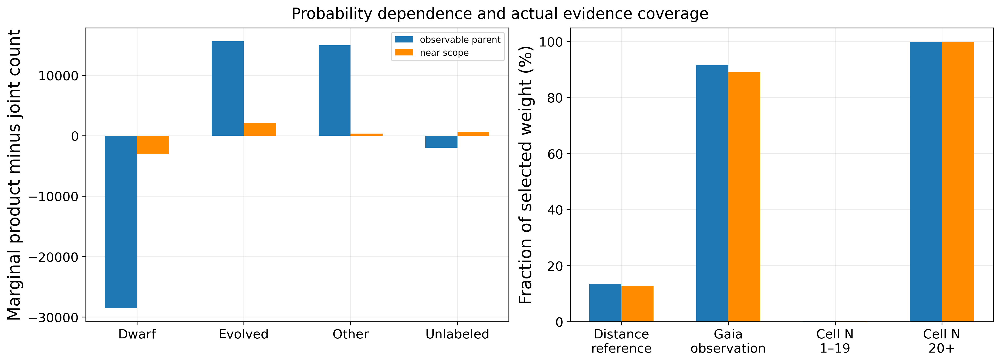

[PNG](../figures/v2_4/08_count_dependence_coverage.png) · [PDF](../figures/v2_4/08_count_dependence_coverage.pdf) · [CSV](../manifests/v2_4/figures/08_count_dependence_coverage.csv) · [JSON](../manifests/v2_4/figures/08_count_dependence_coverage.json)

## 09_population_recovery

Held-out template identities, no samples from the tested model PDF. Same empirical SEDs shifted to five known distances; injected class/metal mixtures are stress designs, not Galaxy priors. Teacher-scale errors limit absolute interpretation.

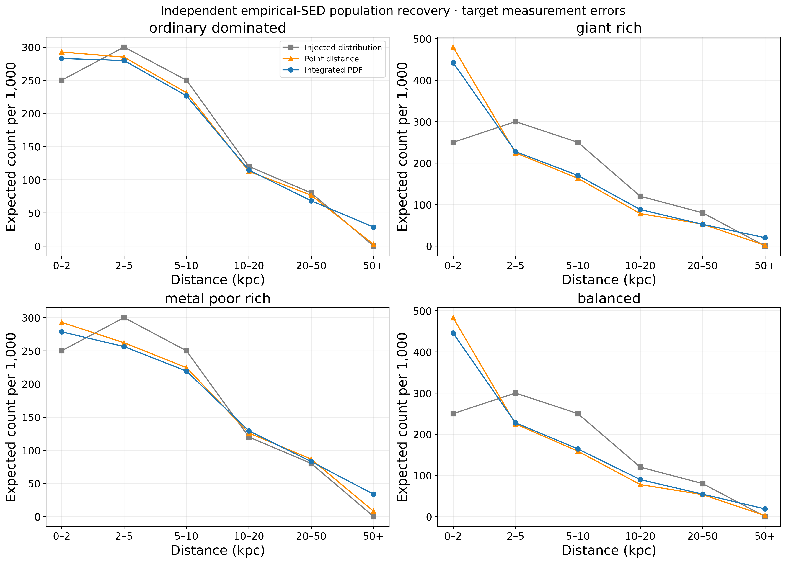

[PNG](../figures/v2_4/09_population_recovery.png) · [PDF](../figures/v2_4/09_population_recovery.pdf) · [CSV](../manifests/v2_4/figures/09_population_recovery.csv) · [JSON](../manifests/v2_4/figures/09_population_recovery.json)

## 10_recovery_noise_selection

Same empirical templates and design weights across clean/noisy cases. Near selection changes true composition; comparisons retain injected truth after the identical observational and predicted selection.

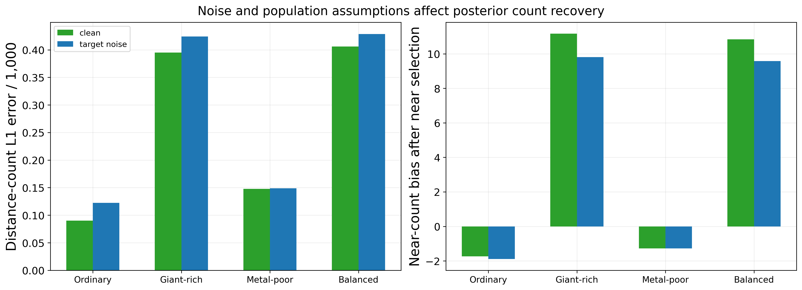

[PNG](../figures/v2_4/10_recovery_noise_selection.png) · [PDF](../figures/v2_4/10_recovery_noise_selection.pdf) · [CSV](../manifests/v2_4/figures/10_recovery_noise_selection.csv) · [JSON](../manifests/v2_4/figures/10_recovery_noise_selection.json)

## 11_count_interval_stress

Conditional Bernoulli count intervals atN=1000, evaluated over500identity-cluster Bayesian-bootstrap pseudo-populations. Not a real-sky coverage claim. Unlabeled-reference contribution has no injected physical-class counterpart; coherent teacher±1sigma sensitivity is retained.

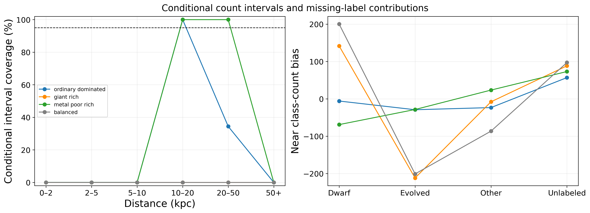

[PNG](../figures/v2_4/11_count_interval_stress.png) · [PDF](../figures/v2_4/11_count_interval_stress.pdf) · [CSV](../manifests/v2_4/figures/11_count_interval_stress.csv) · [JSON](../manifests/v2_4/figures/11_count_interval_stress.json)
