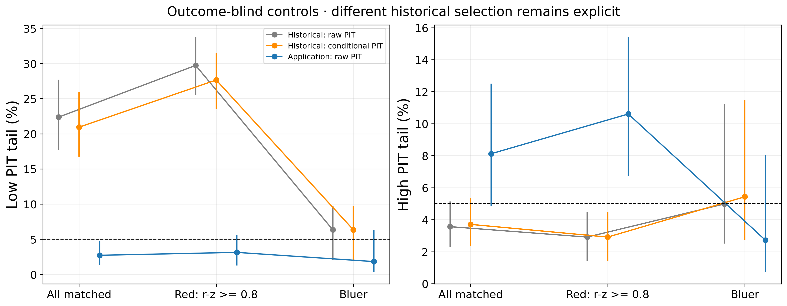
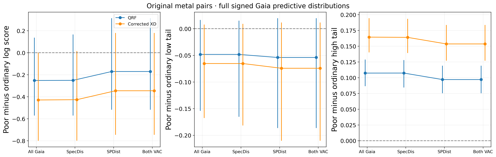
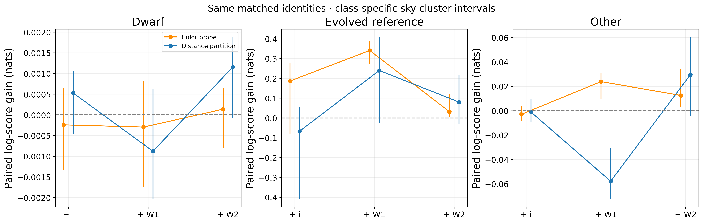
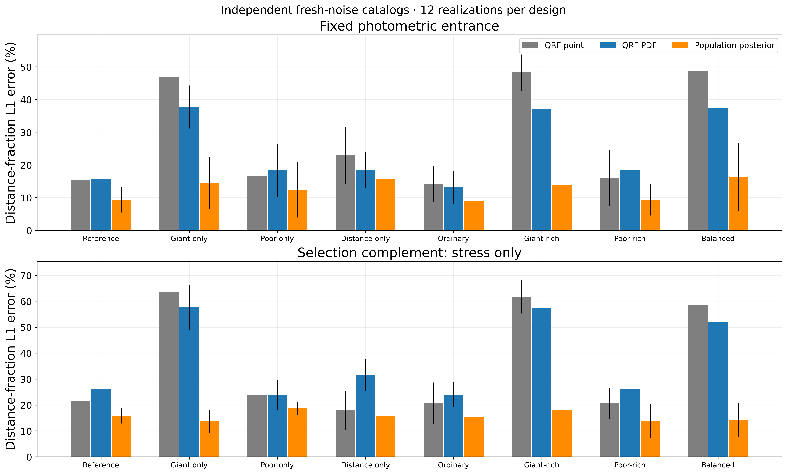
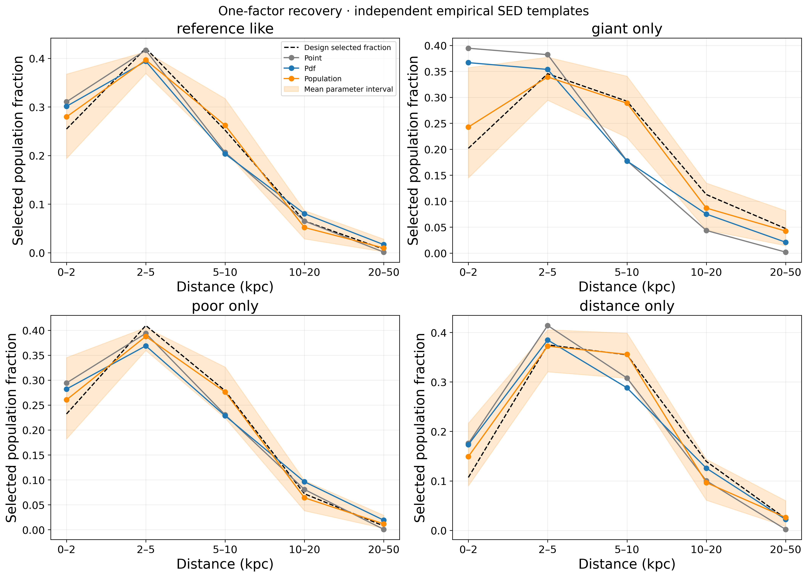
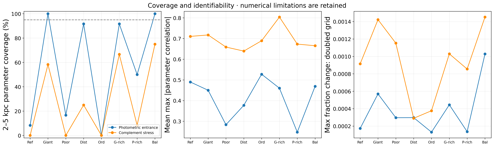
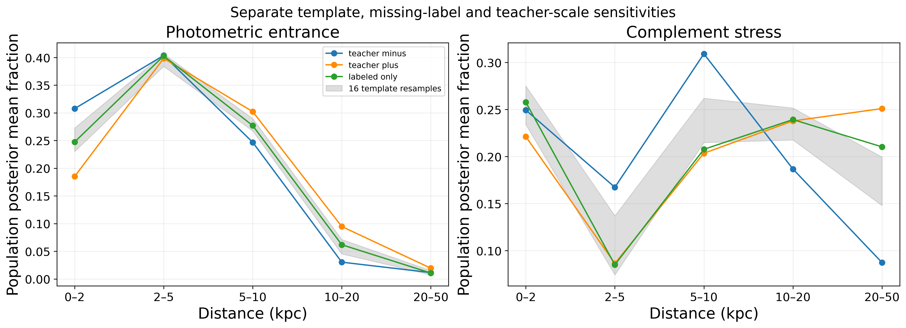
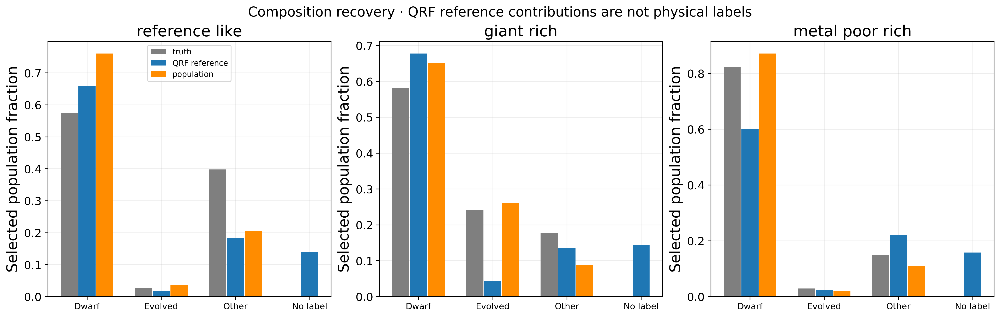

# Photdis v2.5 figure atlas

English-only, source-linked PNG300dpi/PDF plates; scientific denominators remain in CSV.

## 01_red_migration

Match full711historical objects without PIT. With-replacement controls exclude fitting identities and known nonstellar risks. Bars resample reused control IDs. Raw and historical conditional PIT have different selection meanings; weighted and field intervals remain in CSV.

[PDF](../figures/v2_5/01_red_migration.pdf) · [CSV](../manifests/v2_5/figures/01_red_migration.csv)

## 02_metal_signed_gaia

Both sides eligible for paired differences; no SNR cut or weak-parallax inversion. NativePSF, clean references, neither identity fitted. Original2055denominator and one-sided availability in CSV; bars resample reused ordinary IDs. Source selection and shared teachers limit causality.

[PDF](../figures/v2_5/02_metal_signed_gaia.pdf) · [CSV](../manifests/v2_5/figures/02_metal_signed_gaia.csv)

## 03_band_gains_by_class

Group-specific uncertainty, not borrowed overall intervals. Fixed probes and partitions have different fitting support. Matched bands have no faint evolved references; no physical information-bound claim.

[PDF](../figures/v2_5/03_band_gains_by_class.pdf) · [CSV](../manifests/v2_5/figures/03_band_gains_by_class.csv)

## 04_population_recovery

Same128objects/catalog for all three methods. L1 includes six distance bins, including QRF mass beyond50kpc; model truth has five fixed nodes. Bars across independent catalogs, errorbars their SD. Empirical templates/teachers and noise law are not real-sky truth.

[PDF](../figures/v2_5/04_population_recovery.pdf) · [CSV](../manifests/v2_5/figures/04_population_recovery.csv)

## 05_recovery_distance_shapes

Means across12independent catalogs; shaded region is mean parameter-interval endpoints, NOT an interval on the average curve. True selected distribution from separate test-library forward Monte Carlo; no response fitting on test identities.

[PDF](../figures/v2_5/05_recovery_distance_shapes.pdf) · [CSV](../manifests/v2_5/figures/05_recovery_distance_shapes.csv)

## 06_coverage_identifiability

12independent catalogs per design; Wilson intervals for each distance bin in CSV. Parameter intervals and replicate-count intervals are separate. Boundary mass, quadrature ESS and grid convergence retained; high correlation or narrow wrong intervals prohibit adoption.

[PDF](../figures/v2_5/06_coverage_identifiability.pdf) · [CSV](../manifests/v2_5/figures/06_coverage_identifiability.csv)

## 07_uncertainty_sources

First reference-like catalog only;16identity-level Bayesian bootstrap responses, coherent±1teacher-sigma calibration-template shifts and labeled-only response. Sensitivity envelopes are not combined calibrated uncertainty.

[PDF](../figures/v2_5/07_uncertainty_sources.pdf) · [CSV](../manifests/v2_5/figures/07_uncertainty_sources.csv)

## 08_population_composition

Mean over12catalogs in the fixed photometric entrance. New population model marginalizes missing template labels; QRF retains its unlabeled-reference channel separately. No-label is not a true physical population and has no injected truth bar.

[PDF](../figures/v2_5/08_population_composition.pdf) · [CSV](../manifests/v2_5/figures/08_population_composition.csv)
