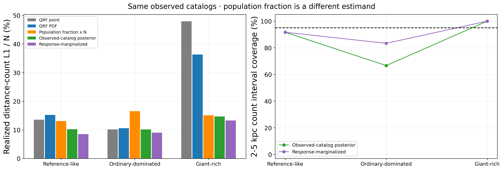
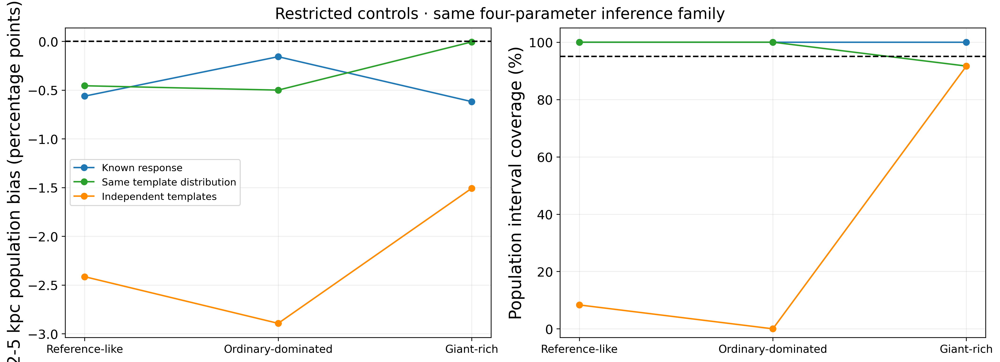
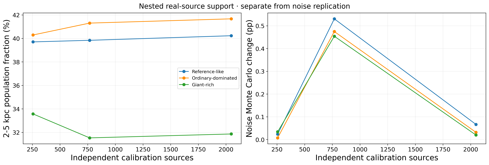
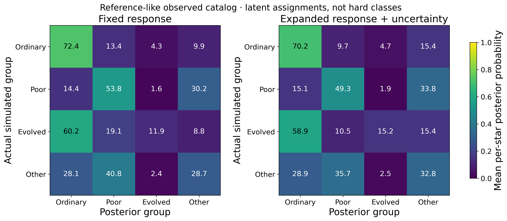
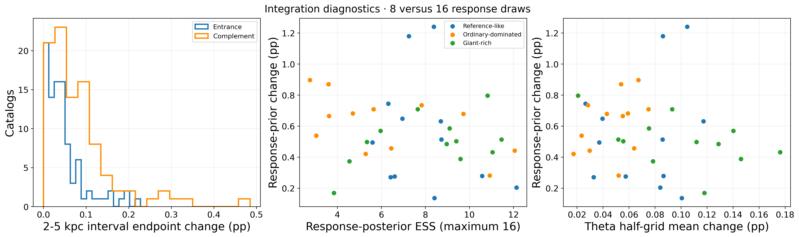
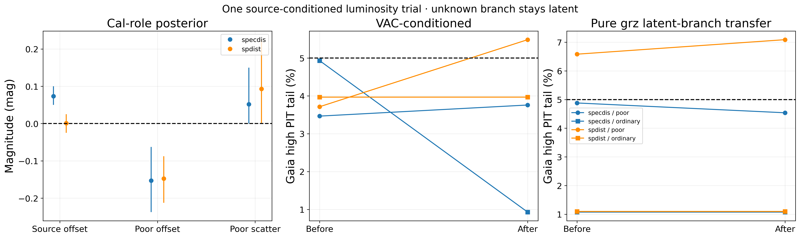
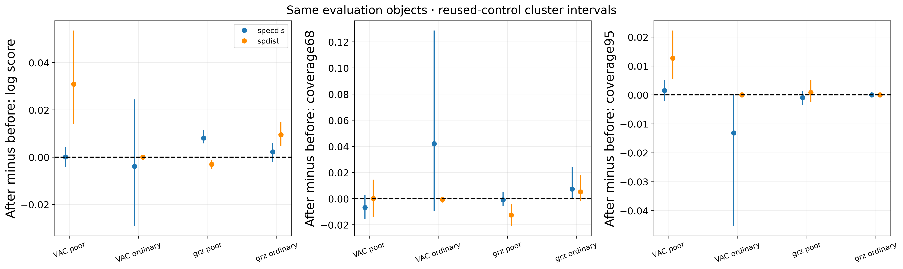
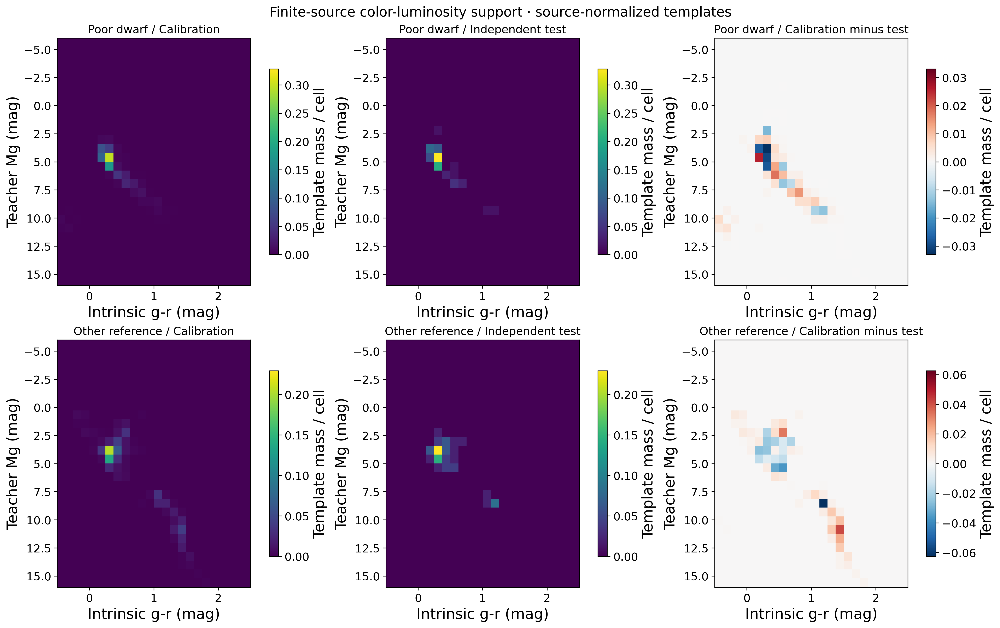
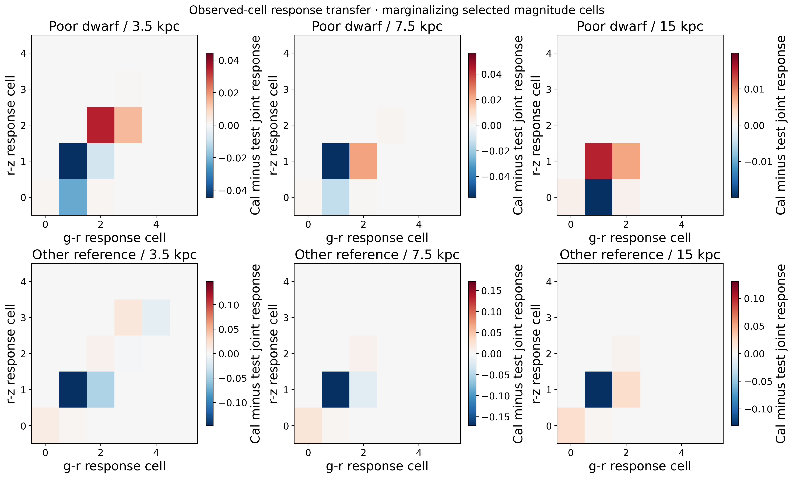

# v2.6 scientific atlas

All figure text is English; PNG300dpi and vector PDF. CSV/JSON keep source tables and hashes.

## 01_observed_counts
All methods compared with the SAME realized128latent objects/catalog, including QRF beyond50kpc mass.12catalogs/design, entrance only; libraries shared across realizations. Count intervals draw a common population parameter and conditional latent labels, not new catalogs.

[PDF](../figures/v2_6/01_observed_counts.pdf) · [CSV](../manifests/v2_6/figures/01_observed_counts.csv) · [JSON](../manifests/v2_6/figures/01_observed_counts.json)

## 02_response_controls
Fixed-parameter Bayesian interval coverage across12catalogs is a diagnostic, not an exact95%requirement at every true parameter. Same-template truth uses independent response Monte Carlo. Reachability is numerical corner reduction, not an interval-arithmetic proof.

[PDF](../figures/v2_6/02_response_controls.pdf) · [CSV](../manifests/v2_6/figures/02_response_controls.csv) · [JSON](../manifests/v2_6/figures/02_response_controls.json)

## 03_template_convergence
Identity-hash nested quotas fixed before results. Noise draws per source are not independent calibration stars. Lines average the same12existing catalogs; no template-scale tuning on test outcomes.

[PDF](../figures/v2_6/03_template_convergence.pdf) · [CSV](../manifests/v2_6/figures/03_template_convergence.csv) · [JSON](../manifests/v2_6/figures/03_template_convergence.json)

## 04_latent_assignments
True labels used ONLY after inference. Group matrix averages per-object joint marginals across same12reference-like catalogs; repeated template identities do not add independent real-source evidence.

[PDF](../figures/v2_6/04_latent_assignments.pdf) · [CSV](../manifests/v2_6/figures/04_latent_assignments.csv) · [JSON](../manifests/v2_6/figures/04_latent_assignments.json)

## 05_integration_limits
Original2^18versus2^17quantile endpoints. Response joint posterior2^16versus2^15theta mean and8versus16response priors. Evidence weights include target likelihood; low responseESS signals finite-prior sensitivity, not more independent data.

[PDF](../figures/v2_6/05_integration_limits.pdf) · [CSV](../manifests/v2_6/figures/05_integration_limits.csv) · [JSON](../manifests/v2_6/figures/05_integration_limits.json)

## 06_luminosity_trial
Cal identities disjoint from complete reused-control evaluation groups. Full signed Gaia likelihood; no SNR cut. Positive Mg offset means shorter distance. VAC-dependent scale checks and pure-photometric kernel transfer differ; no QRF retraining or deployment.

[PDF](../figures/v2_6/06_luminosity_trial.pdf) · [CSV](../manifests/v2_6/figures/06_luminosity_trial.csv) · [JSON](../manifests/v2_6/figures/06_luminosity_trial.json)

## 07_predictive_changes
Intervals resample reused ordinary-control groups, not individual duplicated pair rows. Coverage is Gaia observation-predictive interval coverage, NOT true-distance coverage. Log-score units nats; coverage changes are fractions. Selection and shared-teacher dependence remain.

[PDF](../figures/v2_6/07_predictive_changes.pdf) · [CSV](../manifests/v2_6/figures/07_predictive_changes.csv) · [JSON](../manifests/v2_6/figures/07_predictive_changes.json)

## 08_template_color_luminosity
Largest2048-source cal library versus224testSEDs, poor/other separately. Weights include fixed missing-class soft membership. Same bins and within-class normalization; out-of-display mass retained inCSV. Teachers have uncertainty; these are empirical supports, not true Galactic distributions.

[PDF](../figures/v2_6/08_template_color_luminosity.pdf) · [CSV](../manifests/v2_6/figures/08_template_color_luminosity.csv) · [JSON](../manifests/v2_6/figures/08_template_color_luminosity.json)

## 09_response_cell_transfer
Difference of P(color cell AND selection|group,distance), summing r cells; not normalized conditional-color density. Colors include infinite end cells. Per-panel symmetric scales; no claim that finite-template Monte Carlo defines exact physical truth.

[PDF](../figures/v2_6/09_response_cell_transfer.pdf) · [CSV](../manifests/v2_6/figures/09_response_cell_transfer.csv) · [JSON](../manifests/v2_6/figures/09_response_cell_transfer.json)
