# v3.1 进行中图集

前两张图是已见开发样本的机制诊断，不是最终独立验证。2026-11-13
逐张目检PNG；62项哈希、分辨率、PDF、英文文字及源表对应检查通过。
源表均保留原设计权重和天空块bootstrap区间。

## 目标先验迁移

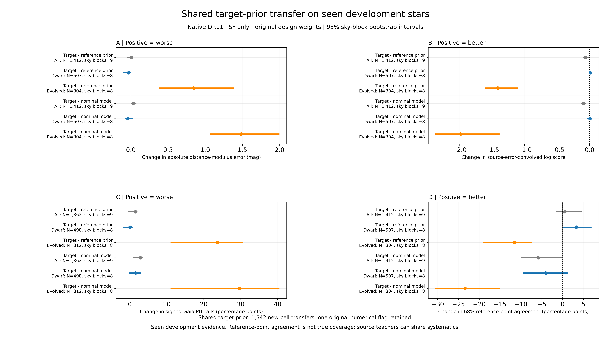

保持response12不变时，目标先验对演化星的开发诊断明显退化。
相对名义模型的对照同时改变响应与先验，不能解释为纯先验效应。
1542星都是新格子的共享超均值迁移；原1个数值标记保留，另有通过的精化侧表。
[PDF](../figures/v3_1/paired_figures/target_prior_transfer.pdf)；
[源表](../manifests/v3_1/paired_figures/target_prior_transfer.csv)。

## 类别和FeH的同身份条件对照

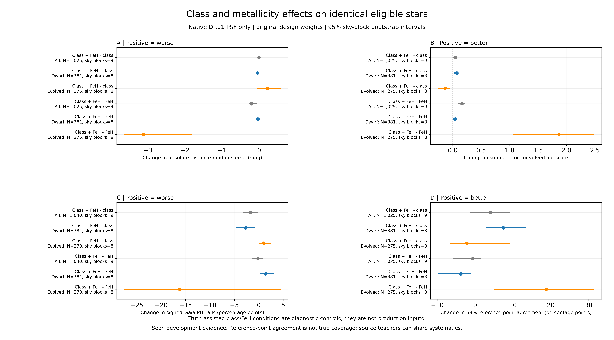

每个对照使用完全相同的合格对象。演化星中，给定FeH后加入类别信息仍有
明显效应；给定类别后加入FeH并不保证改善。这些真实参考条件只用于诊断，
不能进入生产推断。参考点一致率不是实测真实覆盖率。
[PDF](../figures/v3_1/paired_figures/class_metallicity_contrasts.pdf)；
[源表](../manifests/v3_1/paired_figures/class_metallicity_contrasts.csv)。

[实际检查记录](../manifests/v3_1/paired_figures/delivery_validation.json)。
其余工作包图件与最终适用域图仍在推进。

## Constrained luminosity correction

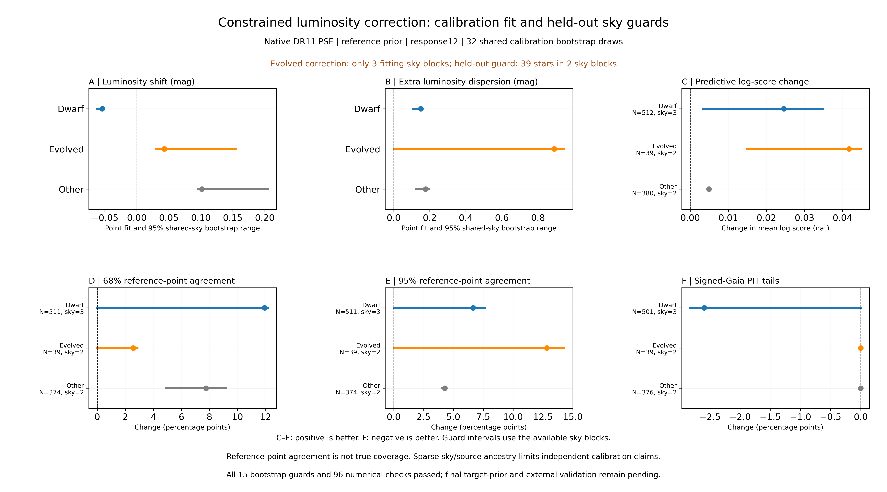

Six panels show class-specific shift/scatter and held-out sky changes in
proper score, reference-point agreement and signed-Gaia PIT tails. All15
bootstrap guards and96numerical checks pass. Evolved scatter remains poorly
constrained by only3fit/2guard sky blocks; this is not independent calibration.
Source rows and actual image/PDF checks: `manifests/v3_1/calibration_figure/`.
PNG300dpi/PDF and all six panels visually inspected.

## Latent-flux support and failure association

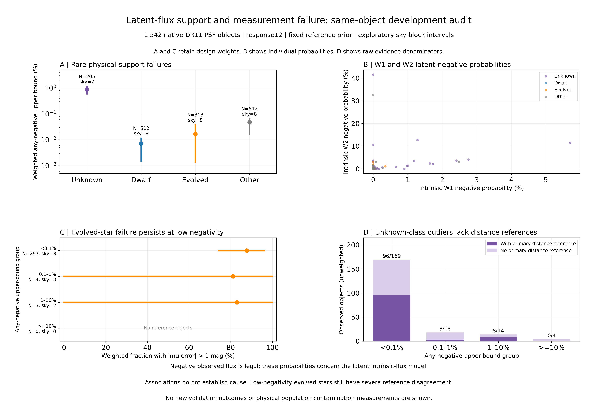

Four panels distinguish weighted latent-negative bounds, individual W1/W2
probabilities, evolved-star reference failures and raw missing-reference counts.
Among297evolved primary-reference stars with negative-probability upper bound
<0.001, the weighted severe |delta_mu|>1mag fraction remains87.6635%; this does
not support negativity as the sole giant-failure explanation. The four
unknown-class objects above0.1lack primary distance references. No causal or
new-validation claim follows. All four panels visually inspected after label
and legend repairs;1574actual image/PDF/hash/source checks pass.
[PDF](../figures/v3_1/latent/latent_support_failure.pdf);
[source rows and acceptance](../manifests/v3_1/latent_figure/acceptance.json).

## Candidate joint counts and finite-state numerical sensitivity

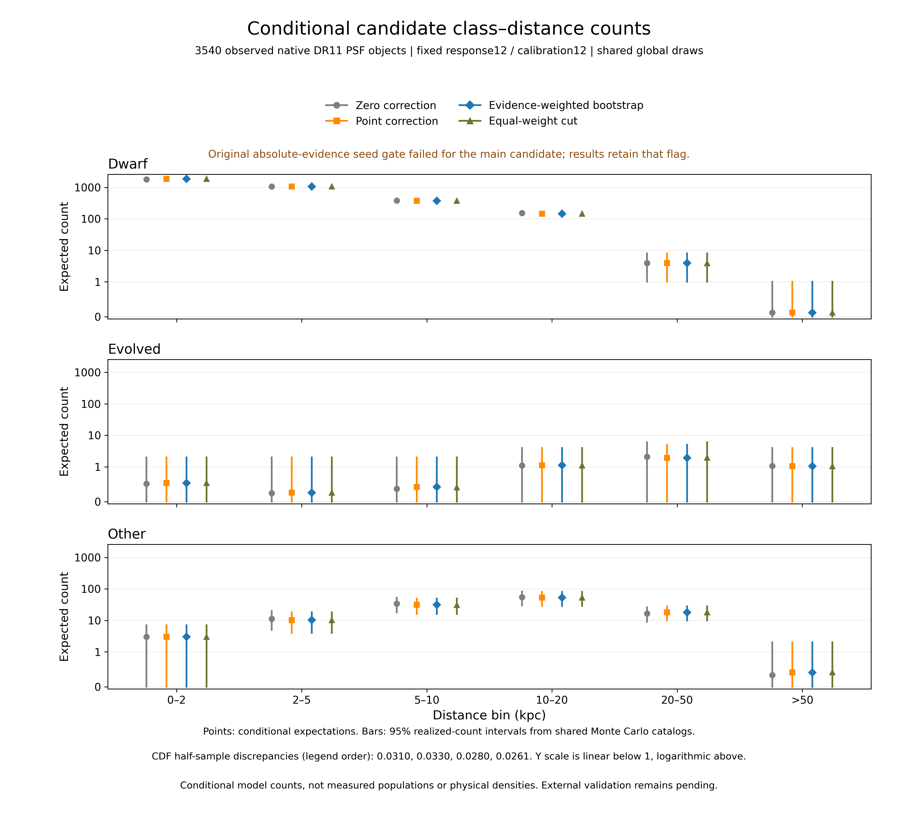

Four registered views share3540nativePSF objects. Points are conditional expected
class–distance counts; intervals are shared realized-count95%intervals. All three
classes use the same scale, linear below1and logarithmic above. Count-CDF half
sample discrepancies are explicitly printed. These are not measured physical
populations or densities; the completed external validation rejects a calibrated-distance claim.

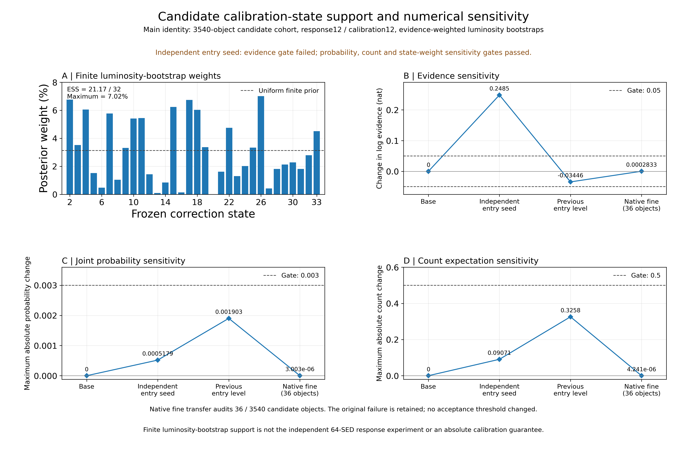

All34conditional states pass their gates, but the main evidence-weighted ensemble
retains its failed absolute-evidence seed gate: delta logZ=.248538 versus.05.
Probability/count/state-weight changes pass their own gates. Finite luminosity
bootstrap ESS21.17325/32and maxweight7.01524%do not measure64-SED response support.
Nativefine sensitivity covers36candidate objects, not all3540.

Both PNG300dpi/PDF exports and all seven panels were individually inspected;
138actual hash/PNG/PDF/source-row checks pass. [Plotted rows](../manifests/v3_1/target_candidate_figures/plotted.csv),
[acceptance record](../manifests/v3_1/target_candidate_figures/acceptance.json),
[count PDF](../figures/v3_1/target_candidate/conditional_counts.pdf),
[sensitivity PDF](../figures/v3_1/target_candidate/weights_numerics.pdf).

## Fixed high-q joint count table

The main qnear=P(d<10kpc)>.95 subset contains3003of3540nativePSF objects.
Each cell below is the conditional expectation [95%shared realized-count interval].
All four controls use exactly these same identities; this table shows the
registered evidence-weighted main view, including its inherited numerical flag.

| Class | 0–2 kpc | 2–5 kpc | 5–10 kpc | 10–20 kpc | 20–50 kpc | >50 kpc |
|---|---:|---:|---:|---:|---:|---:|
| Dwarf | 1824.740 [1803, 1847] | 991.948 [964, 1020] | 150.145 [133, 167] | 1.488 [0, 4] | 0.112 [0, 1] | 0.049 [0, 1] |
| Evolved | 0.430 [0, 2] | 0.184 [0, 1] | 0.173 [0, 1] | 0.283 [0, 2] | 0.450 [0, 2] | 0.478 [0, 2] |
| Other | 2.958 [0, 7] | 9.460 [4, 17] | 14.960 [6, 26] | 3.425 [0, 8] | 1.573 [0, 5] | 0.146 [0, 1] |

Summed model-expected d>=10kpc count is8.00304, leakage0.266502%; the far-count
interval[3,15] comes from the jointly summed draws, not summed bin endpoints.
Its split-half CDF discrepancy is0.01378. Neither the leakage nor the intervals
establish independent contamination or complete model uncertainty.
[All views, numerical alternatives and count moments](../manifests/v3_1/highq_counts/counts.csv);
[joint far-count source](../manifests/v3_1/highq_counts/model_leakage.csv).

## Frozen photometric occupancy

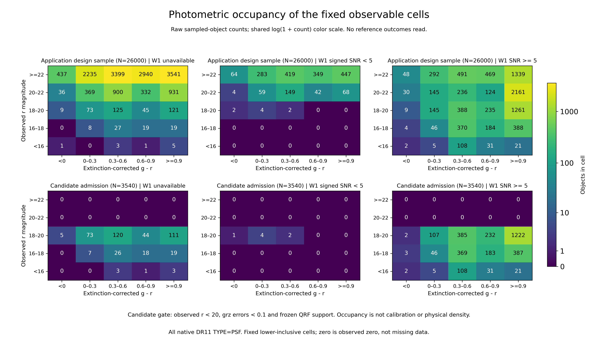

The same75observable cells show raw26000design-sample counts and3540candidate
counts with one shared log(1+count) color scale. Observed r and extinction-corrected
g-r are distinct; all empty cells remain explicit zeros. Candidate W1 counts
are430unavailable,7legal signed weak,3103significant. Thus this admission envelope
does not represent the full faint/weak-W1 application population. These are
photometric counts only, not evidence availability or calibrated scientific domains.

All six panels visually inspected;165actual hash/PNG300dpi/PDF/150source-cell
checks pass. [PDF](../figures/v3_1/domain_photometry/photometric_occupancy.pdf),
[plotted cells](../manifests/v3_1/domain_photometry_figures/plotted.csv),
[acceptance](../manifests/v3_1/domain_photometry_figures/acceptance.json).
Source-qualified reference and missing-reference-mass rendering code is ready,
but has not run because the required final evidence products remain incomplete.

## Frozen external field comparisons

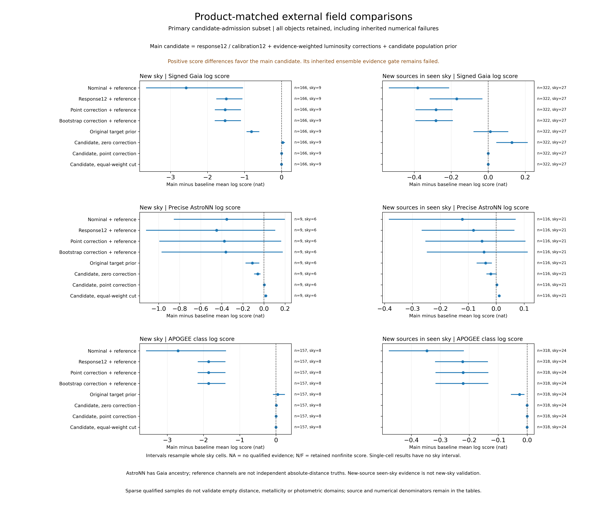

The six panels compare the exact main candidate with eight frozen controls,
using candidate-admission objects and whole-sky-cell intervals. New-sky signed
Gaia scores worsen versus the old target prior by0.8143nat [0.6137,0.9342]
(n166,9cells). Precise AstroNN has only9new-sky references across6cells and Gaia
ancestry. The main evidence failure remains; relative improvements against an
individual control cannot establish absolute calibration or fill empty domains.
[PDF](../figures/v3_1/final_validation/field_score_gains.pdf).

## One shared NGC1261 scale

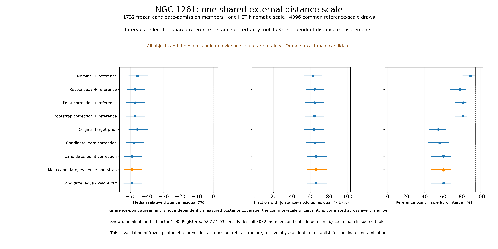

All1732candidate-admission members use one HST kinematic scale,4096shared draws.
The main median relative residual is-49.05% with reference-scale sensitivity
interval[-53.85,-43.44]%; severe modulus residual fraction65.88% and95%reference-
point agreement60.33%. These intervals are not independent-member sampling
uncertainty, and reference agreement is not measured posterior coverage.
All3032objects, outside-domain diagnostics and0.97/1.03method sensitivities remain
in the source report. The72score-convergence failures on38objects are allGaia;
none is erased by this plot. [PDF](../figures/v3_1/final_validation/common_scale_agreement.pdf).

Both plates and all nine panels were individually inspected;104actual
hash/PNG300dpi/PDF/75source-row checks pass.
[Plotted source rows](../manifests/v3_1/final_validation_figures/plotted.csv),
[acceptance record](../manifests/v3_1/final_validation_figures/acceptance.json),
[complete stored-score audit](../manifests/v3_1/final_validation/score_audit/complete.json).

## Complete radial recovery and source dependence

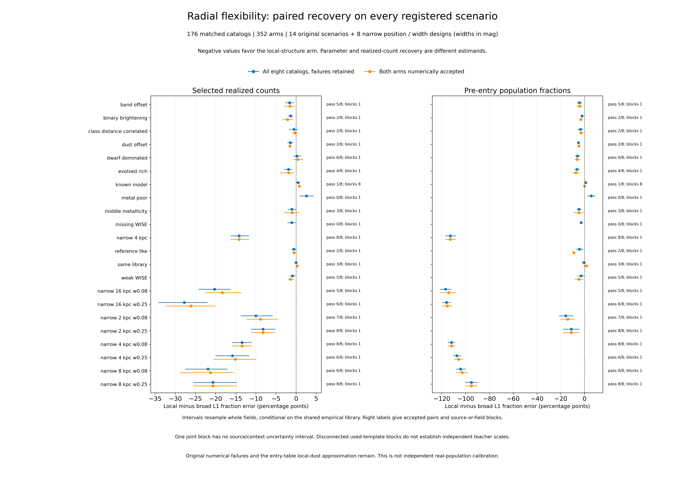

All22scenarios and176matched catalogs remain. Selected realized-count errors
and pre-entry population-fraction errors are separate panels. Blue includes
all numerical failures; orange uses both-arm accepted pairs with explicit
0–8denominators. Sky intervals condition on the shared source bank. All21
empirical-source scenarios have onlyone transitive source/field block, so no
independent source-level interval can be estimated.

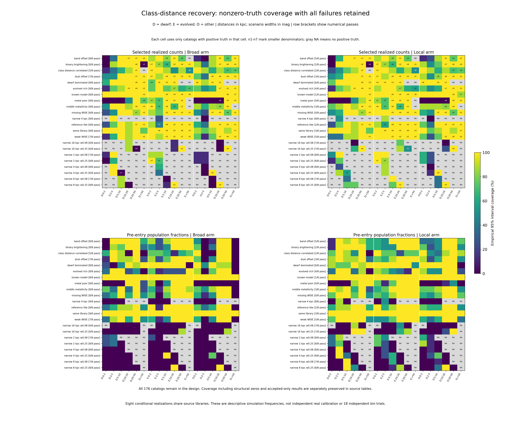

All18class-distance cells, botharms andbothestimands are displayed. Gray NA is
no positive truth, not zero coverage. n1–n7 identify smaller denominators;
structural-zero-inclusive and accepted-only tables remain available. Numerical
passes are163/176broad versus105/176local, with97both passing.

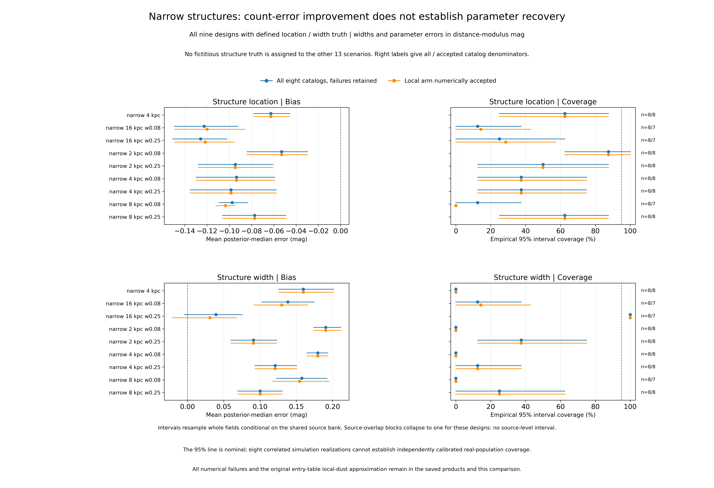

Allnine designs with defined structure truth show location/width errors and
95%interval coverage. The other13scenarios receive no fictitious truth. At
4kpc/0.08mag all8local fits pass, but location covers3/8andwidth0/8despite
joint-count L1 improving38.08%to24.66%. No independent real-calibration claim.

Allthree PNG300dpi/PDF exports and10panels visually inspected;1823actual
hash/format/English/source-row checks pass for1788plottedrows.
[Result and full scenario tables](v3_1_radial_result.md),
[plotted rows](../manifests/v3_1/radial_figures/plotted.csv),
[acceptance](../manifests/v3_1/radial_figures/acceptance.json).

## Complete regenerated-response evidence and source transfer

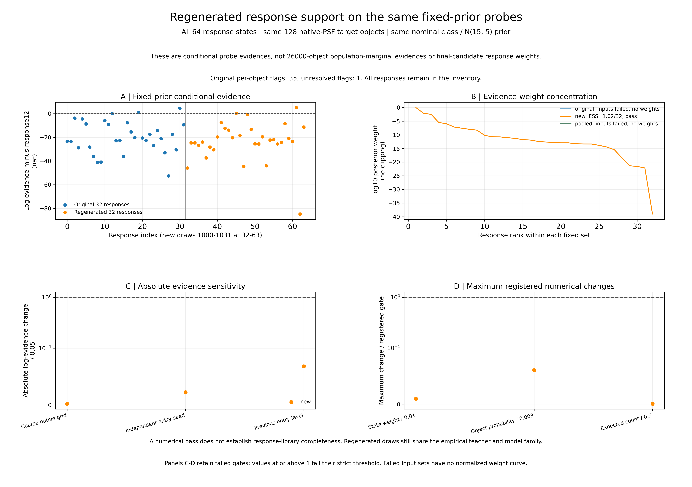

All64responses use the same128target/256seen-development design. One original
response9 target native failure remains, so original/pooled sets are not
renormalized. The regenerated32 set passes its numerical gates but ESS1.023628
and maximumweight98.835% remain. Conditional probe evidence is distinct from
26000-object population evidence and the final candidate's weights.

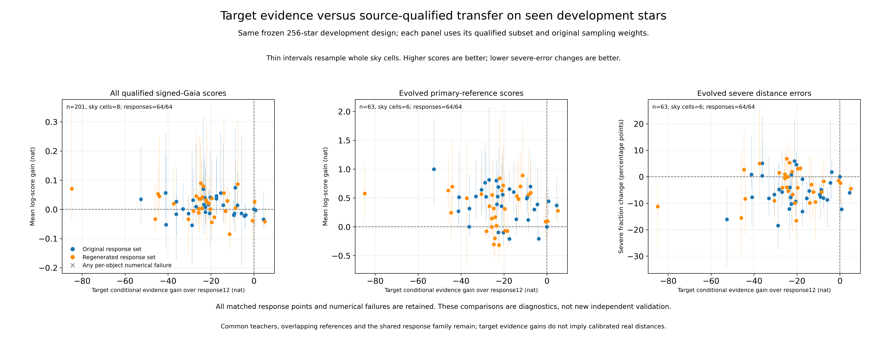

All64same-identity points retained: signedGaia201objects/8sky cells, evolved
primary63/6. Whole-sky intervals and source denominators shown. Regenerated
mixture primary scores improve while all-qualified signedGaia worsens;
seen-source agreement does not establish independent distance calibration.
TwoEnglishPNG300dpi/PDFplates, all7panels visuallyinspected after typography
repair;636actual artifact/source-rowchecks and351compacttablechecks pass.
[Full result](v3_1_response_result.md); [acceptance](../manifests/v3_1/response_figures/acceptance.json).

## Exact candidate mode responsibilities

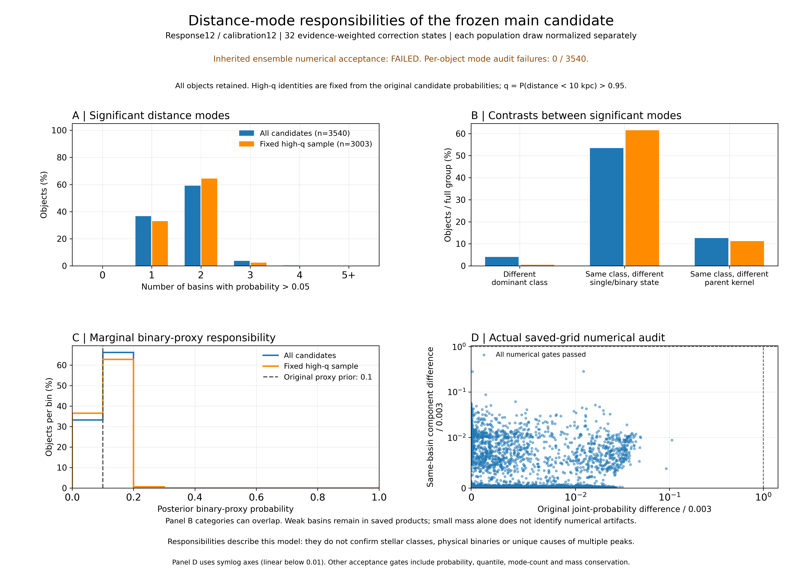

All 3540 candidate identities and fixed 3003 high-q identities are reconciled.
Significant multimodes occur in 2241 / 2013 objects. Class, binary-proxy and
parent-template responsibility categories overlap; they are not physical
classifications or measured binary fractions. Per-object numerical gates pass;
the inherited main ensemble failure remains. All four panels visually inspected
following axis-label repair; 3613 actual artifact/source checks pass.
[Result](v3_1_candidate_modes_result.md);
[PDF](../figures/v3_1/candidate_modes/mode_responsibilities.pdf);
[acceptance](../manifests/v3_1/candidate_mode_figures/acceptance.json).

## Source-qualified domain evidence

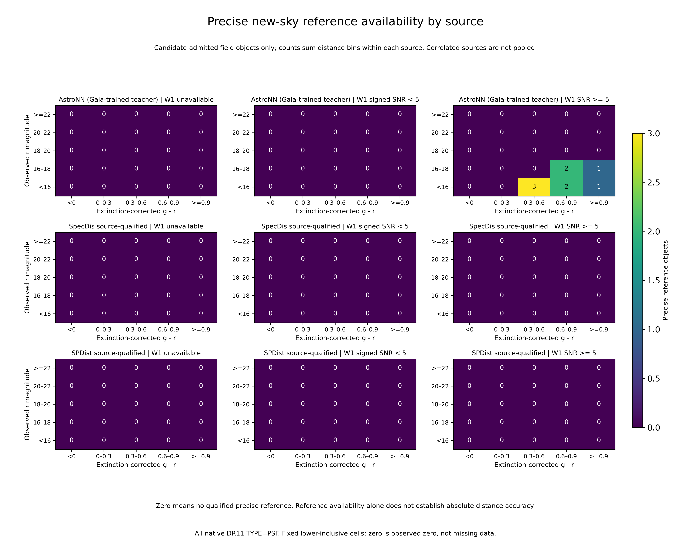

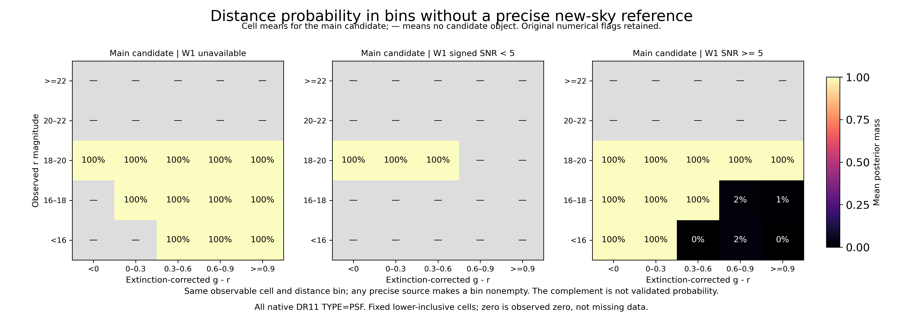

Candidate objects occupy 30 of 75 photometric cells; 2810 of 3540 objects are
in cells without precise new-sky distance references. Mean unsupported model
probability mass is 79.5834%; the complement is not validated mass. Nine
precise AstroNN references occupy five photometric cells; source dependence,
empty cells, shared scales and inherited numerical failure remain explicit.
Both plates / all 12 panels visually inspected; 1309 actual artifact/source
checks pass. Final scientific use-domain adjudication is still pending.
[Result](v3_1_domain_evidence_result.md);
[reference PDF](../figures/v3_1/domain_evidence/precise_newsky_references.pdf);
[gap PDF](../figures/v3_1/domain_evidence/missing_reference_mass.pdf);
[acceptance](../manifests/v3_1/domain_evidence_figures/acceptance.json).
