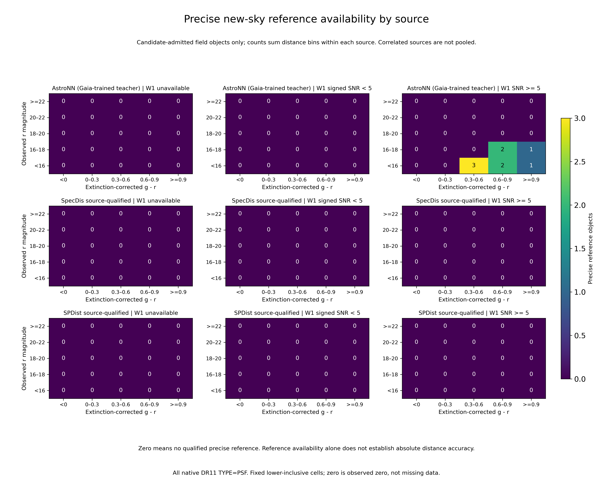
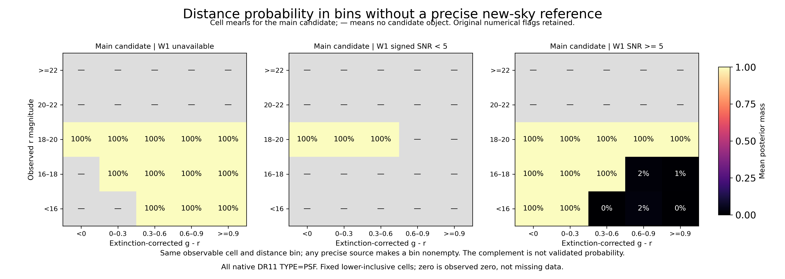

# v3.1 适用域证据：可获得参考与模型距离质量缺口

2026-11-14，证据汇总 `61226776 COMPLETED 00:05:03`。这里汇总冻结75个观测格子
中的原生PSF候选、来源合格参考与实际数值支持。**证据图已完成，最终科学适用域
裁决尚未完成**；没有新增阈值、参考身份、模型或独立校准声明。

## 已核实的缺口

| 项目 | 实际值 |
|---|---:|
| 主候选 / 固定高q候选 | 3540 / 3003 |
| 有候选的观测格子 | 30 / 75 |
| 所在格子无任何精确新天空距离参考的候选 | 2810 / 3540 |
| 同格、同距离段无精确新天空参考的平均模型距离概率质量 | 79.583389% |
| 精确新天空AstroNN / SpecDis / SPDist参考 | 9 / 0 / 0 |
| 原生细网格实际审核的候选 | 36 / 3540 |

9个精确AstroNN参考只落在5个格子，均为r<18且W1 SNR>=5。AstroNN与Gaia教师
有依赖；来源之间不做独立计数池化。有参考只是“非空”，并未证明该格子/距离段
已校准。**79.58%的补集不能解释为已验证概率**；少量参考的可获得性也不能覆盖
类别/FeH差异、选择组成和教师系统误差。

质量缺口按原候选距离后验及每个对象所在观测格子计算，先求格子内对象均值，再按
候选对象数汇总。它是模型条件概率摘要，不是真实错误率、污染率或完整母体的加权
代表性估计。图中灰色“—”表示该格子没有候选，参考图的0表示没有合格精确参考；
小概率在图上取整显示，精确值保留源表。

## 数值支持与来源范围

所有格子保留主候选继承的证据数值失败。34个条件状态的136条数值支持记录、
四个视图×两个子集×75格子的类别距离计数均值均保留（10800行）；600组联合均值
逐组守恒到各格子的候选/固定高q数。这里没有伪造格子计数区间：全局共享计数的
区间不能由格子均值或独立Poisson近似代替。

入选的来源比较保留167个新天空场星、352个新来源已见天空场星、1732个共同尺度
对象。共同尺度跨格子仍然是同一个尺度，不能把逐格尺度数相加当作独立距离约束。
完整外部结果及其科学失败见[v3_1_final_validation_result.md](v3_1_final_validation_result.md)。

再生32响应条件探针ESS1.023628，与主候选32个光度尺度bootstrap状态ESS21.17325
是两个不同实验；既不互换权重，也不据一个数值通过解除另一个的失败。
来源合格的绝对校准证据缺失、数值稳定性、支持外推和相对模型分数将继续分别记录。

## 图与验证

两张英文PNG300dpi/PDF共12面板实际目检。源表哈希、75格子几何、候选/参考总数、
600组计数守恒及300个图中格子数值共1309项实际检查通过。
[完整证据标记](../manifests/v3_1/domain_evidence/complete.json)、
[检查和缺口摘要](../manifests/v3_1/domain_evidence_figures/integrity.json)、
[目检记录](../manifests/v3_1/domain_evidence_figures/acceptance.json)。

复现：`PYTHONPATH=src:scripts:.deps python3 scripts/v3_1_domain_figures.py --stage evidence`；
检查：`PYTHONPATH=src:scripts:.deps python3 scripts/v3_1_domain_evidence_check.py`。
最终科学适用域裁决仍须并入完整天空迁移、结构应用与其限制；不能把本检查通过
写成科学可用域已通过。
