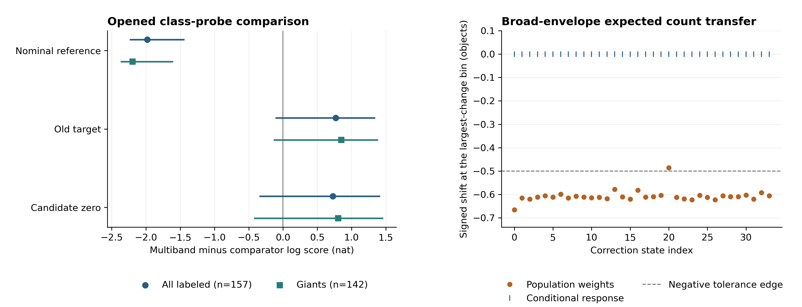
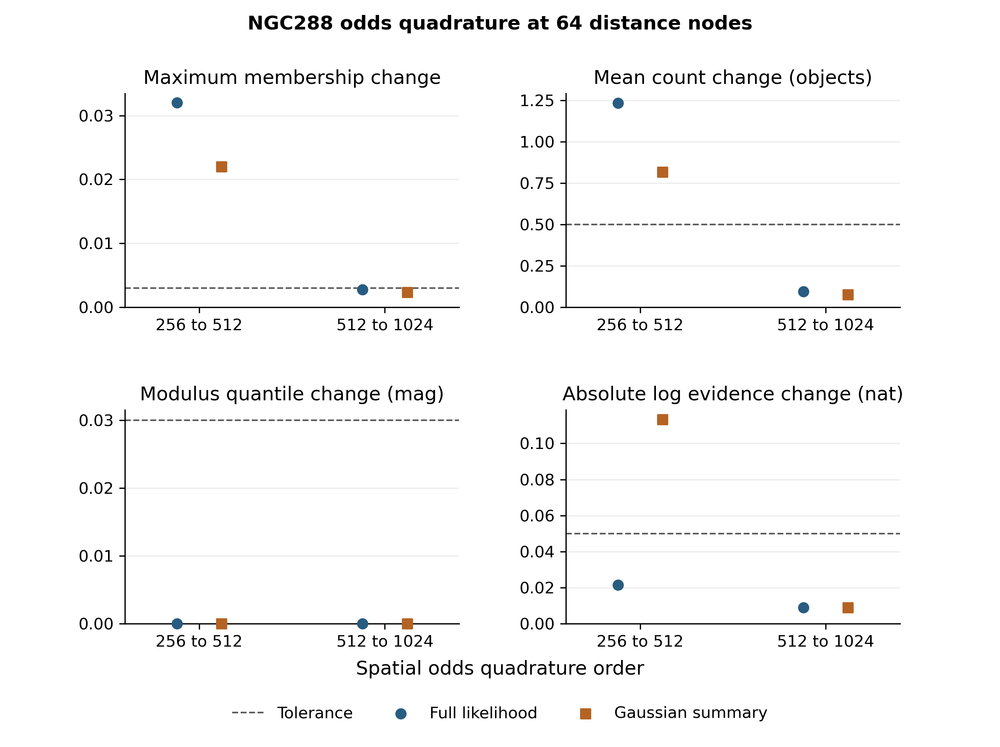
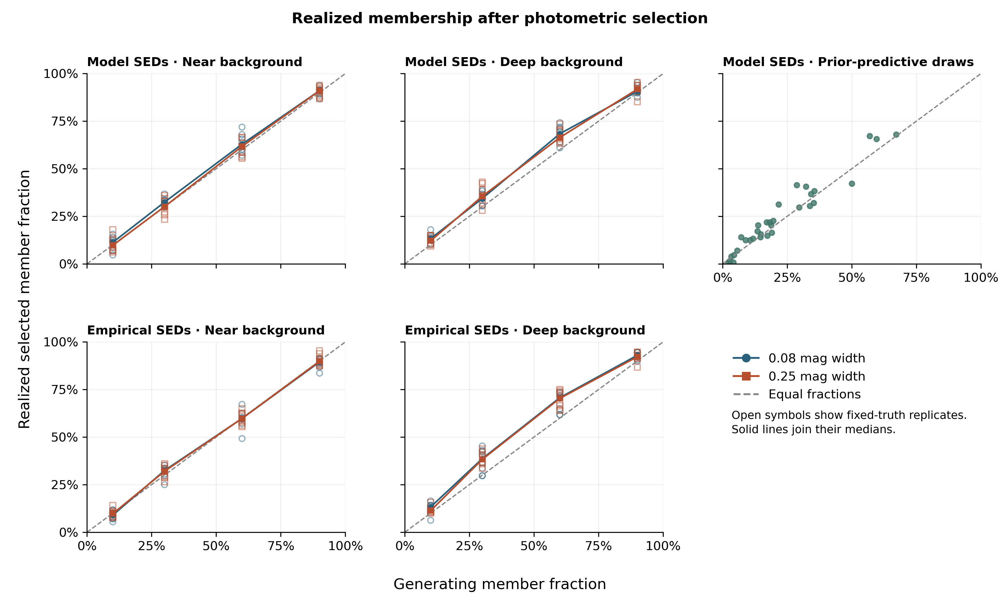

# Photdis v3.2 figure atlas

## Opened new-sky class reliability

[PNG](../figures/v3_2/opened_diagnostics/class_reliability.png) ·
[PDF](../figures/v3_2/opened_diagnostics/class_reliability.pdf) ·
[Probability bins](../manifests/v3_2/opened_diagnostics/reliability.csv) ·
[Opened comparison](v3_2_opened_result.md)

## Opened class probe and count audit

Left panel compares the frozen multiband class log score with three
historical anchors on the same 157 labeled objects from eight sky blocks.
The giant subset contains 142 of these objects. Bars show paired 95%
sky-block intervals. Right panel shows signed changes at the largest
count-shift bin within each of 34 correction states. The 33 failed states
are below −0.5 objects. Selection reweighting supplies the full shift
at those bins in this particular broad-envelope entry-level comparison.

[PNG](../figures/v3_2/opened_audits/probe_and_count_audit.png) ·
[PDF](../figures/v3_2/opened_audits/probe_and_count_audit.pdf) ·
[Plotted records](../manifests/v3_2/opened_audits_figure/plotted.csv) ·
[Source hashes](../manifests/v3_2/opened_audits_figure/complete.json) ·
[Audit result](v3_2_opened_probe_and_count_result.md)

## NGC288 fixed-distance spatial odds quadrature

Absolute changes between successive spatial-odds integrations on the
64-node distance grid. The dashed lines are the registered tolerances.
The first refinement exceeds the membership and mean-count thresholds
for both likelihoods. The second refinement meets all four thresholds
for both likelihoods. Full distance-axis integration remains pending.

[PNG](../figures/v3_2/structure_odds_audit/fixed_distance_odds.png) ·
[PDF](../figures/v3_2/structure_odds_audit/fixed_distance_odds.pdf) ·
[Check rows and source hashes](../manifests/v3_2/structure_odds_audit/)

## Narrow-structure mock membership after selection

The four fixed-truth panels contain 256 mock catalogs. The upper-right
panel contains 32 separate prior-predictive catalogs. Each catalog has
128 admitted objects. At a generating fraction of 60%, the median
selected member fraction for empirical SEDs with a deep background is
70.3–70.7% across the two widths, compared with 59.8% with a near
background. The plotted fractions come from the simulated membership
record before fitting.

[PNG](../figures/v3_2/radial_design/selected_membership.png) ·
[PDF](../figures/v3_2/radial_design/selected_membership.pdf) ·
[Catalog records](../manifests/v3_2/radial_design/design.csv) ·
[Source and output hashes](../manifests/v3_2/radial_design/figure.json)

## Narrow-structure prior shrinkage tables

The recovery report records the distance from each simulated truth to
the value at the center of the latent prior, minus the corresponding
distance from the posterior median. A positive value means the median is
closer to that anchor. Location, width and the pre-entry member fraction
use their own units. Summaries keep the registered catalog denominators
for each fixed-truth design cell and the separate prior-predictive cohort.

In the first empirical pilot, the width median of 0.339 mag is
0.081 mag closer to the 0.250 mag prior anchor than the 0.080 mag
truth is. Its 95% interval still misses the simulated width.
[Pilot recovery records](../manifests/v3_2/radial_recovery/catalog_128/recovery.csv)

The radial report also compares empirical and model SED recovery within
each fixed-truth cell on the same context repeats. It uses each mock's
own realized truth for member counts and joint class-distance counts.
The paired differences describe the change in absolute error, coverage
and interval length under the two generators. Each comparison records
the number of paired fits and the number of registered repeats.
