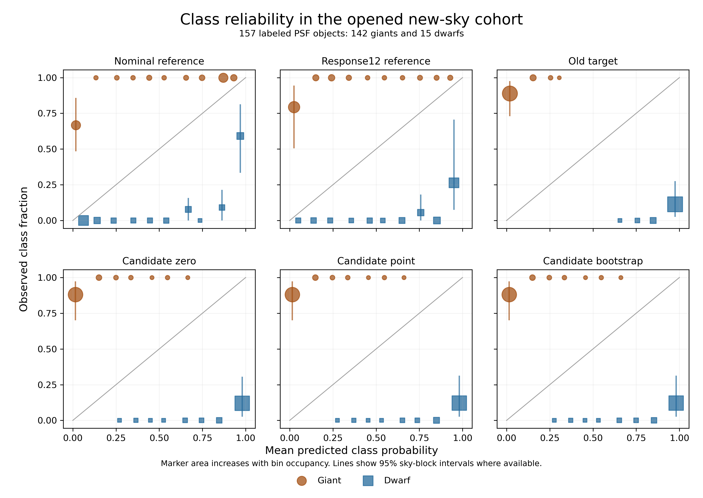

# v3.2 opened field diagnostic

NERSC job 61258927 completed in 17 s and verified all 526 frozen field
objects and their view records. The strict new-sky candidate sample contains
167 PSF objects. The paired intervals below resample whole sky cells directly
for each edge of the comparison.

| Comparison | Signed Gaia change (nat, n=166) | 95% sky-block interval |
|---|---:|---:|
| Nominal reference to response12 reference | −1.0835 | [−1.9052, +0.0640] |
| Response12 reference to old target | −0.6795 | [−0.9385, −0.2839] |
| Old target to candidate zero | −0.8464 | [−0.9503, −0.6741] |
| Candidate zero to point correction | +0.0302 | [−0.0035, +0.0780] |
| Point correction to bootstrap mixture | +0.0019 | [−0.0027, +0.0033] |
| Old target to bootstrap mixture | −0.8143 | [−0.9342, −0.6137] |

Candidate zero minus old target class log score is +0.0419 nat, with
95% sky-block interval [−0.0828, +0.2294] on 157 labeled objects.
Argmax giant recall on the 142 reference giants is 92/142 for nominal
reference, 35/142 for response12 reference, 0/142 for old target, and 7/142
for each of candidate zero, candidate point, and the main bootstrap mixture.

These are conditional comparisons in a reference-availability sample with
142 giants and 15 dwarfs. The absolute summary and confusion tables retain
original numerical status. The frozen path combines population, matched
selection, and tilt changes at the old-target to candidate-zero step. The
factorial experiment is required to separate their effects.

[Score path](../manifests/v3_2/opened_diagnostics/score_path.csv) ·
[Absolute class summary](../manifests/v3_2/opened_diagnostics/new_sky_field_summary_class_all_objects.csv) ·
[Absolute confusion](../manifests/v3_2/opened_diagnostics/new_sky_field_confusion.csv) ·
[Per-object scores](../manifests/v3_2/opened_diagnostics/objects.csv)

[PDF](../figures/v3_2/opened_diagnostics/class_reliability.pdf) ·
[Bin source table](../manifests/v3_2/opened_diagnostics/reliability.csv) ·
[Source hashes](../manifests/v3_2/opened_diagnostics/complete.json)
