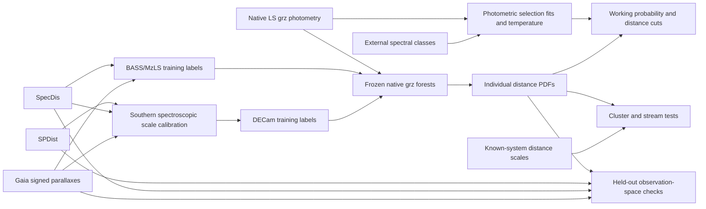

# Photdis scientific validation, 2026-11-18

Frozen evidence starts at f4dc28f5. Production models, native ownership and
the 43,347,612 archived PDFs are bound to 87069408. This directory holds the
new experiment records. Individual sources, calibration rosters and posterior
arrays remain under
`/pscratch/sd/y/yunao/photdis_pipeline/data/science_validation_20261118`.

## Registered experiments

The fixed settings, seeds and criteria are in
`configs/science_validation_20261118.json`. The later known-class control has
its own `configs/science_validation_20261118_oracle.json`. The scientific
decisions are conditional on the recorded samples and input scales.

| Stage | Inputs and measured quantity |
|---|---|
| definitions | Exact cached Gaia reference aggregates, true one-sigma versus 95% modulus halfwidth, and working score/probability/distance cuts |
| observable | Independent native random points with the original mask, observations, reddening and grz-depth cuts. Integrate each CMD cell over actual limits and extinction. The z color follows the empirical native M92 sequence |
| filter | Original template response, selection-matched response, shared-area GD-1 controls, numerical self recovery and noisy native M13-member injections into real blank ribbons |
| provenance | Forest, distance-scale, classifier, temperature and selection roles versus evaluation source IDs and 10-degree sky cells |
| benchmark | Original F15 mask replay and one fixed coarse color–luminosity distribution on the same training identities and nominal labels, compared on the same stars with the archived QRF and BJ |
| populations | Reproduce within-cell metal-poor offsets and rebuild the matching under every sky-block resample, with fixed grid sensitivities and a Gaia-scale counterpart |
| systems | Native cluster and GD-1 members by magnitude and phase, corrected Jarvis track version, and original same-star final-model seam PDFs |
| noise | Fixed bright population with actual faint-error triplets. Incremental band noise preserves the shared measured magnitudes in colors and distance modulus |
| predictive | Signed Gaia observation model with actual S/N windows, approximate Gaussian VAC-modulus observation model, coverage, log score, width/center/branch sensitivities and conditional power |
| oracle | Joint histograms of the original forest leaves conditioned on the externally known class. The trees and original training labels are retained |

## Samples and calibration scales

Source identity, sky-cell separation and known-system overlap are measured
individually. Spectroscopic references retain their shared stars and Gaia
training lineage. The observation-space spectroscopic likelihood uses a
Gaussian approximation to each VAC summary. SPDist already contains the
0.167-mag intrinsic term in the frozen uncertainty cache.

The M13 injection experiment measures empirical sequence transfer into the
GD-1 background. The PSF/deblending/crowding admission is inherited from the
native archive. Random-point selection describes the grz sensitivity and
foreground extinction inside that admitted imaging domain. Numerical profile
intervals are tested by the stated empirical injections.

## Execution

On NERSC, the entry point is `scripts/run_sv18.sh`. Submit its argument as
the stage name in the table above. `filter_complete` first builds observable
selection and then runs the filter. `parallel populations benchmark provenance
systems predictive noise` uses up to three independent processes inside one
allocated node. `oracle` runs the known-class information control.

All source IDs, posterior coordinates and observed/reference denominators
retain DR11 TYPE=PSF checks. The new reference-field names leave the archived
paper-v2 CSV untouched. Configuration and output receipts record scientific
failures as well as successful numerical closure.
